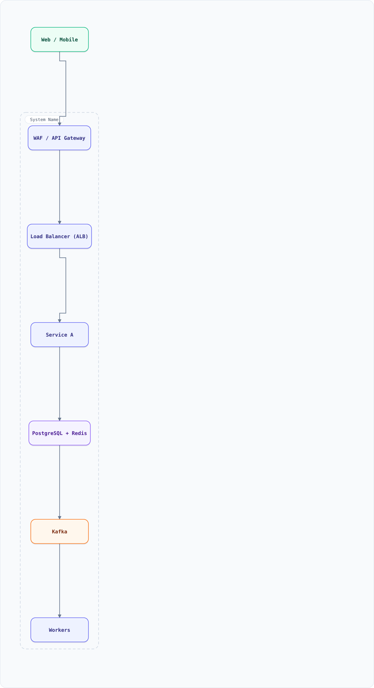

<a id="top"></a>

<div align="center">

<sub>SYSTEM DESIGN LIBRARY</sub>

# System Design & Technology Guides

<sub>56 SYSTEM DESIGNS · 16 GUIDES · 92 DIAGRAMS (87 INTERACTIVE) · 43 ALGORITHMS · 30-DAY ROADMAP</sub>

</div>

> [!TIP]
> **THE LIBRARY** — A working library of system designs, technology guides and interactive diagrams — built for interview prep and production design reviews.

[](https://github.com/aishwary11/system-design/commits)
[](https://github.com/aishwary11/system-design/stargazers)
[](README.md)

High-Level Architecture → Low-Level Design → database design → scaling tiers → interview prep,
each with a **diagram image** plus a **self-contained interactive HTML** (pan/zoom, search, dark/light, export).

**Start here:** [Browse the designs](#system-designs) · [Technology guides](#feature-guides) · [30-day roadmap](STUDY-ROADMAP.md)

The industry concept map — the named technique behind each design (Uber's H3, Google's S2, Stripe's GCRA and ledger, Kafka's LinkedIn origin), with primary sources — lives in [industry-concepts.md](industry-concepts.md).

---

## On this page

<details open>
<summary><b>11 sections</b></summary>

1. [What's inside](#whats-inside)
2. [System Designs by Topic](#system-designs)
3. [Technology Feature Guides](#feature-guides)
4. [Document Structure](#document-structure)
5. [Diagram Style (Archify)](#diagrams-archify)
6. [Scaling Tiers](#scaling-tiers)
7. [Technology Stack](#technology-stack)
8. [Algorithms Library](#algorithms-library)
9. [Techniques & Patterns](#techniques--patterns)
10. [How to Use](#how-to-use)
11. [Contributing](#contributing)

</details>

---

## What's inside

| Surface | What you get | Start |
| :--- | :--- | :--- |
| **56 system designs** | Streaming, social, commerce, transport, infrastructure, trust & safety, AI infrastructure and more | [Browse by topic](#system-designs) |
| **16 guides** | PostgreSQL, Redis, Kafka, MongoDB, Elasticsearch, RabbitMQ, cloud, agentic AI, concepts, LLD, networking, operating systems and more | [Jump to guides](#feature-guides) |
| **92 diagrams** | One architecture map per design, plus sequence, lifecycle and anatomy figures where prose alone was doing the work | [Diagram style](#diagrams-archify) |
| **43 algorithms** | Executable JavaScript — LRU, consistent hashing, Dijkstra, saga and more | [Algorithm library](#algorithms-library) |
| **33 patterns** | Consistent hashing, CQRS, saga, outbox, circuit breaker and more | [Techniques](#techniques--patterns) |

---

<a id="system-designs"></a>
## System Designs by Topic

<details open>
<summary><b>Streaming & Media</b> · 5 docs</summary>

| # | Topic | File |
| :- | :--- | :--- |
| 1 | Hotstar (Live Streaming) | [View](system-design-hotstar.md) |
| 2 | Netflix (Video Streaming) | [View](system-design-netflix.md) |
| 3 | YouTube (Video Streaming) | [View](system-design-youtube.md) |
| 4 | Video Conferencing (Zoom) | [View](system-design-video-conferencing.md) |
| 5 | Spotify (Music Streaming) | [View](system-design-spotify.md) |

</details>

<a id="social"></a>
<details open>
<summary><b>Social & Messaging</b> · 4 docs</summary>

| # | Topic | File |
| :- | :--- | :--- |
| 1 | Twitter / X | [View](system-design-twitter.md) |
| 2 | Instagram | [View](system-design-instagram.md) |
| 3 | LinkedIn | [View](system-design-linkedin.md) |
| 4 | Messaging App (WhatsApp) | [View](system-design-messaging-app.md) |

</details>

<a id="commerce"></a>
<details open>
<summary><b>E-Commerce & Booking</b> · 6 docs</summary>

| # | Topic | File |
| :- | :--- | :--- |
| 1 | E-Commerce (Amazon) | [View](system-design-ecommerce.md) |
| 2 | Ticketing (BookMyShow) | [View](system-design-ticketing-system.md) |
| 3 | IRCTC (Railway Booking) | [View](system-design-irctc.md) |
| 4 | Food Delivery (Zomato) | [View](system-design-food-delivery.md) |
| 5 | Smart Parking System | [View](system-design-parking-system.md) |
| 6 | Airbnb (Rental Marketplace) | [View](system-design-airbnb.md) |

</details>

<a id="transport"></a>
<details open>
<summary><b>Transportation</b> · 4 docs</summary>

| # | Topic | File |
| :- | :--- | :--- |
| 1 | Uber (Ride-Hailing) | [View](system-design-uber.md) |
| 2 | Metro Ticketing System | [View](system-design-metro-ticketing.md) |
| 3 | Proximity Service | [View](system-design-proximity-service.md) |
| 4 | Google Maps (Navigation) | [View](system-design-google-maps.md) |

</details>

<a id="infra"></a>
<details open>
<summary><b>Infrastructure</b> · 17 docs</summary>

| # | Topic | File |
| :- | :--- | :--- |
| 1 | Rate Limiter | [View](system-design-rate-limiter.md) |
| 2 | URL Shortener (bit.ly) | [View](system-design-url-shortener.md) |
| 3 | Web Crawler | [View](system-design-web-crawler.md) |
| 4 | Search Autocomplete | [View](system-design-search-autocomplete.md) |
| 5 | Notification System | [View](system-design-notification-system.md) |
| 6 | File Storage (Google Drive) | [View](system-design-file-storage.md) |
| 7 | Distributed Cache (Redis) | [View](system-design-distributed-cache.md) |
| 8 | Key-Value Store (DynamoDB) | [View](system-design-key-value-store.md) |
| 9 | Pastebin | [View](system-design-pastebin.md) |
| 10 | Alerting & Monitoring (Prometheus) | [View](system-design-alerting.md) |
| 11 | Search Engine (Google-Style) | [View](system-design-search-engine.md) |
| 12 | Recommendation System (Two-Stage Funnel) | [View](system-design-recommendation-system.md) |
| 13 | Serverless Platform (Lambda-style) | [View](system-design-serverless.md) |
| 14 | Online Judge (Sandboxed Execution) | [View](system-design-online-judge.md) |
| 15 | Webhook Delivery (Outbound Fan-Out) | [View](system-design-webhook-delivery.md) |
| 16 | Observability Pipeline (Metrics, Logs & Traces) | [View](system-design-observability-pipeline.md) |
| 17 | A/B Experimentation Platform | [View](system-design-ab-testing.md) |

</details>

<a id="productivity"></a>
<details open>
<summary><b>Collaborative & Productivity</b> · 2 docs</summary>

| # | Topic | File |
| :- | :--- | :--- |
| 1 | Google Docs (Collaborative Editing) | [View](system-design-google-docs.md) |
| 2 | Google Calendar (Scheduling & Free-Busy) | [View](system-design-google-calendar.md) |

</details>

<a id="dating"></a>
<details open>
<summary><b>Dating</b> · 1 doc</summary>

| # | Topic | File |
| :- | :--- | :--- |
| 1 | Tinder (Dating App) | [View](system-design-tinder.md) |

</details>

<a id="finance"></a>
<details open>
<summary><b>Finance & Ads</b> · 4 docs</summary>

| # | Topic | File |
| :- | :--- | :--- |
| 1 | Payment System (Stripe) | [View](system-design-payment-system.md) |
| 2 | Stock Exchange (Matching Engine) | [View](system-design-stock-exchange.md) |
| 3 | Google Ads (Auction & Budget Pacing) | [View](system-design-google-ads.md) |
| 4 | Algorithmic Trading (OMS/EMS + Market Data) | [View](system-design-algo-trading.md) |

</details>

<a id="trust-safety"></a>
<details open>
<summary><b>Trust & Safety</b> · 1 doc</summary>

| # | Topic | File |
| :- | :--- | :--- |
| 1 | Fraud Detection (Real-Time Risk) | [View](system-design-fraud-detection.md) |

</details>

<a id="ai-infra"></a>
<details open>
<summary><b>AI Infrastructure</b> · 4 docs</summary>

| # | Topic | File |
| :- | :--- | :--- |
| 1 | LLM Inference (Production Serving) | [View](system-design-llm-inference.md) |
| 2 | LLM / AI Gateway (Multi-Provider Routing & Quotas) | [View](system-design-ai-gateway.md) |
| 3 | GPU Scheduler & Model Lifecycle (Multi-Tenant) | [View](system-design-gpu-scheduler.md) |
| 4 | Distributed Training (Checkpoint & Recovery) | [View](system-design-distributed-training.md) |

</details>

<a id="devops"></a>
<details open>
<summary><b>DevOps & Delivery</b> · 1 doc</summary>

| # | Topic | File |
| :- | :--- | :--- |
| 1 | Code Deployment System (CI/CD) | [View](system-design-code-deployment.md) |

</details>

<a id="geospatial-ops"></a>
<details open>
<summary><b>Geospatial Operations</b> · 1 doc</summary>

| # | Topic | File |
| :- | :--- | :--- |
| 1 | Route Reconstruction from Noisy GPS (Route IQ) | [View](system-design-route-reconstruction.md) |

</details>

<a id="scheduling"></a>
<details open>
<summary><b>Scheduling</b> · 1 doc</summary>

| # | Topic | File |
| :- | :--- | :--- |
| 1 | Delayed Job Scheduler | [View](system-design-delayed-job-scheduler.md) |

</details>

<a id="communities"></a>
<details open>
<summary><b>Communities & Content</b> · 2 docs</summary>

| # | Topic | File |
| :- | :--- | :--- |
| 1 | Reddit (Threaded Discussions & Ranking) | [View](system-design-reddit.md) |
| 2 | Discord (Community Chat & Voice) | [View](system-design-discord.md) |

</details>

<a id="primitives"></a>
<details open>
<summary><b>Core Primitives & Platform</b> · 3 docs</summary>

| # | Topic | File |
| :- | :--- | :--- |
| 1 | Unique ID Generator (Snowflake) | [View](system-design-unique-id-generator.md) |
| 2 | Leaderboard (Ranked Counters) | [View](system-design-leaderboard.md) |
| 3 | Distributed Lock Manager (Chubby/ZooKeeper) | [View](system-design-distributed-lock-manager.md) |

</details>

<p align="right"><a href="#top">↑ Back to top</a></p>

---

<a id="feature-guides"></a>
## Technology Feature Guides

The guides cover the technology stack behind the design documents, each with runnable examples — and every guide ends with **Hidden Tips & Tricks** (the operational "aha"s) and **Do's & Don'ts** distilled from production incidents:

| # | Guide | Highlights | File |
| :- | :--- | :--- | :--- |
| 1 | **PostgreSQL** | Data types, constraints, 10+ index types, triggers, LISTEN/NOTIFY pub-sub, PL/pgSQL functions, CTEs, window functions, full-text search, JSONB + SQL/JSON, upsert/RETURNING, MVCC & isolation, locks, materialized views (caching), partitioning, replication + PITR, CDC, VACUUM, extensions, row/column security, FDWs | [View](postgresql-features.md) |
| 2 | **Redis** | 15+ data structures (incl. JSON, Time Series, Vector sets), caching patterns & eviction, distributed locking, rate limiting, Pub/Sub, Streams, delayed queues, transactions, Lua, pipelining, ACL security, persistence, Sentinel/Cluster | [View](redis-features.md) |
| 3 | **Kafka** | Topics/partitions/offsets, producers & acks, consumer groups, ordering, exactly-once, replication/ISR, retention vs compaction, Connect + CDC, Kafka Streams, Schema Registry, DLQs, security | [View](kafka-features.md) |
| 4 | **MongoDB** | Documents, CRUD & upserts, indexes (ESR), aggregation pipeline, embedding vs referencing, multi-doc transactions, change streams, replica sets, sharding & shard keys, time-series collections, GridFS, explain plans, security | [View](mongodb-features.md) |
| 5 | **Elasticsearch** | Inverted index & analyzers, mappings (text vs keyword, dense_vector), bulk indexing, bool queries (filter context), aggregations, BM25 & function_score, fuzzy/completion/highlighting, sharding & routing, NRT refresh + ILM, geo, security | [View](elasticsearch-features.md) |
| 6 | **RabbitMQ** | Exchanges (direct/fanout/topic/headers), bindings & routing keys, acks & publisher confirms, prefetch/backpressure, DLX, quorum queues & streams, delayed messages, priority queues, RPC, federation/shovel, RabbitMQ-vs-Kafka | [View](rabbitmq-features.md) |
| 7 | <a id="cloud-guide"></a> **Cloud Services Map** | AWS/GCP/Azure side-by-side + **full service catalog (§19)**: Lambda→Bedrock→Step Functions→EventBridge→DynamoDB→Spanner→Cosmos→Synapse and 150+ more, each with when-to-use; "which tool when" decision table | [View](cloud.md) |
| 8 | <a id="agentic-ai-guide"></a> **Agentic AI & LLMs** | Tokens/context, ReAct agent loop, MCP tool integration, A2A agent-to-agent, context engineering, memory, RAG, orchestration patterns (supervisor/handoffs/graphs), guardrails, evals, model routing, prompt-prefix caching | [View](agentic-ai-features.md) |
| 9 | **Core Concepts** | Sharding, consistent hashing, CAP, ACID vs BASE, SOLID, CQRS, event sourcing, saga, outbox, idempotency, circuit breaker, rate limiting, load balancing, leader election, replication, caching, bloom filters, gossip, vector clocks, Merkle trees, consensus, 2PC, CRDTs, event-driven architecture, DLQ, backpressure, quorum reads & writes, consistency models, PACELC, WAL, B-tree vs LSM, checksums, distributed locking, service discovery, API gateway vs service mesh, CDN, distributed tracing, retries & backoff, timeouts & hedging, logical clocks, fan-out, hot keys, optimistic concurrency, SLI/SLO, multi-region DR, deployment strategies, geospatial indexing, data models vs access patterns, indexing fundamentals & leftmost prefix, monolith vs microservices & service decomposition — plus 17 classic algorithms with runnable JS (Luhn, Dijkstra, A*, BFS/DFS, topological sort, union-find, trie, LRU cache, external sort, reservoir sampling, count-min sketch, HyperLogLog, Levenshtein, KMP/Rabin-Karp, haversine, Base62/Snowflake, sliding window), each with an example | [View](system-design-concepts.md) |
| 10 | <a id="devops-guide"></a> **DevOps & Kubernetes** | Docker multi-stage builds, pods/deployments/services, requests/limits & HPA, ConfigMaps/Secrets/RBAC, probes, ingress & mesh, Jenkins vs GitHub Actions vs GitLab CI, ArgoCD GitOps & canary rollouts, SonarQube/Trivy gates, Terraform, Prometheus/Grafana/Loki, SLOs & error budgets, golden pipeline + **official version matrix checked 29 Oct 2026** (K8s 1.37.2, Redis 8.10.3, Terraform 1.17.1, MongoDB 9.0.4, Kafka 4.4.0, PG 18.6…) | [View](devops-features.md) |
| 11 | <a id="resources-guide"></a> **Curated Resources** | The canon GitHub repos, engineering deep dives (Discord, Slack, Uber, Netflix, Stripe…), Medium/newsletter picks, interview platforms, classic papers, AI-era (MCP/A2A/vLLM) — plus a topic → best modern resource map | [View](resources.md) |
| 12 | <a id="interview-qa-guide"></a> **Interview Q&A** | Cross-tech failure glossary with solutions (cache stampede/avalanche/penetration, rebalance storms, split-brain, OOMKilled, gray failure…) + high-level answers: why Kafka is fast, the Redis-down playbook, Redis Cluster internals, GitOps, the bad-deploy first-5-minutes | [View](interview-qa.md) |
| 13 | <a id="roadmap-guide"></a> **30-Day Study Roadmap** | Day-by-day path: designs interleaved with concepts, guides, and the Q&A bank; weekly checkpoints and mock-interview structure | [View](STUDY-ROADMAP.md) |
| 14 | <a id="networking-guide"></a> **Networking** | OSI vs TCP/IP, TCP/UDP internals (handshake, congestion, Nagle), HTTP/1.1→2→3/QUIC, TLS 1.3 + mTLS, DNS chain & TTL strategy, L4/L7 balancing + algorithms, CDN caching semantics, VPC/subnets/NAT, proxies & API gateways, REST/gRPC/WebSocket/SSE, the latency table + interview Q&A | [View](networking.md) |
| 15 | <a id="operating-systems-guide"></a> **Operating Systems** | Processes vs threads, CFS scheduling & throttling, virtual memory/page cache, fsync & durability, epoll→io_uring, zero-copy (Kafka's secret), CPU caches/NUMA, cgroups+namespaces (what containers really are), OOM mechanics + interview Q&A | [View](operating-systems.md) |
| 16 | <a id="lld-guide"></a> **Low-Level Design** | Thread-safe LRU, hash map without STL, bounded blocking queue, thread pool, priority scheduler, malloc/free allocator, fixed-size object pool, reader–writer lock, ring buffer, async logger, timing wheel, connection pool — each with the invariant, the production reference (CacheLib, Folly, oneTBB, TCMalloc, glibc, Netty, HikariCP) and the failure modes interviewers probe, plus a 25-question coverage map | [View](low-level-design.md) |

<p align="right"><a href="#top">↑ Back to top</a></p>

---

## Document Structure

<details open>
<summary><b>System design</b> — a consistent 15-section template</summary>

1. Overview
2. Requirements
3. High-Level Architecture
4. Microservices
5. Database Design
6. Scaling Tiers (1K-10K, 10K-1M, 1M-10M+)
7. Key Techniques & Patterns
8. Key Design Decisions
9. Failure Modes & Recovery
10. Cost Estimation
11. Trade-off Analysis
12. Key Metrics to Monitor
13. Deep Dive Prompts
14. Common Interview Follow-ups
15. Low-Level Design (Algorithms & Data Structures)

</details>

<details>
<summary><b>Feature guide</b> — reference catalog layout</summary>

A table of contents, a feature-by-feature catalog with runnable examples (SQL / `redis-cli` / Kafka CLI / code), trade-off tables, and links to the related system design documents.

</details>

<p align="right"><a href="#top">↑ Back to top</a></p>

---

<a id="diagrams-archify"></a>
## Diagram Style (Archify)

Every diagram is an [Archify](https://github.com/tt-a1i/archify) diagram: a typed JSON spec in `diagrams/json/`, validated against Archify's showcase quality profile (no label overlaps, no edge crossings, no ambiguous corridors), then rendered two ways:

- **Diagram image** — a GitHub-safe SVG referenced from the Markdown, so the diagram is visible without leaving the doc.
- **Interactive HTML** — a self-contained file (pan/zoom, search, dark/light theme, PNG/SVG export) linked right below the image.

Three diagram types are authored, chosen by what the concept needs:

| Type | Spec suffix | Used for |
| :--- | :--- | :--- |
| `architecture` | `*.architecture.json` | Component maps, boundaries, deployment shape |
| `sequence` | `*.sequence.json` | A traced request or protocol: quorums, leases, sagas, retries, dispatch, merge |
| `lifecycle` | `*.lifecycle.json` | State machines: order, experiment, submission, and their failure exits |

| Folder | Contents |
| :--- | :--- |
| `diagrams/system-design/` | One architecture diagram per design, plus mechanism figures for the flows prose explains badly |
| `diagrams/concepts/` | Concept diagrams: sharding, replication, quorum, leftmost-prefix indexing, single-table design, strangler migration |
| `diagrams/features/` | At-a-glance diagrams for PostgreSQL, Redis, Kafka, MongoDB, Elasticsearch, RabbitMQ, Cloud, Agentic AI, DevOps + the Redis AI-infrastructure set |
| `diagrams/template.html` | Reference architecture template (below) |
| `diagrams/json/` | Editable specs — the source of truth for regeneration |

**Component palette**

| Component type | Meaning | Renders as |
| :--- | :--- | :--- |
| `external` | Humans / external clients | Stadium, green |
| `backend` | Services, workers, gateways | Rectangle, indigo |
| `database` | Databases, caches, buckets | Rectangle, violet |
| `messagebus` | Kafka / event bus | Rectangle, orange |
| `cloud` | Control plane (mesh, ops, DR) | Rectangle, sky |
| Boundary | `{ kind: "region", wraps: [...] }` | Dashed region |
| Emphasis edge | `variant: "emphasis"` | The one main path |
| Dashed edge | `variant: "dashed"` | Control plane / monitoring |

**Regeneration pipeline** — after editing a spec in `diagrams/json/`:

```bash
node tools/archify-all.mjs validate   # quality-check every spec (showcase profile)
node tools/archify-all.mjs deliver    # re-render the interactive HTML per spec
node tools/embed-svg.mjs              # export SVGs + refresh markdown diagram embeds
node tools/build-pages.mjs            # build a local browsable site into ./site (optional)
```

Two figures are geometric rather than architectural, so they are drawn by their own generators and embedded as plain SVGs (no interactive twin):

```bash
node tools/cell-grid-svg.mjs       # geohash vs H3 cell geometry
node tools/bit-layout-svg.mjs      # Snowflake 64-bit field layout
node tools/hnsw-layers-svg.mjs     # HNSW layer stack + query descent
node tools/kafka-log-svg.mjs       # partition segments, HW/LEO, consumer offsets
node tools/bitrate-ladder-svg.mjs  # encoding ladder + ABR policy
```

(`tools/convert-mermaid.mjs` is the one-time Mermaid→spec converter kept for reference.)
Most system-design docs close their diagram with the caption: *Solid = data flow, dashed = control plane / monitoring.*



**Interactive:** [Open diagram](diagrams/template.html) · pan/zoom · search · dark/light · export

<p align="right"><a href="#top">↑ Back to top</a></p>

---

## Scaling Tiers

Every system design document includes infrastructure recommendations at three scale levels:

| Tier | Users | Focus |
| :--- | :--- | :--- |
| **Tier 1** | 1K - 10K | MVP / Prototype |
| **Tier 2** | 10K - 1M | Growth Phase |
| **Tier 3** | 1M - 10M+ | Global Scale |

---

## Technology Stack

Technologies referenced across the system design documents:

| Category | Technologies |
| :--- | :--- |
| **Databases** | PostgreSQL, MongoDB, Cassandra, DynamoDB, Redis, Elasticsearch, Neo4j |
| **Message Queues** | Kafka, RabbitMQ, Redis Streams |
| **Caching** | Redis, Memcached |
| **CDN** | CloudFront, Akamai, Fastly |
| **Compute** | AWS EC2, ECS, EKS, Lambda |
| **Load Balancers** | ALB, NLB, NGINX |
| **Monitoring** | Prometheus, Grafana, Jaeger |
| **Storage** | S3, GCS, HDFS |
| **Geospatial** | PostGIS, Google Maps API, Geohash |
| **Search** | Elasticsearch, Apache Solr |

<p align="right"><a href="#top">↑ Back to top</a></p>

---

<a id="algorithms-library"></a>
## Algorithms Library (JavaScript)

Executable implementations of the algorithms used across the designs:

| Algorithm | File | Use Case |
| :--- | :--- | :--- |
| Haversine Distance | food-delivery | Driver proximity calculation |
| Token Bucket | rate-limiter | API rate limiting |
| Base62 Encoding | url-shortener, pastebin | Short URL generation |
| Elo Rating System | tinder | Match scoring |
| Luhn Algorithm | payment-system | Credit card validation |
| Sliding Window Counter | rate-limiter | Request throttling |
| Tatkal Seat Allocation | irctc | Atomic seat booking |
| Waitlist Priority Queue | irctc | Waitlist/RAC management |
| PNR Status Tracker | irctc | Event-sourced status |
| Fare Calculator | irctc | Dynamic pricing |
| Saga Orchestrator | irctc | Distributed transactions |
| LRU Cache | distributed-cache | Cache eviction |
| Consistent Hash Ring | distributed-cache, key-value-store | Distributed data placement |
| Vector Clock | key-value-store | Causal ordering |
| OT Engine | google-docs | Collaborative editing |
| Feed Generator | linkedin, instagram | Fan-out on read |
| URL Generator | pastebin | Short paste URLs |
| BFS Crawler | web-crawler | Web page traversal |
| Geohash Encoder | proximity-service | Location indexing |
| Surge Pricing | uber, food-delivery | Dynamic pricing |
| Price-Time Matching Engine | stock-exchange | Deterministic order matching |
| Fraud Ring Detector | fraud-detection | Shared-attribute ring clustering |
| Continuous Batching Scheduler | llm-inference | KV-budget GPU admission |
| EMA Anomaly Baseline | alerting | Streaming deviation detection |
| Audio Fingerprinting (Shazam-style) | concepts | Song matching from short, noisy excerpts |
| Snowflake ID Minting | unique-id-generator | Clock-safe distributed ID generation |
| Top-K Heap Merge | leaderboard | Global top-K from sharded boards |
| Hot Ranking (Reddit) | reddit | Time-decayed score ranking |
| Hierarchical Fan-Out | discord | Massive-room message delivery |
| RRULE + Free/Busy | google-calendar | Recurrence expansion & slot intersection |
| Canary Rollout Machine | code-deployment | Health-gated deploys with auto-rollback |
| Inverted Index (Mini) | search-engine | Postings, delta-varint encoding, top-k merge |
| Two-Tower + MMR | recommendation-system | Retrieval then diversity re-ranking |
| GSP Auction + Pacer | google-ads | Second-price auction with budgets |
| Leases + Fencing Tokens | distributed-lock-manager | Safe mutual exclusion under failures |
| Placement + Pre-Warm | serverless | Bin-packing and predictive warming |
| Fair Queue + Early-Exit | online-judge | Per-user fairness, short-circuit grading |
| GPS Cleaning + Viterbi | route-reconstruction | Anomaly removal, HMM consensus paths |
| Retry Ladder + Full Jitter | webhook-delivery | Webhook retries that can't stampede a recovering endpoint |
| Sequential Testing + CUPED | ab-testing | Always-valid p-values and covariate variance reduction for live readouts |
| Smooth Weighted Round-Robin Routing | ai-gateway | Provider selection that respects capacity weights without bursts |
| Tail-Based Trace Sampling | observability-pipeline | Keep every error and latency outlier, sample the rest |
| Idempotent Order State Machine | algo-trading | A retried submit becomes a 409, never a double position — monotonic guards reject fills for cancelled orders |

<p align="right"><a href="#top">↑ Back to top</a></p>

---

<a id="techniques--patterns"></a>
## Techniques & Patterns

<details>
<summary><b>33 patterns</b> — click to expand the full table</summary>

| Technique | Description | Used In |
| :--- | :--- | :--- |
| Consistent Hashing | Distributed key distribution | distributed-cache, key-value-store, rate-limiter |
| Redis Caching | In-memory data store for hot data | All systems |
| SOLID Principles | Single Responsibility, Open/Closed, etc. | All microservices |
| CAP Theorem | Consistency vs Availability trade-offs | key-value-store, distributed-cache |
| Event-Driven Architecture | Kafka/RabbitMQ for async | All systems |
| CQRS | Command Query Responsibility Segregation | google-docs, netflix, linkedin |
| Event Sourcing | Immutable event log | irctc, google-docs, linkedin |
| Saga Pattern | Distributed transaction management | irctc, ecommerce, payment-system |
| Circuit Breaker | Graceful degradation on failure | All systems |
| Rate Limiting | Token bucket, sliding window | rate-limiter, all API gateways |
| Geospatial Indexing | Geohash, PostGIS | uber, food-delivery, google-maps |
| WebSockets | Real-time bidirectional | messaging-app, google-docs, video-conferencing |
| CDN Edge Caching | Content delivery at edge | hotstar, netflix, youtube, file-storage |
| Microservices | Service decomposition by domain | All systems |
| Database Sharding | Horizontal partitioning | ecommerce, payment-system, key-value-store |
| Idempotency | Prevent duplicate operations | payment-system, irctc, ticketing-system |
| LRU/LFU Eviction | Cache eviction strategies | distributed-cache, url-shortener, pastebin |
| Vector Clocks | Causal ordering | key-value-store |
| Merkle Trees | Inconsistency detection | key-value-store, distributed-cache |
| Gossip Protocol | Membership and failure detection | key-value-store, distributed-cache |
| Fan-out on Read | Feed generation at read time | linkedin, instagram, twitter |
| Graph Traversal | Relationship queries | linkedin, instagram (Neo4j) |
| Price-Time Priority | Deterministic order matching fairness | stock-exchange |
| Union-Find Ring Detection | Streaming graph clustering of fraud rings | fraud-detection |
| Continuous Batching | Dynamic GPU batch admission at every decode step | llm-inference |
| Downsampling & Retention | Tiered time-series storage (raw → 1m → 1h) | alerting |
| Load Shedding & Degradation | Admit-by-priority under overload; reduced-quality modes | concepts §27, all API gateways |
| HMAC Webhook Signing & Replay Window | Timestamped signature with dual-key rotation so verification never breaks | webhook-delivery, payment-system |
| Per-Endpoint Circuit Breaking | Open → half-open → closed with exponential cooldown, one probe at a time | webhook-delivery, notification-system |
| Exposure-Based Experimentation | Deterministic bucketing with layered salts, SRM guards and guardrail auto-rollback | ab-testing |
| Token & Cost Quotas | RPM/TPM/$ metering with reserve-then-settle accounting and bounded failover | ai-gateway |
| Cardinality Governance & Tiered Sampling | Series caps, log fingerprinting, tail-based trace sampling and downsampling tiers | observability-pipeline, alerting |
| Pre-Trade Risk Gating | Worst-case-bounded in-memory checks that must reject before the wire — a legal control, not a quality one | algo-trading, payment-system |

</details>

> [!NOTE] Every technique above is explained with a basic example in [System Design Concepts](system-design-concepts.md) and the technology feature guides.

<p align="right"><a href="#top">↑ Back to top</a></p>

---

## How to Use

- ✅ **Browse by topic** — click any link in the tables above
- ✅ **Study scaling** — each system design doc shows infrastructure at 3 scale tiers
- ✅ **Review LLD** — all code examples are executable JavaScript
- ✅ **Master the technology** — read the PostgreSQL / Redis / Kafka / MongoDB / Elasticsearch / RabbitMQ guides, then the Cloud and Agentic AI maps, before their system design docs
- ✅ **Interview prep** — each document includes common follow-up Q&A
- ✅ **Understand patterns** — concepts are explained with examples in the [Concepts guide](system-design-concepts.md)

<p align="right"><a href="#top">↑ Back to top</a></p>

---

## Contributing

To add a new document:

1. **System design** — create `system-design-<topic>.md` following the 15-section template, include executable JavaScript in the LLD section, add an Archify diagram, and add the topic to this README:

   ```bash
   # author diagrams/json/<topic>.architecture.json (copy template.architecture.json)
   node tools/archify-all.mjs validate    # quality-check the spec
   node tools/archify-all.mjs deliver     # render the interactive HTML
   node tools/embed-svg.mjs               # export the SVG and embed it in the doc
   ```

   See [Diagram Style (Archify)](#diagrams-archify) for the full workflow.

2. **Feature guide** — create `<technology>-features.md` (e.g. `mongodb-features.md`), follow the catalog layout used by the PostgreSQL/Redis/Kafka guides (TOC → feature sections with examples → takeaways → related docs), and add it to the [Technology Feature Guides](#feature-guides) table.
3. Verify the Markdown structure and code examples locally.

<p align="center"><b>Happy system designing.</b></p>

<p align="right"><a href="#top">↑ Back to top</a></p>
