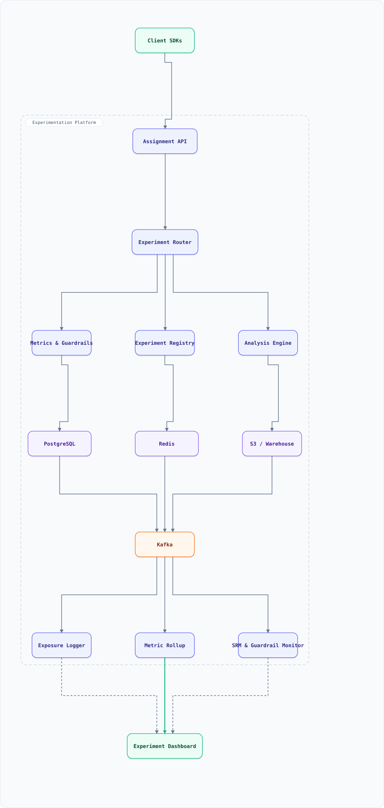
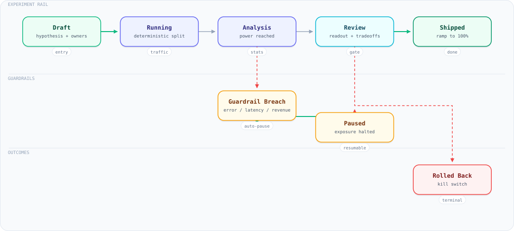

<div align="center">

<sub>INFRASTRUCTURE</sub>

# System Design: A/B Experimentation Platform (Online Controlled Experiments)

</div>


## Table of Contents

<details open>
<summary><b>📑 Jump to a section</b></summary>

1. [Overview](#overview)
2. [Requirements](#requirements)
3. [Capacity Model (Back-of-Envelope)](#capacity-model-back-of-envelope)
4. [High-Level Architecture](#high-level-architecture)
5. [Microservices](#microservices)
6. [API & Interface Contracts](#api--interface-contracts)
7. [Database Design](#database-design)
8. [Security, Identity & Multi-Tenancy](#security-identity--multi-tenancy)
9. [Scaling Tiers](#scaling-tiers)
10. [Key Techniques & Patterns](#key-techniques--patterns)
11. [Key Design Decisions](#key-design-decisions)
12. [Failure Modes & Recovery](#failure-modes--recovery)
13. [Disaster Recovery & Multi-Region](#disaster-recovery--multi-region)
14. [Cost Estimation (300 concurrent experiments)](#cost-estimation-300-concurrent-experiments)
15. [Trade-off Analysis](#trade-off-analysis)
16. [Key Metrics to Monitor](#key-metrics-to-monitor)
17. [Deep Dive Prompts](#deep-dive-prompts)
18. [Common Interview Follow-ups (with answers)](#common-interview-follow-ups-with-answers)
19. [Low-Level Design (LLD) - Algorithms & Data Structures](#low-level-design-lld---algorithms--data-structures)
20. [Micro-Details & Edge Cases](#micro-details--edge-cases)
21. [Do's & Don'ts](#dos--donts)
22. [References & Further Reading](#references--further-reading)

</details>

---

## Overview

Design the platform that answers **"is this change good?"** with statistics instead of opinions: a product engineer declares an experiment (variants, traffic split, metrics, guardrails), the **assignment service** deterministically buckets each unit into a variant *inside the request path*, every unit that actually sees a variant emits an **exposure**, and the analysis engine turns exposures plus metric events into a decision.

The hard parts are not the hashing:

- **Determinism under load** — the same user must land in the same variant on every request, across SDKs, services and devices, even when the assignment cache is cold. This runs in the *user's critical path*, so it must be a pure function plus a cache, never a distributed transaction.
- **Statistical honesty** — peeking at a fixed-horizon p-value inflates false positives; the platform must either fix the horizon in advance or use always-valid inference (sequential tests), and it must police the experiment itself with **guardrail metrics** and **sample-ratio-mismatch (SRM)** detection.
- **Trust in the data** — one miscalibrated metric definition, one duplicated exposure stream, or one skewed randomization hash and a "win" becomes a rollback. The platform's real product is *credible measurement*.

### Key Numbers

| Metric | Value | Why it matters |
| :--- | :--- | :--- |
| Concurrent experiments | 300–500 | Layers must keep them mutually exclusive but orthogonal |
| Assignment QPS | 200K/sec peak | Runs in the request path of every product surface |
| Assignment latency (p99) | < 5 ms (SDK cache hit) | It sits on the critical path of page loads |
| Cache-miss latency budget | < 20 ms | Falls back to the Assignment API |
| Exposures logged | ~23K/s average, 50K/s peak, 1–2B/day | Volume driver for the whole pipeline |
| Metrics per experiment | 1 primary, 5 secondary, 20–50 guardrails | Multiplicity is the default, not the exception |
| Exposure → dashboard latency | < 15 min streaming, nightly deep analysis | Ship decisions are same-day |
| Minimum runtime | 7 days or 2 business cycles | Novelty and primacy effects decay |
| Ramp plan | 1% → 5% → 10% → 25% → 50% → 100% | Guardrails gate each step |
| SRM alarm | p < 0.001 on the observed split | A broken randomizer invalidates every result |
| Assignment availability | 99.99% | If assignment is down, surfaces must still render |

## Requirements

### Functional Requirements

- **Declare** an experiment: hypothesis, unit type (user/device/session), layer, variants with weights, targeting rules, primary + secondary + guardrail metrics, ramp plan
- **Assign** a unit to a variant deterministically from `(layer salt, unit id)`, with sticky overrides for support and debugging
- **Log exposures** at the moment a unit is actually exposed, with variant and context
- **Compute metrics** for any experiment over any window, with variance reduction (CUPED) and sequential or fixed-horizon inference
- **Guardrail** the experiment: automatic evaluation of guardrail regressions, with auto-halt / auto-rollback on breach
- **Detect SRM** continuously and refuse to publish results for a broken randomizer
- **Ramp** exposure in steps with soak time and automatic promotion or rollback
- **Layer and hold out** so unrelated tests run concurrently without interaction, plus long-term holdout cohorts
- **Audit** every change: who ramped, who stopped, and what the analysis said at the time

### Non-Functional Requirements

- **Latency**: assignment p99 < 5 ms in-SDK, < 20 ms on a cache miss; the assignment call must never block a render
- **Determinism**: identical assignment across languages (JS, Java, Go, Python) — one hash spec, shared test vectors in CI
- **Availability**: reads degrade to a local default (control) rather than failing; a platform outage must not take product surfaces down
- **Consistency**: no unit ever sees two variants of one experiment; no exposure without an assignment
- **Scalability**: 200K assignment QPS peak, 50K exposures/sec peak against 1–2B/day sustained; 10× launch spikes absorbed by the ingest buffer, never by the assignment path
- **Privacy**: targeting uses pseudonymous ids; only hashed unit keys reach the warehouse

## Capacity Model (Back-of-Envelope)

Every figure in Key Numbers is derived here, and the calculator is executed by `tools/audit-docs.mjs`, so prose and arithmetic cannot drift apart.

| Step | Input | Derivation | Result |
| :--- | :--- | :--- | :--- |
| Units | 200M distinct units/day | product DAU plus signed-out devices | 200M |
| Exposures | 2B/day | about 10 exposures per active unit | **23.1K/s average** |
| Peak | launch factor 2.2x | concentrated in the first minutes of a launch | **50K/s** |
| Assignments | 4 `getVariant` calls per exposure | feature flags plus experiment reads | **200K/s peak** |
| Exposure storage | ~38 B/row, columnar | 2B x 38 B | **76 GB/day, 30 TB over 400 days** |
| Rollups | 300 exp x 3 arms x 50 metrics x 24 h | moments only, never raw rows | **1.08M rows/day** |
| Redis assignments | 200M distinct units x 120 B | **not** 200K/s x 24 h | **24 GB** |

The classic sizing error: `200K/s x 86,400 s` is **17.3B keys (~1.7 TB)**. Assignments are cached per *unit*, not per *request*, so the correct input is distinct units per day.

```js
const DAY = 86400;
const unitsPerDay = 200e6;
const exposuresPerDay = 2e9;
const peakExposure = 50_000;
const assignPerExposure = 4;
const bytesPerExposure = 38;
const avgExposure = exposuresPerDay / DAY;
const assignmentPeak = peakExposure * assignPerExposure;
const exposureGbPerDay = (exposuresPerDay * bytesPerExposure) / 1e9;
const archiveTb = (exposureGbPerDay * 400) / 1e3;
const naiveCacheKeys = (200_000 * DAY) / 1e9;
const realCacheGb = (unitsPerDay * 120) / 1e9;
const rollupRows = 300 * 3 * 50 * 24;
console.log('exposures/s average :', Math.round(avgExposure));
console.log('peak factor         :', (peakExposure / avgExposure).toFixed(2) + 'x');
console.log('assignment peak/s   :', assignmentPeak);
console.log('exposure GB/day     :', exposureGbPerDay.toFixed(0));
console.log('archive TB (400d)   :', archiveTb.toFixed(1));
console.log('naive cache keys    :', naiveCacheKeys.toFixed(1) + 'B (wrong input)');
console.log('real cache GB       :', realCacheGb.toFixed(0));
console.log('rollup rows/day     :', rollupRows);
```

**What breaks first.** At 50K exposures/s the Kafka ingest and the warehouse join, not the assignment path: assignment is a local hash, while exposures must be deduplicated and joined against metric events. That is why the buffer and the rollup moments exist, and why exposure loss is measured as a first-class SLI.

## High-Level Architecture

### Architecture Diagram



**Interactive diagram:** [diagrams/system-design/ab-testing.architecture.html](diagrams/system-design/ab-testing.architecture.html) — pan/zoom, search, dark/light theme, PNG/SVG export.


*Solid = the assignment and exposure path, dashed = control and monitoring path. Everything inside the boundary is the platform; client SDKs and the analyst dashboard sit outside it.*

### Data Flow

1. A product surface calls its **Client SDK**: `getVariant({ unitKey, layer, experimentId })`. The SDK hashes locally (`sha256(layerSalt:unitKey) → 0..9999`), checks its in-process cache, then Redis, and only then calls the **Assignment API**
2. The **Assignment API** resolves targeting, applies holds and sticky overrides, records an assignment in Redis (24h TTL) and publishes `assignment.events` to Kafka for audit
3. The surface renders the variant, and the SDK emits exactly one **exposure** (`unitKey`, experiment, variant, timestamp, surface). Exposures are the *only* analysis denominator — traffic that never saw the variant is never counted
4. **Exposure Logger** consumes `exposure.events`, deduplicates on `(unit_key, experiment_id, day)` and appends to the warehouse / object store
5. **Metric Rollup** joins exposures with metric events (clicks, purchases, latency) over streaming windows and writes per-variant moments — `n`, `sum`, `sum_sq`, covariate sums — into the **Metric Store**
6. **SRM & Guardrail Monitor** evaluates the observed split (chi-square) and guardrail regressions (sequential test) continuously. A breach publishes to `guardrail.signals` and can auto-halt the ramp
7. The **Analysis Engine** serves dashboards: CUPED-adjusted lifts, confidence intervals, always-valid p-values, and the decision rule for the experiment owner

### Experiment State Machine

An experiment moves through a small set of guarded states, and the interesting part is the loop back: a guardrail breach pauses exposure without ending the experiment, so a fix can resume it with the same assignment salt and no re-randomisation. Shipping and rolling back are both explicit transitions with an audit trail, and a paused experiment still holds its traffic allocation — the alternative, silently dropping the bucket, corrupts the SRM check when it resumes.



**Interactive diagram:** [diagrams/system-design/experiment-lifecycle.lifecycle.html](diagrams/system-design/experiment-lifecycle.lifecycle.html) — pan/zoom, search, dark/light theme, PNG/SVG export.

## Microservices

| Service | Responsibility | Notes |
| :--- | :--- | :--- |
| **Client SDKs** | Local hashing, in-process cache, exposure emission | Must match the server hash exactly; shared test vectors in CI |
| **Assignment API** | Resolve targeting, layer allocation, sticky overrides, assignment writes | Stateless; Redis cache-aside with a 24h TTL |
| **Experiment Registry** | CRUD for experiments, variants, metrics and ramp plans; signed config snapshots to SDKs | Versioned; a running experiment is immutable |
| **Layer Manager** | Owns layer salts and the allocation budget per layer | A salt change is a breaking change — versioned, never edited in place |
| **Exposure Logger** | Dedupe and append exposures to the warehouse | At-least-once consumption, idempotent per `(unit, experiment, day)` |
| **Metric Rollup** | Streaming joins of exposures × metric events into per-variant moments | Parallel-variance accumulators, not raw rows |
| **Analysis Engine** | CUPED, sequential / fixed-horizon tests, CIs, multiplicity control | Reads aggregates only; deterministic for identical inputs |
| **Guardrail Monitor** | SRM detection, guardrail regression tests, halt and rollback signals | Per experiment plus platform-wide SRM sweeps |
| **Ramp Orchestrator** | Step promotions with soak time, freeze windows, auto-rollback | Idempotent state machine, fully audit-logged |
| **Console** | Experiment authoring, dashboards, decision log | Read-mostly over the registry and metric store |

## API & Interface Contracts

SDK reads are authenticated with a public, surface-scoped key (safe to ship in a bundle); the console uses OIDC. Every mutating call carries `Idempotency-Key`, and config changes carry `If-Match` on the experiment version.

| Method | Path | Caller | Idempotency | Limit |
| :--- | :--- | :--- | :--- | :--- |
| `GET` | `/v1/assign?unit_key&layer&experiment` | Client SDK | none (pure read) | 5K rps per key |
| `POST` | `/v1/exposures` | Client SDK (batched) | `event_id` per exposure | 500 events per batch |
| `POST` | `/v1/experiments` | Console | `Idempotency-Key` | 10 rps per user |
| `POST` | `/v1/experiments/{key}/ramp` | Console | `Idempotency-Key` + `If-Match: version` | 1 rps per experiment |
| `GET` | `/v1/experiments/{key}/readout` | Console | none | 5 rps per user |

```json
// GET /v1/assign -> 200
{
  "experiment": "checkout_button_color",
  "variant": "treatment",
  "payload": { "color": "green" },
  "reason": "hash",
  "config_version": 7,
  "snapshot_age_s": 42
}
```

| Status | Meaning | Retryable | Client action |
| :--- | :--- | :--- | :--- |
| `400` | Unknown layer, malformed unit key | No | Drop the exposure, log once |
| `404` | Experiment not found or not running | No | Render control, do **not** emit an exposure |
| `409` | Version conflict on ramp/config write | Yes, after re-read | Re-fetch, re-apply, retry once |
| `412` | `If-Match` failed | Yes | Same as 409 |
| `429` | Key over its rate limit | Yes | Honour `Retry-After`, back off with jitter |
| `503` | Assignment API degraded | Yes | Serve the last signed snapshot; unknown experiments resolve to control |

**Versioning.** `/v1` is additive-only: new response fields may appear, none are removed or retyped. SDKs pin a config schema version and reject a snapshot newer than they understand rather than silently mis-parsing a variant payload.

## Database Design

```sql
-- An experiment is a versioned definition, never edited once running.
CREATE TABLE experiments (
  id             BIGSERIAL PRIMARY KEY,
  key            TEXT NOT NULL UNIQUE,            -- 'checkout_button_color'
  layer          TEXT NOT NULL,                   -- 'checkout'
  unit_type      TEXT NOT NULL DEFAULT 'user',    -- user | device | session
  status         TEXT NOT NULL DEFAULT 'draft',   -- draft | running | ramping | stopped | archived
  allocated_bp   INT  NOT NULL DEFAULT 10000,     -- share of the layer budget, basis points
  version        INT  NOT NULL DEFAULT 1,
  primary_metric TEXT NOT NULL,
  definition     JSONB NOT NULL,                  -- targeting, exclusions, seed config
  started_at     TIMESTAMPTZ,
  stopped_at     TIMESTAMPTZ,
  created_by     TEXT NOT NULL,
  created_at     TIMESTAMPTZ NOT NULL DEFAULT now()
);
CREATE INDEX experiments_layer_idx ON experiments (layer, status);

-- Variants: basis-point weights; the control arm always keeps a non-zero share.
CREATE TABLE variants (
  experiment_id BIGINT NOT NULL REFERENCES experiments(id),
  name          TEXT   NOT NULL,                  -- 'control' | 'treatment'
  weight_bp     INT    NOT NULL CHECK (weight_bp BETWEEN 1 AND 10000),
  payload       JSONB  NOT NULL DEFAULT '{}',     -- what the SDK hands the app
  PRIMARY KEY (experiment_id, name)
);

-- Durable assignment is an optimization and audit trail; the hash is the source of truth.
CREATE TABLE assignments (
  unit_key      TEXT   NOT NULL,                  -- pseudonymous hash, not the raw user id
  experiment_id BIGINT NOT NULL,
  variant       TEXT   NOT NULL,
  layer         TEXT   NOT NULL,
  reason        TEXT   NOT NULL,                  -- hash | sticky | override | fallback
  assigned_at   TIMESTAMPTZ NOT NULL DEFAULT now(),
  PRIMARY KEY (unit_key, experiment_id)           -- one unit, one variant, forever
);

-- Guardrails and ramp steps are data, so any incident is reconstructable.
CREATE TABLE ramp_plans (
  experiment_id  BIGINT NOT NULL,
  step           INT    NOT NULL,                 -- 1..N
  treatment_bp   INT    NOT NULL,                 -- 100 = 1%
  min_soak_hours INT    NOT NULL DEFAULT 24,
  PRIMARY KEY (experiment_id, step)
);

CREATE TABLE guardrail_events (
  id            BIGSERIAL PRIMARY KEY,
  experiment_id BIGINT  NOT NULL,
  metric        TEXT    NOT NULL,                 -- p95_latency | error_rate | refund_rate
  direction     TEXT    NOT NULL,                 -- up | down (direction of harm)
  observed_lift NUMERIC NOT NULL,
  threshold     NUMERIC NOT NULL,
  p_value       NUMERIC NOT NULL,
  action        TEXT    NOT NULL,                 -- halt | rollback | notify
  detected_at   TIMESTAMPTZ NOT NULL DEFAULT now()
);
```

**Warehouse tables** — `exposures` (partitioned by day, clustered by experiment), `metric_events`, and `experiment_rollups` (per experiment × variant × metric × hour with `n`, `sum`, `sum_sq`, covariate moments). The Analysis Engine reads only the rollups.

**Kafka topics** — `assignment.events` (audit), `exposure.events` (the analysis source of truth), `metric.events` (business metrics), `guardrail.signals` (halt / rollback triggers). Partitioned by `experiment_id` so one experiment's analysis stays ordered and scales independently.

**Redis** — assignment cache (`assign:{experiment}:{unit}` with a 24h TTL), layer-salt cache, per-experiment QPS counters, and the sticky-override set used by support engineering.

## Security, Identity & Multi-Tenancy

| Caller | Authentication | Authorization |
| :--- | :--- | :--- |
| Client SDK | Public surface key (safe in a bundle), scoped to one surface and layer set | Read assignments and emit exposures for its own layer only |
| Assignment API (service-to-service) | mTLS with SPIFFE identity | Read registry, write assignments, publish audit events |
| Console user | OIDC + SSO, short-lived session | Role below, scoped to team-owned experiments |
| Metric pipeline | mTLS, workload identity | Append exposures, read metric definitions |
| Support override | OIDC + break-glass approval | Create a sticky override with an expiry, never edit a running experiment |

| Role | Read results | Create/edit draft | Ramp to 50% | Ramp to 100% / stop | Edit guardrails |
| :--- | :--- | :--- | :--- | :--- | :--- |
| Viewer | Yes | No | No | No | No |
| Experimenter | Yes | Yes | Yes | No | No |
| Approver | Yes | Yes | Yes | Yes | Yes |
| Admin | Yes | Yes | Yes | Yes | Yes |

**Controls that matter more than the role table**

- **Separation of duties**: the author of an experiment cannot be the approver of its 100% ramp. The API enforces `created_by != approver` on the final step, not the UI.
- **Signed config snapshots**: snapshots are Ed25519-signed and versioned. An SDK rejects an unsigned snapshot, a signature from an unknown key, or one older than the maximum stale age — a compromised CDN cannot inject a variant.
- **Pseudonymous unit keys**: the SDK sends `HMAC-SHA256(pepper, unit_id)`; the pepper rotates quarterly with a dual-read window. Raw user ids never reach the warehouse.
- **Exposure store ACL**: exposures are queryable only through the analysis service; direct warehouse access is limited to a break-glass group with query audit.
- **Deletion**: a DSAR erasure deletes by `unit_key` from the raw exposure table and recomputes the affected rollups; the audit log keeps the fact of deletion, not the key.
- **Immutable audit trail**: every ramp, stop, override and config change appends `(actor, action, before, after, reason, request_id)` to an append-only store. A running experiment cannot be edited — only versioned.

## Scaling Tiers

### Tier 1: 1K - 10K Users

| Component | Choice |
| :--- | :--- |
| **Assignment** | 1–2 API instances plus a single Redis; SDKs mostly hash locally |
| **Registry** | PostgreSQL (single primary) |
| **Exposures** | Events into PostgreSQL/ClickHouse directly, hourly rollups |
| **Analysis** | Nightly batch job plus a notebook for readouts |
| **Guardrails** | Scheduled chi-square and guardrail check every 15 min, alert-only |
| **Ramp** | Manual ramps against a checklist, with the console as the source of truth |

### Tier 2: 10K - 1M Users

| Component | Choice |
| :--- | :--- |
| **Assignment** | 8–16 instances, Redis Cluster, signed config snapshots to SDKs |
| **Exposures** | Kafka (6 brokers) → stream consumers → ClickHouse / warehouse |
| **Analysis** | Streaming rollups on 5-minute windows plus nightly CUPED analysis |
| **Guardrails** | Continuous SRM and sequential guardrail tests with auto-halt |
| **Ramp** | Ramp Orchestrator with soak windows and launch freeze periods |
| **Hygiene** | Registry linting: required guardrails, minimum runtime, named owner |

### Tier 3: 1M - 10M+ Users

| Component | Choice |
| :--- | :--- |
| **Assignment** | Multi-region assignment with regional Redis; local hash as the floor |
| **Exposures** | Kafka tiered storage, regional aggregation, global warehouse rollup |
| **Analysis** | Warehouse/Spark jobs computing CUPED, sequential tests and heterogeneous effects |
| **Guardrails** | Per-experiment plus platform-wide SRM sweeps; rollback wired to SLOs |
| **Ramp** | Cockpit with per-segment ramps (country, platform, new vs returning) |
| **Holdouts** | Permanent 1–2% holdout cohorts measuring cumulative product effect |

## Key Techniques & Patterns

| Technique | Description | Used In |
| :--- | :--- | :--- |
| **Deterministic hashing assignment** | `sha256(layer_salt:unit_key) → 0..9999` lets any node compute the same bucket with no coordination | Client SDKs + LLD §1 |
| **Layers with distinct salts** | Per-layer salts make experiments orthogonal, so unrelated tests can overlap safely | Layer Manager |
| **Exposure-based analysis** | Metrics are computed over exposed units only, never over eligible traffic | Exposure Logger → rollups |
| **SRM chi-square guard** | The observed split is tested against the designed split before any result is published | Guardrail Monitor + LLD §2 |
| **Always-valid sequential inference** | A mixture SPRT p-value stays valid at every peek, so a watched dashboard cannot inflate false positives | Analysis Engine + LLD §3 |
| **CUPED variance reduction** | Pre-period covariates absorb unrelated variance, raising effective sample size 30–50% | Analysis Engine + LLD §4 |
| **Multiplicity control** | One primary metric plus FDR-controlled secondaries and guardrails; no metric shopping | Analysis Engine |
| **Guardrail auto-rollback** | Ramp steps gate on guardrail significance behind a hard kill switch | Ramp Orchestrator + LLD §6 |
| **Exposure backfill** | Late and replayed exposures land in the correct analysis window instead of being dropped | Exposure Logger |
| **Global holdouts** | A permanent control cohort measures cumulative and long-term effects | Holdout Manager |

| **Switchback tests** | Alternate treatment by time block when units interfere (marketplaces, pricing) — the Uber/Lyft-style design for network effects | Analysis Engine |

## Key Design Decisions

| Decision | Choice | Why |
| :--- | :--- | :--- |
| Where bucketing happens | **SDK local hash, server as fallback** | Sub-millisecond and offline-capable; no single point of failure in the request path |
| Assignment persistence | **Hash is truth, cache is an optimization** | Determinism survives cache loss, restarts and regional failover |
| Analysis population | **Exposed units, joined on `unit_key`** | Including eligible-but-unexposed traffic dilutes every effect |
| Inference model | **Sequential by default, fixed horizon allowed with a declared end date** | Teams peek; making peeking statistically safe beats banning it |
| Changing the split mid-flight | **Only via ramp steps on a new config version** | Silent reweighting invalidates the readout |
| Layer allocation | **Explicit budget per layer, enforced by the registry** | Overlap is the most common source of phantom regressions |
| Metric definitions | **Versioned and tested against golden datasets** | A metric bug looks exactly like a product win |
| Who can stop vs ship | **Guardrail monitor halts, a human ships** | Machines prevent damage; humans stay accountable |
| Unit for ratio metrics | **Randomize on the ratio's denominator** (user, not pageview) | Pageview randomization biases ratio metrics like CTR per session |
| Cross-experiment interaction | **Detect, then mitigate with layers or staggered ramps** | Pairwise interaction testing scales quadratically |

## Failure Modes & Recovery

| Failure | Impact | Recovery |
| :--- | :--- | :--- |
| Assignment API down | New units cannot resolve a variant | SDK uses the last signed config and hashes locally; unknown experiments resolve to control |
| Redis cache loss | Cold-cache latency spike | Recompute locally from the deterministic hash; warm asynchronously; never block the render |
| Layer salt changed by mistake | Every unit re-buckets mid-experiment | Salts are immutable and versioned; a change requires a new key and raises an alert |
| SRM detected | Results are untrustworthy | Halt the ramp, invalidate the readout, root-cause the split (targeting, exposure loss, bots) |
| Exposure loss (SDK crash, sampling) | Underestimated volume, biased comparison when loss correlates with variant | Dual-emit to Kafka, reconcile SDK counters against the pipeline, alert on per-variant exposure-rate mismatch |
| Metric pipeline lag | Decisions made on partial windows | Analysis refuses to publish until the metric's watermark closes |
| Guardrail false positive | Unnecessary rollback | Require significance plus a minimum absolute effect and 30 minutes of persistence before halting |
| Novelty or primacy effect | Early "win" that decays | Enforce minimum runtime, show day-over-day trend, compare against holdout |
| Interference (network effects, shared budget) | Treatment steals from control | Switchback tests, cluster randomization, or measure at a coarser unit |
| Bot or internal traffic | Noisy, uninterpretable metrics | Filter at ingest with a shared classifier; internal ids are pinned to control |
| Variant leaked to the public bundle | Competitive and legal risk | Variants stay server-side config; exposure logs and payloads are access-controlled |

## Disaster Recovery & Multi-Region

| Data class | Store | RPO | RTO | Strategy |
| :--- | :--- | :--- | :--- | :--- |
| Experiment registry | PostgreSQL, multi-AZ + PITR | 0 (sync replica) | 30 min | Cross-region read replica, promote on regional loss; signed snapshots already at the edge |
| Assignments | Redis + deterministic hash | 0 (hash is truth) | 0 | Any region computes the same bucket locally; cache loss is a latency event, not a correctness event |
| Exposures | Kafka RF=3 + cross-region mirror | 1 min | 1 h | Mirror to the analytics region; consumers are idempotent on `(unit, experiment, day)` |
| Metric rollups | Warehouse, hourly snapshots | 1 h | 4 h | Rebuild from the raw exposure mirror; the analysis engine refuses to publish across a gap |
| Guardrail actions | Append-only audit + Kafka | 0 | 15 min | Replay `guardrail.signals` to restore halt state |

**Regional failure behaviour.** Assignment is active-active: the SDK's local hash and cached snapshot keep product surfaces rendering with zero RTO. The registry and analysis plane are active-passive. During a failover the readout API returns `503` with `retry_after` rather than publishing a partial window — a wrong number is worse than no number.

**Drills.** Quarterly restore of the registry into a scratch region, a monthly replay of one day of exposures into a rebuilt rollup (must reproduce the published readout bit-for-bit), and an annual game day where the primary region is removed while a live experiment is ramping. The ramp orchestrator must fail safe: if it cannot read guardrails, it freezes the step rather than promoting.

## Cost Estimation (300 concurrent experiments)

| Component | Monthly Cost |
| :--- | :--- |
| Assignment API and edge fleet (~24 instances) | $2,400 |
| Redis Cluster (assignments + counters) | $1,200 |
| PostgreSQL (registry, multi-AZ) | $900 |
| Kafka (6 brokers, exposure + metric topics) | $2,600 |
| Warehouse compute (streaming rollups + nightly CUPED) | $6,500 |
| Object storage (cold exposures, 400-day retention) | $700 |
| Guardrail and analysis compute plus dashboards | $1,300 |
| **Total** | **~$15,600/mo** |

Warehouse compute dominates, which is the argument for **aggregates over raw rows**: rollups are two orders of magnitude smaller, and CUPED needs only joint moments of the covariate and the metric — not the raw values.

## Trade-off Analysis

| Trade-off | Option A | Option B | Winner | Why |
| :--- | :--- | :--- | :--- | :--- |
| Assignment location | Central assignment service | SDK local hash + cached config | **SDK hash** | Critical-path latency and offline resilience beat centralized purity |
| Randomization unit | Session (more exposures) | User (sticky experience) | **User** | Session randomization biases ratio metrics and confuses returning users |
| Inference | Fixed-horizon p-value | Always-valid sequential | **Sequential while running** | Continuous monitoring is reality; sequential keeps false positives controlled |
| Peeking policy | Ban peeking by contract | Make peeking statistically safe | **Make it safe** | Policies lose to dashboards; the test should survive being watched |
| Metric computation | Query raw events per readout | Pre-aggregated per-variant rollups | **Rollups** | 100× cheaper and CUPED only needs moments |
| Experiment concurrency | One at a time (no layers) | Layered concurrent experiments | **Layers** | Velocity, at the cost of maintaining a real allocation budget |
| Interaction handling | Test all pairs | Detect and handle the worst offenders | **Detect** | Quadratic testing does not survive 300 concurrent experiments |
| Guardrail action | Notify a human | Auto-halt, human ships | **Auto-halt** | The window to prevent damage is shorter than a human response time |
| Exposure timing | Log at assignment | Log at render | **Log at render** | Assignment-only logging inflates denominators and dilutes effects |

## Key Metrics to Monitor

| Metric | Target | Alert Threshold |
| :--- | :--- | :--- |
| Assignment latency p99 | < 5 ms | > 20 ms for 10 min |
| Assignment availability | > 99.99% | any sustained 5xx burst |
| Unexplained SRM alarms | 0 | any p < 0.001 not tied to a known incident |
| Exposure pipeline lag p99 | < 5 min | > 15 min |
| Exposure loss (SDK vs pipeline) | < 0.5% | > 2%, or correlated with variant |
| Guardrail halt rate | < 5% of experiments | > 15% (ramp plan is too aggressive) |
| A/A false-positive rate at α = 0.05 | 5% ± 1% | outside the band — the pipeline is broken, not the product |
| Time to first readout | < 24h | > 48h |
| Stale experiments running > 8 weeks | 0 | > 10 |

**A/A tests are the platform's unit test.** Run a fake experiment where both arms are identical: a healthy platform produces a false-positive rate at the nominal α and a lift distribution centred on zero. If the A/A drifts, every experiment result is suspect — debug the platform before the product.

## Deep Dive Prompts

1. **Why hash instead of storing assignments, and what do you give up?** (Redistribution risk, salt versioning, overrides.)
2. **Design the SRM detector:** what do you compare, at what granularity, and how do you avoid alerting on legitimately dynamic traffic?
3. **Fixed-horizon vs sequential testing** — explain the peeking problem and how a mixture SPRT fixes it.
4. **How does CUPED work**, and how do you choose the covariate when the metric is a ratio?
5. **Walk through layering:** with 300 concurrent experiments, how do you prevent overlap while keeping salts stable?
6. **Randomization unit:** when do you randomize on device, session, cluster or time (switchback), and what does each cost you?
7. **How do you detect interactions** between experiments without testing all pairs?
8. **A guardrail breaches at 10% traffic.** Walk the halt, root-cause and re-ramp flow.
9. **How do you run an experiment on a surface with 50 ms of headroom** and no per-user identity (anonymous traffic)?
10. **How would you measure long-term effects** of a change that lifts short-term revenue but might hurt retention?

## Common Interview Follow-ups (with answers)

**Q: Why not just ask the assignment service for every request?**
A: It sits on the page-render critical path at 200K QPS, and a platform outage would then break product surfaces. The hash is a pure function: compute it locally, cache the result, and treat the server as a fallback plus audit trail. The only hard requirement is that every language implementation passes the same test vectors.

**Q: How do you stop the assignment from being biased by a bad hash?**
A: Two layers of defence. The hash is specified once (`sha256(layer_salt:unit_key)` → uint32 → 0..9999) with cross-language test vectors, and the SRM detector continuously compares observed against designed splits per experiment and platform-wide — a biased hash shows up within minutes at 50K exposures/sec.

**Q: How do you handle a user who arrives before any identifier exists?**
A: Issue a server-side anonymous id signed into the first response, then randomize on it. If a request genuinely has no identifier, assign control rather than a treatment arm and exclude it from analysis; putting unidentified traffic into treatment is how "ghost" variance enters the readout.

**Q: Metrics are noisy. How do you get a decision in a week?**
A: CUPED on a pre-period covariate cuts variance 30–50%, sequential testing lets a conclusive test stop early, and a single pre-registered primary metric prevents metric shopping. If the effect is smaller than the minimum detectable effect at your traffic, the honest answer is that the experiment cannot be run at that traffic level — pick a closer-to-the-click metric or accept a longer horizon.

**Q: What happens to the results when someone edits the variant mid-experiment?**
A: Nothing good, so the platform makes it impossible. A running experiment's definition is immutable; edits create a new version requiring a restart, with the pre-change window excluded. Config snapshots are signed and versioned, so SDKs cannot silently diverge.

**Q: How do you know the experiment didn't just catch a bot wave?**
A: Bot and internal traffic is filtered at ingest by a shared classifier, and the analysis is recomputed with the filter both on and off. If the conclusion flips, the "result" was a traffic-quality artifact. Exposures also carry a `source` dimension so per-source lifts stay visible.

**Q: Should guardrails be one-sided or two-sided tests?**
A: One-sided in the direction of harm — stop for "significantly worse", never halt for "significantly better". Guardrail improvements are reported as a bonus. Each guardrail declares its harm direction in the metric registry so the automation can act without a human reading a chart.

## Low-Level Design (LLD) - Algorithms & Data Structures

### 1. Deterministic Assignment (hash + layer salt)

```js
const crypto = require('crypto');

// Salts are per layer and immutable; changing one re-buckets everyone.
const LAYER_SALTS = {
  checkout: 'exp-layer-checkout-v3',
  ranking: 'exp-layer-ranking-v7',
  pricing: 'exp-layer-pricing-v2',
};

/** Uniform bucket in 0..9999 derived purely from (layer, unit key) — no shared state. */
function bucket(unitKey, layer) {
  const digest = crypto.createHash('sha256').update(`${LAYER_SALTS[layer]}:${unitKey}`).digest();
  return Math.floor((digest.readUInt32BE(0) / 0x100000000) * 10000);
}

/** Variants carry basis-point weights; ranges are cumulative and cover 0..9999. */
function variantFor(unitKey, layer, variants) {
  const b = bucket(unitKey, layer);
  let cursor = 0;
  for (const v of variants) {
    cursor += v.weightBp;
    if (b < cursor) return v.name;
  }
  return variants[variants.length - 1].name; // rounding tail stays in the last arm
}

const variants = [
  { name: 'control', weightBp: 5000 },
  { name: 'treatment', weightBp: 5000 },
];

// 1. Split quality — a small skew is expected, a large one means a broken hash.
const counts = { control: 0, treatment: 0 };
for (let i = 0; i < 100000; i++) counts[variantFor(`user_${i}`, 'checkout', variants)]++;
console.log('split:', counts, 'treatment share:', (counts.treatment / 100000).toFixed(4));
console.log('sticky across calls:', variantFor('user_42', 'checkout', variants) === variantFor('user_42', 'checkout', variants));

// 2. Orthogonality — the same unit in two layers lands independently (~5000 per cell).
const cells = {};
for (let i = 0; i < 20000; i++) {
  const cell = `${variantFor(`user_${i}`, 'checkout', variants)}/${variantFor(`user_${i}`, 'ranking', variants)}`;
  cells[cell] = (cells[cell] ?? 0) + 1;
}
console.log('checkout x ranking cells:', cells);
```

### 2. Sample Ratio Mismatch (chi-square guard)

```js
// Critical values for chi-square at alpha = 0.001, indexed by degrees of freedom.
const CHI2_CRITICAL_001 = { 1: 10.83, 2: 13.82, 3: 16.27, 4: 18.47, 5: 20.52, 6: 22.46 };

/** Observed counts per variant vs designed weights; df = variants - 1. */
function srmCheck(observed, weightsBp) {
  const totalObserved = observed.reduce((a, b) => a + b, 0);
  const totalWeight = weightsBp.reduce((a, b) => a + b, 0);
  let chi2 = 0;
  const rows = observed.map((o, i) => {
    const expected = (weightsBp[i] / totalWeight) * totalObserved;
    const contribution = (o - expected) ** 2 / expected;
    chi2 += contribution;
    return { observed: o, expected: Math.round(expected), contribution: +contribution.toFixed(2) };
  });
  const df = observed.length - 1;
  const critical = CHI2_CRITICAL_001[df] ?? Infinity;
  return { chi2: +chi2.toFixed(2), df, critical, srm: chi2 > critical, rows };
}

const healthy = srmCheck([100310, 99690], [5000, 5000]);
console.log('healthy traffic  ->', healthy.chi2, 'srm:', healthy.srm);

// A targeting bug that over-serves treatment shows up immediately.
const broken = srmCheck([103400, 96600], [5000, 5000]);
console.log('buggy randomizer ->', broken.chi2, 'srm:', broken.srm, broken.rows);

// Small experiments are noisy by construction: a 1% drift on 4K units is not an alarm.
console.log('small n, no alarm:', srmCheck([2020, 1980], [5000, 5000]).srm);

// Three-arm experiments use df = 2 with a different critical value.
console.log('three-arm clean:', srmCheck([33300, 33200, 33500], [3333, 3334, 3333]).srm);
```

### 3. Always-Valid Inference (mixture SPRT)

```js
/**
 * Abramowitz & Stegun 7.1.26 error function (max error ~1.5e-7). Note the two classic
 * bugs: `t` is 1/(1 + p|x|) — not |x| — and the exponential uses |x|, not t. Getting
 * either wrong shifts every p-value you print (a z = 2 result comes out as 0.157
 * instead of 0.045).
 */
function erf(x) {
  const sign = x < 0 ? -1 : 1;
  const ax = Math.abs(x);
  const t = 1 / (1 + 0.3275911 * ax); // A&S 7.1.26: t = 1/(1 + p|x|), exp uses |x|
  const a = [0.254829592, -0.284496736, 1.421413741, -1.453152027, 1.061405429];
  const y = 1 - ((((a[4] * t + a[3]) * t + a[2]) * t + a[1]) * t + a[0]) * t * Math.exp(-ax * ax);
  return sign * y;
}
const normalCdf = (z) => 0.5 * (1 + erf(z / Math.SQRT2));

console.log('erf(1) =', erf(1).toFixed(7), '(truth 0.8427008)');

/** Fixed-horizon two-sided p-value: valid only if you look exactly once. */
const fixedPValue = (delta, variance) =>
  2 * (1 - normalCdf(Math.abs(delta) / Math.sqrt(variance)));

/**
 * Two-sided mixture SPRT p-value (the "always-valid" p-value): `delta` is the
 * observed effect, `variance` its sampling variance, `tau` the prior scale on the
 * true effect. Valid at every peek, at the cost of being conservative early.
 */
function alwaysValidPValue(delta, variance, tau) {
  const scale = variance + tau * tau;
  return Math.sqrt(variance / scale) * Math.exp(-(delta * delta) / (2 * scale));
}

// +0.8pp lift, standard error 0.4pp, prior effect scale 0.5pp.
console.log('one look   fixed p =', fixedPValue(0.008, 0.004 ** 2).toFixed(4),
            '| always-valid p =', alwaysValidPValue(0.008, 0.004 ** 2, 0.005).toFixed(4));

// A decisive effect: both agree, and the sequential test authorises stopping.
console.log('decisive   fixed p =', fixedPValue(0.02, 0.004 ** 2).toFixed(6),
            '| always-valid p =', alwaysValidPValue(0.02, 0.004 ** 2, 0.005).toFixed(6), '-> stop, ship');

// --- The peeking problem, measured rather than asserted: 400 A/A experiments, 20 looks each.
function makeGauss(seed) {
  const next = () => (seed.s = (seed.s * 1103515245 + 12345) & 0x7fffffff) / 0x7fffffff;
  return () => {
    const u = Math.max(next(), 1e-9);
    const v = next();
    return Math.sqrt(-2 * Math.log(u)) * Math.cos(2 * Math.PI * v);
  };
}

const SIGMA = 0.05, TAU = 0.01, LOOKS = 20, TRIALS = 400;
const seed = { s: 20261006 };
let fixedFalsePositives = 0;
let alwaysValidFalsePositives = 0;

for (let trial = 0; trial < TRIALS; trial++) {
  const gauss = makeGauss(seed);
  let cumulative = 0, minFixed = 1, minAlwaysValid = 1;
  for (let look = 1; look <= LOOKS; look++) {
    cumulative += gauss() * SIGMA;              // true effect is zero: pure noise
    const delta = cumulative / look;
    const variance = (SIGMA ** 2) / look;
    minFixed = Math.min(minFixed, fixedPValue(delta, variance));
    minAlwaysValid = Math.min(minAlwaysValid, alwaysValidPValue(delta, variance, TAU));
  }
  if (minFixed < 0.05) fixedFalsePositives++;
  if (minAlwaysValid < 0.05) alwaysValidFalsePositives++;
}

const pct = (n) => (100 * n / TRIALS).toFixed(1) + '%';
console.log(`A/A: ${TRIALS} experiments x ${LOOKS} looks at alpha = 0.05`);
console.log(`  fixed-horizon false positives: ${pct(fixedFalsePositives)}   <- peeking inflates this`);
console.log(`  always-valid  false positives: ${pct(alwaysValidFalsePositives)}   <- stays near nominal alpha`);
```

### 4. CUPED Variance Reduction

```js
/** theta = cov(X, Y) / var(X) minimises adjusted variance; X is a pre-period covariate. */
function cuped(rows) {
  const n = rows.length;
  const mean = (f) => rows.reduce((s, r) => s + f(r), 0) / n;
  const mx = mean(r => r.pre);
  const my = mean(r => r.post);
  const cov = rows.reduce((s, r) => s + (r.pre - mx) * (r.post - my), 0) / (n - 1);
  const varX = rows.reduce((s, r) => s + (r.pre - mx) ** 2, 0) / (n - 1);
  const varY = rows.reduce((s, r) => s + (r.post - my) ** 2, 0) / (n - 1);
  const theta = cov / varX;
  const adjusted = rows.map(r => r.post - theta * (r.pre - mx));
  const meanAdj = adjusted.reduce((a, b) => a + b, 0) / n;
  const varAdj = adjusted.reduce((s, a) => s + (a - meanAdj) ** 2, 0) / (n - 1);
  return {
    n,
    theta: +theta.toFixed(4),
    rawMean: +my.toFixed(4),
    adjustedMean: +meanAdj.toFixed(4),
    rawVar: +varY.toFixed(4),
    adjustedVar: +varAdj.toFixed(4),
    varianceReductionPct: +(100 * (1 - varAdj / varY)).toFixed(1),
    rhoSquaredPct: +(100 * (cov * cov) / (varX * varY)).toFixed(1),
  };
}

// Deterministic users whose post-period spend tracks their pre-period spend.
let seed = 12345;
const rand = () => ((seed = (seed * 1103515245 + 12345) & 0x7fffffff) / 0x7fffffff);
const rows = Array.from({ length: 20000 }, () => {
  const pre = 20 + 10 * rand();
  const post = 0.6 * pre + 4 * rand();
  return { pre, post };
});

const result = cuped(rows);
console.log('CUPED:', result);
console.log(`effective sample-size multiplier: ${(result.rawVar / result.adjustedVar).toFixed(2)}x`);
```

### 5. Two-Proportion Test (lift, CI, decision)

```js
function erf(x) {
  const sign = x < 0 ? -1 : 1;
  const ax = Math.abs(x);
  const t = 1 / (1 + 0.3275911 * ax); // A&S 7.1.26: t = 1/(1 + p|x|), exp uses |x|
  const a = [0.254829592, -0.284496736, 1.421413741, -1.453152027, 1.061405429];
  const y = 1 - ((((a[4] * t + a[3]) * t + a[2]) * t + a[1]) * t + a[0]) * t * Math.exp(-ax * ax);
  return sign * y;
}
const normalCdf = (z) => 0.5 * (1 + erf(z / Math.SQRT2));

/** Relative lift with a 95% CI on the absolute difference, plus the decision. */
function twoProportion({ convA, nA, convB, nB, alpha = 0.05 }) {
  const pA = convA / nA;
  const pB = convB / nB;
  const seDiff = Math.sqrt(pA * (1 - pA) / nA + pB * (1 - pB) / nB);
  const z = (pB - pA) / seDiff;
  const p = 2 * (1 - normalCdf(Math.abs(z)));
  const zCrit = 1.959964; // 95% two-sided
  return {
    controlPct: +(pA * 100).toFixed(3),
    treatmentPct: +(pB * 100).toFixed(3),
    relativeLiftPct: +(((pB - pA) / pA) * 100).toFixed(2),
    ci95AbsolutePct: [+((pB - pA - zCrit * seDiff) * 100).toFixed(3), +((pB - pA + zCrit * seDiff) * 100).toFixed(3)],
    z: +z.toFixed(2),
    p: +p.toFixed(5),
    decision: p < alpha ? (pB > pA ? 'winner' : 'loser') : 'inconclusive',
  };
}

console.log(twoProportion({ convA: 10240, nA: 100310, convB: 10790, nB: 99690 }));
console.log(twoProportion({ convA: 10240, nA: 100310, convB: 10350, nB: 99690 }));
```

### 6. Ramp Controller with Guardrail Auto-Rollback

```js
const PLAN = [100, 500, 1000, 2500, 5000, 10000]; // basis points: 1% -> 100%

class RampController {
  constructor({ plan = PLAN, minSoakHours = 24 } = {}) {
    this.plan = plan;
    this.minSoakHours = minSoakHours;
    this.state = { step: 0, since: '2026-10-01T00:00:00Z', halted: false };
  }

  /** evidence: { nowIso, guardrails: [{ metric, direction, relativeLift, pValue }] } */
  evaluate(evidence) {
    const breached = evidence.guardrails.find(g =>
      g.pValue < 0.001 && (g.direction === 'up' ? g.relativeLift > 0 : g.relativeLift < 0));

    if (breached) {
      this.state = { ...this.state, halted: true };
      return {
        action: 'rollback',
        to: 'control',
        reason: `${breached.metric} regressed ${(breached.relativeLift * 100).toFixed(1)}% (p=${breached.pValue})`,
      };
    }

    const soakHours = (Date.parse(evidence.nowIso) - Date.parse(this.state.since)) / 3.6e6;
    if (soakHours < this.minSoakHours) {
      return { action: 'hold', at: this.plan[this.state.step], reason: `soak ${soakHours.toFixed(1)}h of ${this.minSoakHours}h` };
    }
    if (this.state.step === this.plan.length - 1) {
      return { action: 'complete', at: 10000, reason: 'full traffic, guardrails clean' };
    }

    this.state = { step: this.state.step + 1, since: evidence.nowIso, halted: false };
    return { action: 'advance', to: this.plan[this.state.step], reason: 'guardrails clean' };
  }
}

const ramp = new RampController({ minSoakHours: 24 });
const clean = [
  { metric: 'p95_latency', direction: 'up', relativeLift: 0.004, pValue: 0.42 },
  { metric: 'error_rate', direction: 'up', relativeLift: -0.01, pValue: 0.70 },
];

console.log(ramp.evaluate({ nowIso: '2026-10-01T06:00:00Z', guardrails: clean })); // still soaking
console.log(ramp.evaluate({ nowIso: '2026-10-02T01:00:00Z', guardrails: clean })); // 1% -> 5%
console.log(ramp.evaluate({ nowIso: '2026-10-03T01:00:00Z', guardrails: clean })); // 5% -> 10%

// A significant latency regression halts the ramp and reverts to control.
const bad = clean.concat([{ metric: 'checkout_latency_p99', direction: 'up', relativeLift: 0.09, pValue: 0.0002 }]);
console.log(ramp.evaluate({ nowIso: '2026-10-03T09:00:00Z', guardrails: bad }));
console.log('halted:', ramp.state.halted === true, '| held step:', ramp.plan[ramp.state.step]);
```

### 7. Experiment Lifecycle State Machine

| From | Event | To | Guard |
| :--- | :--- | :--- | :--- |
| `draft` | submit | `scheduled` | Primary metric declared, owner assigned, at least one guardrail |
| `scheduled` | start time reached | `running` | Registry lint passed, config snapshot signed |
| `running` | ramp step | `ramping` | Soak time elapsed, SRM clean, guardrails not breached |
| `ramping` | step complete | `ramping` | Same guards plus approval for steps above 50% |
| `ramping` | guardrail breach | `paused` | Significant harm in the declared direction with minimum absolute effect |
| `paused` | fix verified | `ramping` | Guardrail signal cleared for 30 min, approver signs off |
| `ramping` | final step | `running` | 100% (or holdback) reached |
| `running` | decision | `stopped` | Readout published; winner shipped or reverted |
| `stopped` | retention elapsed | `archived` | 30 days after decision |

Illegal transitions are rejected, not coerced: a `paused` experiment cannot jump to `stopped` without recording the decision, and a `stopped` experiment can never return to `running` (a restart is a new version).

```js
const TRANSITIONS = {
  draft: { submit: 'scheduled' },
  scheduled: { start: 'running', cancel: 'archived' },
  running: { ramp: 'ramping', stop: 'stopped' },
  ramping: { step: 'ramping', pause: 'paused', complete: 'running', stop: 'stopped' },
  paused: { resume: 'ramping', stop: 'stopped' },
  stopped: { archive: 'archived' },
  archived: {},
};

class ExperimentLifecycle {
  constructor() { this.state = 'draft'; this.history = []; }
  apply(event, guards = {}) {
    const next = TRANSITIONS[this.state]?.[event];
    if (!next) return { ok: false, reason: `illegal: ${this.state} -/-> ${event}` };
    if (event === 'step' && guards.guardrailBreached) return { ok: false, reason: 'guardrail breached' };
    if (event === 'step' && guards.srmPValue < 0.001) return { ok: false, reason: 'sample ratio mismatch' };
    if (event === 'step' && guards.approved !== true) return { ok: false, reason: 'approval required' };
    this.history.push({ from: this.state, event, to: next });
    this.state = next;
    return { ok: true, state: next };
  }
}

const exp = new ExperimentLifecycle();
console.log(exp.apply('submit'));
console.log(exp.apply('start'));
console.log(exp.apply('ramp'));
console.log(exp.apply('step', { srmPValue: 0.4, approved: false }));
console.log(exp.apply('step', { srmPValue: 0.4, approved: true }));
console.log(exp.apply('pause', { guardrailBreached: true }));
console.log('final:', exp.state, '| transitions:', exp.history.length);
```

## Micro-Details & Edge Cases

Small decisions that quietly invalidate experiments — the class of bug that costs weeks because the platform reports a confident number:

| Micro-detail | Why it bites |
| :--- | :--- |
| **Unit-key canonicalization** — trim, lowercase, and prefix by type (`u:123`, `d:9f2c`) | A user id and a device id that share a string collide in the same 10,000 buckets |
| **Bucket range is 0–9999 inclusive; weights must sum to the layer allocation** | A rounding remainder silently lands in the last arm and skews it by a few basis points |
| **Salt format `layer-v7`, never edited in place** | Editing a salt mid-experiment re-buckets live users; bump the version instead |
| **Exposure dedupe key `(unit_key, experiment_id, day)` with a 24h TTL** | A chatty SDK that emits per page view double-counts one user twenty times |
| **Filter bots and internal traffic *before* bucketing** | Otherwise non-human traffic consumes allocation budget and dilutes every metric |
| **Randomize on the metric's denominator** (user, not pageview, not session) | Ratio metrics become biased when the unit is finer than the metric's denominator |
| **Ratio metrics need the delta method for variance** | Variance of a ratio is not the ratio of variances; CIs come out too narrow |
| **Winsorize heavy-tailed metrics at p99.9, and record the cap** | One whale account can flip a revenue readout with a single purchase |
| **Money and counts in integer minor units (cents), never summed floats** | 100M float additions drift enough to change a significant digit |
| **"7 days" means 7 full UTC days after the first exposure** | Wall-clock windows shift across DST and truncate the last partial day |
| **Withhold a window until its event-time watermark closes (30–60 min)** | Publishing early windows makes the trend line look like a false regression |
| **Bonferroni for guardrails, BH/FDR for exploratory secondaries** | 40 guardrails at α = 0.05 produce ~2 false alarms per experiment |
| **Guardrails need a minimum absolute effect as well as significance** | With enough traffic, a 3 ms p95 change halts a genuinely good experiment |
| **Sticky overrides carry an expiry and an audit entry** | A forgotten debug override is a permanent silent variant for one customer |
| **Cache the assignment, not the rendered variant** | A render cache can serve the control UI to a treatment user after the split changes |
| **Holdouts are a reserved allocation inside their layer** | A "separate" holdout that overlaps a layer creates interaction you cannot measure |
| **Partition exposures by experiment, and watch for one experiment owning a partition** | A 50% experiment on the largest surface can starve the consumer group's other partitions; cap per-experiment ingress |
| **Refresh signed snapshots with jitter, not on a fixed minute** | Every SDK waking at `:00` turns a config publish into a thundering herd on the CDN and the registry |
| **Treat exposure schema changes as breaking** | Adding a required field silently drops events from SDK versions that cannot send it; make fields optional and version the envelope |
| **Dedupe days in UTC, and document it** | A local-time day boundary double-counts or drops the hour around midnight and quietly shifts the split |
| **Shed debug surfaces before treatment surfaces under buffer pressure** | Dropping exposures randomly biases the readout; dropping by surface priority is at least measurable |
| **Bound the maximum snapshot age the SDK will trust** | Serving a week-old snapshot is a silent variant change; expire to control instead |

The pattern behind all of these: the platform is a *measurement instrument*. A mismatch between what the statistics assume (an exact 50/50 split, one exposure per user, units independent of outcomes) and what the pipeline actually produces is a wrong answer, not a noisy one.

## Do's & Don'ts

| ✅ Do | ❌ Don't |
| :--- | :--- |
| Randomize on a stable unit id with a versioned layer salt | Don't re-randomize per request or per session — it biases ratio metrics |
| Log the exposure when the variant renders, not when it is assigned | Don't count eligible-but-unexposed traffic as control; it dilutes every effect |
| Always keep a slice in control, even after a win ramps to 100% | Don't ship a winner to everyone and lose the ability to catch a delayed regression |
| Pre-register the primary metric and the ramp plan | Don't choose the winning metric after seeing the numbers |
| Use always-valid inference while a test is running | Don't treat a peeked fixed-horizon p-value as permission to ship |
| Watch SRM per experiment and platform-wide | Don't debug a "flat" result before proving the split is what you designed |
| Cap experiment runtime and force a decision date | Don't let zombie experiments run for months — they burn traffic and trust |
| Gate every ramp step on guardrails with a hard kill switch | Don't let the launch calendar decide the exposure curve |
| Version metric definitions and test them against golden data | Don't edit a metric mid-experiment and keep reading the same result |
| Use global holdouts to measure cumulative product effect | Don't assume per-experiment wins compose additively |

## References & Further Reading

**Open-source implementations to read**

- [GrowthBook](https://github.com/growthbook/growthbook) — warehouse-native flags + experimentation; the assignment hashing and SRM checks are worth reading directly
- [PlanOut](https://github.com/facebook/planout) — the original Facebook scripting language for online experiments (the source of the tag/salt naming convention)
- [Microsoft ExP](https://github.com/microsoft/ExP) — a production experiment platform's service layout, including shared assignment and layered analysis

**Statistics and integrity checks**

- [Always Valid Inference: Continuous Monitoring of A/B Tests](https://arxiv.org/pdf/1512.04922) — the mixture SPRT behind the always-valid p-value in LLD §3
- [Improving the Sensitivity of Online Controlled Experiments (CUPED)](https://alexdeng.github.io/public/files/kdd2023-inexp.pdf) — variance reduction, plus a later paper on using in-experiment covariates
- [Diagnosing Sample Ratio Mismatch](https://exp-platform.com/Documents/2019_KDDFabijanGupchupFuptaOmhoverVermeerDmitriev.pdf) — the taxonomy of SRM causes used in the failure table
- [Sample ratio mismatch](https://en.wikipedia.org/wiki/Sample_ratio_mismatch) — a compact summary of the check and its thresholds
- *Trustworthy Online Controlled Experiments* (Kohavi, Tang, Xu) — the reference text for the run-vs-ship rules and guardrail practice below

*More cross-topic rules: [Interview Q&A §84](interview-qa.md#84-universal-dos--donts) · Related: [Recommendation System](system-design-recommendation-system.md) · [Google Ads](system-design-google-ads.md) · [Cloud Guide](cloud.md)*

---

<nav>[📖 All guides](README.md) · [ai gateway](system-design-ai-gateway.md) →</nav>
