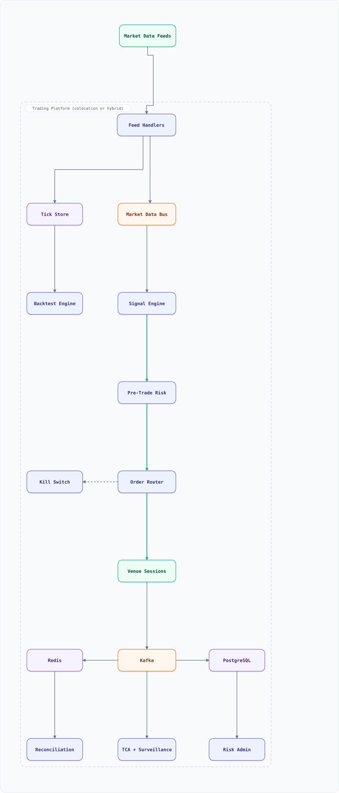

<div align="center">

# System Design: Algorithmic Trading Platform (OMS/EMS + Market Data)

</div>


> [!TIP]
> **TL;DR** — Design the **buy-side** trading platform that turns a signal into an order and a fill into a position: normalized **market data** in, strategy decisions, a **pre-trade risk gate** that is legally responsible for what leaves the building, an **order/execution management system** (OMS/EMS) that owns the order lifecycle across venues, and a **reconciliation** path that treats every fill as a claim until the broker and the tape agree. The hot path is measured in **microseconds**, the audit trail in **years**, and the one bug that matters is *double-sending an order*.


## Table of Contents

<details>
<summary><b>📑 Jump to a section</b></summary>

1. [Overview](#overview)
2. [Requirements](#requirements)
3. [Capacity Model (Back-of-Envelope)](#capacity-model-back-of-envelope)
4. [High-Level Architecture](#high-level-architecture)
5. [Microservices](#microservices)
6. [API & Interface Contracts](#api--interface-contracts)
7. [Database Design](#database-design)
8. [Security, Identity & Regulatory Controls](#security-identity--regulatory-controls)
9. [Scaling Tiers](#scaling-tiers)
10. [Key Techniques & Patterns](#key-techniques--patterns)
11. [Key Design Decisions](#key-design-decisions)
12. [Failure Modes & Recovery](#failure-modes--recovery)
13. [Disaster Recovery & Business Continuity](#disaster-recovery--business-continuity)
14. [Cost Estimation (12 feeds, 40 strategies)](#cost-estimation-12-feeds-40-strategies)
15. [Trade-off Analysis](#trade-off-analysis)
16. [Key Metrics to Monitor](#key-metrics-to-monitor)
17. [Deep Dive Prompts](#deep-dive-prompts)
18. [Common Interview Follow-ups (with answers)](#common-interview-follow-ups-with-answers)
19. [Low-Level Design (LLD) - Algorithms & Data Structures](#low-level-design-lld---algorithms--data-structures)
20. [Micro-Details & Edge Cases](#micro-details--edge-cases)
21. [Do's & Don'ts](#dos--donts)
22. [References & Further Reading](#references--further-reading)

</details>

---

## Overview

Design the **algorithmic trading platform** of a systematic fund: market data arrives from a dozen venues, strategies decide, orders are risk-checked, routed through execution algorithms (TWAP/VWAP/POV), acknowledged, partially filled, amended, cancelled, reconciled and settled — and every one of those events must be reconstructable years later.

This is a different problem from the [stock exchange](system-design-stock-exchange.md) design, which is the *sell-side matching engine* (one microsecond-scale auction per symbol). Here we are a **participant**: we consume the exchange's tape and submit to its rules. The distinctions that drive the whole design:

- **Two clocks, one wire.** Market data (the world's state) and order/ack traffic (our intent) share the same network path but not the same priorities: a delayed quote is a *wrong decision*, a delayed order is a *missed decision*, and a dropped ack is an *unbounded risk*. So they are separate sessions with separate queues and separate backpressure.
- **The risk gate is a legal control, not a quality one.** Under [SEC Rule 15c3-5](https://www.sec.gov/rules-regulations/staff-guidance/trading-markets-frequently-asked-questions/divisionsmarketregfaq-0) a broker-dealer providing market access must enforce pre-set credit, order-size and price-collars *before* an order reaches an exchange, and it must reject rather than slow. That makes the gate a synchronous, in-memory, worst-case-bounded check on the critical path — not a call to a database.
- **Exactly-once is impossible; exactly-once-*effect* is required.** Network retries are guaranteed, so the platform idempotently dedupes on `ClOrdID`/client-order-id and applies fills with a monotonic state machine. A duplicate `NewOrderSingle` that becomes a double position is a real, recurring class of production incident.
- **Everything is a claim until reconciled.** A fill in our database is a *belief*. The broker's execution report, the clearing house's confirmation and the settlement date (T+1 for US equities since [2024-05-28](https://www.sec.gov/investment/settlement-cycle-small-entity-compliance-guide-15c6-1-15c6-2-204-2)) are the truth, and the reconciliation pipeline is what turns belief into books.

### Key Numbers

| Metric | Value | Why it matters |
| :--- | :--- | :--- |
| Market data ingest | 300K msgs/s sustained, **1.5M/s at the open** | 20× burst in the first minute of the session |
| Tick store | 26B msgs/day, ~234 GB/day compressed | The research plane's raw material |
| Order flow | 50 orders/s sustained, **500/s peak** | ~10:1 cancel/amend to new-order ratio |
| Order events | 4.3M/day (orders + cancels + fills) | The audit trail is small; the *retention* is long |
| Signal → wire (p99) | < 150 µs in colocation | The entire execution-quality budget |
| Wire → ack (p50) | ~40 µs round trip to venue | Determines cancel/amend cadence |
| Pre-trade risk check | < 10 µs, in-memory, worst case bounded | It is on the critical path *by regulation* |
| Position ledger | 200K positions, 60 MB in Redis | Hot path never queries SQL |
| Backtest replay | 30 days of ticks in ~16 min on 200 workers | Research turnaround time |
| Kill switch | Flattens and blocks in < 1 s | The one feature that must never be clever |
| Audit retention | 7 years (orders, fills, risk decisions) | Regulator asks for it years later |

## Requirements

### Functional Requirements

- **Ingest and normalize** market data (quotes, trades, depth) from 12 venues into one canonical tick model, with per-venue sequence-gap detection
- **Run strategies** on the normalized stream: 40 strategies across 3 asset classes, each with its own symbol universe, capital allocation and risk budget
- **Generate and route orders** through execution algorithms — TWAP, VWAP, POV (percent of volume), implementation shortfall, marketable limit, and pass-through for manual trades
- **Enforce pre-trade risk** on every order: fat-finger price collar, max order notional, per-strategy and per-firm position and loss limits, order-rate limits, short-sell and restricted-list checks
- **Own the order lifecycle**: new → routed → acked → partially filled → filled / cancelled / rejected / expired, with amendments and cancel-replace, and idempotent retry on every hop
- **Report and reconcile**: apply execution reports, mark positions, compute realized/unrealized PnL, and reconcile against broker statements daily
- **Kill switch**: halt, cancel-all, flatten — per strategy, per desk, firm-wide — armable from two independent paths
- **Research offline**: replay historical ticks through a strategy with a fill simulator that is deliberately pessimistic (no look-ahead), and produce TCA

### Non-Functional Requirements

- **Latency**: signal→wire p99 < 150 µs (colocation) / < 2 ms (cloud region); the risk gate adds < 10 µs
- **Determinism**: the same event log must reproduce the same positions and PnL to the cent; replays are a compliance requirement, not a debugging convenience
- **Availability**: order path 99.99% during market hours; a venue outage degrades to "no trading on that venue", never to "uncertain state"
- **Durability**: zero accepted-order loss — an order is durable before it is routed, and the routing decision is recorded before the wire
- **Correctness over freshness**: never send an order derived from a stale quote past its staleness deadline; a rejected trade is cheaper than a wrong one
- **Auditability**: every order, cancel, risk decision and fill is queryable for 7 years, by strategy, by trader, by venue

## Capacity Model (Back-of-Envelope)

Every figure in Key Numbers is derived here, and the calculator is executed by `tools/audit-docs.mjs`, so prose and arithmetic cannot drift apart.

| Step | Input | Derivation | Result |
| :--- | :--- | :--- | :--- |
| Ticks | 12 feeds, 300K msgs/s sustained | 300K × 86,400 s | **25.9B msgs/day** |
| Open burst | first minute at 09:30 ET | 1.5M/s ÷ 300K/s | **5× burst, 25× on news** |
| Tick storage | 90 B/row, columnar, ~10:1 compression | 2.33 TB raw ÷ 10 | **234 GB/day, 7 TB hot (30 d)** |
| Order events | 50 orders/s + 10:1 cancel ratio + fills | ~500 msgs/s peak | **4.3M events/day** |
| Order store | 300 B/event row + index | 4.3M × 300 B | **1.3 GB/day** (7 yr ≈ 3.3 TB) |
| Positions | 40 strategies × 5K symbols | × 300 B in Redis | **60 MB** — one small node |
| Backtest | 30 days of ticks on 200 workers @ 4M ev/s | 777B ÷ 800M/s | **~16 min** for a full replay |
| Wire budget | 150 µs signal→wire | 40 µs RTT + 10 µs risk + 100 µs internal | **93% of budget is ours** |

The classic sizing error: sizing the tick store by `300K/s × 86400 × 90 B` and calling it **2.33 TB/day**. That is the *raw* figure; columnar + dictionary encoding + zstd on quotes compresses 8–12× because a quote row is mostly a repeated symbol id and unchanged bid sizes. The other classic error is sizing the order path from averages: the risk gate must bound the **worst case at the open**, when a 5× tick burst coincides with a cancel storm from every strategy reacting to it.

```js
const DAY = 86400;
const tickRate = 300_000;
const bytesRaw = 90;
const ticksPerDay = tickRate * DAY;
const rawGbPerDay = (ticksPerDay * bytesRaw) / 1e9;
const compressedGbPerDay = rawGbPerDay / 10;
const hotTb = (compressedGbPerDay * 30) / 1e3;

const ordersPerDay = 50 * DAY;
const eventsPerDay = ordersPerDay * 12; // new + ~10 cancels/amends + ~1 fills
const orderStoreGb = (eventsPerDay * 300) / 1e9;
const auditTb = (orderStoreGb * 365 * 7) / 1e3;

const positions = 40 * 5000;
const redisMb = (positions * 300) / 1e6;

const backtestEvents = ticksPerDay * 30;
const workers = 200;
const evPerWorkerPerSec = 4e6;
const backtestSeconds = backtestEvents / (workers * evPerWorkerPerSec);

const rtt = 40, risk = 10, internal = 100, budget = 150;
const used = rtt + risk + internal;
console.log('ticks/day          :', (ticksPerDay / 1e9).toFixed(1) + 'B');
console.log('open burst factor  :', (1_500_000 / tickRate).toFixed(1) + 'x');
console.log('raw tick GB/day    :', rawGbPerDay.toFixed(0));
console.log('compressed GB/day  :', compressedGbPerDay.toFixed(0));
console.log('hot 30d TB         :', hotTb.toFixed(1));
console.log('order events/day   :', (eventsPerDay / 1e6).toFixed(1) + 'M');
console.log('audit 7y TB        :', auditTb.toFixed(2));
console.log('positions in Redis :', redisMb.toFixed(0) + ' MB');
console.log('30d backtest (s)   :', Math.round(backtestSeconds));
console.log('wire budget used   :', used + '/' + budget + ' us =', Math.round((used / budget) * 100) + '%');
```

**What breaks first.** Not the databases — the *fan-out*. At 1.5M msgs/s the market data bus must deliver to 40 strategy processes without a single one stalling, and a stalled consumer either drops ticks (silently corrupting a strategy's view of the book) or back-pressures the feed handler (silently corrupting *everyone's* view of time). The answer is a lossless-with-gap-detection contract: the consumer is allowed to fall behind by a bounded amount, must detect and report any gap, and must re-snapshot rather than interpolate.

## High-Level Architecture

### Architecture Diagram



**Interactive diagram:** [diagrams/system-design/algo-trading.architecture.html](diagrams/system-design/algo-trading.architecture.html) — pan/zoom, search, dark/light theme, PNG/SVG export.

*Solid = market-data and order path, dashed = the emergency path that bypasses strategies but never the risk ledger.*

### Data Flow

1. Feed handlers decode venue-native binaries (PITCH/OUCH/ITCH-style), normalize to one tick model, stamp with venue sequence + local receive time, and detect gaps
2. Market data bus fans out losslessly to strategy processes, with per-consumer bounded buffers and an explicit "re-snapshot" signal on overflow
3. Strategy emits an *intent* — not an order: symbol, side, quantity, limit price, strategy id, and a validity deadline
4. Pre-trade risk gate checks the intent in memory (collar, notional, position, loss, rate, restricted list) — **reject or forward in < 10 µs**
5. Order router picks the execution algorithm, slices it, and owns the slice lifecycle (send, amend, cancel, expire)
6. Venue session (FIX or binary gate) sends the order; every hop records `ClOrdID` and its own sequence before the wire
7. Execution reports come back, are applied idempotently by the state machine, and update Redis positions + the audit stream
8. Kafka carries exec reports, risk decisions and audit events to reconciliation, TCA and surveillance
9. Overnight, reconciliation compares our books against broker statements and the clearing file; breaks are first-class objects with owners

## Microservices

| Service | Responsibility | Why it is separate |
| :--- | :--- | :--- |
| **Feed Handler** | Decode + normalize per venue; gap detection; no logic | One process per venue, pinned to a NIC and a core |
| **Market Data Bus** | Lossless fan-out with bounded per-consumer buffers | Decouples "world speed" from "strategy speed" |
| **Strategy Runtime** | 40 strategies, one process each; sandboxed API | A bad strategy cannot OOM the risk gate |
| **Pre-Trade Risk** | Synchronous in-memory limit checks | Legally on the critical path; worst case must be bounded |
| **OMS (order state)** | Authoritative order lifecycle + idempotency | Single writer per order; owns the state machine |
| **EMS / Router** | TWAP, VWAP, POV, IS slicing and venue choice | Trading logic separate from bookkeeping |
| **Venue Sessions** | FIX 4.4 / FIXT 1.1 and binary gateways; seq mgmt | One session state machine per venue connection |
| **Position Ledger** | Redis hot positions + SQL books of record | Hot path reads Redis; SQL is the audit |
| **Reconciliation** | Broker vs. ours vs. clearing; break handling | Runs offline, never on the hot path |
| **Kill Switch** | Halt / cancel-all / flatten | Independent deploy, independent auth, dual arm |
| **TCA + Surveillance** | Implementation shortfall, order-to-trade ratio | Regulatory and research consumers only |

## API & Interface Contracts

Strategies never talk to venues. They submit **intents** to the OMS over an internal RPC (gRPC in most firms; a binary ring for the latency-critical ones), and everything downstream is derived from that call.

| Method | Path | Caller | Idempotency | Limit |
| :--- | :--- | :--- | :--- | :--- |
| `POST` | `/v1/intents` | Strategy runtime | `client_order_id` (required) | 500/s per strategy |
| `DELETE` | `/v1/orders/{cl_ord_id}` | Strategy / desk | `client_order_id` | 2K/s firm-wide |
| `PATCH` | `/v1/orders/{cl_ord_id}` | EMS slice engine | `client_order_id` + `version` | 5K/s firm-wide |
| `GET` | `/v1/orders/{cl_ord_id}` | Desk UI, TCA | none | 10K/s |
| `GET` | `/v1/positions?strategy=` | Desk UI, PnL | none (Redis) | 20K/s |
| `POST` | `/v1/admin/kill` | Risk admin (dual auth) | `kill_id` | 1/s, break-glass |
| `POST` | `/v1/admin/limits` | Risk admin | `If-Match: version` | 10/s |

```json
// POST /v1/intents -> 202
{
  "client_order_id": "strat-momentum-7-000184",
  "strategy_id": "momentum_us_eq",
  "symbol": "AAPL",
  "side": "buy",
  "qty": 5000,
  "type": "limit",
  "limit_price": 18955,          // integer cents, never float
  "tif": "day",
  "max_slice_notional": 2500000,
  "validity_deadline_ms": 150,
  "metadata": { "model_version": "v7", "signal_strength": 0.31 }
}
```

| Status | Meaning | Retryable | Client action |
| :--- | :--- | :--- | :--- |
| `202` | Accepted and risk-cleared; routing in flight | No | Wait for exec reports on the callback topic |
| `400` | Malformed intent (bad tick size, missing `client_order_id`) | No | Fix and submit with a *new* id |
| `403` | Restricted list, kill switch armed, or strategy not entitled | No | Never retry; page risk desk |
| `409` | `client_order_id` already used with a different payload | No | This is the double-send guard; log as an incident |
| `422` | Risk reject (collar, notional, position, loss) | No | Feed the reject reason back into the strategy |
| `429` | Order-rate limit | Yes, after `Retry-After` | Back off with jitter; do not burst at the open |
| `503` | Venue session down for that venue | Yes, bounded | Fail to the *other* venue or drop the trade; never queue unbounded |

**Versioning.** `/v1` is additive-only. Integer minor units for money and prices — a float price at 0.01 ticks is how a rounding bug becomes a $40K loss.

## Database Design

```sql
-- The order is the unit of the lifecycle; one row per version, current in Redis.
CREATE TABLE orders (
  client_order_id  TEXT PRIMARY KEY,           -- idempotency key, set by the strategy
  venue_order_id   TEXT UNIQUE,                -- assigned by the venue on accept
  strategy_id      TEXT NOT NULL,
  trader_id        TEXT NOT NULL,
  symbol           TEXT NOT NULL,
  side             TEXT NOT NULL CHECK (side IN ('buy','sell')),
  qty              BIGINT NOT NULL,            -- shares
  limit_price_cents BIGINT,                    -- NULL for marketable
  tif              TEXT NOT NULL DEFAULT 'day',
  state            TEXT NOT NULL,              -- new|routed|acked|partial|filled|cancelled|rejected|expired
  version          INT NOT NULL DEFAULT 1,
  created_at       TIMESTAMPTZ NOT NULL,
  updated_at       TIMESTAMPTZ NOT NULL,
  risk_decision_id TEXT NOT NULL               -- FK to the pre-trade decision
);
CREATE INDEX orders_strategy_active_idx ON orders (strategy_id, state)
  WHERE state IN ('new','routed','acked','partial');

-- Execution reports are immutable; fills are derived, never edited.
CREATE TABLE execution_reports (
  id               BIGSERIAL PRIMARY KEY,
  client_order_id  TEXT NOT NULL REFERENCES orders(client_order_id),
  exec_id          TEXT NOT NULL,              -- venue's unique id
  exec_type        TEXT NOT NULL,              -- trade|cancel|replace|reject|expire
  last_qty         BIGINT NOT NULL DEFAULT 0,
  last_price_cents BIGINT NOT NULL DEFAULT 0,
  leaves_qty       BIGINT NOT NULL,
  cum_qty          BIGINT NOT NULL,
  venue_ts         TIMESTAMPTZ NOT NULL,
  received_ts      TIMESTAMPTZ NOT NULL,
  applied          BOOLEAN NOT NULL DEFAULT false
);
CREATE UNIQUE INDEX exec_dedupe_idx ON execution_reports (client_order_id, exec_id);

-- Every risk decision, pass or reject, is retained: this is the 15c3-5 record.
CREATE TABLE risk_decisions (
  id             TEXT PRIMARY KEY,
  client_order_id TEXT,
  strategy_id    TEXT NOT NULL,
  checks         JSONB NOT NULL,               -- per-limit pass/fail detail
  outcome        TEXT NOT NULL CHECK (outcome IN ('pass','reject')),
  reject_reason  TEXT,
  evaluated_at   TIMESTAMPTZ NOT NULL,
  latency_us     INT NOT NULL
);

-- Positions are bookkeeping; the ledger is append-only (double-entry for cash).
CREATE TABLE position_lots (
  id           BIGSERIAL PRIMARY KEY,
  account      TEXT NOT NULL,
  symbol       TEXT NOT NULL,
  qty          BIGINT NOT NULL,                -- signed
  price_cents  BIGINT NOT NULL,
  realized_cents BIGINT NOT NULL DEFAULT 0,
  booked_at    TIMESTAMPTZ NOT NULL
);

CREATE TABLE broker_breaks (
  id           BIGSERIAL PRIMARY KEY,
  trade_date   DATE NOT NULL,
  symbol       TEXT NOT NULL,
  ours_qty     BIGINT NOT NULL,
  theirs_qty   BIGINT NOT NULL,
  status       TEXT NOT NULL DEFAULT 'open',   -- open|investigating|resolved|written_off
  owner        TEXT,
  resolution   TEXT
);
```

**Storage choices.** Orders, exec reports and risk decisions are **PostgreSQL** — audit-grade, immutably append-only, indexed by the query regulators actually ask for. Positions live in **Redis** for the hot path (`STRATEGY:SYMBOL → qty, avg_price, realized`) with SQL as the book of record. Ticks are **columnar files on object storage** (Parquet, partitioned by symbol-day) with a 30-day hot window in a fast columnar store — no row store survives 26B events/day, and nobody random-accesses a tick by primary key.

## Security, Identity & Regulatory Controls

| Caller | Authentication | Authorization |
| :--- | :--- | :--- |
| Strategy runtime | mTLS + SPIFFE workload identity | Submit intents for *its own* strategy id, at *its own* rate, within *its own* limits |
| Desk UI (manual orders) | OIDC + SSO + hardware key | Trade only in entitled accounts; kill switch is read-only unless granted |
| EMS / router | mTLS, service identity | Route and amend only orders it created |
| Venue sessions | Venue-issued certs/keys, rotated | Send only orders that carry a valid `risk_decision_id` |
| Risk admin | OIDC + **dual authorization** for kill | Set limits; cannot trade. Traders cannot set limits |
| Research / backtest | OIDC, read-only to tick store | No order path credentials exist in research environments |

**Controls that matter more than the role table**

- **The gate cannot be bypassed by construction.** Venue sessions reject any order without a valid, unexpired `risk_decision_id`. There is no configuration, flag or admin action that disables this; the "bypass" code path does not exist in the binary.
- **Dual-armed kill switch.** Firm-wide kill requires two approvers from disjoint teams; either can *halt* alone. The switch lives in its own deployable with its own credentials so a compromise of the trading tier cannot reach it.
- **Restricted list and short-sell checks** are enforced against a versioned, signed list; an order carries the list version it was checked against, so a stale check is auditable.
- **Segregation of duties.** Whoever can raise a limit cannot approve its own trade; whoever can trade cannot edit the audit stream; both are enforced by the API, not the UI.
- **Immutable audit.** Order, risk and fill records are append-only in SQL *and* mirrored to WORM object storage with a retention lock. "Delete the losing trade" is not a supported operation.
- **Order-to-trade ratio and surveillance** are computed continuously: a strategy that generates thousands of cancels per fill is a regulatory problem, not just a cost one.

## Scaling Tiers

### Tier 1: One desk, one asset class

- Single colocated host: feed handlers + 5 strategies + risk gate + OMS in one process group, shared memory bus
- Redis and PostgreSQL single-node; tick store on a 14 TB NVMe box
- Kill switch is a script with a hardware token. Audit = append-only SQL

### Tier 2: 10 desks, multiple venues

- Feed handlers pinned per venue/NIC; market data bus becomes a shared-memory fan-out library, then a process boundary
- Strategy processes isolated, one per strategy, with per-strategy risk budgets in Redis
- PostgreSQL HA (sync standby) + read replica for TCA; tick store moves to object storage with a 30-day hot tier
- Kill switch becomes an independent service with dual authorization and a tested path to every venue session

### Tier 3: Multi-asset, multi-region, regulatory scale

- Active-passive regions: the backup region is a *warm* trading floor with pre-staged venue sessions and a promoted risk set
- Kafka as the durable spine for exec reports and audit; the market data bus stays a purpose-built fan-out, Kafka mirrors it for research only
- Reconciliation becomes a streaming join (broker feed ↔ our exec reports) with a break queue and an owner per break class
- Surveillance, TCA and regulatory reporting are separate consumers with their own SLAs — they must never sit on the order path

## Key Techniques & Patterns

- **Idempotency keys end to end**: `client_order_id` generated once by the strategy, carried through OMS, router, venue session and reconciliation; every hop dedupes on it
- **State machine with monotonic guards**: a fill cannot arrive for a cancelled order without a defined, logged path; `version` rejects out-of-order amendments
- **Pre-trade risk as a pure in-memory function**: limits in a flat array or perfect hash, checked in < 10 µs, decision logged synchronously but off the critical path via the audit bus
- **Single writer per order**: one OMS shard owns `client_order_id` by hash — no distributed locks on the hot path
- **Pessimistic fill simulation**: backtests fill at the *next* bar with a spread and queue penalty, never at the mid of the decision bar — the cheapest guard against overfit
- **Integer minor units everywhere**: prices in cents, quantities in shares, PnL as integers; floats never touch money
- **Kill switch by flattening, not by "stopping"**: cancel-all then marketable flatten orders, so exposure goes to zero rather than to "unknown"

## Key Design Decisions

| Decision | Rationale | Trade-off |
| :--- | :--- | :--- |
| Risk gate synchronous, in-memory | Regulation puts it on the critical path; worst case must be bounded | Limits are as fresh as the last snapshot (100–500 ms); staleness is bounded and alerted |
| Order durability before routing | A crash must never lose an accepted order | Adds one write-ahead log append (~20 µs) to the send path |
| Redis for hot positions, SQL for books | Hot path never waits on a disk or a lock | Two sources of truth reconciled by an explicit, tested pipeline |
| Kafka for audit/fills, purpose-built bus for ticks | Durability where it matters, latency where it matters | Two log systems to operate; mirror between them is lossy by design |
| Cloud for research, colocation for execution | Backtests need elasticity; execution needs microseconds | Two environments to build; research data must be shipped to the trading floor |
| Integer minor units | Rounding bugs in money are silent | Every consumer must convert; a `toFixed` in a UI is a bug |

## Failure Modes & Recovery

| Failure | Detection | Recovery |
| :--- | :--- | :--- |
| **Duplicate order after retry** | Same `client_order_id`, different payload → 409 | Rejected at the OMS; incident logged; the double-send never reaches a venue |
| **Drop during cancel → phantom position** | `leaves_qty` mismatch, broker drop file | OMS cancels by venue order id, not by `ClOrdID`; reconciliation flags the break with an owner |
| **Stale quote drives an order** | Staleness deadline exceeded in the intent | Risk gate rejects with `stale_market_data`; the strategy must re-price |
| **Feed gap (venue outage)** | Sequence-gap detector | Consumer suppresses strategy decisions on that symbol until re-snapshot completes |
| **Risk limits stale** | Snapshot age > 500 ms | Fail closed: reject new orders, keep cancels and flattens flowing |
| **Venue session drop** | FIX heartbeat/timeout | Session logon with sequence recovery; in-flight orders reconciled from the venue's drop copy before resuming |
| **Strategy runaway (order storm)** | Rate limiter per strategy | Hard 429 at the limit; strategy auto-suspended; the cancel/amend ratio alarm is the early warning |
| **Clock skew vs venue** | PTP/GPS offset monitor | Stamp both venue and local time; TCA uses venue time; skew > 1 ms pages — regulatory timestamps depend on it |
| **Kill switch itself fails** | Regular failover drill (monthly) | Second path: each venue session honors a venue-side "cancel all"; worst case, manual flatten |
| **Broker statement mismatch** | Overnight reconciliation | Break object with owner and SLA; unresolved breaks escalate to the CRO, not to a spreadsheet |

## Disaster Recovery & Business Continuity

| Data class | Store | RPO | RTO | Strategy |
| :--- | :--- | :--- | :--- | :--- |
| Accepted orders + fills | Postgres WAL, sync standby, WORM mirror | 0 | 5 min | Promote standby; replay audit stream into the OMS |
| Position ledger | Redis + continuous SQL mirror | 0 (SQL is truth) | 2 min | Rebuild Redis from SQL; the hot path resumes read-only until verified |
| Market data | Colocation capture + object store | 1 s (gap in the record) | 15 min | Re-snapshot from venue; historical gaps are unrecoverable and *annotated* |
| Risk limits | Versioned config, signed | 0 | 1 min | Reload from the last signed snapshot; a failed load = fail closed |
| Audit stream | Kafka RF=3 + cross-region mirror + WORM | 0 | 30 min | Consumers are idempotent on `(client_order_id, exec_id)` |
| Strategy state | Deterministic replay from the tick log | n/a | 30 min | Strategies are stateless over the log; restart = replay from the last checkpoint |

**Business continuity.** The runbook is short and rehearsed: halt → cancel-all → flatten → verify zero exposure in Redis *and* against the broker's drop copy → only then reopen. A regional failover does not resume trading automatically: a human promotes the region and arms the risk set, because an unattended promotion of stale limits is worse than downtime.

## Cost Estimation (12 feeds, 40 strategies)

| Component | Spec | Monthly |
| :--- | :--- | :--- |
| Colocation + cross-connects | 2 cabinets, venue fees, ~10 Gbps | $18,000 |
| Market data | 12 exchange feeds (L1+), per-venue fees | $95,000 |
| Trading hosts | 24 bare-metal, low-latency NICs | $22,000 |
| Cloud research | 200 spot workers for backtests, bursty | $9,000 |
| Tick store | 7 TB hot + 170 TB/yr object storage | $4,500 |
| PostgreSQL HA + Redis | Multi-AZ, 2 nodes each | $3,000 |
| Kafka (audit, fills) | 6 brokers, 7-year retention tiering | $2,500 |
| Connectivity | 2 ISPs + dark fibre failover | $6,000 |
| Compliance/surveillance | TCA, order-to-trade ratio, reporting | $5,000 |
| **Total** | | **~$165,000/mo** |

**Market data dominates** — at ~$95K/month it is more than half the bill, which is the real reason firms share feeds across desks and subscribe to aggregated L1 rather than full depth. Compute is cheap; *permission to see the tape* is not.

## Trade-off Analysis

| Choose | If | Cost |
| :--- | :--- | :--- |
| Colocation + binary gates | Latency is the edge (microsecond strategies) | Capital, venue fees, ops on bare metal |
| Cloud execution region | Latency budget is milliseconds (alpha from signals, not speed) | Upstream of the fastest participants; simpler ops |
| Pass-through manual orders | Discretionary overlay on systematic flow | Kills the "one order path" simplification; needs its own risk path |
| Streaming reconciliation (intraday) | Positions must be right *during* the day | A second write path; breaks surface earlier and demand instant owners |
| Full-depth market data | You trade on microstructure | 5–10× the L1 cost and storage; rarely the bottleneck for a mid-frequency strategy |
| Optimistic backtest fills | You need research throughput | Overfits silently; the pessimistic simulator is slower but it is the one that predicts live PnL |

## Key Metrics to Monitor

- **Signal → wire latency** p50/p99, and its three components (strategy compute, risk gate, session write)
- **Risk gate latency** p99 *and* worst case — it must be bounded at the open, not on average
- **Order-to-trade ratio** per strategy and firm-wide (regulatory threshold, not just cost)
- **Cancel/amend ratio** and its trend — the early signature of a runaway strategy
- **Stale-quote rejects** and feed staleness percentiles — the cheapest safety signal
- **Open feed gaps** (venue sequence discontinuities), by venue, with age
- **Fill latency** and **ack latency** by venue; a drifting venue is a routing decision
- **Break count and age** in reconciliation; a rising backlog means the books are drifting
- **Kill switch drill result** — the only metric that proves the escape hatch works
- **PnL attribution vs. TCA** — realized slippage vs. the backtest's assumed slippage

## Deep Dive Prompts

- What exactly happens between a strategy's decision and an order on the wire, and where can each microsecond go?
- How do you make cancel/replace idempotent when the venue's ack is lost?
- Why must the risk gate fail closed, and what does that cost you during an outage?
- Design the fill simulator's pessimism so research and live do not diverge by a factor of ten.
- How would you prove, a year later, that a given fill was authorized by a limit that existed at that moment?
- Where does the platform stop being distributed systems and start being a regulatory system?

## Common Interview Follow-ups (with answers)

**Q: Why not put the pre-trade risk check in a database or a service?**
A: Because it is synchronous and legal. A DB round trip is 200 µs–2 ms and it fails in exactly the moment you need it most. Limits are snapshotted into memory and checked in microseconds; the *decision* is logged off the critical path.

**Q: Your strategy retried a submit and the exchange acked twice. What now?**
A: `client_order_id` is the idempotency key at every hop; the second submit returns 409 and never reaches a venue. If it did reach a venue (a retry across a venue session restart), the OMS reconciles by `venue_order_id` from the drop copy and flattens the duplicate — the fix is mechanical only because the key was there from the start.

**Q: Backtest says 3% a month. Live says -1%. Where do you look first?**
A: The fill simulator. Live fills pay spread, queue position and market impact that a mid-price backtest never sees; then check data staleness and whether the backtest saw ticks that arrived after the decision. The simulator's pessimism is the cure for exactly this.

**Q: How do you handle a venue outage mid-session?**
A: Fail the venue, not the firm: cancel-all on that venue by `venue_order_id`, suppress strategies on its symbols, re-session with sequence recovery and reconcile the drop copy before resuming. Never guess the state of in-flight orders.

**Q: Why integer cents instead of floats?**
A: `0.1 + 0.2 !== 0.3` in IEEE-754, and a rounding error at a 0.01 tick is money and a reconciliation break. Every price, quantity and PnL figure is an integer in minor units; conversion happens once, at the UI edge.

**Q: What is the kill switch's hardest requirement?**
A: That it works when everything else is broken — independent deploy, independent credentials, dual authorization, and a monthly drill with the result on a dashboard. A kill switch nobody has exercised is a hope.

## Low-Level Design (LLD) - Algorithms & Data Structures

### 1. Idempotent Order State Machine

```js
// Legal transitions; anything else is a bug or a duplicate — both must be loud.
const TRANSITIONS = {
  new:     ['routed', 'rejected'],
  routed:  ['acked', 'rejected', 'cancelled'],
  acked:   ['partial', 'filled', 'cancelled', 'expired'],
  partial: ['partial', 'filled', 'cancelled', 'expired'],
  filled:  [],
  cancelled: [],
  rejected: [],
  expired:  [],
};

// Orders are deduped by client_order_id: the payload hash makes a
// same-id/different-payload retry a hard error instead of a double send.
function hashPayload(o) {
  const s = `${o.strategy_id}|${o.symbol}|${o.side}|${o.qty}|${o.limit_price_cents ?? 'mkt'}|${o.tif}`;
  let h = 2166136261;
  for (let i = 0; i < s.length; i++) { h ^= s.charCodeAt(i); h = Math.imul(h, 16777619); }
  return (h >>> 0).toString(16);
}

function submit(order, store) {
  const h = hashPayload(order);
  const existing = store.get(order.client_order_id);
  if (existing) {
    if (existing.hash === h) return { status: 'duplicate', state: existing.state };
    throw new Error('CONFLICT: client_order_id reused with a different payload');
  }
  store.set(order.client_order_id, { hash: h, state: 'new', version: 1 });
  return { status: 'accepted', state: 'new' };
}

function applyExec(orderId, exec, store) {
  const o = store.get(orderId);
  const legal = TRANSITIONS[o.state] || [];
  if (!legal.includes(exec.nextState)) {
    // e.g. a fill arriving after a cancel: venue raced our cancel. Keep it,
    // mark it, and let reconciliation settle it — never silently drop a fill.
    return { ok: false, reason: `illegal ${o.state} -> ${exec.nextState}` };
  }
  o.state = exec.nextState;
  o.version += 1;
  return { ok: true, state: o.state, version: o.version };
}

const store = new Map();
const order = { client_order_id: 'c-1', strategy_id: 's', symbol: 'AAPL', side: 'buy', qty: 100, limit_price_cents: 18955, tif: 'day' };
console.log(submit(order, store));                    // accepted
console.log(submit(order, store));                    // duplicate — not a double send
try { submit({ ...order, qty: 200 }, store); }        // same id, different payload
catch (e) { console.log('conflict  :', e.message); }  // -> CONFLICT, loud
console.log(applyExec('c-1', { nextState: 'acked' }, store));
console.log(applyExec('c-1', { nextState: 'acked' }, store)); // illegal: already acked
```

### 2. Pre-Trade Risk Gate (worst-case bounded, no allocation)

```js
// Limits live in a flat object keyed by strategy; the check allocates nothing.
// In production this is a perfect hash over a pre-built array: < 10 us worst case.
function riskCheck(intent, limits, book, nowMs) {
  const reasons = [];
  const L = limits[intent.strategy_id];
  if (!L) return { pass: false, reason: 'unknown_strategy' };

  if (nowMs - intent.quote_ts_ms > L.max_quote_age_ms) reasons.push('stale_market_data');
  if (intent.validity_deadline_ms && intent.validity_deadline_ms < 50) reasons.push('deadline_too_tight');

  // Fat-finger collar: reject prices far from the reference (integer cents).
  if (intent.limit_price_cents != null) {
    const devBps = Math.abs(intent.limit_price_cents - L.ref_price_cents) / L.ref_price_cents * 10000;
    if (devBps > L.collar_bps) reasons.push(`price_collar_${Math.round(devBps)}_bps`);
  }

  const notional = intent.qty * (intent.limit_price_cents ?? L.ref_price_cents);
  if (notional > L.max_order_notional_cents) reasons.push('max_order_notional');

  const pos = book[intent.strategy_id]?.[intent.symbol] ?? 0;
  const delta = intent.side === 'buy' ? intent.qty : -intent.qty;
  if (Math.abs(pos + delta) > L.max_position_qty) reasons.push('position_limit');

  if (L.restricted.has(intent.symbol)) reasons.push('restricted_list');
  if (L.order_count_last_sec >= L.max_orders_per_sec) reasons.push('order_rate_limit');

  return reasons.length
    ? { pass: false, reason: reasons.join('+'), checks: reasons.length }
    : { pass: true, decision_id: `rd-${intent.client_order_id}`, latency_us: 4 };
}

const limits = {
  momentum_us_eq: {
    ref_price_cents: 18950, collar_bps: 100, max_order_notional_cents: 500_000_00,
    max_position_qty: 50_000, max_quote_age_ms: 250, max_orders_per_sec: 50,
    order_count_last_sec: 3, restricted: new Set(['BRK-A']),
  },
};
const book = { momentum_us_eq: { AAPL: 4_000 } };
const intent = {
  client_order_id: 'c-1', strategy_id: 'momentum_us_eq', symbol: 'AAPL', side: 'buy',
  qty: 5_000, limit_price_cents: 20_850,             // ~10% above reference -> collar trips
  quote_ts_ms: 1_000, validity_deadline_ms: 150,
};
console.log(riskCheck(intent, limits, book, 1_100));
console.log(riskCheck({ ...intent, limit_price_cents: 18_955, qty: 1_000 }, limits, book, 1_100));
```

### 3. TWAP Slice Scheduler (deterministic, seeded)

```js
// Slices are deterministic in (start, end, seed) so a replay reproduces the day.
function twapSlices({ startTimeMs, endTimeMs, totalQty, slices, seed = 1 }) {
  const span = (endTimeMs - startTimeMs) / slices;
  let s = seed >>> 0;
  const rnd = () => ((s = (Math.imul(s, 1664525) + 1013904223) >>> 0) / 4294967296);

  const out = [];
  let sent = 0;
  for (let i = 0; i < slices; i++) {
    // Jitter the release time inside the slice; do NOT jitter the quantity —
    // quantity jitter makes the realized schedule depend on the RNG stream.
    const at = startTimeMs + span * i + rnd() * span * 0.5;
    let qty = Math.floor(totalQty / slices);
    if (i === slices - 1) qty = totalQty - sent;   // last slice absorbs the remainder
    sent += qty;
    out.push({ at, qty, cumQty: sent });
  }
  return out;
}

const day = twapSlices({ startTimeMs: 0, endTimeMs: 390 * 60_000, totalQty: 10_000, slices: 20, seed: 42 });
console.log('slices          :', day.length);
console.log('total accounted :', day[day.length - 1].cumQty); // 10000 — never 9995 or 10005
console.log('first release at:', day[0].at.toFixed(0) + ' ms');
console.log('determinism     :', JSON.stringify(day.slice(0, 2)) === JSON.stringify(twapSlices({ startTimeMs: 0, endTimeMs: 390 * 60_000, totalQty: 10_000, slices: 20, seed: 42 }).slice(0, 2)));
```

### 4. VWAP Schedule from a Historical Volume Curve

```js
// The curve is a per-minute share of the day's volume from 20 recent sessions.
function vwapSchedule(curve, totalQty, startTimeMin, endTimeMin) {
  const window = curve.slice(startTimeMin, endTimeMin);
  const share = window.reduce((a, b) => a + b, 0);
  let cum = 0, sent = 0;
  return window.map((w, i) => {
    let qty = Math.floor((w / share) * totalQty);
    if (i === window.length - 1) qty = totalQty - sent;   // remainder to the end
    sent += qty; cum += qty;
    return { minute: startTimeMin + i, targetQty: qty, cumTarget: cum };
  });
}

// U-shaped intraday curve: heavy open, light midday, heavy close.
const curve = Array.from({ length: 390 }, (_, m) =>
  1 + 4 * Math.exp(-m / 25) + 4.5 * Math.exp(-(389 - m) / 25));

const sched = vwapSchedule(curve, 100_000, 0, 390);
const scheduled = sched.reduce((a, s) => a + s.targetQty, 0);
const early = sched.slice(0, 30).reduce((a, s) => a + s.targetQty, 0);
console.log('scheduled total :', scheduled);                       // 100000, exactly
console.log('first 30 min %  :', (early / scheduled * 100).toFixed(1)); // ~21% — front-loaded
console.log('midday 30 min % :', (sched.slice(180, 210).reduce((a, s) => a + s.targetQty, 0) / scheduled * 100).toFixed(1)); // ~4%
```

### 5. Book Reconstruction with Gap Detection

```js
// A feed handler's output: (symbol, venueSeq, kind, ...). Reconstructing the
// book is a fold over a stream whose gaps must be *detected*, not papered over.
function buildBook(ticks, onGap) {
  const book = new Map();   // symbol -> { bid, ask, bidSize, askSize, lastSeq }
  let rejected = 0;
  for (const t of ticks) {
    const s = book.get(t.symbol) ?? { bid: 0, ask: 0, bidSize: 0, askSize: 0, lastSeq: -1 };
    if (t.seq !== s.lastSeq + 1) {
      onGap({ symbol: t.symbol, expected: s.lastSeq + 1, got: t.seq });
      rejected++;          // suppress decisions on this symbol until re-snapshot
      s.lastSeq = t.seq;   // resync at the reported sequence
      book.set(t.symbol, s);
      continue;
    }
    if (t.kind === 'quote') { s.bid = t.bid; s.ask = t.ask; s.bidSize = t.bidSize; s.askSize = t.askSize; }
    if (t.kind === 'trade') { s.last = t.price; }
    s.lastSeq = t.seq;
    book.set(t.symbol, s);
  }
  return { book, rejected };
}

const ticks = [
  { symbol: 'AAPL', seq: 100, kind: 'quote', bid: 18950, ask: 18952, bidSize: 100, askSize: 200 },
  { symbol: 'AAPL', seq: 101, kind: 'trade', price: 18951 },
  { symbol: 'AAPL', seq: 104, kind: 'quote', bid: 18948, ask: 18951, bidSize: 300, askSize: 100 }, // gap!
  { symbol: 'AAPL', seq: 105, kind: 'quote', bid: 18949, ask: 18952, bidSize: 150, askSize: 150 },
];
const gaps = [];
const { book, rejected } = buildBook(ticks, g => gaps.push(g));
console.log('gaps detected :', gaps.length, gaps[0]);   // 1 — expected 102, got 104
console.log('ticks skipped :', rejected);               // 1 — we never interpolate a book
console.log('book          :', book.get('AAPL'));
```

### 6. Pessimistic Fill Simulator (no look-ahead)

```js
// Fill at the NEXT bar's prices, never the decision bar's mid. Add spread and
// a queue penalty proportional to how much of the bar you try to take.
function simulateFill(decision, bar) {
  if (decision.side === 'buy') {
    const touch = bar.ask;                                   // pay the offer
    const impact = Math.min(bar.spread * 0.5, (decision.qty / Math.max(bar.volume, 1)) * bar.spread * 2);
    const priceCents = Math.ceil(touch + impact);            // round against yourself
    return { filled: true, priceCents, fillQty: decision.qty, slippageCents: priceCents - bar.mid };
  }
  const touch = bar.bid;
  const impact = Math.min(bar.spread * 0.5, (decision.qty / Math.max(bar.volume, 1)) * bar.spread * 2);
  const priceCents = Math.floor(touch - impact);
  return { filled: true, priceCents, fillQty: decision.qty, slippageCents: bar.mid - priceCents };
}

const decision = { side: 'buy', qty: 5_000 };
// The bar at decision time looked great: mid 18951. The NEXT bar is what you get.
const nextBar = { bid: 18948, ask: 18952, mid: 18950, spread: 4, volume: 20_000 };
const fill = simulateFill(decision, nextBar);
console.log('fill price (cents):', fill.priceCents);   // >= 18953 — you paid up, as you would live
console.log('slippage (cents)  :', fill.slippageCents); // positive: the backtest never shows a free fill
console.log('optimistic would be:', nextBar.mid, '(no spread, no impact) — that is the 10x trap');
```

## Micro-Details & Edge Cases

Small decisions that quietly lose money or create regulatory exposure:

| Micro-detail | Why it bites |
| :--- | :--- |
| **Prices and PnL in integer cents** | `0.1 + 0.2 !== 0.3`; a float rounding error becomes a $40K reconciliation break |
| **`client_order_id` uniqueness across restarts** | Restart the strategy and it regenerates the same ids → mass 409s or, worse, accepted duplicates |
| **Tick-size rounding at submission** | An off-tick limit is rejected by the venue *after* your window closed; round against yourself at the gate |
| **Cancel by `venue_order_id`, never by `ClOrdID`** | After a session restart the venue no longer maps your id the way you think it does |
| **Partial-fill average price from `last_qty` × `last_price`** | Summing per-fill averages is wrong; accumulate `cum_qty` and `cum_value` in integers |
| **`leaves_qty` is the venue's truth** | Your computed leaves drift on amend races; the venue's number wins and yours becomes a break |
| **Day orders expire at the venue's close, in the venue's timezone** | DST and half-day sessions move the boundary; a missed expiry is an overnight position |
| **Drop copies are not optional** | They are how you learn about an order you never saw acked; ingest them on a separate session |
| **Self-trade prevention** | Two strategies crossing = you pay the spread to yourself and report a trade to yourself; use STP at the venue or cancel-the-lower side |
| **Staleness deadline on every intent** | A quote older than 250 ms at the open is a different market; reject rather than trade against the past |
| **Market state machine (halted / pre-open / closing auction)** | Sending a marketable order into a halt gets rejected; sending into the closing auction gets a different fill distribution than you modeled |
| **Order-to-trade ratio** | Thousands of cancels per fill is a regulatory problem; alarm on the ratio, not the absolute count |
| **Kill switch idempotency** | Double-firing flatten is safe; a partially applied kill is not — make it resumable and verifiable |
| **Corporate actions and symbol changes** | Positions and prices must be adjusted on the same event, or the next day's PnL is fiction |
| **Reconciliation break ownership** | A break with no owner is a break forever; class → owner → SLA → escalation |
| **Backtest data survivorship** | Delisted symbols must be in the tick history, or every strategy looks better than it is |

The pattern behind all of these: the trading platform is a **system of record that happens to be fast**. Latency is a feature; correctness of the record is the product. Anything that trades speed for an unverifiable state is a bad trade.

## Do's & Don'ts

| ✅ Do | ❌ Don't |
| :--- | :--- |
| Make `client_order_id` the idempotency key at every hop | Don't rely on "the network probably didn't deliver it twice" |
| Fail the risk gate closed and keep cancels flowing | Don't let a stale limit snapshot turn into "trade anyway" |
| Fill backtests at the next bar with spread and impact | Don't backtest on the decision bar's mid price |
| Store money in integer minor units | Don't let a float near a price or a PnL |
| Keep the kill switch independent and drilled monthly | Don't ship a kill switch nobody has exercised |
| Reconcile broker vs. ours vs. clearing every night | Don't treat your own database as the truth about a fill |
| Bound the worst case of every hot-path check | Don't average your way into a latency surprise at the open |
| Log the risk decision with the order, for years | Don't make the audit trail a downstream consumer of the order path |
| Detect feed gaps and suppress decisions on that symbol | Don't interpolate a book across a gap |
| Separate research credentials from trading credentials | Don't let a notebook hold an order-path token |

## References & Further Reading

**Regulatory and venue rules (read these before the architecture)**

- [SEC Division of Market Regulation FAQ — Rule 15c3-5 Market Access](https://www.sec.gov/rules-regulations/staff-guidance/trading-markets-frequently-asked-questions/divisionsmarketregfaq-0) — the pre-trade risk-control obligations the gate implements
- [SEC Rule 15c6-1 / T+1 settlement](https://www.sec.gov/investment/settlement-cycle-small-entity-compliance-guide-15c6-1-15c6-2-204-2) — why the reconciliation window collapsed to one night in May 2024
- [SEC staff report on algorithmic trading in US capital markets](https://www.sec.gov/file/staff-report-algorithmic-trading-us-capital-markets) — the taxonomy of execution algorithms and their market structure effects
- [Nasdaq Trader — Co-Location](https://www.nasdaqtrader.com/Trader.aspx?id=colo) — the latency figures that justify colocation (2–5 µs average RTT reduction)
- [Nasdaq Trader — FIX order entry](https://www.nasdaqtrader.com/Trader.aspx?id=FIX) — session profiles the venue sessions implement

**Protocols and patterns**

- [FIX Trading Community — Session Protocol](https://forum.fixtrading.org/t/technical-standard-fix-session-protocol/15159) — logon, sequence numbers and gap-fill, which is why venue sessions need their own state machine
- [FIX Orchestra](https://github.com/FIXTradingCommunity/fix-orchestra-spec) — machine-readable rules of engagement; the modern way to encode a venue's order-entry constraints
- [Exegy — embedded feed handlers](https://www.exegy.com/embedded-software-feed-handlers/) — the decode/normalize path and its microsecond budget (≈2–5 µs/message)
- [AWS — algorithmic trading on AWS](https://aws.amazon.com/blogs/industries/algorithmic-trading-on-aws-with-amazon-sagemaker-and-aws-data-exchange/) — the cloud-research + colocation hybrid pattern

**The parts people get wrong**

- *Advances in Financial Machine Learning* (López de Prado) — the source for pessimistic fill simulation, leakage and the backtest/live divergence in LLD §6
- [SS&C Advent — OMS vs EMS](https://www.advent.com/news-and-insights/blog/order-management-system-vs-execution-management-system/) — why the two responsibilities stay separate even when one product ships both

*More cross-topic rules: [Interview Q&A §84](interview-qa.md#84-universal-dos--donts) · Related: [Stock Exchange (matching engine)](system-design-stock-exchange.md) · [Fraud Detection](system-design-fraud-detection.md) · [Concepts](system-design-concepts.md)*

---

<nav>← [alerting](system-design-alerting.md) · [📖 All guides](README.md) · [code deployment](system-design-code-deployment.md) →</nav>
