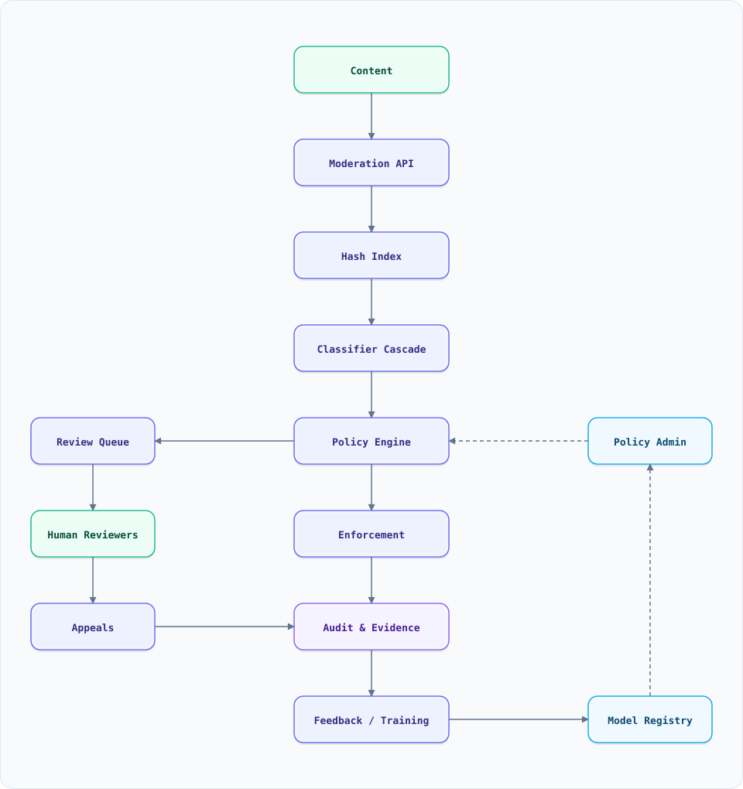

<a id="top"></a>

<div align="center">

<sub>TRUST & SAFETY</sub>

# System Design: Content Moderation (Trust & Safety Platform)

<sub>16 SECTIONS · 13 MIN READ · 1 DIAGRAM · 6 EXAMPLES</sub>

</div>

> [!TIP]
> **THE PROBLEM** — A platform receives millions of posts, images, videos and messages a day. Some are illegal, some violate policy, and most are fine. The system must catch the harmful ones quickly, avoid punishing legitimate users, explain every decision, and let people appeal — while adversaries change tactics every week.

## Start here (plain English)

**What it does.** Decides what user content is allowed, routes the uncertain cases to humans, and records why each decision was made.

**Think of it like.** Airport security: a fast scanner catches the obvious cases, a trained officer looks at the ambiguous bag, and a supervisor handles disputes. Most travellers walk straight through.

**Why it's hard.** The cost of missing harmful content and the cost of wrongly removing legitimate content pull in opposite directions, and the adversary adapts to whatever you ship.

**The core idea.** Run a cheap-to-expensive cascade: exact and perceptual hash matching first, then lightweight classifiers, then a human only for the uncertain band — with every decision stored against the policy version that produced it.

**Watch out for.** "Just train a better classifier." A classifier gives you a score; the product needs a threshold, a policy, a review path, an appeal path, and a feedback loop. The model is one component, not the system.

**Before this doc.** [Idempotency](system-design-concepts.md#10-idempotency) · [Event sourcing](system-design-concepts.md#7-event-sourcing)

**Read it in.** 5 min: [Overview](#overview) + [Architecture](#high-level-architecture) · 20 min: add [Design decisions](#key-design-decisions) + [Failures](#failure-modes--recovery) · full: all 16 sections.

**Read next.** [Fraud detection](system-design-fraud-detection.md) — the same score-and-review loop for money · [Notification system](system-design-notification-system.md) — how the decision reaches the user

**Terms.** [idempotency](GLOSSARY.md#idempotency) · [bloom-filter](GLOSSARY.md#bloom-filter) · [sampling](GLOSSARY.md#sampling) · [event-sourcing](GLOSSARY.md#event-sourcing) · [shard](GLOSSARY.md#shard)

---

## On this page

<details open>
<summary><b>16 sections</b></summary>

1. [Overview](#overview)
2. [Requirements](#requirements)
3. [High-Level Architecture](#high-level-architecture)
4. [Microservices](#microservices)
5. [Database Design](#database-design)
6. [Scaling Tiers](#scaling-tiers)
7. [Key Design Decisions](#key-design-decisions)
8. [Failure Modes & Recovery](#failure-modes--recovery)
9. [Cost Estimation (Illustrative)](#cost-estimation-illustrative)
10. [Trade-off Analysis](#trade-off-analysis)
11. [Key Metrics to Monitor](#key-metrics-to-monitor)
12. [Deep Dive Prompts](#deep-dive-prompts)
13. [Key Techniques & Patterns](#key-techniques--patterns)
14. [Common Interview Follow-ups](#common-interview-follow-ups)
15. [Low-Level Design (LLD) - Algorithms & Data Structures](#low-level-design-lld---algorithms--data-structures)
16. [Do's & Don'ts](#dos--donts)

</details>

---

## Overview

Content moderation is a **decision system**, not a model. Every piece of content gets one of four outcomes:

| Outcome | When | User experience |
| :--- | :--- | :--- |
| **Allow** | High confidence it is compliant | Published normally |
| **Limit** | Likely compliant but risky | Published, reduced distribution, age-gated, or labelled |
| **Review** | Uncertain or severe | Held or shadowed while a human decides |
| **Remove** | High confidence it violates policy | Blocked, with an appeal path |

The system must optimise two things that fight each other:

- **Recall on harmful content** — illegal material, credible threats, child safety, fraud. Missing it can hurt people and create legal exposure.
- **Precision on enforcement** — wrongly removing a journalist, an artist, or a customer support account destroys trust and generates appeals.

A mature platform separates **detection** (models and hashes), **policy** (what the rules say), **enforcement** (what action to take), and **appeals** (how a human corrects the machine). Each has its own owner and its own metrics.

### Key Numbers

| Metric | Illustrative target |
| :--- | :--- |
| **Content/day** | 100M posts, images, videos and comments |
| **Pre-publish check** | p99 ≤ 200 ms for images, ≤ 500 ms for short video |
| **Automated decision rate** | 90–95% of content, leaving 5–10% for humans |
| **Human reviewers** | 10K–50K globally, 24×7, language-specific |
| **Appeal SLA** | 24 hours for enforcement, 7 days for account actions |
| **Known-bad hash match** | < 50 ms, before any model runs |
| **Policy versions** | Every decision pinned to the version in force at the time |

> [!NOTE]
> These are teaching numbers. Real platforms differ by content type, jurisdiction and risk appetite. The *shape* of the problem is what matters.

---

## Requirements

### Functional Requirements

- Accept text, image, video, audio and live streams from upload, edit, comment and message paths.
- Match exact and perceptual hashes against known-violation databases.
- Classify content by policy category: sexual content, violence, hate, harassment, self-harm, spam, fraud, illegal goods, terrorism.
- Apply a policy engine that maps scores, user history, jurisdiction and context to an action.
- Hold uncertain content for human review; prioritise by severity and age.
- Provide reviewers with evidence, policy guidance and a consistent decision UI.
- Record every decision immutably: model version, policy version, scores, reviewer, timestamp.
- Support appeals with a different reviewer and an SLA.
- Feed confirmed labels back into training and hash databases.
- Support policy changes with a defined retroactive scope.
- Delete content and evidence on legal request while preserving an audit record.

### Non-Functional Requirements

| Attribute | Target | Why |
| :--- | :--- | :--- |
| **Latency** | Pre-publish ≤ 200 ms p99 (image) | The upload must not feel broken |
| **Recall** | ≥ 95% on illegal categories | The cost of a miss is asymmetric |
| **Precision** | ≥ 99% on auto-removal | False positives are visible and expensive |
| **Availability** | 99.99% for the decision API | A failed check cannot silently allow everything |
| **Auditability** | Every action replayable for 7 years | Regulators and appeals |
| **Explainability** | Category, score and policy clause attached | Users and reviewers need a reason |
| **Privacy** | Evidence encrypted, access-logged, retained minimally | Reviewers see sensitive material |
| **Adversarial resilience** | Hash and model updates within hours | Tactics change weekly |

---

## High-Level Architecture

### Architecture Diagram



**Interactive:** [Open diagram](diagrams/system-design/content-moderation.architecture.html) · pan/zoom · search · dark/light · export

*Solid = content and decisions, dashed = policy, review and feedback control plane.*

### Data Flow

1. **Upload / edit / message** calls the **Moderation API** with content plus context: author, surface, language, audience, prior strikes.
2. The **Hash Index** computes exact hashes and perceptual hashes (PDQ for images, TMK+PDQF for video, SimHash for text) and looks them up. A match to a confirmed illegal hash short-circuits to removal.
3. If no hash match, the **Classifier Service** runs a cascade: a tiny text/spam model first, then an image safety model, then expensive video/audio models only if the cheap stage is uncertain.
4. The **Policy Engine** combines category scores with context (new account, repeat offender, jurisdiction, user appeals) and emits `allow`, `limit`, `review` or `remove` with a reason code.
5. `remove` writes an enforcement record and notifies the user. `review` goes to the **Review Queue**, prioritised by severity and age.
6. **Human reviewers** see the content, the model's labels, the policy clause and similar past cases. Their decision is stored with a reviewer ID and a policy version.
7. **Appeals** route to a different reviewer with fresh eyes; the outcome is recorded and sampled for quality.
8. **Feedback** joins confirmed labels, appeals and reviewer overrides into a training set; the **Policy Admin** publishes new policy versions and model releases with a rollback path.
9. **Audit & Evidence** stores the immutable decision log and encrypted evidence with retention limits.
10. **Metrics** track prevalence, recall, precision, appeal overturn rate, queue age and time-to-action per category.

### Where the decision happens

| Surface | Default timing | Why |
| :--- | :--- | :--- |
| Public post / image | Pre-publish for high-risk categories, post-publish for the rest | Latency vs safety |
| Direct message | Post-delivery, with reporting and hash matching | Privacy expectations; scanning messages is legally sensitive |
| Live stream | Near-real-time sampling plus user reports | Full-frame analysis is too expensive |
| Comments | Pre-publish for spam/links, post-publish for toxicity | Volume and latency |
| Profile / bio | Post-publish review | Low virality, high false-positive cost |

---

## Microservices

| Service | Responsibility | Tech | Key metric |
| :--- | :--- | :--- | :--- |
| **Moderation API** | Auth, context enrichment, decision orchestration | Go / Java | p99 latency, error rate |
| **Hash Index** | Exact + perceptual hash lookup, known-bad DB | Redis + vector/ANN store | Match rate, false-match rate |
| **Classifier Service** | Text, image, video, audio models behind one API | Python / Triton / GPU pool | Recall, precision, p99 |
| **Policy Engine** | Rules, thresholds, jurisdiction, user history | Declarative rules + versioned config | Decision distribution, policy version |
| **Review Queue** | Priority queue, assignment, SLA | Postgres + Redis | Queue age, backlog |
| **Reviewer Console** | Evidence, labels, policy, appeals | Web app | Decisions/hour, overturn rate |
| **Appeals Service** | Intake, routing, SLA, outcome | Workflow engine | Overturn rate, SLA |
| **Enforcement Service** | Remove, limit, label, notify, strike | Event-driven | Action latency, notification delivery |
| **Audit & Evidence** | Immutable log, encrypted media, retention | Object storage + WORM log | Completeness, retention compliance |
| **Feedback Pipeline** | Labels → training set, hash DB, evaluation | Batch + stream | Label freshness, drift |
| **Policy Admin** | Draft, review, publish, rollback policy | Versioned config + approvals | Change lead time, rollback time |

The **Policy Engine is deliberately separate from the models**. A model outputs "sexual content: 0.83"; the policy decides whether 0.83 means remove, limit or review for a 14-year-old on a public surface in Germany. Mixing the two makes every threshold change a model deploy.

---

## Database Design

### Immutable decision log

```sql
CREATE TABLE moderation_decisions (
    decision_id      UUID PRIMARY KEY,
    content_id       UUID NOT NULL,
    content_hash     STRING NOT NULL,
    author_id        UUID NOT NULL,
    surface          STRING NOT NULL,      -- post | comment | message | live
    categories       JSONB NOT NULL,       -- [{name, score, model_version}]
    action           STRING NOT NULL,      -- allow | limit | review | remove
    reason_code      STRING NOT NULL,
    policy_version   STRING NOT NULL,
    model_versions   JSONB NOT NULL,
    reviewer_id      UUID,                 -- null for automated decisions
    decided_at       TIMESTAMP NOT NULL,
    appeal_id        UUID,
    jurisdiction     STRING
)
PARTITIONED BY (decided_at::date);
```

The log is append-only. A correction is a new decision with a reference to the original, never an update. This is what makes appeals and audits possible.

### Known-bad hash store

```sql
CREATE TABLE hash_matches (
    hash_type        STRING NOT NULL,   -- exact_sha256 | pdq | tmk | simhash
    hash_value       STRING NOT NULL,
    category         STRING NOT NULL,
    severity         INT NOT NULL,
    source           STRING NOT NULL,   -- internal | partner | regulator
    first_seen       TIMESTAMP,
    last_seen        TIMESTAMP,
    confirmed_by     UUID,
    PRIMARY KEY (hash_type, hash_value)
);
```

Perceptual hashes need approximate lookup, not equality. Store the 64-bit PDQ value and search within a Hamming radius using a multi-index (or a small ANN index over bit vectors). Exact hashes can use a Bloom filter in front of the table to avoid a lookup for the common case.

### Review cases

```sql
CREATE TABLE review_cases (
    case_id          UUID PRIMARY KEY,
    content_id       UUID NOT NULL,
    priority         INT NOT NULL,       -- severity × virality × age
    category         STRING,
    state            STRING NOT NULL,    -- queued | assigned | decided | appealed
    assigned_to      UUID,
    assigned_at      TIMESTAMP,
    sla_due_at       TIMESTAMP NOT NULL,
    decision_id      UUID,
    created_at       TIMESTAMP NOT NULL
);
CREATE INDEX idx_queue ON review_cases (state, priority DESC, sla_due_at)
  WHERE state = 'queued';
```

### Policy versions

```sql
CREATE TABLE policy_versions (
    version          STRING PRIMARY KEY,
    category         STRING NOT NULL,
    rule             JSONB NOT NULL,      -- thresholds, jurisdictions, exceptions
    effective_from   TIMESTAMP NOT NULL,
    effective_to     TIMESTAMP,
    approved_by      UUID NOT NULL,
    rollback_of      STRING
);
```

A decision must be judged against the policy that was in force when it was made. If policy v42 lowers a threshold, you do not retroactively re-punish every user who acted under v41 unless the policy explicitly says so.

---

## Scaling Tiers

### Tier 1: Up to 1M items/day

| Component | Choice |
| :--- | :--- |
| **Hash matching** | Redis set + exact SHA-256 |
| **Classifiers** | Managed moderation API + one in-house text model |
| **Review** | Shared inbox + spreadsheet, 2–5 reviewers |
| **Policy** | Config file in git, manual deploy |
| **Audit** | Application logs, 90-day retention |

### Tier 2: 1M – 50M items/day

| Component | Choice |
| :--- | :--- |
| **Hash matching** | Redis + PDQ index, partner hash feeds |
| **Classifiers** | GPU pool behind Triton, cascade by category |
| **Review** | Dedicated queue + console, 100+ reviewers, SLA |
| **Policy** | Versioned service with approvals and rollback |
| **Audit** | Immutable log + encrypted object storage |
| **Appeals** | Workflow service with a separate reviewer pool |

### Tier 3: 50M – 1B+ items/day

| Component | Choice |
| :--- | :--- |
| **Hash matching** | Sharded ANN index, multi-region, sub-50 ms |
| **Classifiers** | Regional GPU fleets, model routing by language/category |
| **Review** | Global workforce, language queues, quality sampling |
| **Policy** | Per-jurisdiction rule sets, simulation before publish |
| **Audit** | WORM storage, legal hold, automated retention |
| **Adversarial** | Continuous red-team corpus, hash/model update pipeline |

---

## Key Design Decisions

### 1. Pre-publish vs post-publish

Pre-publish is safer but adds latency and can hold legitimate content behind a slow model. Post-publish is faster but exposes users to harm for a window.

The usual answer is a **risk-tiered hybrid**: pre-publish for high-risk categories and new accounts, post-publish with fast takedown for low-risk surfaces and trusted accounts. Measure the exposure window, not just the model accuracy.

### 2. A cascade, not one model

A single large model on every item is too expensive and too slow. Run cheap stages first:

```text
exact hash → perceptual hash → lightweight text/spam → image safety → video/audio → human
```

Each stage has an **abstain band**. Only items in the band go to the next, more expensive stage. The bands are chosen so the cascade hits the recall target at the lowest average cost.

### 3. Thresholds are policy, not model parameters

A score of 0.8 might mean "remove" for terrorism and "review" for profanity. Keep the model output as a calibrated score and let the policy engine map it to an action using category, surface, audience and jurisdiction. This lets policy teams change enforcement without retraining.

### 4. Human review is a queue with an SLA, not a fallback

Reviewers are expensive and can be traumatised by the material. The queue must prioritise by severity, virality and age; assign by language and category skill; cap exposure to disturbing content; and provide counselling and rotation. A backlog is a safety incident, not a staffing inconvenience.

### 5. Appeals need a different reviewer

The reviewer who made the original decision should not hear the appeal. Appeals are a quality signal: a rising overturn rate means the policy, the model or the reviewer guidance is wrong. Track overturn rate by category, reviewer and policy version.

### 6. Hash matching is the cheapest high-precision signal

Known illegal material is usually re-uploaded. Exact hashes catch byte-identical copies; perceptual hashes catch crops, resizes, re-encodes and minor edits. Hash matching is fast, explainable and has a low false-positive rate when the database is curated. It is the first stage for a reason.

### 7. Policy changes need a blast-radius analysis

Before publishing a new threshold, replay it against a sample of recent decisions and estimate the change in removals, appeals and reviewer load. Publish behind a flag, ramp by surface, and keep the previous version addressable for rollback. A policy change is a product launch, not a config edit.

### 8. Adversarial evolution is the default

Once a detector is known, adversaries test it: homoglyphs, leetspeak, image overlays, cropped frames, encoded text, dog-whistles. Keep a red-team corpus, update hashes and models continuously, and do not rely on a single static classifier. Measure evasion, not just accuracy on last quarter's data.

---

## Failure Modes & Recovery

| Failure | Impact | Detection | Recovery |
| :--- | :--- | :--- | :--- |
| **Classifier outage** | Content queues or is allowed unchecked | Health check, decision latency | Fail closed for high-risk categories; queue the rest; page |
| **False positive wave** | Legitimate users blocked | Appeal spike, social media, support tickets | Roll back the model/policy, re-review the affected batch |
| **Review backlog** | Harmful content stays up | Queue age > SLA | Surge staff, temporary triage, tighten auto-thresholds cautiously |
| **Hash false match** | Innocent content removed | Appeal overturn rate for hash matches | Require a secondary check for perceptual-only matches |
| **Policy version mismatch** | Inconsistent enforcement | Decision log audit | Pin every decision to a version; replay to reconcile |
| **Evidence loss** | Appeal impossible | Retention audit | Immutable storage, legal hold, integrity checks |
| **Adversarial evasion** | Harmful content slips through | Red-team corpus, user reports | Update hashes/models, add a new stage, measure again |
| **Reviewer harm** | Turnover, bad decisions | Wellbeing surveys, quality sampling | Exposure limits, rotation, counselling, blur tools |
| **Appeal starvation** | Users lose trust, regulators notice | SLA dashboard | Separate appeal pool, escalation path |
| **Jurisdiction conflict** | Legal exposure | Policy simulation per region | Per-jurisdiction rules, legal review |
| **Data breach of evidence** | Severe privacy harm | Access logs, anomaly detection | Encryption, least privilege, break-glass audit |

The hardest failure is **silent over-removal**. A takedown looks like a successful moderation action in the metrics. Track appeals and reinstatements as first-class outcomes, or the system will drift toward removing everything.

---

## Cost Estimation (Illustrative)

For 100M items/day, 95% handled by cheap stages, 5% by GPU models, 2% by humans:

| Component | Specification | Monthly cost |
| :--- | :--- | :--- |
| Hash index | Redis cluster + ANN, multi-region | $6,000 |
| CPU classifiers | 200 vCPU steady, autoscaled | $8,000 |
| GPU classifiers | 20 A10/L4 equivalents, peak | $18,000 |
| Human review | 20K reviewers, blended rate | $2,400,000 |
| Review console + workflow | Managed + engineering | $15,000 |
| Evidence storage | 10 PB with retention tiers | $25,000 |
| Audit + logging | WORM, 7-year retention | $8,000 |
| **Total** | | **~$2.48M/month** |

Human review dominates the bill at this scale. That is why the cascade and the auto-decision rate matter: every percentage point moved from human to confident automation saves roughly $25K/month here, but only if precision holds.

---

## Trade-off Analysis

| Approach A | Approach B | Winner | Reason |
| :--- | :--- | :--- | :--- |
| One big model on everything | Cheap-to-expensive cascade | Cascade | Same recall at a fraction of cost and latency |
| Pre-publish for all content | Risk-tiered hybrid | Hybrid | Protects high-risk surfaces without slowing every upload |
| Single global threshold | Policy engine per category/jurisdiction | Policy engine | Enforcement is a product/legal decision, not a model constant |
| Remove on low confidence | Review on low confidence | Review | False positives are expensive; queue only the uncertain band |
| Reviewer decides alone | Model-assisted reviewer with policy context | Assisted | Faster, more consistent, easier to audit |
| Same reviewer handles appeal | Independent appeal reviewer | Independent | Catches bias and systematic errors |
| Static hash list | Continuous hash + model updates | Continuous | Adversaries change; a stale list is a false sense of safety |
| Delete evidence immediately | Retain encrypted evidence with legal hold | Retain | Appeals and investigations need it; minimisation limits the scope |

---

## Key Metrics to Monitor

| Metric | What it tells you | Target |
| :--- | :--- | :--- |
| **Prevalence** | Share of live content that violates policy | Falling, measured by sampling |
| **Recall** | Share of violating content caught | ≥ 95% for illegal categories |
| **Precision** | Share of enforcement actions that were correct | ≥ 99% on auto-removal |
| **Appeal overturn rate** | Share of appeals that reverse the decision | < 5%, investigated by category |
| **Time to action** | Upload → decision | p99 ≤ 200 ms pre-publish; < 1 h post-publish |
| **Queue age** | Oldest queued case | < SLA (e.g. 4 h high severity) |
| **Reviewer agreement** | Inter-rater consistency | > 90% on gold cases |
| **Automation rate** | Share decided without a human | Rising without a recall drop |
| **Evasion rate** | Red-team content that slips through | Falling each cycle |
| **Appeal SLA** | Appeals answered within target | > 99% |
| **Evidence access** | Who viewed sensitive content | 100% logged, anomalies investigated |

---

## Deep Dive Prompts

- How do you set thresholds when a false negative and a false positive have different costs?
- How would you design the review queue so the most harmful content is seen first?
- How do you detect that a classifier has drifted after an adversarial campaign?
- How do you handle a policy change that would retroactively affect millions of past decisions?
- How do you let reviewers see sensitive content without exposing them to unnecessary harm?
- How would you moderate encrypted messaging without breaking end-to-end encryption?
- How do you measure prevalence when you only see what you catch?
- How do you prevent a hash database from becoming a tool for censorship or abuse?

---

## Key Techniques & Patterns

| Technique | What it does | Used in |
| :--- | :--- | :--- |
| **Perceptual hashing** | Matches near-duplicate images/video after edits | Hash index |
| **Classifier cascade** | Cheap stages first, expensive only on uncertainty | Classifier service |
| **Abstain band** | Sends only uncertain items to the next stage | Cascade thresholds |
| **Policy engine** | Maps scores + context to an action | Enforcement |
| **Priority queue** | Orders review by severity × virality × age | Review queue |
| **Immutable decision log** | Replayable audit of every action | Audit |
| **Shadow mode** | Runs a new model/policy without enforcing it | Model rollout |
| **Red-team corpus** | Continuously tests evasion | Adversarial resilience |
| **Appeal sampling** | Uses overturns to find systematic errors | Quality |
| **Label feedback loop** | Confirmed decisions become training data | Model improvement |
| **Legal hold** | Preserves evidence despite retention rules | Investigations |

---

## Common Interview Follow-ups

**Q: How do you balance false positives and false negatives?**
A: Start from the cost of each error per category. For illegal content, optimise recall and accept more human review. For low-severity policy, optimise precision and use limiting or labelling instead of removal. The threshold is a product decision, not a model default.

**Q: Why not just use a large multimodal model for everything?**
A: Cost and latency. A large model on every item is often 10–100× the cost of a cascade and may not meet the pre-publish budget. Use the large model only for the uncertain band and for appeals.

**Q: How do you handle a review backlog?**
A: Prioritise by harm and virality, add temporary staff, and tighten only the thresholds you can defend. Do not silently lower the bar for removal just to clear the queue; that trades a visible backlog for invisible over-removal.

**Q: How do you know your recall if you only label what you catch?**
A: Use prevalence sampling: take a random sample of live content, label it thoroughly, and estimate the miss rate. Combine with user reports and red-team probes. Recall on a curated test set is not the same as recall in the wild.

**Q: How do you handle appeals at scale?**
A: Route to a reviewer who did not make the original decision, give them the evidence and policy clause, track overturn rate by category and reviewer, and feed systematic errors back into policy and training.

**Q: What about encrypted messages?**
A: You cannot scan what you cannot read. Use client-side reporting, metadata signals, user reports, and hash matching on unencrypted attachments where legally permitted. Be explicit about the limits rather than pretending the system sees everything.

**Q: How do you avoid bias against a language or community?**
A: Measure precision and recall per language, dialect and demographic proxy; staff reviewers who speak the language; test with community samples; and treat a disparity as a bug, not a threshold tweak.

---

## Low-Level Design (LLD) - Algorithms & Data Structures

### 1. Perceptual hash matching with a Hamming radius

```js
// A 64-bit perceptual hash. Two images are near-duplicates when their
// Hamming distance is below a threshold (typically 8-12 bits for PDQ).
function hammingDistance(a, b) {
  let x = BigInt(a) ^ BigInt(b);
  let count = 0;
  while (x > 0n) {
    x &= x - 1n; // clear the lowest set bit
    count++;
  }
  return count;
}

class PerceptualHashIndex {
  constructor(threshold = 10) {
    this.threshold = threshold;
    this.entries = []; // { hash: BigInt, category, severity }
  }

  add(hash, category, severity) {
    this.entries.push({ hash: BigInt(hash), category, severity });
  }

  // Linear scan for clarity. At scale, bucket by the first 16 bits or use
  // a multi-index / ANN structure so the scan stays sub-linear.
  lookup(hash) {
    const target = BigInt(hash);
    let best = null;
    for (const e of this.entries) {
      const d = hammingDistance(target, e.hash);
      if (d <= this.threshold && (!best || d < best.distance)) {
        best = { ...e, distance: d };
      }
    }
    return best;
  }
}

const index = new PerceptualHashIndex(10);
index.add(0b1010101010101010n, 'known-illegal', 5);
const probe = 0b1010101010101011n; // one bit different
console.log(index.lookup(probe)); // match, distance 1
```

A perceptual hash is not a cryptographic hash: it is designed to be *close* for visually similar content. The threshold is the precision/recall dial, and it must be tuned per content type.

### 2. Classifier cascade with an abstain band

```js
// Each stage returns a score in [0, 1]. Only the uncertain band goes on.
class ModerationCascade {
  constructor(stages) {
    this.stages = stages; // [{ name, classify, low, high }]
  }

  decide(content) {
    const trace = [];
    for (const stage of this.stages) {
      const score = stage.classify(content);
      trace.push({ stage: stage.name, score });
      if (score >= stage.high) return { action: 'remove', score, trace };
      if (score <= stage.low) return { action: 'allow', score, trace };
      // else: abstain, continue to the next, more expensive stage
    }
    return { action: 'review', score: null, trace };
  }
}

const cascade = new ModerationCascade([
  { name: 'spam', classify: () => 0.05, low: 0.2, high: 0.8 },
  { name: 'image-safety', classify: () => 0.55, low: 0.3, high: 0.9 },
  { name: 'video', classify: () => 0.7, low: 0.4, high: 0.95 },
]);

console.log(cascade.decide({ text: 'hello', image: 'cat.jpg' }));
// spam abstains, image-safety abstains, video abstains -> review
```

The bands are not symmetric. A high `low` threshold means the stage clears more content as safe; a low `high` threshold means it removes more. Tune them per category, not globally.

### 3. Review priority queue

```js
class ReviewQueue {
  constructor() {
    this.items = [];
  }

  // Higher score = reviewed first. Severity dominates, then virality,
  // then age (older items age into urgency).
  score(item, now) {
    const ageHours = (now - item.createdAt) / 3_600_000;
    return item.severity * 100 + Math.log10(1 + item.views) * 10 + Math.min(ageHours, 24);
  }

  enqueue(item) {
    this.items.push(item);
  }

  dequeue(now = Date.now()) {
    if (!this.items.length) return null;
    let best = 0;
    for (let i = 1; i < this.items.length; i++) {
      if (this.score(this.items[i], now) > this.score(this.items[best], now)) best = i;
    }
    return this.items.splice(best, 1)[0];
  }
}

const q = new ReviewQueue();
q.enqueue({ id: 'a', severity: 2, views: 10, createdAt: Date.now() - 3_600_000 });
q.enqueue({ id: 'b', severity: 5, views: 1_000, createdAt: Date.now() - 60_000 });
console.log(q.dequeue().id); // b: severity and reach win
```

In production this is a heap or a database query with an index, not a linear scan. The scoring function is the product decision: severity, reach, age and reviewer skill all matter.

---

## Do's & Don'ts

| ✅ Do | ❌ Don't |
| :-- | :-- |
| Separate detection, policy and enforcement | Hard-code thresholds inside the model service |
| Pin every decision to a policy and model version | Change a threshold and silently reinterpret old decisions |
| Use a cheap-to-expensive cascade with an abstain band | Run the largest model on every item |
| Keep an immutable decision log and encrypted evidence | Update the decision row when an appeal succeeds |
| Route appeals to an independent reviewer | Let the original reviewer mark their own homework |
| Measure precision and recall per language and category | Report one global accuracy number |
| Prioritise the review queue by harm and reach | Process the queue first-in-first-out |
| Run new models and policies in shadow mode first | Roll out a threshold change to 100% of traffic |
| Protect reviewers from unnecessary exposure | Treat review as an unlimited human resource |
| Red-team the detector continuously | Assume last quarter's accuracy still holds |

*More cross-topic rules: [Interview Q&A §84](interview-qa.md#84-universal-dos--donts) · Concepts: [Fraud detection](system-design-fraud-detection.md) · [LLM safety](agentic-ai-features.md)*

---

## Related System Design Documents

- [Fraud Detection](system-design-fraud-detection.md) — the same score, threshold and review loop for financial risk
- [Notification System](system-design-notification-system.md) — how enforcement decisions reach users
- [Observability Pipeline](system-design-observability-pipeline.md) — the metrics and audit trail behind the queue
- [LLM Inference](system-design-llm-inference.md) — model serving for the classifier tier
- [Data Pipeline](system-design-data-pipeline.md) — the feedback loop that turns labels into training data

---

<nav>← [data pipeline](system-design-data-pipeline.md) · [All guides](README.md) · [fraud detection](system-design-fraud-detection.md) →</nav>

---

<p align="right"><a href="#top">↑ Back to top</a></p>
