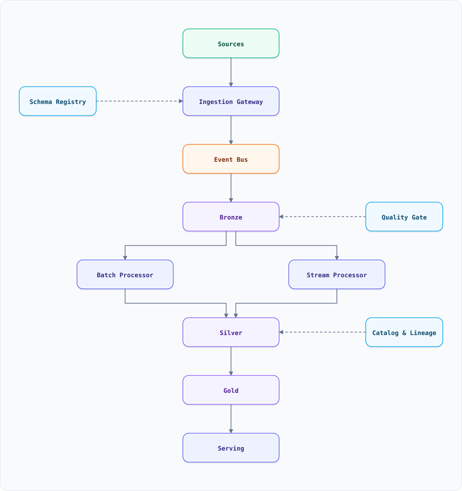

<a id="top"></a>

<div align="center">

<sub>DATA & ANALYTICS</sub>

# System Design: Data Pipeline (Batch + Streaming)

<sub>16 SECTIONS · 14 MIN READ · 1 DIAGRAM · 6 EXAMPLES</sub>

</div>

> [!TIP]
> **THE PROBLEM** — A company has operational data in PostgreSQL, MongoDB, Kafka, SaaS APIs and application logs, but analysts and ML models need one trustworthy, replayable, queryable history of what happened. The pipeline must ingest it, clean it, model it, and serve it without silently duplicating or losing records.

## Start here (plain English)

**What it does.** Moves data from the systems that produce it into the systems that analyse it, cleaning and reshaping it on the way.

**Think of it like.** A water treatment plant: raw water arrives from many pipes, settles in a reservoir, passes through filters, and leaves as clean water in separate pipes for homes and factories.

**Why it's hard.** The source keeps changing while you copy it, events arrive late and out of order, a retry can duplicate a row, and a one-line schema change upstream can break every dashboard downstream.

**The core idea.** Land raw data immutably, transform it in layers (raw → clean → modelled), and make every write idempotent on a deterministic key so replay is always safe.

**Watch out for.** "Exactly-once delivery" is not a checkbox on a queue. It is at-least-once delivery plus an idempotent sink; the sink is where the guarantee is actually earned.

**Before this doc.** [Idempotency](system-design-concepts.md#10-idempotency) · [WAL & durability](system-design-concepts.md#31-write-ahead-log-wal--durability)

**Read it in.** 5 min: [Overview](#overview) + [Architecture](#high-level-architecture) · 20 min: add [Design decisions](#key-design-decisions) + [Failures](#failure-modes--recovery) · full: all 16 sections.

**Read next.** [Observability pipeline](system-design-observability-pipeline.md) — the same ingest-and-store problem for metrics, logs and traces · [Recommendation system](system-design-recommendation-system.md) — the feature store this pipeline feeds

**Terms.** [idempotency](GLOSSARY.md#idempotency) · [exactly-once](GLOSSARY.md#exactly-once) · [watermark](GLOSSARY.md#watermark) · [windowing](GLOSSARY.md#windowing) · [lakehouse](GLOSSARY.md#lakehouse) · [cdc](GLOSSARY.md#cdc) · [backfill](GLOSSARY.md#backfill) · [data-contract](GLOSSARY.md#data-contract)

---

## On this page

<details open>
<summary><b>16 sections</b></summary>

1. [Overview](#overview)
2. [Requirements](#requirements)
3. [High-Level Architecture](#high-level-architecture)
4. [Microservices](#microservices)
5. [Database Design](#database-design)
6. [Scaling Tiers](#scaling-tiers)
7. [Key Design Decisions](#key-design-decisions)
8. [Failure Modes & Recovery](#failure-modes--recovery)
9. [Cost Estimation (Illustrative)](#cost-estimation-illustrative)
10. [Trade-off Analysis](#trade-off-analysis)
11. [Key Metrics to Monitor](#key-metrics-to-monitor)
12. [Deep Dive Prompts](#deep-dive-prompts)
13. [Key Techniques & Patterns](#key-techniques--patterns)
14. [Common Interview Follow-ups](#common-interview-follow-ups)
15. [Low-Level Design (LLD) - Algorithms & Data Structures](#low-level-design-lld---algorithms--data-structures)
16. [Do's & Don'ts](#dos--donts)

</details>

---

## Overview

A data pipeline is the path from **operational truth** to **analytical truth**. Operationally, a payment service owns one row in PostgreSQL; analytically, the company needs every payment joined to refunds, chargebacks, campaigns and support tickets, over years, without slowing checkout down.

The pipeline has four jobs:

1. **Extract** changes from sources without impacting them (CDC, log shipping, API pulls, event streams).
2. **Land** the raw data immutably so it can always be replayed.
3. **Transform** it into clean, conformed and business-level tables.
4. **Serve** it to dashboards, notebooks, feature stores, reverse-ETL and auditors.

Batch and streaming are not opposites; most mature pipelines use both. Batch is cheaper and simpler for large history. Streaming is required when a decision (fraud, pricing, alerting) cannot wait an hour.

### Key Numbers

| Metric | Illustrative target |
| :--- | :--- |
| **Daily ingest** | 10 TB/day raw, 3× with replicas and history |
| **Tables** | 1,000+ source tables, 150 curated marts |
| **Freshness** | Batch ≤ 60 min; streaming ≤ 60 s p99 |
| **History** | 7 years for financial tables, 90 days for debug logs |
| **Backfill window** | 30 days in < 6 hours without touching production |
| **Duplicate tolerance** | 0 duplicate business keys in gold tables |

> [!NOTE]
> The numbers are a teaching model, not a benchmark. Replace them with your own source volumes and freshness SLA before sizing anything.

---

## Requirements

### Functional Requirements

- Ingest from databases (CDC), event streams, object storage, SaaS APIs and application logs.
- Preserve raw data exactly as received, with ingest time and source metadata.
- Validate schema on arrival; quarantine records that do not match the contract.
- Clean, deduplicate, conform and join data into analytics-ready tables.
- Support both batch and streaming transformations from the same definitions where possible.
- Replay any historical window; backfill a new table without double-counting.
- Publish lineage: which table, column and job produced this value.
- Enforce data quality checks before a partition is published.
- Serve BI queries, ML feature reads and reverse ETL to operational systems.
- Apply retention, PII masking and access control per column.

### Non-Functional Requirements

| Attribute | Target | Why |
| :--- | :--- | :--- |
| **Freshness** | Batch ≤ 60 min, stream ≤ 60 s p99 | Decisions and dashboards both have a clock |
| **Correctness** | Exactly-once effect at the sink | Retries are guaranteed; duplicates are not acceptable |
| **Replayability** | Any partition can be rebuilt from raw | The only defence against a logic bug |
| **Schema evolution** | Additive changes never break consumers | Producers deploy independently |
| **Isolation** | Analytics never degrades production | A backfill must not slow checkout |
| **Cost** | Cost per GB ingested and per query tracked | Pipeline cost grows silently |
| **Governance** | Column-level lineage and PII tags | Audits and deletion requests |

---

## High-Level Architecture

### Architecture Diagram



**Interactive:** [Open diagram](diagrams/system-design/data-pipeline.architecture.html) · pan/zoom · search · dark/light · export

*Solid = data flow, dashed = control plane / orchestration / quality.*

### Data Flow

1. **Sources** emit changes three ways: CDC from database logs (Debezium-style), events from Kafka, and API pulls for SaaS tools that have no log.
2. The **Ingestion Gateway** authenticates the source, validates the envelope, assigns `ingest_id` and `ingested_at`, and writes to a raw landing topic. It never transforms business fields.
3. **Raw Landing** writes immutable files to object storage in the **bronze** zone, partitioned by source and ingest date. Nothing is overwritten.
4. A **Schema Registry** checks the record against the subject's contract. A breaking change goes to a quarantine topic and pages the owner; it does not silently enter the lake.
5. **Batch Processor** (Spark) and **Stream Processor** (Flink) read bronze, clean and conform into **silver**: typed, deduplicated, standardized timestamps and currencies.
6. The **Modeling Job** joins silver into **gold** marts: facts, dimensions, aggregates and feature tables.
7. The **Table Catalog** tracks schemas, partitions, snapshots and lineage. The **Quality Service** runs assertions before a partition is marked published.
8. **Serving** exposes gold to the warehouse, an OLAP engine, a feature store and reverse ETL. Consumers never read bronze directly.
9. The **Orchestrator** schedules batch DAGs, manages retries and backfills, and holds the dependency graph. Streaming jobs are supervised separately.
10. **Observability** tracks freshness, lag, row counts, null rates and cost per job; an alert fires on a missed SLA, not just a failed task.

### Why the zones exist

| Zone | Contents | Retention | Who reads it |
| :--- | :--- | :--- | :--- |
| **Bronze (raw)** | Exact source payload + ingest metadata | 30–90 days, cheap object storage | Reprocessing jobs, auditors |
| **Silver (clean)** | Typed, deduplicated, conformed entities | 1–7 years | Analysts, feature jobs |
| **Gold (modelled)** | Facts, dimensions, marts, features | Per business policy | BI, ML, reverse ETL |

The zones are a contract, not a folder convention. A bug in silver is fixed by replaying bronze; a bug in gold is fixed by replaying silver. Without immutable bronze, every bug becomes permanent.

---

## Microservices

| Service | Responsibility | Tech | Failure domain |
| :--- | :--- | :--- | :--- |
| **Ingestion Gateway** | Auth, envelope validation, ingest IDs, backpressure | Go / Java | Source-specific; one bad source must not starve others |
| **CDC Connectors** | Read database logs, snapshot then stream | Debezium / native | Per-database; lag is the key metric |
| **Schema Registry** | Contracts, compatibility checks, versioning | Avro/Protobuf + registry | Control plane; cached by producers |
| **Raw Landing Writer** | Buffer, batch, write immutable bronze files | Kafka Connect / Flink | Idempotent writes keyed by ingest ID |
| **Batch Processor** | Spark jobs for history, joins, backfills | Spark / Trino | Isolated cluster; never shares production DB |
| **Stream Processor** | Event-time windows, enrichment, exactly-once sinks | Flink / Kafka Streams | Checkpointed; bounded state |
| **Modeling Service** | Build gold facts, dimensions and marts | dbt / Spark SQL | Versioned SQL; tested in CI |
| **Quality Service** | Assertions, quarantine, publish gate | Great Expectations-style | Blocks publish, not ingest |
| **Catalog & Lineage** | Schemas, partitions, column lineage, ownership | Iceberg/Hive catalog + OpenLineage | Read-only for consumers |
| **Orchestrator** | DAG scheduling, retries, SLAs, backfills | Airflow / Dagster / Temporal | Control plane; idempotent tasks |
| **Serving Layer** | Warehouse, OLAP, feature store, reverse ETL | Snowflake/BigQuery/ClickHouse | Per-consumer isolation |
| **Cost & FinOps** | Per-job bytes scanned, storage, egress | Usage logs + budgets | Alerts, not enforcement |

The important split is **data plane vs control plane**. Ingestion and processing move bytes; the registry, orchestrator, catalog and quality service decide whether those bytes are allowed to become truth. A control-plane outage should stop new publishes, not corrupt existing tables.

---

## Database Design

### Bronze: immutable raw tables

```sql
-- One table per source, append-only. Never updated in place.
CREATE TABLE bronze.orders_raw (
    ingest_id        STRING        NOT NULL,   -- deterministic: source + lsn + hash
    ingested_at      TIMESTAMP     NOT NULL,
    source_system    STRING        NOT NULL,
    source_lsn       STRING,                   -- CDC log position
    schema_version   INT           NOT NULL,
    payload          STRING        NOT NULL,   -- exact JSON/Avro bytes
    op               STRING        NOT NULL,   -- c / u / d / snapshot
    dt               DATE          NOT NULL    -- ingest partition
)
PARTITIONED BY (source_system, dt)
STORED AS PARQUET;
```

### Silver: deduplicated, typed entities

```sql
-- Merge on the business key, keeping the newest source timestamp.
MERGE INTO silver.orders AS t
USING (
  SELECT order_id, customer_id, status, amount_cents, currency,
         updated_at, ingest_id,
         ROW_NUMBER() OVER (PARTITION BY order_id ORDER BY updated_at DESC, ingest_id DESC) AS rn
  FROM bronze.orders_parsed
  WHERE dt BETWEEN :start AND :end
) AS s
ON t.order_id = s.order_id
WHEN MATCHED AND s.updated_at > t.updated_at THEN UPDATE SET *
WHEN NOT MATCHED AND s.rn = 1 THEN INSERT *;
```

The `ROW_NUMBER` is the deduplication: replaying the same batch produces the same winner, so the merge is idempotent. Without a deterministic tie-breaker (`ingest_id`), two identical timestamps can flip a row on every run.

### Gold: facts, dimensions and aggregates

```sql
CREATE TABLE gold.fact_orders (
    order_id        STRING,
    customer_key    BIGINT,      -- surrogate key, not the operational ID
    date_key        INT,
    status          STRING,
    amount_usd      DECIMAL(18,2),
    is_refunded     BOOLEAN,
    updated_at      TIMESTAMP
)
PARTITIONED BY (date_key)
TBLPROPERTIES ('format-version' = '2');  -- Iceberg: snapshots, time travel, evolution
```

### Streaming state and checkpoints

```text
Flink job state (per key):
  last_event_time      max event timestamp seen
  watermark            last_event_time - allowed_lateness
  open_windows         map<window_end, aggregate>
  seen_event_ids       bounded dedup set (or bloom + store lookup)

Checkpoint:
  every 30-60s, to object storage, with exactly-once sink transactions
  on restore: replay from checkpoint, re-emit only uncommitted windows
```

### Table format responsibilities

| Concern | Iceberg / Delta / Hudi gives you |
| :--- | :--- |
| Atomic commit | A partition is visible only when the manifest commits |
| Time travel | Query the table as of a snapshot ID or timestamp |
| Schema evolution | Add/rename/drop columns without rewriting history |
| Partition evolution | Change partitioning without a full copy |
| Concurrent writers | Snapshot isolation with optimistic commit conflict detection |
| Small files | Compaction jobs rewrite manifests and data files |

---

## Scaling Tiers

### Tier 1: Up to 50 GB/day

| Component | Choice |
| :--- | :--- |
| **Ingest** | Managed Kafka (1–3 brokers) or cloud pub/sub |
| **Storage** | Object storage + Parquet, no table format |
| **Batch** | One Spark/dbt job on a scheduled warehouse |
| **Stream** | Optional; a single consumer for alerts |
| **Orchestration** | Cron + a small Airflow instance |
| **Quality** | Row-count and null checks in the modeling job |

### Tier 2: 50 GB – 5 TB/day

| Component | Choice |
| :--- | :--- |
| **Ingest** | Kafka with schema registry, CDC for core databases |
| **Storage** | Lakehouse tables (Iceberg/Delta) with a catalog |
| **Batch** | Spark on ephemeral clusters; dbt for SQL models |
| **Stream** | Flink with checkpoints and exactly-once sinks |
| **Orchestration** | Airflow/Dagster with SLAs and backfill UI |
| **Quality** | Dedicated assertion service; quarantine tables |
| **Governance** | Column lineage, PII tags, per-team cost budgets |

### Tier 3: 5 TB – 100+ TB/day

| Component | Choice |
| :--- | :--- |
| **Ingest** | Multi-region Kafka, tiered storage, per-tenant quotas |
| **Storage** | Multi-account lake, cross-region replication, lifecycle tiers |
| **Batch** | Spark on Kubernetes with spot pools; workload isolation |
| **Stream** | Flink clusters per domain, savepoints, autoscaling |
| **Serving** | Warehouse + OLAP + feature store, each independently scaled |
| **Orchestration** | Federated orchestrators per domain, global catalog |
| **Governance** | Automated PII discovery, retention enforcement, audit trails |
| **Cost** | Chargeback per team; query budgets; compaction SLAs |

---

## Key Design Decisions

### 1. Batch, micro-batch or streaming?

| Need | Choose | Why |
| :--- | :--- | :--- |
| Daily finance close, 6-hour SLA | Batch | Cheapest, simplest, easy to reprocess |
| 15-minute dashboards | Micro-batch (1–5 min) | Near-streaming at a fraction of the operational cost |
| Fraud, pricing, alerting < 1 min | Streaming | The decision cannot wait for a batch boundary |
| Mixed | Lambda or Kappa | See decision 2 |

The mistake is choosing streaming for everything because it sounds modern. Streaming doubles operational cost and failure modes; use it where the freshness SLA actually requires it.

### 2. Lambda vs Kappa

**Lambda** runs a batch layer for correctness and a speed layer for freshness, then merges them. It is robust but maintains two copies of the logic, which drift.

**Kappa** runs one streaming path for everything and replays the log to reprocess history. It removes the duplicate logic but requires long retention and a stream processor that can handle backfills.

A practical middle ground: **stream for the live path, batch for the historical replay**, but generate both from the same SQL/definition where the engine allows it. If the two implementations are handwritten, assume they will disagree.

### 3. Exactly-once at the sink

Delivery is at-least-once almost everywhere. The guarantee comes from the sink:

1. Give every record a deterministic `event_id` (source + primary key + version, or a UUID produced once at the source).
2. Write to a staging table or a transactional table format.
3. `MERGE` on the business key, keeping the newest version.
4. Commit the checkpoint only after the sink commit.

A duplicate delivery then becomes a no-op. This is stronger and cheaper than trying to make every queue deliver once.

### 4. Event time vs processing time

**Event time** is when the user action happened. **Processing time** is when the pipeline saw it. A phone that was offline for two hours uploads events whose event time is old but processing time is now.

Use event time for business windows (revenue per hour, sessions) and processing time for operational metrics (consumer lag). A watermark declares "no events older than this will be accepted"; late events either update a retained window or go to a side output for reconciliation.

### 5. Table format and partitioning

Choose Iceberg, Delta or Hudi when you need ACID commits, schema evolution, time travel or concurrent writers on object storage. Partition by the columns consumers actually filter on — usually `dt`, then a high-cardinality key such as `tenant_id` only if it is genuinely used. Over-partitioning creates the small-file problem, which costs more than it saves.

### 6. The small-file problem

Streaming writes one file per checkpoint; a 10-second checkpoint over a day is 8,640 files per partition. Query planning then dominates the query. Compact on a schedule:

```text
target file size: 128–512 MB
compact when: files < 100 MB and count > threshold
rewrite manifests, keep snapshots for time travel, expire old snapshots
```

### 7. Backfills without double counting

A backfill is a new write of history. Make it safe by writing to a **new table or partition**, validating row counts and checksums against the old one, then swapping the pointer atomically. Never update the live gold table in place while consumers are reading it.

Run backfills on a separate compute pool with a lower priority, and cap their concurrency. A backfill that saturates the warehouse is an outage with a good excuse.

### 8. Schema evolution and data contracts

Producers and consumers deploy independently, so the contract must be explicit:

- **Backward compatible:** add an optional field, never rename or change a type.
- **Forward compatible:** consumers ignore unknown fields.
- **Breaking:** new subject version, dual-write window, migrate consumers, then retire the old field.

The registry enforces compatibility; the catalog records ownership; the quality service checks the semantics the schema cannot express (uniqueness, referential integrity, freshness).

---

## Failure Modes & Recovery

| Failure | Impact | Detection | Recovery |
| :--- | :--- | :--- | :--- |
| **Duplicate delivery** | Double-counted revenue | Gold row count vs source checksum | Idempotent MERGE; replay the affected partition |
| **Late events** | Wrong hourly aggregate | Watermark lag, side-output count | Re-open the window or reconcile in a correction table |
| **Partial write** | Half a partition visible | Snapshot/manifest audit | Never publish without an atomic commit; replay |
| **Schema drift** | Job crashes or silent nulls | Registry compatibility check, null-rate alert | Quarantine, fix producer, replay |
| **Source snapshot takes too long** | CDC lag grows | Replication slot lag | Throttle snapshot, chunk by key, use a read replica |
| **Backfill storm** | Warehouse saturation | Queue time, cost spike | Separate pool, concurrency cap, off-peak window |
| **Small files** | Query planning slow, cost up | File count per partition | Compaction job with a target size |
| **Metadata loss** | Table unreadable | Catalog backup check | Restore catalog; data files remain in object storage |
| **Bad transformation deploy** | Wrong gold data | Quality assertions, canary partition | Roll back the model, replay from silver |
| **PII leak** | Compliance incident | Column tags, access logs | Mask at ingest, revoke, delete by key, audit |
| **Cost explosion** | Budget overrun | Per-job bytes scanned | Query budgets, partition pruning, clustering |

The cardinal rule: **raw data is never edited**. If a transformation is wrong, fix the code and replay. If raw data is wrong, fix the source and re-ingest; do not patch history in place.

---

## Cost Estimation (Illustrative)

For 10 TB/day raw ingest, 3× retained, 30% compression, one batch run per hour and one streaming job per domain:

| Component | Specification | Monthly cost |
| :--- | :--- | :--- |
| Object storage | 300 TB retained, lifecycle tiers | $4,500 |
| Kafka / ingest | 3 brokers, 10 TB/day, 7-day retention | $3,000 |
| Batch compute | 200 Spark executor-hours/day, spot | $6,000 |
| Streaming compute | 20 Flink task-manager slots, steady | $5,000 |
| Warehouse | 100 TB scanned/day, 2 clusters | $12,000 |
| Orchestration + catalog | Managed services | $1,500 |
| Observability + quality | Logs, metrics, assertions | $1,500 |
| **Total** | | **~$33,500/month** |

The dominant cost is usually **queries scanning partitions they did not need**, not storage. Partition pruning, clustering and materialized marts save more than switching clouds.

---

## Trade-off Analysis

| Approach A | Approach B | Winner | Reason |
| :--- | :--- | :--- | :--- |
| Batch only | Streaming for everything | Depends on SLA | Batch is cheaper; streaming only where freshness is a product requirement |
| Lambda (two code paths) | Kappa (one streaming path) | Kappa where retention is affordable | One implementation cannot drift from itself |
| Raw files + schema-on-read | Lakehouse table format | Lakehouse at scale | ACID commits, evolution and time travel are not optional for shared tables |
| Update rows in place | Append + deduplicate on read/merge | Append + merge | Replayability and auditability |
| One giant warehouse | Lake + warehouse + OLAP | Tiered serving | Each engine is priced for a different query shape |
| Backfill in place | Shadow table then swap | Shadow table | Consumers never see a half-written history |
| JSON everywhere | Typed schema with a registry | Typed + registry | Errors move left, before they reach dashboards |

---

## Key Metrics to Monitor

| Metric | What it tells you | Target |
| :--- | :--- | :--- |
| **Freshness lag** | Now − max event time in gold | ≤ SLA (60 min batch, 60 s stream) |
| **CDC lag** | Source log position vs consumer position | < 5 min p99 |
| **Consumer lag** | Messages behind per partition | < 1 minute of traffic |
| **Row-count reconciliation** | Source vs bronze vs silver vs gold | 100% match after dedup |
| **Duplicate keys in gold** | Uniqueness assertion | 0 |
| **Null rate on required columns** | Contract violation | 0 |
| **Schema compatibility failures** | Producers breaking contracts | 0 unquarantined |
| **Failed assertions** | Data quality | 0 published with a failed blocking check |
| **File count per partition** | Small-file problem | < 100 files per active partition |
| **Bytes scanned per query** | Cost efficiency | Within budget per dashboard |
| **Backfill progress** | Partitions remaining / ETA | Completes inside the window |
| **Lineage coverage** | Tables with a known upstream/downstream | > 95% |

---

## Deep Dive Prompts

- How do you guarantee exactly-once semantics end to end when the source can only produce at-least-once?
- How do you handle an event that arrives three days late — correct the old window, or write a correction?
- How would you migrate 5,000 tables from a legacy warehouse without a freeze?
- What is the difference between a data lake, a lakehouse and a warehouse, and when do you need each?
- How do you backfill two years of data without taking the production warehouse down?
- How do you detect and prevent a silent schema change from breaking every dashboard?
- What would you monitor to know the pipeline is healthy before a user complains?
- How do you delete a user's data from an immutable lake and still satisfy an audit?

---

## Key Techniques & Patterns

| Technique | What it does | Used in |
| :--- | :--- | :--- |
| **CDC + snapshot** | Copies existing rows once, then streams changes | Ingestion, bronze |
| **Idempotent MERGE** | Replay-safe upsert on a deterministic key | Silver, gold |
| **Event-time watermark** | Decides when a window is complete | Streaming aggregates |
| **Checkpoint + two-phase sink** | Recovers exactly-once state after a failure | Flink/Kafka Streams |
| **Medallion zones** | Raw → clean → modelled separation | Whole pipeline |
| **Data contracts** | Explicit schema + semantics + freshness | Producer/consumer boundary |
| **Quality gate** | Blocks publish on failed assertions | Before gold visibility |
| **Shadow backfill** | Build new history beside the old, then swap | Schema/logic migrations |
| **Compaction** | Merges small files, controls read cost | Lakehouse maintenance |
| **Column lineage** | Traces a value back to its source | Governance, debugging |
| **Reverse ETL** | Pushes modelled data back to operational tools | CRM, support, ads |

---

## Common Interview Follow-ups

**Q: Why not just query the production database with a read replica?**
A: It works until analytics scans compete with production I/O, history is needed beyond the OLTP retention window, or multiple sources must be joined. A replica is also not a historical archive: an update overwrites the old value.

**Q: How do you decide batch vs streaming?**
A: Start from the decision the data enables. If a human looks at it tomorrow, batch is fine. If a model or a customer waits on it, stream. Then cost the streaming path honestly, including on-call.

**Q: What does exactly-once actually mean here?**
A: At-least-once delivery into an idempotent sink keyed by a deterministic ID, with the checkpoint committed after the sink. The business effect is once; the network may deliver twice.

**Q: How do you handle late data?**
A: Keep the window open until the watermark plus allowed lateness passes; after that, emit a correction record into a separate table rather than mutating a published aggregate. Consumers can add the correction.

**Q: How do you stop a bad deploy from corrupting gold?**
A: Version the transformation, test it on a shadow partition, gate the publish on assertions, and keep the previous snapshot addressable. If it passes the gate and is still wrong, replay from silver after the fix.

**Q: Where does the feature store fit?**
A: It is a serving layer over gold, optimized for point reads at low latency. It is not a second pipeline; it should consume the same modelled data with the same definitions to avoid training/serving skew.

**Q: How do you cost-control a pipeline?**
A: Track bytes scanned and written per job, partition and cluster for the real query patterns, compact small files, expire snapshots, and put budgets on dashboards. Most bills are queries, not storage.

---

## Low-Level Design (LLD) - Algorithms & Data Structures

### 1. Event-time window with a watermark

```js
class EventTimeWindow {
  constructor(windowMs, allowedLatenessMs) {
    this.windowMs = windowMs;
    this.allowedLatenessMs = allowedLatenessMs;
    this.maxEventTime = -Infinity;
    this.windows = new Map(); // windowStart -> { count, sum, late }
  }

  // Returns the window boundaries an event belongs to.
  windowStart(ts) {
    return Math.floor(ts / this.windowMs) * this.windowMs;
  }

  add(event) {
    const start = this.windowStart(event.ts);
    // An event older than the watermark is late; accept it only inside the lateness budget.
    const watermark = this.maxEventTime - this.allowedLatenessMs;
    const isLate = event.ts < watermark;
    if (event.ts > this.maxEventTime) this.maxEventTime = event.ts;
    if (isLate && event.ts < watermark - this.allowedLatenessMs) {
      return { accepted: false, reason: 'too-late' };
    }
    const w = this.windows.get(start) ?? { count: 0, sum: 0, late: 0 };
    w.count += 1;
    w.sum += event.value;
    if (isLate) w.late += 1;
    this.windows.set(start, w);
    return { accepted: true, window: start, late: isLate };
  }

  // Emit every window whose end is behind the current watermark.
  drain() {
    const watermark = this.maxEventTime - this.allowedLatenessMs;
    const emitted = [];
    for (const [start, w] of [...this.windows].sort((a, b) => a[0] - b[0])) {
      if (start + this.windowMs <= watermark) {
        emitted.push({ windowStart: start, count: w.count, avg: w.sum / w.count, late: w.late });
        this.windows.delete(start);
      }
    }
    return emitted;
  }
}

const w = new EventTimeWindow(60_000, 5_000);
w.add({ ts: 1_000, value: 10 });
w.add({ ts: 61_000, value: 20 });
w.add({ ts: 30_000, value: 30 }); // late but inside the budget
console.log(w.drain());            // first window closes once the watermark passes 60s
console.log(w.drain());            // second window still open
```

The watermark is a promise, not a clock: it says "I will not wait for events older than this". Allowed lateness buys a bounded amount of correction before the window is final.

### 2. Idempotent sink with a deterministic key

```js
class IdempotentSink {
  constructor() {
    this.byKey = new Map();   // business key -> version
    this.seenEvents = new Set(); // event_id -> already applied
  }

  // Apply once. A replay with the same event_id is a no-op.
  apply(event) {
    if (this.seenEvents.has(event.eventId)) {
      return { applied: false, reason: 'duplicate-event' };
    }
    const current = this.byKey.get(event.key);
    if (current && current.version >= event.version) {
      this.seenEvents.add(event.eventId);
      return { applied: false, reason: 'stale-version' };
    }
    this.byKey.set(event.key, { version: event.version, value: event.value });
    this.seenEvents.add(event.eventId);
    return { applied: true, value: event.value };
  }

  get(key) { return this.byKey.get(key)?.value ?? null; }
}

const sink = new IdempotentSink();
console.log(sink.apply({ eventId: 'e1', key: 'order-1', version: 1, value: 100 })); // applied
console.log(sink.apply({ eventId: 'e1', key: 'order-1', version: 1, value: 100 })); // duplicate
console.log(sink.apply({ eventId: 'e2', key: 'order-1', version: 1, value: 999 })); // stale
console.log(sink.get('order-1')); // 100
```

The two guards cover different failures: `seenEvents` handles a redelivered message, and the version check handles an out-of-order update that arrives after a newer one.

### 3. Topological order for a pipeline DAG

```js
function topologicalOrder(nodes, edges) {
  const indegree = new Map(nodes.map(n => [n, 0]));
  const next = new Map(nodes.map(n => [n, []]));
  for (const [from, to] of edges) {
    indegree.set(to, indegree.get(to) + 1);
    next.get(from).push(to);
  }
  const queue = nodes.filter(n => indegree.get(n) === 0);
  const order = [];
  while (queue.length) {
    const n = queue.shift();
    order.push(n);
    for (const m of next.get(n)) {
      indegree.set(m, indegree.get(m) - 1);
      if (indegree.get(m) === 0) queue.push(m);
    }
  }
  if (order.length !== nodes.length) throw new Error('cycle in pipeline DAG');
  return order;
}

const dag = ['raw_orders', 'clean_orders', 'dim_customer', 'fact_orders', 'mart_revenue'];
const deps = [
  ['raw_orders', 'clean_orders'],
  ['clean_orders', 'fact_orders'],
  ['dim_customer', 'fact_orders'],
  ['fact_orders', 'mart_revenue'],
];
console.log(topologicalOrder(dag, deps)); // dependencies always run before consumers
```

A cycle in a pipeline DAG is not a slow job; it is an impossible schedule. Fail fast at definition time, not at 3 a.m. when the scheduler cannot make progress.

---

## Do's & Don'ts

| ✅ Do | ❌ Don't |
| :-- | :-- |
| Land raw data immutably before transforming it | Patch history in place when a transformation is wrong — replay instead |
| Make every sink idempotent on a deterministic key | Assume the queue's "exactly-once" checkbox covers the whole pipeline |
| Publish a partition only after an atomic commit and a quality gate | Let consumers see a half-written table |
| Version schemas and enforce compatibility in a registry | Rename or retype a column and hope every dashboard survives |
| Partition by the columns queries actually filter on | Over-partition on tenant or user and create millions of tiny files |
| Run backfills on a separate pool with a concurrency cap | Saturate the production warehouse with a historical replay |
| Track freshness, duplicates and bytes scanned per job | Monitor only "task succeeded" and discover the data is wrong a week later |
| Keep the batch and streaming logic as close as the engine allows | Hand-write two implementations and assume they will agree |
| Mask PII at ingest and tag columns in the catalog | Copy raw production data into a lake with no access control |
| Compact small files on a schedule | Wait for a query to time out before noticing the file count |

*More cross-topic rules: [Interview Q&A §84](interview-qa.md#84-universal-dos--donts) · Concepts: [Kafka](kafka-features.md) · [Observability](system-design-observability-pipeline.md)*

---

## Related System Design Documents

- [Observability Pipeline](system-design-observability-pipeline.md) — the same ingest/retain/serve shape for metrics, logs and traces
- [Recommendation System](system-design-recommendation-system.md) — the feature store and offline/online split this pipeline feeds
- [A/B Experimentation Platform](system-design-ab-testing.md) — experiment exposure and metric data depend on trustworthy pipelines
- [Fraud Detection](system-design-fraud-detection.md) — streaming features and feedback loops
- [Kafka Guide](kafka-features.md) — partitions, offsets, consumer groups and exactly-once mechanics
- [PostgreSQL Guide](postgresql-features.md#17-logical-replication--change-data-capture-cdc) — logical replication and CDC

---

<nav>← [observability pipeline](system-design-observability-pipeline.md) · [All guides](README.md) · [content moderation](system-design-content-moderation.md) →</nav>

---

<p align="right"><a href="#top">↑ Back to top</a></p>
