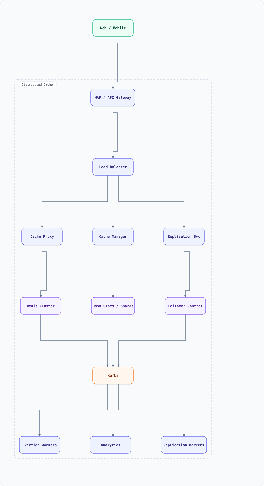

<a id="top"></a>

<div align="center">

<sub>INFRASTRUCTURE</sub>

# System Design: Distributed Cache (Redis/Memcached)

<sub>16 SECTIONS · 5 MIN READ · 1 DIAGRAM · 2 EXAMPLES</sub>

</div>

> [!TIP]
> **THE PROBLEM** — High-performance in-memory caching layer providing sub-millisecond reads for frequently accessed data, reducing database load.

## Start here (plain English)

**What it does.** A shared in-memory layer that serves hot reads in under a millisecond and protects the database.

**Think of it like.** A row of quick-access shelves in front of the warehouse: most requests never need the warehouse, but a missing item sends a runner.

**Why it's hard.** The cache must survive node loss without losing the keyspace, and a hot key must not melt one shard.

**The core idea.** Shard with consistent hashing, replicate each shard, and treat a miss as the normal path with single-flight protection.

**Watch out for.** Invalidation is not just deleting the key. The hard part is the race between the database write and the cache fill.

**Before this doc.** [Caching strategies](system-design-concepts.md#16-caching-strategies) · [Consistent hashing](system-design-concepts.md#2-consistent-hashing)

**Read it in.** 5 min: [Overview](#overview) + [Architecture](#high-level-architecture) · 20 min: add [Design decisions](#key-design-decisions) + [Failure modes](#failure-modes--recovery) · full: all 16 sections.

**Read next.** [Key-value store](system-design-key-value-store.md) · [URL shortener](system-design-url-shortener.md)

**Terms.** [consistent hashing](GLOSSARY.md#consistent-hashing) · [cache-aside](GLOSSARY.md#cache-aside) · [eviction](GLOSSARY.md#eviction) · [LRU](GLOSSARY.md#lru) · [hot key](GLOSSARY.md#hot-key) · [cache stampede](GLOSSARY.md#cache-stampede)


---

## On this page

<details open>
<summary><b>16 sections</b></summary>

1. [Overview](#overview)
2. [Requirements](#requirements)
3. [High-Level Architecture](#high-level-architecture)
4. [Microservices](#microservices)
5. [Database Design](#database-design)
6. [Scaling Tiers](#scaling-tiers)
7. [Key Design Decisions](#key-design-decisions)
8. [Failure Modes & Recovery](#failure-modes--recovery)
9. [Cost Estimation (1M Users)](#cost-estimation-1m-users)
10. [Trade-off Analysis](#trade-off-analysis)
11. [Key Metrics to Monitor](#key-metrics-to-monitor)
12. [Deep Dive Prompts](#deep-dive-prompts)
13. [Key Techniques & Patterns](#key-techniques--patterns)
14. [Common Interview Follow-ups](#common-interview-follow-ups)
15. [Low-Level Design (LLD)](#low-level-design-lld)
16. [Do's & Don'ts](#dos--donts)

</details>

---


## Overview

High-performance in-memory caching layer providing sub-millisecond reads for frequently accessed data, reducing database load.

### Key Numbers

- 1M+ ops/sec per node
- <1ms P99 latency
- 99.999% availability
- TB-scale capacity

---

## Requirements

### Functional Requirements

- Put(key, value, ttl) - Store key-value pair with expiration
- Get(key) - Retrieve value by key
- Delete(key) - Remove key-value pair
- Support multiple eviction policies (LRU, LFU, TTL)
- Support distributed sharding across nodes

### Non-Functional Requirements

| Attribute | Target |
| :--- | :--- |
| **Latency** | < 1ms P99 |
| **Throughput** | 1M+ ops/sec per node |
| **Availability** | 99.999% |
| **Consistency** | Tunable (strong to eventual) |

---

## High-Level Architecture

### Architecture Diagram



**Interactive:** [Open diagram](diagrams/system-design/distributed-cache.architecture.html) · pan/zoom · search · dark/light · export


*Solid = data flow, dashed = control plane / monitoring.*

### Data Flow

1. Client request - Cache Proxy hashes key to find shard
2. Consistent hashing maps key to virtual node -> physical node
3. Cache hit: return value (< 1ms latency)
4. Cache miss: fetch from origin DB, store in cache with TTL
5. Write-through or write-behind based on consistency needs
6. Replication: async to replicas for fault tolerance
7. Eviction: LRU/LFU when memory limit reached

## Microservices
How the system is decomposed into independently deployed services:

| Service | Responsibility | Tech Stack | Pattern |
| --------- | --------------- | ------------ | --------- |
| Cache Proxy | Client routing, command parsing | Go/C++ | Connection Pool |
| Replication Mgr | Primary-replica sync, failover | Go | Redis replication + Sentinel/Cluster failover (async; not Raft) |
| Eviction Manager | LRU/LFU/TTL eviction | C++ | Background Worker |
| Cluster Manager | Hash slot distribution and membership | Go | Redis Cluster gossip + configuration epochs |
| Persistence Svc | RDB snapshots, AOF logs | C++ | WAL |
| Monitoring Svc | Hit rate, memory, connections | Go, Prometheus | Metrics Export |

---

## Database Design
The data stores, schemas, and access patterns behind each service:

```sql
CREATE TABLE cache_metadata (
    slot_id     INT PRIMARY KEY,
    node_id     VARCHAR(50) NOT NULL,
    key_count   BIGINT DEFAULT 0,
    memory_used BIGINT DEFAULT 0,
    status      VARCHAR(20) DEFAULT 'active'
);

CREATE TABLE cache_stats (
    stat_id     BIGSERIAL PRIMARY KEY,
    node_id     VARCHAR(50),
    hit_count   BIGINT DEFAULT 0,
    miss_count  BIGINT DEFAULT 0,
    evict_count BIGINT DEFAULT 0,
    recorded_at TIMESTAMP DEFAULT NOW()
);
```

---

## Scaling Tiers

### 1K - 10K Users ($500/mo)

- Single Redis instance, 2GB RAM
- In-process cache (Node LRU)

### 10K - 1M Users ($20K/mo)

- Redis cluster (3 nodes), 32GB total
- Read replicas for read-heavy workloads
- Consistent hashing for key distribution

### 1M - 10M+ Users ($800K/mo)

- 100+ Redis instances, TB-scale
- Multi-region replication
- Custom eviction policies per workload
- Persistent caching with RDB + AOF

---

## Key Design Decisions
The choices that shape this architecture, and why each was made:

| Decision | Choice | Why |
| ---------- | -------- | ----- |
| Eviction Policy | LRU + TTL hybrid | LRU for hot data, TTL for temporary entries |
| Sharding | Consistent hashing or Redis Cluster hash slots | Redis Cluster routes by 16,384 slots; a generic ring is an alternative design, not its internal partitioning model |
| Replication | Primary-replica (Redis-style asynchronous replication) | Read scaling and availability; failover may lose acknowledged writes |
| Persistence | RDB + AOF | RDB for backups, AOF for durability |
| Protocol | RESP (Redis Serialization) | Simple, fast, widely supported |

---

## Failure Modes & Recovery
What can go wrong in production, and how the system detects and recovers:

| Failure | Impact | Recovery |
| --------- | -------- | ---------- |
| Primary node crash | Brief write interruption; recent acknowledged writes may be absent on promoted replica | Sentinel/Cluster promotes a replica; reconcile or refill from the source of truth when lost writes matter |
| Replica lag | Stale reads | Increase replication priority, rebuild from primary |
| Memory exhaustion | Eviction storms | Scale horizontally, adjust eviction policy |
| Network partition | Some clients may be unable to write; stale reads or lost acknowledged writes are possible across failover | Follow Redis Cluster/Sentinel quorum and reachability rules; treat cache as disposable and never use it as the sole authoritative ledger |
| Cache stampede | DB overload | Request coalescing, jittered/probabilistic early refresh, and bounded origin concurrency; locks are an optimization, not a correctness boundary |

---

## Cost Estimation (1M Users)
Rough monthly cost of running this design for one million users:

| Component | Monthly Cost |
| ----------- | ------------- |
| Redis cluster (100GB) | $4,000 |
| Compute (proxy + replication) | $3,000 |
| Monitoring (Prometheus) | $500 |
| Backup storage | $100 |
| Total | ~$7,600 |

---

## Trade-off Analysis
The alternatives considered, and which one won and why:

| Trade-off | Option A | Option B | Winner | Why |
| ----------- | ---------- | ---------- | -------- | ----- |
| Eviction | LRU | LFU | LRU | Simpler, better for most workloads |
| Persistence | RDB only | RDB + AOF | RDB + AOF | Durability + performance balance |
| Sharding | Consistent Hash | Range-based | Consistent Hash | Better load distribution |
| Replication | Sync | Async | Async | Better performance, accept small lag |

---

## Key Metrics to Monitor
The metrics that signal system health, with alert thresholds:

| Metric | Target | Alert Threshold |
| -------- | -------- | ----------------- |
| Hit Rate | > 95% | < 85% |
| P99 Latency | < 1ms | > 5ms |
| Memory Usage | < 80% | > 90% |
| Eviction Rate | < 1% | > 5% |
| Replication Lag | < 100ms | > 1s |

---

## Deep Dive Prompts

1. **How does consistent hashing minimize key movement when nodes are added/removed?**
2. **Explain cache stampede and how to prevent it.**
3. **How would you handle cache invalidation across distributed nodes?**
4. **Design a cache warming strategy for cold starts.**
5. **How do you ensure cache consistency with the database?**
6. **Explain the trade-offs between Redis and Memcached.**

---

## Key Techniques & Patterns
The recurring techniques and patterns this design applies, mapped to where they are used:

| Technique | Description | Used In |
| ----------- | ------------- | ---------- |
| Consistent Hashing | Hash ring with virtual nodes (Ketama); adding one node moves about 1/N of keys, not all of them | Cluster layout |
| LRU/LFU Eviction | Hash map + intrusive list gives O(1) LRU; Redis approximates LFU with frequency counters and random sampling | Memory policy |
| Cache Stampede Prevention | Single-flight request coalescing plus probabilistic early expiry (XFetch) stops N clients recomputing one hot key | Read path |
| Write-Through/Write-Behind | Write-through keeps cache and store in step; write-behind batches and risks losing the tail on a crash | Write path |
| Redis Cluster (Hash Slots) | 16,384 slots, CRC16(key) mod 16384; multi-key commands need hash tags to stay in one slot | Sharding |
| TTL-based Expiration | Lazy expiry on read plus periodic sampling; a TTL alone does not bound memory if the key is never read again | Memory |

## Common Interview Follow-ups

**Q: How do you handle cache invalidation?**
A: Use write-through (update cache + DB simultaneously), write-behind (update cache, async DB), or cache-aside (check cache first, fallback to DB). For distributed invalidation, publish invalidation events via Kafka.

**Q: How do you prevent cache stampede?**
A: Use distributed locks (only one thread rebuilds cache), probabilistic early expiration (randomly refresh before TTL), or background refresh threads that keep hot keys alive.

**Q: Redis vs Memcached?**
A: Redis supports data structures (lists, sets, sorted sets), persistence, replication, and pub/sub. Memcached is a pure in-memory cache: servers do not replicate or sync with each other and may evict live items under memory pressure, so losing a node loses that shard's data. Use Redis when you need structures, persistence or replication; use Memcached when a horizontally sharded, disposable cache is exactly what you want.

---

## Low-Level Design (LLD)

The cache internals are already implemented in the concepts guide. This design composes them instead of repeating the code:

| Concern | Canonical implementation | Why it matters here |
| :--- | :--- | :--- |
| LRU eviction | [Concepts §65 — LRU Cache](system-design-concepts.md#65-lru-cache) | Keeps hot objects resident without unbounded memory. |
| Consistent hashing | [Concepts §2 — Consistent Hashing](system-design-concepts.md#2-consistent-hashing) | Moves only about 1/N of keys; use ~150 virtual nodes per physical node to smooth hotspots. |

## Do's & Don'ts

| ✅ Do | ❌ Don't |
| :-- | :-- |
| Pin down the key numbers before drawing boxes | Don't hand-wave the hardest component — distributed cache lives or dies there |

*More cross-topic rules: [Interview Q&A §84](interview-qa.md#84-universal-dos--donts) · Concepts: [Networking](networking.md) · [Operating Systems](operating-systems.md)*

---

<nav>← [discord](system-design-discord.md) · [All guides](README.md) · [distributed lock manager](system-design-distributed-lock-manager.md) →</nav>

---

<p align="right"><a href="#top">↑ Back to top</a></p>
