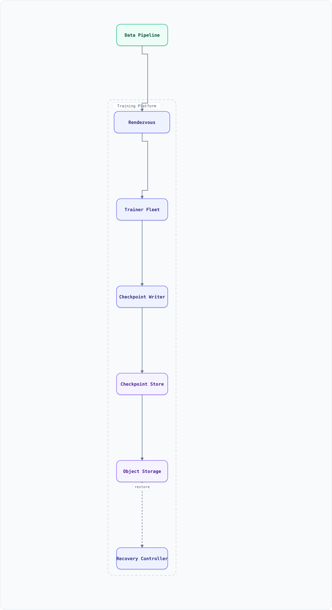

<a id="top"></a>

<div align="center">

<sub>SYSTEM DESIGN · AI INFRASTRUCTURE</sub>

# Checkpoint & Recovery for Distributed Training

**Atomic, reshardable snapshots of a 1,024-GPU job — without stopping the fleet.**

<sub>1K GPUS · 1.12 TB STATE · 30 MIN CADENCE</sub>

</div>

> [!TIP]
> **THE PROBLEM** — Design durable state for a 1,024-GPU training job: snapshot weights, optimizer, RNG and data position without stopping training for a minute, commit the checkpoint atomically, and restore onto a **different** world size after a node fails. The hard parts are distributed snapshot consistency, sharded I/O throughput, and the commit protocol — not the file format.

| THE PROBLEM | THE HARD PART | THE BET |
| :--- | :--- | :--- |
| 1,024 ranks must survive node loss, preemption and elastic resizes. | A consistent snapshot of more than weights, written without a 60-second stall. | Stage at a step boundary, write shards in parallel, and commit a manifest last. |

---

## On this page

<details open>
<summary><b>17 sections</b></summary>

1. [Overview](#overview)
2. [Requirements](#requirements)
3. [High-Level Architecture](#high-level-architecture)
4. [Microservices](#microservices)
5. [Database Design](#database-design)
6. [Scaling Tiers](#scaling-tiers)
7. [Key Techniques & Patterns](#key-techniques--patterns)
8. [Key Design Decisions](#key-design-decisions)
9. [Failure Modes & Recovery](#failure-modes--recovery)
10. [Cost Estimation](#cost-estimation)
11. [Trade-off Analysis](#trade-off-analysis)
12. [Key Metrics to Monitor](#key-metrics-to-monitor)
13. [Production Readiness Checklist](#production-readiness-checklist)
14. [Deep Dive Prompts](#deep-dive-prompts)
15. [Common Interview Follow-ups (with answers)](#common-interview-follow-ups-with-answers)
16. [Low-Level Design (LLD) — Atomic Manifest + Resharding](#low-level-design-lld--atomic-manifest--resharding)
17. [Do's & Don'ts](#dos--donts)

</details>

---

## Overview

A large training job is a **stateful distributed system** that happens to compute gradients. Each rank owns a shard of the parameters, optimizer state, and data stream. A node failure, a preemption, or an elastic resize destroys the process group; the job can only resume if there is a globally consistent snapshot of *more than the weights*.

The design must answer four questions precisely:

1. **What** is in a checkpoint? (weights, optimizer moments, scheduler/scaler, RNG, global step, data sampler position, parallelism metadata)
2. **When** is it consistent? (a step boundary, with every rank's shard from the same step)
3. **How** is it written without stalling the fleet? (async staging, parallel shard writes, a separate process group)
4. **When is it safe to call it "the latest"?** (atomic manifest commit after every shard is durable and verified)

### Key Numbers

| Metric | Value |
| :--- | :--- |
| Cluster | 1,024 H100 GPUs = 128 nodes × 8; DP=64, TP=8, PP=2 |
| Model | 70B parameters, bf16 compute with fp32 master weights |
| Full training state | ~1.12 TB: bf16 weights 140 GB + bf16 grads 140 GB + fp32 master 280 GB + Adam m/v 560 GB |
| Sharded footprint | ~1.1 GB per rank at 1,024-way sharding |
| Step time | ~400 ms; 4,500 steps per 30-minute interval |
| Checkpoint cost | stage ~3 s + write 1.12 TB at 200 GB/s ≈ 6 s + verify/commit ≈ 2 s |
| Blocking pause | 45–90 s naive; 3–5 s with async staging |
| Fleet MTBF | GPU MTBF 50,000 h → 1,024 GPUs ≈ one failure every **49 h** |
| Recovery | RTO < 10 min; restore 1.12 TB at 100 GB/s ≈ 11 s + 5–8 min init/warmup |
| Retention | 8 recent + 1 daily, ~9 TB per job |
| Lost work | ≤ one checkpoint interval (30 min) — expected ~15 min per failure |

The arithmetic that drives the design: at one failure every 49 hours, a 30-minute interval loses ~15 minutes per event — roughly 3.75 hours of fleet wall-clock, or ~3,800 GPU-hours, per month per 1,024 GPUs. Checkpoint frequency is a **cost optimisation**, not a compliance checkbox.

## Requirements

### Functional Requirements

- Periodic full checkpoints at a configurable step/time interval
- On-demand checkpoint before preemption or a planned maintenance drain
- Atomic commit: a checkpoint is either fully restorable or invisible
- Restore onto a different world size / parallelism layout (elastic training)
- Restore optimizer, scheduler, scaler, RNG, global step, and data position — not just weights
- Retention and garbage collection without deleting the checkpoint being written or restored
- Integrity verification and a periodic restore drill
- Observability: duration, bytes, throughput, pause time, last committed step per job

### Non-Functional Requirements

| Attribute | Target |
| :--- | :--- |
| **Consistency** | Every shard in a checkpoint comes from the same global step |
| **Durability** | Committed checkpoint survives a region/AZ loss (replicated object store) |
| **Overhead** | < 5% training slowdown; async pause < 5 s |
| **RTO** | < 10 min from failure detection to first step after restore |
| **RPO** | ≤ one interval (30 min) |
| **Scale** | 1 TB-class state, 1,000+ ranks, 100+ GB/s aggregate write |
| **Portability** | Restore at a different world size without a manual conversion step |

---

## High-Level Architecture

### Architecture Diagram



**Interactive:** [Open diagram](diagrams/system-design/distributed-training.architecture.html) · pan/zoom · search · dark/light · export

*Solid = checkpoint/restore flow, dashed = control plane / monitoring.*

### Data Flow

1. **Rendezvous** (torchrun/etcd-style) forms the process group and assigns ranks. Every rank heartbeats its step; the coordinator is the only writer of checkpoint intent.
2. At a checkpoint step, the **Checkpoint Writer** pins a version: all ranks stage their shards from GPU to pinned host memory at the same step boundary. Training resumes as soon as staging completes.
3. Writer threads upload shards in parallel (one object per shard, or a small pack), computing a checksum per shard. A **separate process group** carries checkpoint collectives so they do not contend with gradient all-reduce.
4. Shards land under `s3://.../<job>/<step>/`. Only after every shard is durable and its checksum verified does the writer publish the **manifest** — the atomic commit point.
5. On failure, the **Recovery Controller** reads the newest committed manifest, plans a new shard→rank mapping for the surviving world size, and streams shards back in parallel. Ranks restore in place, re-enter rendezvous, and resume at `global_step + 1`.
6. **Telemetry** records pause time, upload throughput, success/failure, bytes per step, and the age of the last committed checkpoint (the RPO gauge).

---

## Microservices

| Service | Responsibility | Scaling |
| :--- | :--- | :--- |
| Rendezvous / Coordinator | Rank assignment, membership, checkpoint trigger | Leader-elected per job |
| Trainer Fleet | Compute; stage shards at a step boundary | 8–1,024 GPUs per job |
| Checkpoint Writer | Shard planning, parallel upload, checksums, manifest commit | Per job; I/O-bound |
| Manifest Store | Commit point and shard index (PostgreSQL) | Highly available, small |
| Object Storage | Durable shard + manifest bytes | Replicated, versioned |
| Recovery Controller | Detect failure, choose manifest, plan reshard, resume | Per job / per cluster |
| Telemetry | Throughput, pause, RPO, corruption signals | Shared |

---

## Database Design

PostgreSQL holds the commit point; object storage holds the bytes. The database row is the **only** authority on what is restorable.

```sql
CREATE TABLE training_jobs (
  job_id        UUID PRIMARY KEY,
  model         TEXT NOT NULL,
  world_size    INT NOT NULL,
  parallelism   JSONB NOT NULL,          -- {dp, tp, pp}
  state         TEXT NOT NULL,           -- running | recovering | done
  last_committed_step BIGINT
);

CREATE TABLE checkpoints (
  checkpoint_id UUID PRIMARY KEY,
  job_id        UUID REFERENCES training_jobs,
  step          BIGINT NOT NULL,
  state         TEXT NOT NULL,           -- writing | committed | failed | deleted
  world_size    INT NOT NULL,
  shard_count   INT NOT NULL,
  total_bytes   BIGINT NOT NULL,
  manifest_uri  TEXT,                    -- set only on commit
  manifest_sha  TEXT,
  created_at    TIMESTAMPTZ DEFAULT now(),
  UNIQUE (job_id, step)
);

CREATE TABLE shards (
  checkpoint_id UUID REFERENCES checkpoints,
  shard_id      INT NOT NULL,
  tensor_range  TEXT NOT NULL,           -- logical slice, not a rank number
  uri           TEXT NOT NULL,
  bytes         BIGINT NOT NULL,
  sha256        TEXT NOT NULL,
  PRIMARY KEY (checkpoint_id, shard_id)
);
```

Two schema choices carry the design:

- **`tensor_range`, not `rank`.** A shard describes a logical slice of the global tensor. Resharding maps slices to a new rank layout; storing the original rank would force a full rewrite on every world-size change.
- **`state = committed` + `manifest_uri NOT NULL`.** Shards can exist for a failed attempt without ever becoming visible. The recovery query is `WHERE state = 'committed' ORDER BY step DESC LIMIT 1`.

---

## Scaling Tiers

| Tier | GPUs | Checkpoint strategy | Monthly Cost |
| :--- | :--- | :--- | :--- |
| Small | 8–64 | Blocking save to local NVMe + copy to object store; single file per rank | $2K–$15K |
| Medium | 128–512 | Async staging, parallel shard writes, manifest in PostgreSQL | $60K–$250K |
| Large | 1,024+ | Sharded DCP-style save, separate checkpoint process group, reshard on restore, incremental deltas, cross-region replication | $500K+ |

At the largest tier, **aggregate storage bandwidth becomes the bottleneck**, not GPU compute. The writer must be scheduled like a workload: rate-limited, isolated from training traffic, and monitored for stragglers.

---

## Key Techniques & Patterns

- **Sharded checkpoint (DCP-style)**: every rank writes its own shard in parallel; the loader reads a logical state dict and reshards on load. This is what makes world-size changes possible.
- **Logical slices, not ranks**: store `tensor_range` + shape metadata so a 1,024-rank checkpoint can restore onto 512 or 2,048 ranks.
- **Async staging**: copy GPU → pinned host memory at a step boundary, then write from CPU threads while training continues. The snapshot is consistent because the copy happens at a known step.
- **Separate process group**: checkpoint collectives on their own NCCL group so they do not serialize behind gradient all-reduce and inflate step time.
- **Atomic manifest commit**: shards first, verify checksums, then write the manifest. Readers never see a partially written checkpoint.
- **Checksums + manifest digest**: per-shard SHA-256 catches silent corruption; the manifest digest catches a truncated or mixed manifest.
- **Retention by generation**: keep the last N plus periodic long-term checkpoints; garbage-collect only `committed` checkpoints older than the policy, never the one being written or restored.
- **Elastic rendezvous**: on membership change, restart the worker group with new ranks/world size and restore from the latest commit. `torchrun` restarts processes; the application must load the checkpoint.
- **Restore drills**: periodically restore the latest checkpoint into a scratch job and run a few steps. An untested checkpoint is a hypothesis.
- **Checkpoint interval math**: Young's result gives an optimal interval near `sqrt(2 × C × MTBF)` for checkpoint cost `C`. With `C = 45 s` and MTBF ≈ 176,000 s, that is ~66 minutes — so a 30-minute policy trades extra I/O for a smaller RPO, which is usually the right call when restore also costs minutes.
- **Incremental/delta checkpoints**: write only changed shards when the optimizer state is sparse or the model is frozen in layers; always keep a full baseline for recovery.

---

## Key Design Decisions

| Decision | Rationale | Trade-off |
| :--- | :--- | :--- |
| Sharded files over one giant file | Parallel write/read at 100+ GB/s; resharding | Thousands of objects; manifest/index needed |
| Logical tensor ranges over rank numbers | Restore at a different world size | Mapping code and validation on load |
| Async staging over blocking save | Pause drops from ~60 s to ~4 s | Needs pinned-memory headroom and a consistent snapshot |
| Manifest in PostgreSQL, bytes in object store | Atomic commit + fast "latest" query | Two systems to keep consistent; DB is a dependency |
| Separate process group | Checkpoint traffic does not inflate step time | More NCCL groups and tuning |
| Keep last 8 + daily | Bounded storage; recovery from a bad checkpoint | ~9 TB per job; GC must be exact |
| Checksums per shard | Detect silent corruption before it poisons a restore | CPU cost; verify on write and read |

---

## Failure Modes & Recovery

| Failure | Detection | Recovery |
| :--- | :--- | :--- |
| Node dies mid-checkpoint | Rank heartbeat lost; writer timeout | Abort attempt, mark `failed`, keep previous commit; requeue job at last committed step |
| Coordinator dies after writing shards, before manifest | No manifest; orphan shards | GC orphan prefix; previous committed checkpoint is still authoritative |
| Two coordinators (split brain) | Lease expiry / duplicate manifest for a step | Unique `(job_id, step)` + lease fencing; one manifest wins |
| Silent shard corruption | Checksum mismatch on read | Fall back one checkpoint; quarantine the bad attempt; alert |
| Storage throttling / 429s | Upload latency, retry rate | Backoff + jitter, cap concurrent writers, degrade to slower tier |
| Restore at a different world size | Elastic event / resize request | Reshard using logical ranges; validate every tensor is covered exactly once |
| Checkpoint storm after a failure | Many jobs checkpointing at once | Jitter schedules, stagger by job hash, rate-limit the writer pool |
| OOM during staging | Host memory pressure | Bound pinned buffers, stage shard-by-shard, reduce concurrency |
| Version skew (code/config changed) | Manifest metadata mismatch | Store code/config hash; refuse incompatible restore with a clear error |

---

## Cost Estimation

| Component | Spec | Monthly |
| :--- | :--- | :--- |
| Checkpoint storage | 9 TB per job × 20 active jobs, replicated | $8,300 |
| Request + egress | PUT/GET, cross-region replication | $2,500 |
| Pause cost (sync baseline) | 1,024 GPUs × $2.50/h × 60 s × 48/day | $61,000 |
| Pause cost (async) | ~4 s staging × 48/day | $4,100 |
| Restore drills + failed attempts | 10% overhead | $1,200 |
| **Total (async)** | | **~$16,100** |

The headline: **the pause is the cost**, not the bytes. Async staging saves roughly $57K/month on this fleet, which is why it is worth the complexity.

---

## Trade-off Analysis

| Decision | Gain | Cost |
| :--- | :--- | :--- |
| Async checkpoint | ~15× less pause time | Pinned memory; snapshot must be pinned at a step |
| Every 30 min vs every 2 h | RPO 15 min vs 1 h | 4× the I/O and storage churn |
| Full vs incremental | Simple, always restorable | 1.12 TB every time |
| Local NVMe first | Fast restore start | Another tier to invalidate; node loss loses cache |
| Keep many checkpoints | Recover from a poisoned commit | Storage cost and GC risk |
| Cross-region replication | Region-loss durability | Egress cost and write amplification |

---

## Key Metrics to Monitor

- **Pause**: GPU-idle time per checkpoint (stage + barrier), p50/p99
- **Throughput**: aggregate write/read GB/s, per-shard straggler ratio
- **Commit**: success rate, attempt duration, manifest age (RPO gauge)
- **Restore**: time to first step, reshard validation failures, checksum failures
- **Storage**: bytes per checkpoint, object count, GC lag, orphan prefixes
- **Training impact**: step-time delta during checkpoint windows, NCCL timeouts

---

## Production Readiness Checklist

- [ ] **Atomicity** — a checkpoint is invisible until the manifest commits; tested by killing the writer at every stage
- [ ] **Consistency** — all shards come from one global step; enforced by a barrier and a step field in the manifest
- [ ] **Reshard** — restore tested at 0.5×, 1×, and 2× the original world size
- [ ] **Durability** — object store replication + versioning; region-loss restore rehearsed
- [ ] **Integrity** — per-shard checksums verified on write and on read; corruption injection test
- [ ] **Retention** — GC never deletes the newest commit or an in-progress attempt
- [ ] **Elasticity** — node loss mid-step triggers rendezvous restart and resume from the last commit
- [ ] **Observability** — RPO, pause time, and restore time on the job dashboard; page on commit failure
- [ ] **Drills** — automated weekly restore of a real checkpoint into a scratch job

---

## Deep Dive Prompts

- Compute the full training-state size for a 70B model with Adam in mixed precision. How does ZeRO-3 change the per-rank footprint?
- Your checkpoint pause is 90 s and the step is 400 ms. How many steps are lost per checkpoint, and what do you optimise first?
- Design the manifest so a restore can validate that every tensor element is covered exactly once after resharding.
- A node dies 20 seconds into a 30-second checkpoint upload. What is the state of the system, and what does the next job do?
- Derive a checkpoint interval from MTBF and checkpoint cost. Why might you still choose a shorter interval?

## Common Interview Follow-ups (with answers)

**Q1. Why not just `torch.save(model.state_dict())`?**
It materialises the full state on one rank, serialises it through one process, and produces a single file that must be loaded into the same layout. At 1 TB and 1,024 ranks that is a memory bomb, a bandwidth bottleneck, and a barrier to resharding. DCP writes per-rank shards in parallel and loads into a preallocated state dict, which is what enables a different world size.

**Q2. What exactly must a checkpoint contain?**
Model weights, optimizer moments and step counters, LRU/parameter-group state, gradient scaler, learning-rate scheduler, RNG states (Python/NumPy/CUDA), the data sampler position and consumed-token count, the global step, and the parallelism/config metadata needed to interpret the shards. Missing RNG or sampler state silently changes the training trajectory on resume.

**Q3. How do you guarantee all ranks checkpoint the same step?**
The coordinator triggers at a step boundary and all ranks enter a checkpoint barrier at that step. Staging copies the tensors as of that boundary; the manifest records the step. A rank that misses the barrier aborts the attempt rather than contributing a shard from a different step.

**Q4. How does resharding work after losing nodes?**
Each shard stores a logical tensor range, not a rank id. On restore, the loader builds the target state dict for the new world size, computes which logical ranges each new rank owns, and fetches only those shards. PyTorch DCP performs this mapping; the design requirement is that ranges tile the global tensor exactly once with no overlap or gap.

**Q5. Async checkpointing: is the snapshot still consistent?**
Yes, if the GPU→host copy happens at a single step boundary and the host buffers are not mutated afterwards. Training resumes on the GPU while the host buffers are written. The costs are pinned-memory headroom and the need to bound how many checkpoints can be in flight.

**Q6. Why is the manifest a separate commit instead of writing `latest.json` last?**
Because object stores are eventually consistent per prefix in some configurations, and a writer can die between the last shard and the pointer. A transactional row with `state = committed` gives a single compare-and-set authority; readers query it, not a mutable pointer object. Orphan shards are harmless and GC-able.

**Q7. How often should you checkpoint?**
Use `sqrt(2 × C × MTBF)` as the starting point (Young/Daly), where `C` is checkpoint cost and MTBF is fleet mean time between failures. Then adjust for restore time, storage cost, and business RPO. On a 1,024-GPU fleet with a 45 s checkpoint, the formula suggests roughly an hour; 30 minutes is a defensible choice when restore itself takes 10 minutes.

**Q8. What breaks when you restore from a checkpoint written by older code?**
Tensor shapes, optimizer parameter groups, sharding layout, and config defaults can all change. Store a code/config hash and a schema version in the manifest; refuse an incompatible restore instead of silently loading a partially correct state.

## Low-Level Design (LLD) — Atomic Manifest + Resharding

The core protocol is small enough to model: write shards with checksums, publish the manifest only after all shards verify, and derive a new shard→rank plan from logical ranges. The demo simulates a crash mid-write (no commit), a successful commit, and a restore onto half the ranks.

```javascript
class ManifestStore {
  constructor() { this.rows = []; }
  commit(jobId, step, shards, worldSize) {
    const manifest = {
      jobId, step, worldSize, shards: shards.map(s => ({ ...s })),
      bytes: shards.reduce((n, s) => n + s.bytes, 0),
      state: 'committed',
    };
    this.rows.push(manifest);
    return manifest;
  }
  latest(jobId) {
    return this.rows.filter(r => r.jobId === jobId && r.state === 'committed')
      .sort((a, b) => b.step - a.step)[0] ?? null;
  }
}

// Each shard owns a logical [start, end) slice; ranges must tile exactly once.
function writeCheckpoint(jobId, step, worldSize, shards, store, crashAfter = Infinity) {
  const written = [];
  for (let i = 0; i < shards.length; i++) {
    if (i === crashAfter) return { committed: false, written, reason: 'writer crashed' };
    const s = shards[i];
    if (s.end <= s.start || s.bytes <= 0) return { committed: false, written, reason: `bad shard ${i}` };
    written.push({ ...s, sha256: `sha-${s.start}-${s.end}` });
  }
  if (written.length !== worldSize) return { committed: false, written, reason: 'missing shards' };
  return { committed: true, manifest: store.commit(jobId, step, written, worldSize), written };
}

// Reshard: map logical ranges onto a new rank count; ranges may be split, never dropped.
function planRestore(manifest, newWorldSize) {
  const total = manifest.shards.reduce((n, s) => n + s.bytes, 0);
  const target = Math.ceil(total / newWorldSize);
  const plan = Array.from({ length: newWorldSize }, () => []);
  let rank = 0, used = 0;
  for (const shard of manifest.shards) {
    let offset = 0;
    while (offset < shard.bytes) {
      const room = target - used;
      const take = Math.min(room, shard.bytes - offset);
      plan[rank].push({ shard: shard.sha256, from: offset, bytes: take });
      offset += take; used += take;
      if (used >= target && rank < newWorldSize - 1) { rank++; used = 0; }
    }
  }
  return plan;
}

const store = new ManifestStore();
const shards = Array.from({ length: 8 }, (_, i) => ({ start: i * 1000, end: (i + 1) * 1000, bytes: 1000 }));
console.log('crash at shard 3:', writeCheckpoint('job-1', 900, 8, shards, store, 3).committed);
console.log('latest after crash:', store.latest('job-1'));
const ok = writeCheckpoint('job-1', 900, 8, shards, store);
console.log('commit step 900:', ok.committed, '| bytes:', ok.manifest.bytes);
const plan = planRestore(store.latest('job-1'), 4);
console.log('reshard to 4 ranks:', plan.map((p, i) => `rank${i}:${p.reduce((n, x) => n + x.bytes, 0)}B`).join(' '));
```

Expected: the crashed attempt produces no committed manifest; the successful attempt commits 8,000 bytes; the reshard plan covers 8,000 bytes across 4 ranks with no gap or overlap.

### Primary references

- [PyTorch Distributed Checkpoint tutorial](https://docs.pytorch.org/tutorials/recipes/distributed_checkpoint_recipe.html) — parallel sharded save, preallocated load, resharding across world sizes
- [PyTorch — reducing checkpointing times](https://pytorch.org/blog/reducing-checkpointing-times/) — GPU→CPU staging, background writes, separate process group
- [torchrun — elastic launch](https://docs.pytorch.org/docs/2.14/elastic/run.html) — membership changes, restarts and rendezvous
- [DeepSpeed — model checkpointing](https://deepspeed.readthedocs.io/en/latest/model-checkpointing.html) — sharded optimizer/parameter state

## Do's & Don'ts

| ✅ Do | ❌ Don't |
| :-- | :-- |
| Store logical tensor ranges, not rank ids | Don't make a world-size change a full rewrite |
| Commit the manifest last, after checksums | Don't publish `latest` before the bytes are durable |
| Stage at a step boundary, then resume training | Don't block the fleet for the entire upload |
| Include RNG and sampler state | Don't call weights-only a "resume" |
| Run checkpoint collectives on a separate process group | Don't let checkpoint traffic inflate every step |
| Test restore at 0.5× and 2× world size | Don't discover resharding bugs during an outage |
| Compute an interval from MTBF and checkpoint cost | Don't checkpoint "every hour" without the arithmetic |
| Keep a restore drill in CI | Don't trust a checkpoint you have never loaded |

*More cross-topic rules: [Interview Q&A](interview-qa.md) · [GPU Scheduler](system-design-gpu-scheduler.md) · [LLM Inference](system-design-llm-inference.md) · [Low-Level Design](low-level-design.md)*

---

<p align="right"><a href="#top">↑ Back to top</a></p>
