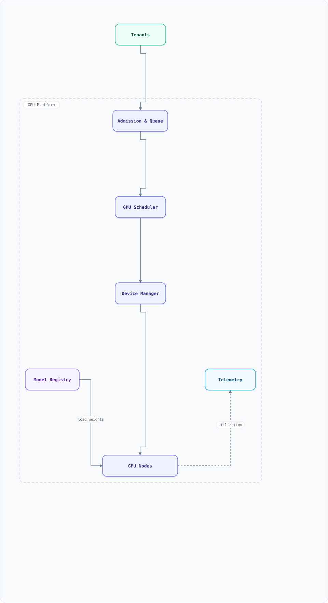

<div align="center">

<sub>SYSTEM DESIGN · AI INFRASTRUCTURE</sub>

# GPU Scheduler & Model Lifecycle

**Multi-tenant placement, quota fairness, and model residency on one GPU fleet.**


[Overview](#overview) · [Architecture](#high-level-architecture) · [Decisions](#key-design-decisions) · [Failures](#failure-modes--recovery) · [LLD](#low-level-design-lld--placement--model-eviction)

</div>

> [!TIP]
> **THE PROBLEM** — Design the control plane that decides **which tenant gets which GPU slice, and which model lives in GPU memory**. It combines Kubernetes-style admission and placement with a model cache: gang scheduling, topology-aware bin-packing, quota borrowing, MIG/MPS isolation, single-flight model loads, and drain-before-evict. The scarce resources are GPU **memory** and **interconnect topology**, not CPU.

| THE PROBLEM | THE HARD PART | THE BET |
| :--- | :--- | :--- |
| 200 tenants compete for 4,096 GPUs across training, inference and notebooks. | Placing a gang **and** keeping the right model resident — placement and eviction are one decision. | Separate admission from placement, reserve whole gangs, and drain before evicting a model. |

## Table of Contents

<details open>
<summary><b>📑 Jump to a section</b></summary>

1. [Overview](#overview)
2. [Requirements](#requirements)
3. [High-Level Architecture](#high-level-architecture)
4. [Microservices](#microservices)
5. [Database Design](#database-design)
6. [Scaling Tiers](#scaling-tiers)
7. [Key Techniques & Patterns](#key-techniques--patterns)
8. [Key Design Decisions](#key-design-decisions)
9. [Failure Modes & Recovery](#failure-modes--recovery)
10. [Cost Estimation (4K GPUs)](#cost-estimation-4k-gpus)
11. [Trade-off Analysis](#trade-off-analysis)
12. [Key Metrics to Monitor](#key-metrics-to-monitor)
13. [Production Readiness Checklist](#production-readiness-checklist)
14. [Deep Dive Prompts](#deep-dive-prompts)
15. [Common Interview Follow-ups (with answers)](#common-interview-follow-ups-with-answers)
16. [Low-Level Design (LLD) — Placement + Model Eviction](#low-level-design-lld--placement--model-eviction)
17. [Do's & Don'ts](#dos--donts)

</details>

---

## Overview

A multi-tenant GPU platform serves three workloads on one fleet: **training jobs** (gangs of 8–512 GPUs for days), **inference services** (long-lived replicas that must keep models resident), and **interactive notebooks** (small, bursty, preemptible). The control plane has two schedulers that are easy to conflate:

1. **Admission** — may this tenant start work now, given quotas, priority, and fairness? (Queue-level, not device-level.)
2. **Placement** — which physical GPUs, on which nodes, with which interconnect, and which model can stay resident there?

The second half is **model lifecycle**: a 70B model in FP8 is ~70 GB, so an 80 GB GPU can hold exactly one plus a small KV budget. Loading takes seconds to minutes; evicting the wrong model causes a cold-start storm. Placement and eviction must be designed together.

### Key Numbers

| Metric | Value |
| :--- | :--- |
| Fleet | 4,096 GPUs = 512 nodes × 8, 3 regions |
| Tenants | 200 teams, ~800 concurrent jobs, 5,000 submissions/day |
| Utilization target | 85% of GPU-hours allocated; < 3% stranded by fragmentation |
| Scheduling SLO | p99 placement decision < 2 s; queue wait p50 < 30 s for normal priority |
| Models | 200 versions in the registry; 7B–405B params; 14 GB–810 GB FP8 weights |
| Model load | 70 GB from local NVMe at ~6 GB/s ≈ 12 s; from object store over 25 GB/s ≈ 3 s + warmup |
| Preemption | 60 s notice for training (checkpoint), 0 s for notebooks (restart) |
| Isolation | MIG for hard memory/fault isolation; MPS for trusted co-tenants; time-slicing for dev only |
| Failure budget | One node loss must not lose a gang's reservation; scheduler restart < 30 s |

## Requirements

### Functional Requirements

- Submit training jobs (gang size, GPU type, topology, priority, deadline) and inference deployments (model, replicas, SLO)
- Per-tenant quotas with weighted fair sharing, borrowing, and reclaim
- Gang admission: all GPUs at once or none; no partial gangs parked forever
- Topology-aware placement: NVLink domain ≥ TP group, rack-aware for PP groups
- Model registry integration: load on demand, route to a replica that already has the model, evict under memory pressure
- Preemption with checkpoint/drain semantics by priority class
- Device sharing: MIG partitions, MPS multiplexing, time-slicing (development only)
- Visibility: per-tenant utilization, queue position, stranded-GPU report, cost

### Non-Functional Requirements

| Attribute | Target |
| :--- | :--- |
| **Correctness** | A GPU is never bound to two workloads; no double-assignment after scheduler failover |
| **Latency** | Placement p99 < 2 s at 4K GPUs; model-load admission decision < 100 ms |
| **Availability** | 99.9% control plane; existing workloads keep running if the scheduler is down |
| **Fairness** | No tenant exceeds its quota while another is queued, except through explicit borrowing |
| **Elasticity** | Add a node → schedulable in < 60 s; drain a node without killing a gang |
| **Auditability** | Every placement/eviction has a reason code and an actor |

---

## High-Level Architecture

### Architecture Diagram



**Interactive diagram:** [diagrams/system-design/gpu-scheduler.architecture.html](diagrams/system-design/gpu-scheduler.architecture.html) — pan/zoom, search, dark/light theme, PNG/SVG export.

*Solid = job/model flow, dashed = control plane / telemetry.*

### Data Flow

1. A tenant submits a JobSet or Deployment. **Admission** checks quota, priority class, gang size, and fair-share debt; it either queues the workload or marks it `Admitted`.
2. The **GPU Scheduler** takes a snapshot of node/device inventory from the device manager (DRA `ResourceSlice`-style attributes: GPU type, MIG profile, NVLink domain, NUMA, taints).
3. **Filter** (GPU type, memory, topology, taints, quota) → **Score** (bin-pack, locality, fragmentation, pre-warm affinity) → **Reserve** (optimistic version bump or lease). Gang reservations are all-or-nothing.
4. The **Device Manager** binds the claims and configures isolation: MIG instance, MPS daemon, or time-slice. It writes the binding; the scheduler never touches the driver directly.
5. For inference, the **Model Loader** checks the node's model cache. A hit is ready immediately; a miss is single-flighted, loaded from local NVMe or object storage, warmed up, and only then marked `READY`.
6. **Telemetry** reports SM occupancy, HBM usage, Xid errors, queue wait, and per-tenant cost. Eviction pressure and preemption decisions consume the same stream.

---

## Microservices

| Service | Responsibility | Scaling |
| :--- | :--- | :--- |
| Admission / Queue | Quota, fair share, priority, gang admission, borrowing | Stateless, leader-elected per cluster |
| GPU Scheduler | Filter/score/reserve, topology, preemption planning | Active-passive per cluster; sharded by pool |
| Device Manager | DRA claims, MIG/MPS setup, health, inventory | DaemonSet per node + regional controller |
| Model Registry | Model versions, weight URIs, size, compatibility | Read-heavy, cached at edge |
| Model Loader | Single-flight load, warmup, readiness, unload/drain | Per node agent |
| Recovery/Reconciler | Detect stale leases, rebuild state, requeue | Leader-elected |
| Telemetry & Billing | Utilization, cost, SLOs, eviction signals | Partitioned by cluster |

---

## Database Design

PostgreSQL is the source of truth for intent; etcd/Kubernetes holds the live object graph; Redis holds ephemeral leases and heartbeats.

```sql
CREATE TABLE tenants (
  tenant_id    BIGSERIAL PRIMARY KEY,
  name         TEXT UNIQUE NOT NULL,
  fair_weight  INT NOT NULL DEFAULT 1
);

CREATE TABLE quotas (
  tenant_id    BIGINT REFERENCES tenants,
  pool         TEXT NOT NULL,              -- h100-prod, l40s-dev
  gpu_limit    INT NOT NULL,
  borrowed     INT NOT NULL DEFAULT 0,
  PRIMARY KEY (tenant_id, pool)
);

CREATE TABLE jobs (
  job_id       UUID PRIMARY KEY,
  tenant_id    BIGINT NOT NULL,
  kind         TEXT NOT NULL,              -- train | infer | notebook
  state        TEXT NOT NULL,              -- queued | admitted | running | draining | done
  priority     INT NOT NULL,
  gpu_count    INT NOT NULL,
  gpu_type     TEXT NOT NULL,
  topology     TEXT,                       -- nvlink-domain | rack | any
  model_version TEXT,                      -- inference only
  submitted_at TIMESTAMPTZ DEFAULT now()
);

CREATE TABLE gpu_devices (
  device_id    UUID PRIMARY KEY,
  node_id      TEXT NOT NULL,
  gpu_type     TEXT NOT NULL,
  memory_gb    INT NOT NULL,
  mig_profile  TEXT,
  nvlink_domain TEXT,
  health       TEXT NOT NULL DEFAULT 'ready',
  version      BIGINT NOT NULL DEFAULT 0   -- optimistic concurrency
);

CREATE TABLE placements (
  job_id       UUID REFERENCES jobs,
  device_id    UUID REFERENCES gpu_devices,
  lease_id     UUID NOT NULL,
  attempt      INT NOT NULL,
  bound_at     TIMESTAMPTZ DEFAULT now(),
  PRIMARY KEY (device_id)                  -- one live workload per device
);

CREATE TABLE model_placements (
  model_version TEXT NOT NULL,
  node_id       TEXT NOT NULL,
  state         TEXT NOT NULL,             -- loading | ready | draining
  size_gb       INT NOT NULL,
  last_used     TIMESTAMPTZ NOT NULL,
  pinned        BOOLEAN NOT NULL DEFAULT false,
  PRIMARY KEY (model_version, node_id)
);
```

**Why a lease, not just a row?** A scheduler that crashes between "choose device" and "bind" must not leave a device reserved forever. Each reservation carries `(lease_id, attempt, expires_at)`; the device manager rejects a bind whose attempt is stale, and the reconciler expires orphaned leases. This is the fencing-token pattern applied to placement.

---

## Scaling Tiers

| Tier | GPUs | Infrastructure | Monthly Cost |
| :--- | :--- | :--- | :--- |
| 1K–10K users / lab | 8–64 | Single cluster, default scheduler + static MIG partitions, model cache on local disk | $15K–$120K |
| 10K–1M users | 256–1,024 | Kueue-style queues, gang scheduling, DRA, 2 pools (train/infer), regional model cache | $500K–$2M |
| 1M–10M+ users | 4,096+ | Multi-cluster federation, hierarchical quotas, topology-aware placement, predictive pre-warm, defragmentation | $7M+ |

At the top tier the scheduler becomes a **federation problem**: each cluster schedules locally, a global allocator hands out quota slices, and cross-region placement is driven by data gravity and latency SLOs rather than raw utilization.

---

## Key Techniques & Patterns

### Isolation: choose by blast radius, not utilization

| Mode | Isolation | Best for | Cost |
| :--- | :--- | :--- | :--- |
| **MIG** | Hardware partitions: dedicated memory, fault isolation; fixed profiles (e.g. 1g.10gb) | Untrusted tenants, inference replicas, predictable QoS | Wastes memory when the profile doesn't fit |
| **MPS** | Shared GPU, cooperative processes, no fault isolation | Trusted co-tenants, small models, bursty notebooks | One process can stall others |
| **Time-slicing** | Oversubscription with context switching | Development, interactive notebooks | No memory isolation, latency unpredictable |

NVIDIA documents all three; do not claim MPS gives MIG-like error isolation — it does not.

### Scheduling mechanics

- **Gang scheduling**: reserve the whole gang before binding any member. Otherwise 7 of 8 GPUs sit idle while the last waits, and two gangs can deadlock each other.
- **Topology-aware placement**: TP groups want one NVLink domain; PP groups want high-bandwidth inter-node links; data-parallel ranks can spread. A topology-blind scheduler produces "GPUs are free but the job cannot start".
- **Bin-packing vs spreading**: pack to reduce fragmentation and power draw; spread to reduce correlated failure. Most fleets pack training, spread inference across failure domains.
- **Quota borrowing with reclaim**: idle quota is lent to other tenants with a preemption order; the borrower must be evictable (checkpointable or restartable).
- **Backfill**: fill small jobs into reserved-but-unused gaps without delaying the reservation's start time.
- **Preemption**: priority + fair-share debt + deadline. Training gets a 60 s checkpoint window; inference replicas drain connections; notebooks are killed and restarted.
- **Model cache tiers**: HBM → host RAM (pinned) → local NVMe → object store. Each tier trades load latency for cost; a hit at a higher tier skips the lower ones.
- **Single-flight loading**: one load per `(model, node)`; concurrent requests wait on the same future. Without it, ten replicas on one node each pull 70 GB.
- **Drain-before-evict**: stop routing, wait for in-flight requests, unload, then free memory. Evicting a model with live requests is a production outage disguised as a cache miss.
- **Predictive pre-warm**: schedule loads for known daily peaks (and after a deploy) before traffic arrives; otherwise the first request pays the cold start.
- **Defragmentation**: when a large gang cannot fit despite enough total free GPUs, optionally drain/migrate small workloads or preempt to create a contiguous topology block.

---

## Key Design Decisions

| Decision | Rationale | Trade-off |
| :--- | :--- | :--- |
| Separate admission from placement | Queue wait and device choice fail differently; quotas are global, topology is local | Two state machines and a handoff protocol |
| Gang reservation before bind | Prevents partial gangs and deadlock | Holds capacity idle briefly; needs a reservation timeout |
| MIG for untrusted inference | Memory and fault isolation are non-negotiable for multi-tenant SLOs | Fixed profiles fragment memory |
| Model cache on local NVMe, not only object store | 70 GB over the network per replica is a cold-start storm | Local disk cost and cache invalidation |
| Drain-before-evict + LRU | Bounded churn, no dropped requests | Eviction can be blocked by long streams; needs a deadline |
| Optimistic concurrency + leases | Scheduler HA without a global lock | Retries and reconciler complexity |
| Kueue/DRA-style abstractions rather than a bespoke CRD | Existing ecosystem, portable semantics | Version skew across Kubernetes/GPU Operator |

---

## Failure Modes & Recovery

| Failure | Detection | Recovery |
| :--- | :--- | :--- |
| Scheduler crashes mid-reservation | Lease TTL expires; bind rejected as stale | Reconciler expires leases, job returns to queue, no device double-bound |
| Node dies with a gang's GPUs | Node heartbeat + Xid/NVML errors | Requeue gang, prefer a different topology block, restart from checkpoint |
| Enough free GPUs but job stuck Pending | Fragmentation metric + queue age alert | Preempt/migrate small workloads or place on the next topology block |
| Model load storm after deploy | Load queue depth, NVMe saturation | Single-flight, admission cap on concurrent loads, stagger rollout |
| Model evicted while serving | In-flight request errors | `pinned` while a request is active; drain before unload; re-route to a warm replica |
| Quota accounting drifts | Reconciler compares intended vs actual placements | Recompute from `placements`, not from cached counters; alert on delta |
| MIG profile mismatch | Device plugin reports unsupported profile | Filter before scoring; fail the job with an actionable reason code |
| GPU Xid error / ECC failure | Node agent health stream | Cordon device, drain workloads, replace node; never reschedule onto it |
| API server / etcd overload | Apiserver latency, watch backlog | Rate-limit informer churn, cache snapshots, jitter resyncs |

---

## Cost Estimation (4K GPUs)

| Component | Spec | Monthly |
| :--- | :--- | :--- |
| H100 GPUs | 4,096 × $2.50/hr | $7,475,200 |
| GPU nodes (CPU/RAM/NIC) | 512 nodes, included/amortised | $900,000 |
| Local NVMe model cache | 512 × 30 TB | $150,000 |
| Control plane | Scheduler, DB, telemetry, 3 regions | $45,000 |
| Object storage + egress | Weights, checkpoints, 2 PB | $60,000 |
| **Total** | | **~$8.63M** |

**The number that matters:** at 85% utilization the fleet delivers ~3,482 effective GPU-hours/hour; at 60% it delivers ~2,458. The gap is ~1,024 GPU-hours/hour ≈ **$1.9M/month**. Scheduling quality is a cost feature, not an ops nicety.

---

## Trade-off Analysis

| Decision | Gain | Cost |
| :--- | :--- | :--- |
| MIG instead of time-slicing | Predictable latency, fault isolation | 10–20% memory stranded by fixed profiles |
| Gang scheduling | No partial-gang deadlock | Short idle reservations; needs timeout/backfill |
| Pack tightly | Higher utilization, lower power | Correlated failure, noisy neighbours, harder defrag |
| Spread inference | Failure isolation, smoother latency | More cross-node traffic, lower packing efficiency |
| Aggressive preemption | Fast recovery of quota | Checkpoint churn; tenants lose trust in guarantees |
| Large local model cache | Fast cold start | Idle disk cost; stale versions must be evicted |

---

## Key Metrics to Monitor

- **Allocation**: GPU-hours allocated vs used, queue depth by priority, admission latency, gang success rate
- **Utilization**: SM occupancy, HBM used, achieved MFU, idle-allocated (the expensive kind)
- **Fragmentation**: largest schedulable gang vs total free GPUs, stranded GPU-hours by pool
- **Model lifecycle**: load latency p50/p99, cache hit rate by tier, evictions/hour, drain timeouts
- **Reliability**: Xid errors, node churn, preemption rate, checkpoint success rate
- **Fairness**: usage share vs quota share per tenant, borrowing debt, oldest pending job age

---

## Production Readiness Checklist

- [ ] **Correctness** — a GPU can never be bound twice: DB uniqueness + lease attempt fencing + reconciler replay test
- [ ] **HA** — scheduler leader election; existing workloads unaffected by control-plane outage; state rebuilt from placements
- [ ] **Isolation** — MIG profiles enforced for untrusted tenants; MPS only within a trust boundary; time-slicing blocked in prod
- [ ] **Preemption** — every preemptible workload has a checkpoint or a restart contract; grace period tested
- [ ] **Capacity** — queue SLOs at 2× peak; gang admission tested with a fragmented fleet
- [ ] **Model cache** — single-flight verified under a 20-replica rollout; drain-before-evict verified with live streams
- [ ] **Cost** — per-tenant showback from actual placements, not requested GPU counts
- [ ] **Observability** — utilization, stranded GPUs, load latency, eviction churn, Xid events on one dashboard

---

## Deep Dive Prompts

- Derive how many 8K-context 70B inference replicas fit on one 80 GB GPU alongside 70 GB of weights.
- Your fleet has 40 free GPUs but a 32-GPU gang cannot schedule. What do you do, and what metric proves the problem?
- Design quota borrowing so a borrower cannot starve the owner when the owner returns.
- How does MIG change bin-packing compared with whole-GPU allocation?
- Design the failover path for a scheduler that dies after reserving 64 GPUs but before binding them.

## Common Interview Follow-ups (with answers)

**Q1. Why not just use the default Kubernetes scheduler?**
It schedules pods one at a time: no gang semantics, no GPU topology awareness, no quota borrowing or fair share, and no model-residency concept. Kueue adds queueing/quota/preemption, DRA adds device claims with attributes, and a GPU scheduler adds topology and cache-aware placement. The interview answer is the **layering**, not a claim that Kubernetes cannot schedule GPUs.

**Q2. How do you prevent double-assignment when the scheduler is HA?**
Three mechanisms together: a database uniqueness constraint on `placements.device_id`; a monotonically increasing `attempt`/lease id that the device manager validates; and a reconciler that expires leases and compares intended vs actual state. Optimistic concurrency alone is not enough if two schedulers both read a stale snapshot.

**Q3. Gang scheduling vs sequential scheduling?**
Sequential scheduling lets a gang hold 7 GPUs while waiting for the 8th, wasting capacity, and two gangs can each hold half of what the other needs. Gang reservation avoids both but holds capacity idle during the reservation window, so it needs a timeout and backfill for small jobs.

**Q4. MIG, MPS, or time-slicing?**
MIG when tenants are untrusted or SLOs are strict — hardware memory and fault isolation. MPS for trusted co-tenants who want concurrency without partition waste. Time-slicing for development only; it oversubscribes memory and makes latency unpredictable. Never describe MPS as fault-isolated.

**Q5. When do you evict a model, and how?**
When a node cannot admit a new model without freeing memory. Rank candidates by LRU + size + pin state, but only evict models with zero in-flight requests: mark `draining`, stop routing, wait for streams to finish (bounded), unload, then admit. Pin a model while a request holds it; otherwise you will evict the model you are serving.

**Q6. How do you make a 70B model cold start fast?**
Tiered cache: keep hot weights on local NVMe (12 s) instead of pulling from object storage every time; single-flight per node; overlap host-to-device copy with warmup; pre-warm before known peaks; and route requests to replicas that already hold the model (cache-aware routing) rather than always scaling a new replica.

**Q7. What is "stranded" capacity and why does it matter?**
GPUs that are free but unusable for the pending workload because of topology, MIG profile, or gang size. Total free GPUs is a misleading utilization metric; the schedulable-gang metric is what determines whether the queue drains. Defragmentation, backfill, and profile-aware pools are the levers.

## Low-Level Design (LLD) — Placement + Model Eviction

Two structures make the design concrete: a **first-fit-decreasing placement** over devices with topology labels, and an **LRU model cache** per node that must free memory before admitting a new model. The demo shows a job that only fits after evicting the least-recently-used model, and a job that must be rejected because draining models cannot free enough.

```javascript
class Node {
  constructor(id, gpus, gbPerGpu, nvlinkDomain) {
    this.id = id; this.gpus = gpus; this.free = Array(gpus).fill(gbPerGpu);
    this.nvlinkDomain = nvlinkDomain;
    this.models = new Map(); // name -> { gb, lastUsed, state, pinned, gpu }
  }
  freeGb() { return this.free.reduce((a, b) => a + b, 0); }
  largestFree() { return Math.max(...this.free); }
  cache(name, gb, lastUsed, pinned = false) {
    const gpu = this.free.indexOf(Math.max(...this.free));
    if (this.free[gpu] < gb) return false;      // does not fit on any device
    this.free[gpu] -= gb;                        // resident weights consume HBM
    this.models.set(name, { gb, lastUsed, state: 'ready', pinned, gpu });
    return true;
  }
}

// Evict LRU unpinned models on the GPUs that can be made large enough for the job.
function evictToFit(node, needGb, now) {
  const evicted = [];
  for (let gpu = 0; gpu < node.free.length; gpu++) {
    if (node.free[gpu] >= needGb) return evicted;
    const candidates = [...node.models.entries()]
      .filter(([, m]) => m.gpu === gpu && m.state === 'ready' && !m.pinned)
      .sort((a, b) => a[1].lastUsed - b[1].lastUsed);     // least recently used first
    for (const [name, m] of candidates) {
      if (node.free[gpu] >= needGb) break;
      node.models.delete(name);                            // production: drain, then unload
      node.free[gpu] += m.gb;
      evicted.push(`${name}(${m.gb}GB)`);
    }
  }
  return evicted;
}

function place(job, nodes, now) {
  const slots = n => n.free.filter(gb => gb >= job.gbPerGpu).length;
  const take = (n, evicted) => {
    for (let k = 0; k < job.gpus; k++) {
      const i = n.free.findIndex(gb => gb >= job.gbPerGpu);
      n.free[i] -= job.gbPerGpu;
    }
    return { placed: true, node: n.id, evicted, freeAfter: n.freeGb() };
  };
  // Pass 1: prefer a node that already has room — never evict to pack tightly.
  const ready = nodes.filter(n => slots(n) >= job.gpus).sort((a, b) => a.freeGb() - b.freeGb());
  for (const node of ready) return take(node, []);
  // Pass 2: only if nothing fits, free unpinned models (pinned models are serving).
  for (const node of nodes) {
    const evicted = evictToFit(node, job.gbPerGpu, now);
    if (slots(node) >= job.gpus) return take(node, evicted);
  }
  return { placed: false, reason: 'no node can free enough HBM — filter/topology failure' };
}

const now = 1_000;
const n1 = new Node('node-a', 1, 80, 'nvlink-1');
n1.cache('llama-70b', 70, now - 500);      // old, evictable
n1.cache('reranker', 8, now - 50);         // newer, evictable
const n2 = new Node('node-b', 1, 80, 'nvlink-1');
n2.cache('embed', 40, now - 10, true);     // pinned: an active request holds it

console.log('70B job:', place({ gpus: 1, gbPerGpu: 70 }, [n1, n2], now));
console.log('node-a models after eviction:', [...n1.models.keys()].join(',') || '(none)');
console.log('impossible 90GB slice:', place({ gpus: 1, gbPerGpu: 90 }, [n2], now));
console.log('pinned embed survives:', [...n2.models.keys()].join(','));
```

Expected: no node has 70 GB free, so node-a evicts `llama-70b` (oldest) and keeps `reranker`; node-b cannot help because its `embed` model is pinned — a drain would be needed, not eviction. The 90 GB request is rejected because no single GPU can ever satisfy it: a filter failure, not a queue problem.

### Primary references

- [NVIDIA MIG user guide — concepts](https://docs.nvidia.com/datacenter/tesla/mig-user-guide/latest/concepts.html) — hardware partitions, profiles and isolation limits
- [NVIDIA GPU Operator — GPU sharing](https://docs.nvidia.com/datacenter/cloud-native/gpu-operator/latest/gpu-sharing.html) — MPS and time-slicing behaviour
- [Kubernetes Dynamic Resource Allocation](https://kubernetes.io/docs/concepts/resource-management/dynamic-resource-allocation/) — claiming devices by attributes
- [Kueue — fair sharing](https://kueue.sigs.k8s.io/docs/concepts/fair_sharing/) — quotas, borrowing and preemption
- [Triton — batchers](https://docs.nvidia.com/deeplearning/triton-inference-server/user-guide/docs/user_guide/batcher.html) — queue delay, priorities, preferred batch sizes
- [Ray Serve — model multiplexing](https://docs.ray.io/en/latest/serve/model-multiplexing.html) — on-demand load and LRU eviction per replica

## Do's & Don'ts

| ✅ Do | ❌ Don't |
| :-- | :-- |
| Separate admission (quota) from placement (devices) | Don't make the queue wait on topology decisions it cannot influence |
| Reserve the whole gang before binding any member | Don't park partial gangs and call it backfill |
| Quote the isolation properties of MIG, MPS, and time-slicing precisely | Don't claim MPS provides fault or memory isolation |
| Make the device manager the only writer of bindings | Don't let two control loops touch the driver |
| Lease + fence every reservation | Don't trust a scheduler's in-memory "assumed" cache after failover |
| Drain before evicting a model | Don't free HBM under an in-flight request |
| Track stranded GPUs, not just free GPUs | Don't report 90% utilization while a 32-GPU gang waits |
| Pre-warm for known peaks and deploys | Don't discover a cold-start storm in production |

*More cross-topic rules: [Interview Q&A](interview-qa.md) · [Operating Systems](operating-systems.md) · [LLM Inference](system-design-llm-inference.md) · [Low-Level Design](low-level-design.md)*
