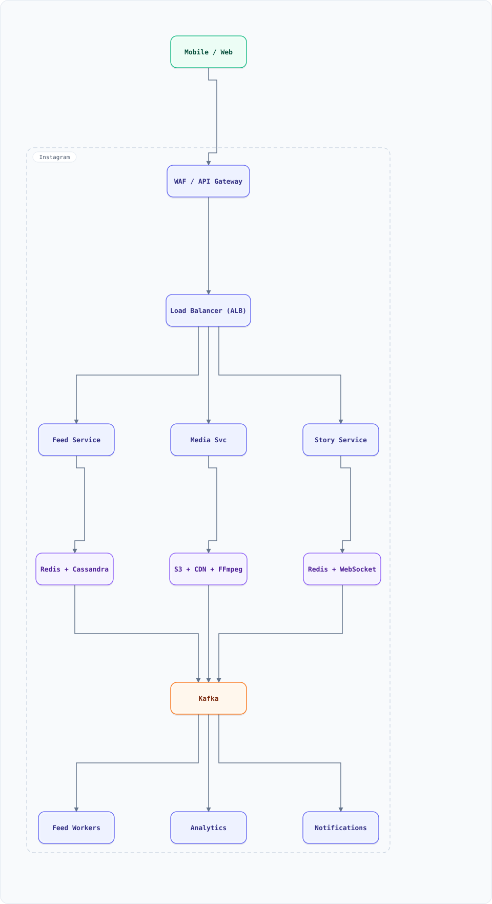

<div align="center">

# System Design: Instagram

</div>

> [!TIP]
> **TL;DR** — A photo/video sharing social platform supporting content upload, following, personalized feed, stories, likes/comments, and search for 2B+ users.

## Table of Contents

<details>
<summary><b>📑 Jump to a section</b></summary>

1. [Overview](#overview)
2. [Requirements](#requirements)
3. [High-Level Architecture](#high-level-architecture)
4. [Microservices](#microservices)
5. [Database Design](#database-design)
6. [Scaling Tiers](#scaling-tiers)
7. [Key Design Decisions](#key-design-decisions)
8. [Failure Modes & Recovery](#failure-modes--recovery)
9. [Cost Estimation (1M Users)](#cost-estimation-1m-users)
10. [Trade-off Analysis](#trade-off-analysis)
11. [Key Metrics to Monitor](#key-metrics-to-monitor)
12. [Deep Dive Prompts](#deep-dive-prompts)
13. [Key Techniques & Patterns](#key-techniques--patterns)
14. [Common Interview Follow-ups](#common-interview-follow-ups)
15. [Low-Level Design (LLD) - Algorithms & Data Structures](#low-level-design-lld---algorithms--data-structures)
16. [Do's & Don'ts](#dos--donts)

</details>

---


## Overview

A photo/video sharing social platform supporting content upload, following, personalized feed, stories, likes/comments, and search for 2B+ users.

### Key Numbers

| Metric | Value |
| :--- | :--- |
| **monthly active users** | 2B+ |
| **daily stories** | 500M+ |
| **photos/videos uploaded daily** | 100M+ |
| **Peak** | 1M+ likes per second |

---

## Requirements

### Functional Requirements

- Post photos/videos with filters
- Follow users and see feed
- Like, comment, share posts
- Direct messages with media
- Stories that disappear after 24h

### Non-Functional Requirements

| Attribute | Target |
| :--- | :--- |
| **Latency** | Feed < 200ms, upload < 5s |
| **Throughput** | 100M+ photos/day |
| **Availability** | 99.99% uptime |
| **Consistency** | Eventually consistent feed |
| **Scale** | 2B+ monthly active users |

---

## High-Level Architecture

### Architecture Diagram



**Interactive diagram:** [diagrams/system-design/instagram.architecture.html](diagrams/system-design/instagram.architecture.html) — pan/zoom, search, dark/light theme, PNG/SVG export.


*Solid = data flow, dashed = control plane / monitoring.*

### Data Flow

1. User posts photo - Media Service uploads to S3, transcodes
2. Fan-out pushes to all followers feeds (write-heavy)
3. Feed Service reads from Redis cache (< 50ms latency)
4. Stories: ephemeral content with 24h TTL in Redis
5. Explore: ML-based discovery from engagement signals
6. Kafka events: impressions, likes, shares - Analytics
7. Notifications: likes, comments, follows, story views

## Microservices

### 1. Auth Service

- **Responsibility**: Registration, login, OAuth, JWT tokens
- **Tech**: Node.js / Go
- **DB**: PostgreSQL

### 2. User Service

- **Responsibility**: Profiles, follow/unfollow, block list, settings
- **Tech**: Go
- **DB**: PostgreSQL (users), Redis (follow graph cache)

### 3. Post Service

- **Responsibility**: Create/delete posts, caption, tags, location, comments, likes
- **Tech**: Go / Java
- **DB**: Cassandra (posts, write-heavy)
- **Cache**: Redis (post metadata)

### 4. Feed Service (Critical)

- **Responsibility**: Home feed generation, timeline assembly, ranking
- **Tech**: Java / Go
- **DB**: Redis (pre-computed feeds), Cassandra (feed metadata)
- **Pattern**: Fan-out-on-write for regular users, fan-out-on-read for celebrities

### 5. Media Service

- **Responsibility**: Image/video upload, resizing, thumbnail generation, CDN upload
- **Tech**: Go / Python
- **Storage**: S3 (original + processed)
- **Queue**: Kafka (async processing)
- **CDN**: CloudFront / Akamai

### 6. Search Service

- **Responsibility**: User search, hashtag search, location search
- **Tech**: Python / Go
- **DB**: Elasticsearch

### 7. Notification Service

- **Responsibility**: Push notifications, in-app notifications, email digests
- **Tech**: Node.js
- **Queue**: Kafka consumer
- **Channels**: FCM, APNs, SendGrid

### 8. Stories Service

- **Responsibility**: Story upload, story feed, story views, story reactions
- **Tech**: Go
- **DB**: Cassandra (stories, time-series)
- **Cache**: Redis (story feed)

---

## Database Design

### PostgreSQL (Users & Social Graph)

```sql
CREATE TABLE users (
    user_id         UUID PRIMARY KEY DEFAULT gen_random_uuid(),
    username        VARCHAR(50) UNIQUE NOT NULL,
    email           VARCHAR(255) UNIQUE,
    phone           VARCHAR(20),
    name            VARCHAR(255),
    bio             TEXT,
    avatar_url      TEXT,
    is_verified     BOOLEAN DEFAULT FALSE,
    is_private      BOOLEAN DEFAULT FALSE,
    followers_count INT DEFAULT 0,
    following_count INT DEFAULT 0,
    post_count      INT DEFAULT 0,
    created_at      TIMESTAMP DEFAULT NOW()
);

CREATE TABLE follows (
    follower_id     UUID REFERENCES users(user_id),
    followee_id     UUID REFERENCES users(user_id),
    created_at      TIMESTAMP DEFAULT NOW(),
    PRIMARY KEY (follower_id, followee_id)
);
```

### Cassandra (Posts & Media)

```cql
CREATE TABLE posts (
    user_id         UUID,
    post_id         TIMEUUID,
    caption         TEXT,
    media_urls      LIST<TEXT>,
    media_type      TEXT,
    location        TEXT,
    tags            SET<TEXT>,
    likes_count     COUNTER,
    comments_count  COUNTER,
    created_at      TIMESTAMP,
    PRIMARY KEY ((user_id), post_id)
) WITH CLUSTERING ORDER BY (post_id DESC);

CREATE TABLE feed (
    user_id         UUID,
    post_id         TIMEUUID,
    author_id       UUID,
    created_at      TIMESTAMP,
    PRIMARY KEY ((user_id), created_at, post_id)
) WITH CLUSTERING ORDER BY (created_at DESC);
```

### Redis

```
# Feed cache (pre-computed home feed)
LPUSH feed:{user_id} {post_json}
LTRIM feed:{user_id} 0 499

# Like status
SADD likes:{post_id} {user_id}

# Follow graph cache
SADD following:{user_id} {followee_id}
SCARD followers:{user_id}

# Post metadata cache
SETEX post:{post_id} 3600 {json}
```

---

## Scaling Tiers

### Tier 1: 1K - 10K Users

| Component | Choice |
| ----------- | -------- |
| **Compute** | 2-4 EC2 (t3.large) |
| **Database** | PostgreSQL RDS |
| **Cache** | Redis ElastiCache |
| **Media** | S3 + CloudFront |
| **Feed** | On-read (pull model) |
| **Queue** | Redis Streams |

### Tier 2: 10K - 1M Users

| Component | Choice |
| ----------- | -------- |
| **Compute** | ECS (20-50 containers) |
| **Database** | PostgreSQL + Cassandra (3 nodes) |
| **Cache** | Redis Cluster (12 nodes) |
| **Media** | S3 + multi-CDN |
| **Feed** | Hybrid fan-out |
| **Queue** | Kafka (3 brokers) |
| **Search** | Elasticsearch (3 nodes) |

### Tier 3: 1M - 10M+ Users

| Component | Choice |
| ----------- | -------- |
| **Compute** | Multi-region K8s (500+ pods) |
| **Database** | Cassandra (50+ nodes) + PostgreSQL (sharded) |
| **Cache** | Redis Cluster (30+ nodes) |
| **Media** | S3 + custom edge CDN |
| **Feed** | Fan-out-on-write + celebrity hybrid |
| **Queue** | Kafka (15+ brokers) |
| **ML** | SageMaker (feed ranking) |

---

## Key Design Decisions

### 1. Fan-Out-on-Write vs Fan-Out-on-Read

- **Write**: Pre-compute feed when post is created (fast reads, slow writes)
- **Read**: Generate feed when user opens app (slow reads, fast writes)
- **Hybrid**: Fan-out-on-write for regular users, on-read for celebrities (1M+ followers)

### 2. Why Cassandra for Posts?

- Write-heavy workload (100M+ posts/day)
- Time-series access pattern (recent posts first)
- Partition by user_id for even distribution

### 3. Why Redis for Feed Cache?

- Sub-millisecond reads for feed loading
- List data structure is perfect for timeline
- TTL for automatic feed expiry

### 4. Image Processing Pipeline

- Upload to S3 -> Lambda triggers resize -> Generate thumbnails (150x150, 640x640, 1080x1080) -> Upload to CDN
- Use blurhash for placeholder images

### 5. Like Count Strategy

- Use Redis INCR for real-time count (eventual consistency OK)
- Periodically sync to Cassandra for durability
- Use SET for unique like tracking (prevent double likes)

---

## Failure Modes & Recovery
What can go wrong in production, and how the system detects and recovers:

| Failure | Impact | Recovery |
| --------- | -------- | ---------- |
| Feed slow for celebrity | Followers see delay | Fan-out-on-read for celebrities, pre-computed cache |
| Media CDN failure | Cannot load images | Multi-CDN failover, lazy loading |
| Story expiration storm | Millions expire simultaneously | Distributed expiration with jitter |
| Like count inconsistency | Wrong number | Eventual consistency, reconciliation |
| Abuse false positive | Legitimate account suspended | Human review queue, appeal process |
| DM storage overflow | Media conversations exhaust storage | Tiered storage, auto-archive old |

---

## Cost Estimation (1M Users)
Rough monthly cost of running this design for one million users:

| Component | Specification | Monthly Cost |
| ----------- | -------------- | ------------- |
| API Servers | 50x c5.xlarge | $7,000 |
| PostgreSQL | db.r5.2xlarge + 8 replicas | $10,400 |
| Redis Cluster | 24x cache.r5.xlarge | $19,200 |
| Kafka Cluster | 12x kafka.m5.large | $4,800 |
| S3 Media Storage | 500TB | $11,500 |
| CDN | 200TB/month transfer | $16,000 |
| Feed Service | 30x c5.xlarge | $4,200 |
| ML Ranking | GPU instances | $5,000 |
| Stories Service | 10x c5.xlarge | $1,400 |
| **Total** | | **~$79,500/month** |

---

## Trade-off Analysis
The alternatives considered, and which one won and why:

| Approach A | Approach B | Winner | Reason |
| ----------- | ----------- | -------- | -------- |
| Redis GEO | PostGIS | Redis GEO | Sub-ms location queries for nearby posts |
| Fan-out-on-write | Fan-out-on-read | Hybrid | Normal users: push, celebrities: pull |
| Sharp | ImageMagick | Sharp | 5x faster image processing in Node.js |
| PostgreSQL | MongoDB | PostgreSQL | ACID compliance for user data |
| Kafka | RabbitMQ | Kafka | Higher throughput for post events |

---

## Key Metrics to Monitor
The metrics that signal system health, with alert thresholds:

| Metric | Target |
| -------- | -------- |
| Feed load time (p99) | < 500ms |
| Image upload success rate | > 99.9% |
| Feed generation latency | < 200ms |
| Like/comment latency | < 100ms |
| CDN cache hit ratio | > 95% |
| API response time (p99) | < 200ms |
| Story view latency | < 300ms |
| Search latency (p99) | < 500ms |
| System availability | 99.95% |
| Image processing queue depth | < 1000 |

---

## Deep Dive Prompts

- How does fan-out-on-write work for accounts with 100M+ followers?
- How does EdgeRank algorithm rank posts in the feed?
- How do you handle 100M+ photo uploads per day?
- How does the Explore page discover content for new users?

---

## Key Techniques & Patterns
The recurring techniques and patterns this design applies, mapped to where they are used:

| Technique | Description | Used In |
| ----------- | ------------- | ---------- |
| Fan-out on Write/Read Hybrid | Applied in this system | Architecture + LLD |
| CDN for Media | Applied in this system | Architecture + LLD |
| Redis Feed Cache | Applied in this system | Architecture + LLD |
| Graph API for Social | Applied in this system | Architecture + LLD |
| Image Processing Pipeline | Applied in this system | Architecture + LLD |
| Hashtag Inverted Index | Applied in this system | Architecture + LLD |

## Common Interview Follow-ups

**Q: How does fan-out-on-write work for stories?**
A: Redis sorted sets with 24h TTL, pre-computed story ring, fan-out for < 1000 followers

**Q: How does EdgeRank-like feed ranking work?**
A: Affinity score, weight (photo/video/link), time decay, ML personalization

**Q: How do you handle 100M+ photos/day upload?**
A: Chunked upload to S3, compression, processing pipeline, CDN delivery

---

## Low-Level Design (LLD) - Algorithms & Data Structures

### 1. Fan-Out-on-Write Algorithm

```js
class FeedService {
  constructor(redisClient, dbClient) { this.r = redisClient; this.db = dbClient; }
  async fanout(post, authorId) {
    const followers = await this.db.getFollowers(authorId);
    if (followers.length > 10000) return { strategy: 'pull', notified: 0 };
    const pipe = this.r.pipeline();
    for (const fid of followers) { pipe.lpush('feed:' + fid, post.id); pipe.ltrim('feed:' + fid, 0, 999); }
    await pipe.exec();
    return { strategy: 'push', notified: followers.length };
  }
  async getFeed(userId, cursor, limit = 20) {
    const ids = await this.r.lrange('feed:' + userId, cursor || 0, limit - 1);
    return this.db.getPostsByIds(ids);
  }
}

const feed = new FeedService(); console.log("Feed service ready");
```

### 2. Home Feed Generation (Hybrid)

```js
async function getHomeFeed(userId, cursor = null, limit = 20) {
  // Hybrid fan-out: read the pre-computed inbox (fast path) and merge in the latest
  // posts from accounts the user follows that are NOT pre-computed (celebrities).
  //  1. inbox: pre-computed post ids for normal accounts (fan-out on write)
  //  2. outbox: on-demand pull for high-follower accounts (fan-out on read)
  //  3. merge + deduplicate by post id
  //  4. hydrate post details in one batched read (avoid N+1)
  //  5. rank (EdgeRank-style, see rank_posts)
  //  6. paginate with a stable cursor (score + id, never an offset)
  const seen = new Set();
  const candidates = [];

  for (const postId of await feedStore.inbox(userId, { before: cursor?.inboxTs, limit: limit * 2 })) {
    if (!seen.has(postId)) { seen.add(postId); candidates.push({ id: postId, source: 'inbox' }); }
  }
  for (const postId of await feedStore.celebrityPull(userId, { limit: limit })) {
    if (!seen.has(postId)) { seen.add(postId); candidates.push({ id: postId, source: 'pull' }); }
  }

  const posts = await postStore.getMany(candidates.map(c => c.id));
  // rankPosts() is defined in the next section; the pass-through keeps this block
  // runnable on its own (the real ranking is never a no-op in production).
  const rankPosts = globalThis.rankPosts || (items => items);
  const ranked = rankPosts(posts, userId);
  const page = ranked.slice(0, limit);

  return {
    items: page,
    nextCursor: page.length === limit
      ? { score: page[page.length - 1].score, id: page[page.length - 1].id }
      : null,
  };
}

const feedStore = { inbox: async () => ['p3', 'p2'], celebrityPull: async () => ['p9'] };
const postStore = { getMany: async ids => ids.map(id => ({ id, ageHours: 1, likes: 10, comments: 2, type: 'photo' })) };
getHomeFeed('u1').then(feed => console.log('feed:', feed.items.map(p => p.id)));
```

### 3. EdgeRank-like Ranking Algorithm

```js
function rankPosts(posts, userId) {
  // Instagram-style ranking: four signals, weighted, then sorted.
  //   affinity        how often you interact with this author
  //   timeliness      freshness, decayed by age
  //   engagement      likes + comments, normalised by the author's reach
  //   content type    does this user actually watch reels/photos/carousels?
  const affinityOf = authorId => (affinity.get(`${userId}:${authorId}`) || 0) / 100;
  const prefersType = type => (typePrefs.get(`${userId}:${type}`) || 0) / 100;
  const HALF_LIFE_HOURS = 18;

  return posts
    .map(post => {
      const affinity = affinityOf(post.authorId);
      const timeliness = Math.pow(2, -(post.ageHours ?? 0) / HALF_LIFE_HOURS);
      const engagement = Math.min(1, ((post.likes ?? 0) + 2 * (post.comments ?? 0)) / 500);
      const contentType = prefersType(post.type);
      const score =
        affinity * 0.4 + timeliness * 0.3 + engagement * 0.2 + contentType * 0.1;
      return { ...post, score: Number(score.toFixed(4)) };
    })
    .sort((a, b) => b.score - a.score || (b.id > a.id ? 1 : -1)); // stable tie-break
}

const affinity = new Map([['u1:a2', 90]]);
const typePrefs = new Map([['u1:photo', 70]]);
console.log(rankPosts([
  { id: 'p1', authorId: 'a2', ageHours: 2, likes: 300, comments: 40, type: 'photo' },
  { id: 'p2', authorId: 'a3', ageHours: 30, likes: 20, comments: 1, type: 'reel' },
], 'u1'));
```

### 4. Image Processing Pipeline (Implementation)

```js
async function processImage(imageUrl, { variants = [1080, 640, 320], format = 'webp' } = {}) {
  // Ingestion pipeline: download → validate → resize/transcode → upload → emit event.
  // Each step is retried independently; the variant list is an intentional fan-out.
  const original = await storage.get(imageUrl);
  const meta = await validate(original);                        // reject > 20MB, non-image MIME
  const resized = await Promise.all(
    variants.map(width => imageProcessor.resize(original, { width, format }))
  );
  const uploaded = await Promise.all(
    resized.map((buf, i) => storage.put(`${meta.hash}/${variants[i]}.${format}`, buf, {
      cacheControl: 'public, max-age=31536000, immutable',
    }))
  );
  await events.publish('image.processed', { id: meta.hash, variants: uploaded.map(u => u.url) });
  return { hash: meta.hash, variants: uploaded.map(u => u.url) };
}

async function validate(buf) {
  if (buf.length > 20 * 1024 * 1024) throw new Error('image too large');
  // Content hash = the storage key, so identical uploads deduplicate for free.
  // (In production: crypto.createHash('sha256').update(buf).digest('hex'))
  let hash = 2166136261;
  for (const byte of buf) hash = Math.imul(hash ^ byte, 16777619) >>> 0;
  return { hash: hash.toString(16), bytes: buf.length };
}

// Pluggable adapters — S3 + sharp in production.
const storage = {
  get: async () => Buffer.from('fake-jpeg-bytes'),
  put: async (key, buf) => ({ url: `https://cdn.example.com/${key}`, bytes: buf.length }),
};
const imageProcessor = { resize: async (buf, { width }) => Buffer.alloc(width) };
const events = { publish: async (topic, payload) => console.log('emit', topic, payload.id, payload.variants.length + ' variants') };

processImage('s3://uploads/original.jpg').then(r => console.log('done:', r.hash.slice(0, 8)));
```

## Do's & Don'ts

| ✅ Do | ❌ Don't |
| :-- | :-- |
| Pin down the key numbers before drawing boxes | Don't hand-wave the hardest component — instagram lives or dies there |
| Justify the functional requirements choice against one alternative out loud | Don't default to the trendiest store without a consistency/scale argument |
| State the failure mode of non-functional requirements explicitly (what breaks first?) | Don't present a sunny-day design only — the follow-up question is always "and when it fails?" |
| Anchor capacity numbers before proposing shards/replicas | Don't introduce a component you can't cost or size with the numbers on the board |

*More cross-topic rules: [Interview Q&A §84](interview-qa.md#84-universal-dos--donts) · Concepts: [Networking](networking.md) · [Operating Systems](operating-systems.md)*

---

<nav>← [hotstar](system-design-hotstar.md) · [📖 All guides](README.md) · [irctc](system-design-irctc.md) →</nav>
