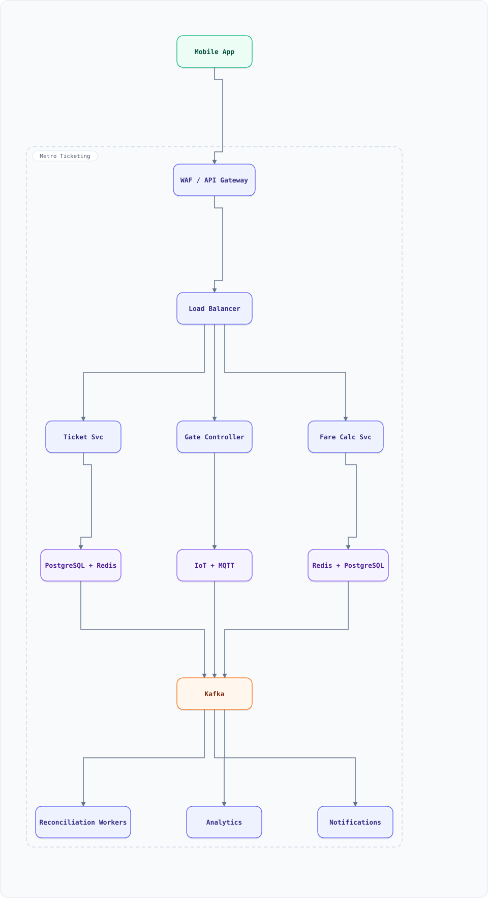

<a id="top"></a>

<div align="center">

<sub>TRANSPORTATION</sub>

# System Design: Metro Ticketing System

<sub>16 SECTIONS · 6 MIN READ · 1 DIAGRAM · 8 EXAMPLES</sub>

</div>

> [!TIP]
> **THE PROBLEM** — A metro transit ticketing system supporting smart cards, QR code tickets, fare calculation, and real-time passenger tracking.

---

## On this page

<details open>
<summary><b>16 sections</b></summary>

1. [Overview](#overview)
2. [Requirements](#requirements)
3. [High-Level Architecture](#high-level-architecture)
4. [Microservices](#microservices)
5. [Database Design](#database-design)
6. [Scaling Tiers](#scaling-tiers)
7. [Key Design Decisions](#key-design-decisions)
8. [Failure Modes & Recovery](#failure-modes--recovery)
9. [Cost Estimation (1M Users)](#cost-estimation-1m-users)
10. [Trade-off Analysis](#trade-off-analysis)
11. [Key Metrics to Monitor](#key-metrics-to-monitor)
12. [Deep Dive Prompts](#deep-dive-prompts)
13. [Key Techniques & Patterns](#key-techniques--patterns)
14. [Common Interview Follow-ups](#common-interview-follow-ups)
15. [Low-Level Design (LLD) - Algorithms & Data Structures](#low-level-design-lld---algorithms--data-structures)
16. [Do's & Don'ts](#dos--donts)

</details>

---


## Overview

A metro transit ticketing system supporting smart cards, QR code tickets, fare calculation, and real-time passenger tracking.

### Key Numbers

- 10M+ daily passengers
- 500+ metro stations
- 1M+ smart card transactions per day
- 99.99% uptime required (critical infrastructure)

---

## Requirements

### Functional Requirements

- Tap NFC/QR at entry gate
- Tap at exit to deduct fare
- Calculate fare by distance
- Daily/weekly/monthly pass
- Real-time train schedules

### Non-Functional Requirements

| Attribute | Target |
| :--- | :--- |
| **Latency** | Gate < 500ms |
| **Throughput** | 100K+ taps/sec |
| **Availability** | 99.99% uptime |
| **Consistency** | Strong for balance |
| **Scale** | 10M+ passengers, 500+ stations |

---

## High-Level Architecture

### Architecture Diagram



**Interactive:** [Open diagram](diagrams/system-design/metro-ticketing.architecture.html) · pan/zoom · search · dark/light · export


*Solid = data flow, dashed = control plane / monitoring.*

### Data Flow

1. User books ticket - Ticket Service generates QR/NFC token
2. Entry gate: scanner validates token - stores entry in Redis
3. Exit gate: scanner reads exit station - Fare Calc computes charge
4. Fare deducted from wallet/account (ACID transaction)
5. Kafka events: entry, exit, fare - Reconciliation pipeline
6. Analytics: peak hours, station traffic, revenue reports
7. Dynamic pricing: peak vs off-peak fare adjustment

## Microservices

### 1. Ticket Service

- **Responsibility**: Ticket generation, validation, QR code/NFC handling
- **Tech**: Go
- **DB**: PostgreSQL (tickets), Redis (validation cache)

### 2. Fare Service

- **Responsibility**: Fare calculation, zone-based pricing, daily caps
- **Tech**: Go
- **DB**: PostgreSQL (fare rules), Redis (cached fares)

### 3. Card Service

- **Responsibility**: Smart card management, balance tracking, recharging
- **Tech**: Java / Go
- **DB**: PostgreSQL (card accounts)

### 4. Gate Controller Service

- **Responsibility**: Entry/exit validation, anti-passback, real-time status
- **Tech**: Go (embedded systems)
- **DB**: Redis (real-time validation)

### 5. Settlement Service

- **Responsibility**: Daily settlement, revenue sharing, reconciliation
- **Tech**: Java
- **DB**: PostgreSQL (settlement records)

---

## Database Design

### PostgreSQL

```sql
-- Smart Cards
CREATE TABLE cards (
    card_id         UUID PRIMARY KEY,
    card_number     VARCHAR(20) UNIQUE NOT NULL,
    user_id         UUID,
    balance         DECIMAL(10,2) DEFAULT 0.00,
    status          VARCHAR(20) DEFAULT 'active',
    last_used_at    TIMESTAMP,
    created_at      TIMESTAMP DEFAULT NOW()
);

-- Transactions (Entry/Exit)
CREATE TABLE transactions (
    transaction_id  UUID PRIMARY KEY,
    card_id         UUID REFERENCES cards(card_id),
    station_id      UUID NOT NULL,
    entry_station   UUID,
    exit_station    UUID,
    entry_time      TIMESTAMP,
    exit_time       TIMESTAMP,
    fare            DECIMAL(10,2),
    status          VARCHAR(20), -- entry, exit, completed
    created_at      TIMESTAMP DEFAULT NOW()
);

-- Fare Rules
CREATE TABLE fare_rules (
    rule_id         UUID PRIMARY KEY,
    from_zone       INT,
    to_zone         INT,
    base_fare       DECIMAL(10,2),
    per_km_rate     DECIMAL(10,2),
    peak_multiplier DECIMAL(3,2) DEFAULT 1.5,
    daily_cap       DECIMAL(10,2),
    created_at      TIMESTAMP DEFAULT NOW()
);

-- Stations
CREATE TABLE stations (
    station_id      UUID PRIMARY KEY,
    name            VARCHAR(255),
    zone            INT,
    latitude        DECIMAL(10,8),
    longitude       DECIMAL(11,8),
    line            VARCHAR(50),
    is_active       BOOLEAN DEFAULT TRUE
);
```

---

## Scaling Tiers

### Tier 1: 1K - 10K Users

| Component | Choice |
| ----------- | -------- |
| **Compute** | 2 EC2 (t3.large) |
| **Database** | PostgreSQL RDS |
| **Cache** | Redis (single) |
| **Gate** | Simple NFC readers |

### Tier 2: 10K - 1M Users

| Component | Choice |
| ----------- | -------- |
| **Compute** | ECS (10-20 containers) |
| **Database** | PostgreSQL (read replicas) |
| **Cache** | Redis Cluster (6 nodes) |
| **Gate** | Smart gate controllers |

### Tier 3: 1M - 10M+ Users

| Component | Choice |
| ----------- | -------- |
| **Compute** | Multi-region K8s (100+ pods) |
| **Database** | PostgreSQL (sharded) + Cassandra |
| **Cache** | Redis Cluster (30+ nodes) |
| **Gate** | Edge computing at each station |

---

## Key Design Decisions

### 1. Why Redis for Gate Validation?

- Sub-millisecond reads (< 10ms required)
- Gate must open in < 500ms
- DB fallback for cold cards

### 2. Why Zone-Based Pricing?

- Simple to implement and understand
- Easy to adjust prices per zone
- Daily caps prevent overcharging

### 3. Why Anti-Passback?

- Prevents card sharing
- Ensures accurate passenger counting
- Required for revenue integrity

### 4. Why QR Codes + NFC?

- QR codes: Cheaper hardware, works with phones
- NFC: Faster, works with smart cards
- Both: Redundancy for reliability

---

## Failure Modes & Recovery
What can go wrong in production, and how the system detects and recovers:

| Failure | Impact | Recovery |
| --------- | -------- | ---------- |
| NFC gate reader offline | Passengers cannot tap in/out | Offline mode: cache balance locally, sync when back online |
| Anti-passback state corrupted | Wrong fare charged, stuck passengers | Manual override by station staff + state reconciliation |
| Redis cache failure | Balance check slow, gates delay | Fallback to PostgreSQL with connection pooling |
| Fare calculation error | Over/under charging passengers | Audit log + automated refund for discrepancies |
| Kafka consumer lag | Analytics dashboard stale | Auto-scale consumers + alert on lag > threshold |
| Wallet balance race condition | Double-spend possible | Distributed lock + idempotency key on transactions |

## Cost Estimation (1M Users)
Rough monthly cost of running this design for one million users:

| Component | Specification | Monthly Cost |
| ----------- | -------------- | ------------- |
| Gate Controllers | 500x edge devices | $25,000 |
| NFC Readers | 1000x hardware | $50,000 (amortized) |
| API Servers | 10x c5.xlarge | $1,400 |
| PostgreSQL | db.r5.xlarge + 3 replicas | $4,800 |
| Redis Cluster | 6x cache.r5.xlarge | $4,800 |
| Kafka Cluster | 6x kafka.m5.large | $2,400 |
| QR Code Service | 3x c5.large | $420 |
| Real-time Displays | 500x screens | $15,000 (amortized) |
| **Total** | | **~$103,820/month** |

---

## Trade-off Analysis
The alternatives considered, and which one won and why:

| Approach A | Approach B | Winner | Reason |
| ----------- | ----------- | -------- | -------- |
| NFC | QR Code | Both | NFC for speed, QR for backup |
| Redis state | Database state | Redis | Sub-ms anti-passback checks |
| Zone fare | Distance fare | Zone fare | Simpler, more predictable |
| HMAC | UUID for tickets | HMAC | Tamper-proof, verifiable offline |
| MQTT | HTTP for gates | MQTT | Lightweight, better for IoT |

---

## Key Metrics to Monitor
The metrics that signal system health, with alert thresholds:

| Metric | Description | Target |
| -------- | ------------- | -------- |
| **Gate Tap Latency** | Time from tap to gate open | < 500ms |
| **Fare Calculation Time** | Time to compute fare | < 50ms |
| **Anti-Passback Violations** | Invalid taps blocked | Monitored |
| **QR Code Validation Rate** | Successful QR scans | > 99% |
| **Daily Cap Accuracy** | Correctly applied spending limits | 100% |
| **Gate Availability** | % of time gates are operational | > 99.9% |
| **Peak Hour Throughput** | Taps per second during rush hour | > 50/sec/gate |
| **Balance Deduction Accuracy** | Correct fare charged | 100% |
| **Card Read Failure Rate** | Failed NFC/QR reads | < 1% |
| **Offline Mode Usage** | Taps processed while offline | Monitored |

## Deep Dive Prompts

- How does anti-passback prevent fare evasion?
- How do you handle offline gate operation during network outages?
- How does zone-based fare calculation work?
- How do you validate NFC/QR tickets in under 500ms?

---

## Key Techniques & Patterns
The recurring techniques and patterns this design applies, mapped to where they are used:

| Technique | Description | Used In |
| ----------- | ------------- | ---------- |
| QR Code Generation | HMAC-signed, short-TTL QR with a nonce so a screenshot cannot be replayed at the gate | Ticketing |
| Tap-In/Tap-Out State Machine | One open journey per card or QR; duplicate taps are idempotent and resolve to the same journey | Gates |
| Fare Calculation by Distance | Zone or station-pair table with daily caps and discounts, versioned and auditable | Fares |
| Real-time Train Tracking | GTFS-Realtime vehicle positions and trip updates feeding platform displays | Operations |
| Dynamic Seat Allocation | Only for reserved intercity services; metro is turn-up-and-go and has no seat inventory | Seating |
| Payment Gateway Integration | Open-loop EMV contactless (cEMV) alongside closed-loop cards, with batched settlement | Payments |

## Common Interview Follow-ups

**Q: How does anti-passback prevent evasion?**
A: State machine tracks entry/exit, prevents re-entry without exit, Redis state

**Q: How do you calculate zone-based fare?**
A: Entry/exit zones, distance matrix in Redis, daily cap auto-applied

**Q: How do you handle gate validation < 500ms?**
A: Local Redis cache on gate, async sync, offline mode with last-known balance

---

## Low-Level Design (LLD) - Algorithms & Data Structures

### 1. Anti-Passback State Machine

```js
class GateController {
  constructor(nfcReader, dbClient) { this.nfc = nfcReader; this.db = dbClient; }
  async tapIn(cardId, gateId) {
    const card = await this.db.getCard(cardId);
    if (!card || card.balance <= 0) return { allowed: false, reason: 'insufficient_balance' };
    const lastEntry = await this.db.getLastEntry(cardId);
    if (lastEntry && !lastEntry.exited) return { allowed: false, reason: 'already_inside' };
    await this.db.recordEntry({ cardId, gateId, entryTime: Date.now() });
    return { allowed: true, station: gateId };
  }
  async tapOut(cardId, gateId) {
    const entry = await this.db.getUnexitedEntry(cardId);
    if (!entry) return { allowed: false, reason: 'no_entry_found' };
    const fare = this.calcFare(entry.station, gateId);
    await this.db.deductBalance(cardId, fare);
    await this.db.recordExit({ cardId, gateId, exitTime: Date.now(), fare });
    return { allowed: true, fare, newBalance: await this.db.getBalance(cardId) };
  }
  calcFare(from, to) { return Math.abs(from.charCodeAt(0) - to.charCodeAt(0)) + 10; }
}

const event = new EventService(); console.log("Event service ready");
```

### 2. Zone-Based Fare Calculation

```js
class FareCalculator {
  // Zone-to-zone fare, peaked in the rush windows, then capped per day.
  // - Zone 1 -> Zone 1: $1.00   (base, all in-zone trips)
  // - Zone 1 -> Zone 2: $1.50   (each extra zone adds $0.50)
  // - Zone 1 -> Zone 3: $2.00
  // - Daily cap: $5.00
  static BASE_FARE = 1.00;
  static PER_ZONE = 0.50;
  static DAILY_CAP = 5.00;
  static PEAK_MULTIPLIER = 1.25;
  static PEAK_HOURS = [[7, 10], [17, 20]];

  isPeak(hour) {
    return FareCalculator.PEAK_HOURS.some(([from, to]) => hour >= from && hour < to);
  }

  fareFor(entryZone, exitZone, hour) {
    const zones = Math.abs(exitZone - entryZone);
    const base = FareCalculator.BASE_FARE + zones * FareCalculator.PER_ZONE;
    return Number((base * (this.isPeak(hour) ? FareCalculator.PEAK_MULTIPLIER : 1)).toFixed(2));
  }
}

const fares = new FareCalculator();
console.log('z1->z1 off-peak:', fares.fareFor(1, 1, 12));
console.log('z1->z2 peak:    ', fares.fareFor(1, 2, 8));
```

### 3. QR Code Generation (HMAC-Secured)

```js
const { createHmac } = require('crypto');

class QRCodeGenerator {
  // Signed, expiring QR payload — the gate must verify without a DB round trip.
  // Payload: card_id | station_id | issued_at | nonce, plus an HMAC tag.
  // The QR image itself is just qrcode.encode(JSON.stringify(payload)) at the edge.
  constructor(secret, ttlSeconds = 90) {
    this.secret = secret;
    this.ttl = ttlSeconds;
    this.usedNonces = new Set(); // replay guard, in Redis with the same TTL
  }

  issue(cardId, stationId, now = Date.now()) {
    const payload = { cardId, stationId, issuedAt: now, nonce: Math.random().toString(36).slice(2) };
    const body = `${payload.cardId}|${payload.stationId}|${payload.issuedAt}|${payload.nonce}`;
    payload.sig = createHmac('sha256', this.secret).update(body).digest('base64url');
    return payload;
  }

  verify(payload, now = Date.now()) {
    const body = `${payload.cardId}|${payload.stationId}|${payload.issuedAt}|${payload.nonce}`;
    const expected = createHmac('sha256', this.secret).update(body).digest('base64url');
    if (expected !== payload.sig) return { ok: false, reason: 'bad signature' };
    if (now - payload.issuedAt > this.ttl * 1000) return { ok: false, reason: 'expired' };
    if (this.usedNonces.has(payload.nonce)) return { ok: false, reason: 'replayed' };
    this.usedNonces.add(payload.nonce);
    return { ok: true };
  }
}

const gates = new QRCodeGenerator('metro-secret');
const ticket = gates.issue('card-42', 'station-7');
console.log(gates.verify(ticket), gates.verify(ticket));
```

**Incomplete journeys are priced, not discarded.** A missed tap-out has no exit station, so the operator charges a maximum fare; on TfL that charge does not count toward the daily or weekly cap. Keep journey construction separate from fare calculation: an `INCOMPLETE` journey resolves to a max-fare product with its own refund/appeal path, and cap accounting must exclude it rather than silently absorbing it.

### 4. Daily Cap Algorithm

```js
class DailyCap {
  // Cap the day's spend per card; once reached, further rides are free.
  // Keyed by service day (not calendar day) — the metro day ends at 03:00 local.
  constructor(cap = FareCalculator.DAILY_CAP) {
    this.cap = cap;
    this.totals = new Map(); // `${cardId}|${serviceDay}` -> { spent, freeRides }
  }

  static serviceDay(now) {
    const d = new Date(now - 3 * 3600 * 1000); // shift so 00:00-03:00 belongs to yesterday
    return d.toISOString().slice(0, 10);
  }

  charge(cardId, fare, now = Date.now()) {
    const key = `${cardId}|${DailyCap.serviceDay(now)}`;
    const entry = this.totals.get(key) || { spent: 0, freeRides: 0 };
    const remaining = Number((this.cap - entry.spent).toFixed(2));
    if (remaining <= 0) {
      entry.freeRides++;
      this.totals.set(key, entry);
      return { charged: 0, freeRide: true, spentToday: entry.spent };
    }
    const charged = Math.min(fare, remaining);
    entry.spent = Number((entry.spent + charged).toFixed(2));
    this.totals.set(key, entry);
    return { charged, freeRide: charged < fare, spentToday: entry.spent };
  }
}

const cap = new DailyCap(2.5);
console.log(cap.charge('card-42', 2.0, 1000), cap.charge('card-42', 2.0, 2000));
```

---

### Key Algorithms

### 1. Fare Calculation (Zone-Based)

```js
// One zone per station, loaded from the fare-config service on boot.
const STATION_ZONES = new Map([['A1', 1], ['B2', 2], ['C3', 3]]);

function calculateFare(entryStationId, exitStationId, cardId, travelTimeMs) {
  // Tap-out pipeline: station -> zone -> zone fare -> peak multiplier -> daily cap.
  // Every step is idempotent so a retried tap-out charges exactly once.
  const zoneOf = stationId => (STATION_ZONES.get(stationId) ?? 1);
  const hour = new Date(travelTimeMs).getHours();

  const calculator = new FareCalculator();
  const cap = new DailyCap();
  const zones = { entry: zoneOf(entryStationId), exit: zoneOf(exitStationId) };
  const baseFare = calculator.fareFor(zones.entry, zones.exit, hour);
  const settled = cap.charge(cardId, baseFare, travelTimeMs);

  return { ...zones, baseFare, ...settled, at: new Date(travelTimeMs).toISOString() };
}

console.log(calculateFare('A1', 'C3', 'card-42', Date.now()));
```

### 2. Anti-Passback (Prevent Tailgating)

```js
function validate_entry(card_id, station_id) {
    // Anti-passback: Prevent using the same card at the same station twice
    // - Check the last transaction for that card
    // - If the last action was not an exit, reject entry
    // - Otherwise allow the new entry and record the transaction

    last = get_last_transaction(card_id);
    if (last && last.station_id == station_id && last.type != "exit") {
        return "deny";
    }
    return "allow";
}
```

### 3. QR Code Ticket Generation

```js
function generate_qr_ticket(user_id, journey_type) {
    // Generate a QR code ticket:
    // - Build payload with user_id, timestamp, journey_type
    // - Sign payload with private key
    // - Encode signed payload as QR code

    payload = {
        user_id: user_id,
        journey_type: journey_type,
        timestamp: now()
    };
    signed = sign(payload);
    return generate_qr(signed);
}
```

### 4. Real-Time Validation (Gate Controller)

```js
function validate_at_gate(card_id, gate_type) {
    // Validate the fare and opening state for the gate
    // 1. Check if the card is active and valid
    // 2. Record the entry/exit event
    // 3. Open the gate if validation passes
    // 4. Fall back to the DB if cache is stale

    if (cache_has_valid_state(card_id)) {
        return open_gate(gate_type);
    }
    return validate_from_db(card_id, gate_type);
}
```

---

## Do's & Don'ts

| ✅ Do | ❌ Don't |
| :-- | :-- |
| Pin down the key numbers before drawing boxes | Don't hand-wave the hardest component — metro ticketing lives or dies there |
| Justify the functional requirements choice against one alternative out loud | Don't default to the trendiest store without a consistency/scale argument |
| State the failure mode of non-functional requirements explicitly (what breaks first?) | Don't present a sunny-day design only — the follow-up question is always "and when it fails?" |
| Anchor capacity numbers before proposing shards/replicas | Don't introduce a component you can't cost or size with the numbers on the board |

*More cross-topic rules: [Interview Q&A §84](interview-qa.md#84-universal-dos--donts) · Concepts: [Networking](networking.md) · [Operating Systems](operating-systems.md)*

---

<nav>← [messaging app](system-design-messaging-app.md) · [All guides](README.md) · [netflix](system-design-netflix.md) →</nav>

---

<p align="right"><a href="#top">↑ Back to top</a></p>
