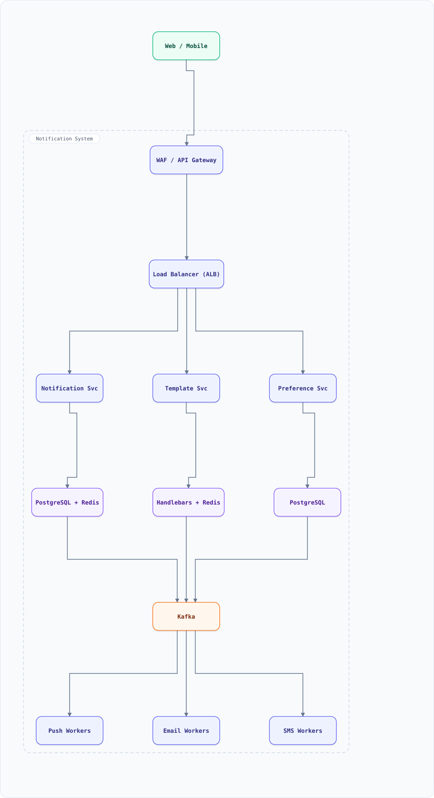

<div align="center">

# System Design: Notification System

</div>

> [!TIP]
> **TL;DR** — A multi-channel notification system supporting push, email, SMS, and in-app notifications for millions of users.

## Table of Contents

<details>
<summary><b>📑 Jump to a section</b></summary>

1. [Overview](#overview)
2. [Requirements](#requirements)
3. [High-Level Architecture](#high-level-architecture)
4. [Microservices](#microservices)
5. [Database Design](#database-design)
6. [Scaling Tiers](#scaling-tiers)
7. [Key Design Decisions](#key-design-decisions)
8. [Failure Modes & Recovery](#failure-modes--recovery)
9. [Cost Estimation (1M Users)](#cost-estimation-1m-users)
10. [Trade-off Analysis](#trade-off-analysis)
11. [Key Metrics to Monitor](#key-metrics-to-monitor)
12. [Deep Dive Prompts](#deep-dive-prompts)
13. [Key Techniques & Patterns](#key-techniques--patterns)
14. [Common Interview Follow-ups](#common-interview-follow-ups)
15. [Low-Level Design (LLD) - Algorithms & Data Structures](#low-level-design-lld---algorithms--data-structures)
16. [Do's & Don'ts](#dos--donts)

</details>

---


## Overview

A multi-channel notification system supporting push, email, SMS, and in-app notifications for millions of users.

### Key Numbers

- 10B+ notifications per day
- 1M+ notifications per second at peak
- 95%+ delivery rate

---

## Requirements

### Functional Requirements

- Send push notifications (iOS/Android)
- Send SMS via carrier
- Send email with templates
- Notification preferences
- Schedule optimal delivery

### Non-Functional Requirements

| Attribute | Target |
| :--- | :--- |
| **Latency** | Push < 1s, SMS < 10s |
| **Throughput** | 10M+ notifications/day |
| **Availability** | 99.99% uptime |
| **Consistency** | At-least-once delivery |
| **Scale** | 500M+ registered devices |

---

## High-Level Architecture

### Architecture Diagram



**Interactive diagram:** [diagrams/system-design/notification-system.architecture.html](diagrams/system-design/notification-system.architecture.html) — pan/zoom, search, dark/light theme, PNG/SVG export.


*Solid = data flow, dashed = control plane / monitoring.*

### Data Flow

1. Service publishes event to Kafka notification topic
2. Notification Service consumes event, checks user preferences
3. Template Service renders notification content (per channel)
4. Priority routing: critical -> immediate, bulk -> batched
5. Push Workers: FCM/APNs, email: SendGrid, SMS: Twilio
6. Delivery tracking: sent -> delivered -> opened (read receipts)
7. Analytics: delivery rate, open rate, click-through rate

## Microservices

### 1. Notification API

- **Responsibility**: Accept notification requests, validate, enqueue
- **Tech**: Go / Node.js
- **DB**: PostgreSQL (notification templates)

### 2. Preference Service

- **Responsibility**: User notification preferences, opt-out management
- **Tech**: Go
- **DB**: PostgreSQL (preferences), Redis (cache)

### 3. Push Service

- **Responsibility**: FCM (Android), APNs (iOS), Web Push
- **Tech**: Node.js
- **External**: Firebase Cloud Messaging, Apple Push Notification Service

### 4. Email Service

- **Responsibility**: Email rendering, sending, tracking
- **Tech**: Node.js
- **External**: SendGrid, SES, Mailgun

### 5. SMS Service

- **Responsibility**: SMS sending, delivery tracking
- **Tech**: Node.js
- **External**: Twilio, Nexmo, AWS SNS

### 6. In-App Service

- **Responsibility**: Real-time in-app notifications, notification center
- **Tech**: Go
- **DB**: Cassandra (notifications), Redis (unread count)

---

## Database Design

### PostgreSQL

```sql
CREATE TABLE notifications (
    notification_id UUID PRIMARY KEY DEFAULT gen_random_uuid(),
    user_id         UUID NOT NULL,
    type            VARCHAR(50) NOT NULL,
    channel         VARCHAR(20) NOT NULL,
    title           VARCHAR(255),
    body            TEXT,
    data            JSONB,
    status          VARCHAR(20) DEFAULT 'pending',
    scheduled_at    TIMESTAMP,
    sent_at         TIMESTAMP,
    created_at      TIMESTAMP DEFAULT NOW()
);

CREATE TABLE notification_templates (
    template_id     UUID PRIMARY KEY DEFAULT gen_random_uuid(),
    name            VARCHAR(100) UNIQUE NOT NULL,
    channel         VARCHAR(20) NOT NULL,
    subject         VARCHAR(255),
    body_template   TEXT NOT NULL,
    variables       JSONB,
    created_at      TIMESTAMP DEFAULT NOW()
);

CREATE TABLE user_preferences (
    user_id         UUID PRIMARY KEY,
    push_enabled    BOOLEAN DEFAULT TRUE,
    email_enabled   BOOLEAN DEFAULT TRUE,
    sms_enabled     BOOLEAN DEFAULT FALSE,
    quiet_hours_start TIME,
    quiet_hours_end   TIME,
    updated_at      TIMESTAMP DEFAULT NOW()
);
```

### Cassandra (In-App Notifications)

```cql
CREATE TABLE in_app_notifications (
    user_id         UUID,
    notification_id UUID,
    type            TEXT,
    title           TEXT,
    body            TEXT,
    is_read         BOOLEAN DEFAULT FALSE,
    created_at      TIMESTAMP,
    PRIMARY KEY ((user_id), created_at, notification_id)
) WITH CLUSTERING ORDER BY (created_at DESC);
```

---

## Scaling Tiers

### Tier 1: 1K - 10K Users

| Component | Choice |
| ----------- | -------- |
| **Compute** | 2 EC2 (t3.large) |
| **Database** | PostgreSQL RDS |
| **Queue** | Redis Streams |
| **Push** | FCM + APNs directly |
| **Email** | SendGrid |

### Tier 2: 10K - 1M Users

| Component | Choice |
| ----------- | -------- |
| **Compute** | ECS (10-20 containers) |
| **Database** | PostgreSQL + Cassandra (3 nodes) |
| **Queue** | Kafka (3 brokers) |
| **Push** | FCM + APNs + dedicated workers |
| **Email** | SendGrid + SES |

### Tier 3: 1M - 10M+ Users

| Component | Choice |
| ----------- | -------- |
| **Compute** | Multi-region K8s (100+ pods) |
| **Database** | Cassandra (20+ nodes) + PostgreSQL (sharded) |
| **Queue** | Kafka (15+ brokers) |
| **Push** | Custom push infrastructure |
| **Email** | Multi-provider (SendGrid + SES + custom SMTP) |
| **SMS** | Multi-provider (Twilio + Nexmo) |

---

## Key Design Decisions

### 1. Why Multi-Channel Delivery?

- Different users prefer different channels (push, email, SMS)
- Redundancy ensures delivery even if one channel fails
- Cost optimization (push is free, SMS is expensive)

### 2. Why Exponential Backoff with Jitter?

- Prevents thundering herd on retry storms
- Jitter spreads retries across time window
- Exponential increase avoids overwhelming failing services

### 3. Why Per-User Rate Limiting?

- Prevents notification fatigue (spam)
- Different limits for different channels (SMS < push < email)
- Protects users and maintains engagement

### 4. Why Batch Low-Priority Notifications?

- Reduces API calls (email batching saves 80% of calls)
- Better user experience (hourly digest vs constant pings)
- High-priority notifications still sent immediately

## Failure Modes & Recovery
What can go wrong in production, and how the system detects and recovers:

| Failure | Impact | Recovery |
| --------- | -------- | ---------- |
| FCM/APNs delivery failure | Push not delivered | Retry with backoff, SMS fallback |
| Email provider rate limit | Batch emails delayed | Multi-provider failover, queue-based |
| SMS carrier outage | SMS fails in region | Multi-carrier fallback, priority queuing |
| Preference sync lag | User unsubscribes but still receives | Immediate local cache, eventual sync |
| Template rendering failure | Broken formatting sent | Validation before send, plain text fallback |
| Priority delayed | Critical alerts stuck behind marketing | Separate queues per priority level |

---

## Cost Estimation (1M Users)
Rough monthly cost of running this design for one million users:

| Component | Specification | Monthly Cost |
| ----------- | -------------- | ------------- |
| API Servers | 10x c5.xlarge | $1,400 |
| PostgreSQL | db.r5.xlarge + 2 replicas | $3,600 |
| Redis Cluster | 6x cache.r5.xlarge | $4,800 |
| Kafka (queues) | 6x kafka.m5.large | $2,400 |
| FCM/APNs | Push delivery fees | $500 |
| Twilio (SMS) | 1M SMS/month | $500 |
| SendGrid (Email) | 1M emails/month | $90 |
| Worker Nodes | 20x c5.xlarge | $2,800 |
| **Total** | | **~$16,090/month** |

---

## Trade-off Analysis
The alternatives considered, and which one won and why:

| Approach A | Approach B | Winner | Reason |
| ----------- | ----------- | -------- | -------- |
| FCM | WebPush | FCM | Better Android support, higher delivery rate |
| SES | SendGrid | SES | Lower cost at scale |
| Twilio | Nexmo | Twilio | Better global coverage |
| Redis priority | Database priority | Redis | Sub-ms priority operations |
| Kafka | SQS | Kafka | Higher throughput for notification events |

---

## Key Metrics to Monitor
The metrics that signal system health, with alert thresholds:

| Metric | Description | Target |
| -------- | ------------- | -------- |
| **Delivery Rate** | % of notifications successfully delivered | > 99% |
| **Delivery Latency** | Time from trigger to delivery | < 1s (push), < 30s (email) |
| **Dedup Rate** | % of duplicate notifications blocked | > 95% |
| **Rate Limit Hits** | Users hitting rate limits | < 1% |
| **Channel Error Rate** | Failures per provider (FCM/APNs/SendGrid) | < 1% |
| **Batch Efficiency** | % of notifications batched vs immediate | Monitored |
| **User Opt-out Rate** | Users disabling notifications | < 5% |
| **Template Render Time** | Time to render notification template | < 10ms |
| **Provider Failover** | Automatic switch on provider failure | < 30 seconds |
| **DLQ Depth** | Dead letter queue notifications | < 100 |

---

## Deep Dive Prompts

- How do you handle notification delivery across multiple channels?
- How do you prevent duplicate notifications?
- How do you implement exponential backoff for failed deliveries?
- How do you handle notification preferences for millions of users?

---

## Key Techniques & Patterns
The recurring techniques and patterns this design applies, mapped to where they are used:

| Technique | Description | Used In |
| ----------- | ------------- | ---------- |
| Multi-Channel Delivery (Push/SMS/Email) | Applied in this system | Architecture + LLD |
| Template Engine | Applied in this system | Architecture + LLD |
| Rate Limiting | Applied in this system | Architecture + LLD |
| Preference Management | Applied in this system | Architecture + LLD |
| Retry with Backoff | Applied in this system | Architecture + LLD |
| Delivery Tracking | Applied in this system | Architecture + LLD |

## Common Interview Follow-ups

**Q: How do you handle FCM/APNs failures?**
A: Retry with backoff, SMS fallback for critical, delivery tracking

**Q: How do you scale to 500M+ devices?**
A: Shard by user ID, separate queues per channel, priority queuing

**Q: How do you handle notification preferences?**
A: Immediate local cache, eventual sync, per-channel opt-in/out

---

## Low-Level Design (LLD) - Algorithms & Data Structures

### 1. Exponential Backoff with Jitter

```js
class NotificationRouter {
  constructor(fcmClient, apnsClient, emailClient) { this.fcm = fcmClient; this.apns = apnsClient; this.email = emailClient; }
  async send(notification) {
    const { userId, channel, title, body } = notification;
    switch (channel) {
      case 'push':
        const devices = await this.getDevices(userId);
        for (const d of devices) {
          if (d.platform === 'android') await this.fcm.send({ to: d.token, notification: { title, body } });
          else await this.apns.send({ token: d.token, alert: { title, body } });
        }
        break;
      case 'email':
        await this.email.send({ to: notification.email, subject: title, text: body });
        break;
      case 'sms':
        await this.sendSMS(userId, body);
        break;
    }
    return { sent: true, channel };
  }
  async getDevices(userId) { return [{ token: 'dummy', platform: 'android' }]; }
  async sendSMS(userId, body) { return { sent: true }; }
}
```

### 2. Notification Deduplication

```js
const { createHmac, randomUUID } = require('crypto');

class NotificationDedup {
  // Prevents duplicate sends with an idempotency key per (user, channel, event).
  // Redis form: SET key 1 NX EX ttl — the first writer wins, everyone else skips.
  constructor(secret, ttlSeconds = 86400) {
    this.secret = secret;
    this.ttl = ttlSeconds;
    this.seen = new Map(); // stands in for Redis
  }

  keyFor({ userId, channel, eventId }) {
    // Hash the payload so retries of the same event map to the same key.
    return createHmac('sha256', this.secret)
      .update(`${userId}|${channel}|${eventId}`)
      .digest('hex');
  }

  claim(event, now = Date.now()) {
    const key = this.keyFor(event);
    const expiresAt = this.seen.get(key);
    if (expiresAt && expiresAt > now) return { duplicate: true, key };
    this.seen.set(key, now + this.ttl * 1000);
    return { duplicate: false, key };
  }
}

const dedup = new NotificationDedup('shared-secret', 60);
const evt = { userId: 'u1', channel: 'push', eventId: randomUUID() };
console.log(dedup.claim(evt), dedup.claim(evt));
```

### 3. Priority Queue for Notification Batching

```js
class MinHeap {
  // Tiny binary heap — the JS stand-in for Python's heapq.
  constructor() { this.items = []; }
  get size() { return this.items.length; }
  push(item) {
    this.items.push(item);
    let i = this.items.length - 1;
    while (i > 0) {
      const parent = (i - 1) >> 1;
      if (this.items[parent].dueAt <= this.items[i].dueAt) break;
      [this.items[parent], this.items[i]] = [this.items[i], this.items[parent]];
      i = parent;
    }
  }
  pop() {
    const top = this.items[0];
    const last = this.items.pop();
    if (this.items.length) {
      this.items[0] = last;
      let i = 0;
      for (;;) {
        const l = 2 * i + 1, r = l + 1;
        let smallest = i;
        if (l < this.items.length && this.items[l].dueAt < this.items[smallest].dueAt) smallest = l;
        if (r < this.items.length && this.items[r].dueAt < this.items[smallest].dueAt) smallest = r;
        if (smallest === i) break;
        [this.items[smallest], this.items[i]] = [this.items[i], this.items[smallest]];
        i = smallest;
      }
    }
    return top;
  }
}

class NotificationBatcher {
  // Batches per user so one slow digest replaces ten push notifications.
  constructor({ windowSeconds = 30, maxBatch = 5, maxWaitSeconds = 120 } = {}) {
    this.windowMs = windowSeconds * 1000;
    this.maxWaitMs = maxWaitSeconds * 1000;
    this.maxBatch = maxBatch;
    this.byUser = new Map(); // userId -> { items: [], dueAt }
    this.timer = new MinHeap();
  }

  add(userId, notification, now = Date.now()) {
    const entry = this.byUser.get(userId) || { items: [], dueAt: now + this.windowMs };
    entry.items.push(notification);
    this.byUser.set(userId, entry);
    if (entry.items.length >= this.maxBatch || now >= entry.dueAt) return this.flush(userId);
    this.timer.push({ userId, dueAt: Math.min(entry.dueAt, now + this.maxWaitMs) });
    return null;
  }

  flush(userId) {
    const entry = this.byUser.get(userId);
    if (!entry) return null;
    this.byUser.delete(userId);
    return { userId, count: entry.items.length, summary: entry.items.slice(0, 3).map(n => n.title) };
  }
}

const batcher = new NotificationBatcher({ windowSeconds: 0 });
console.log(batcher.add('u1', { title: '3 new messages' }, 1000));
```

### 4. Rate Limiter per User

```js
class UserRateLimiter {
  // Per-user, per-channel limits so a noisy service can't spam one person.
  // Rolling windows (hour/day) instead of fixed buckets — reminder fatigue is real.
  static LIMITS = {
    push:  { hour: 10, day: 50 },
    email: { hour: 5,  day: 20 },
    sms:   { hour: 2,  day: 5  },
  };

  constructor() {
    this.sent = new Map(); // `${userId}|${channel}` -> timestamps
  }

  allow(userId, channel, now = Date.now()) {
    const limit = UserRateLimiter.LIMITS[channel];
    if (!limit) throw new Error(`unknown channel: ${channel}`);
    const key = `${userId}|${channel}`;
    const history = (this.sent.get(key) || []).filter(t => now - t < 86400000); // keep a day
    const lastHour = history.filter(t => now - t < 3600000).length;
    if (history.length >= limit.day) return { allowed: false, reason: 'daily cap' };
    if (lastHour >= limit.hour) return { allowed: false, reason: 'hourly cap' };
    history.push(now);
    this.sent.set(key, history);
    return { allowed: true, remainingToday: limit.day - history.length };
  }
}

const limiter = new UserRateLimiter();
console.log(limiter.allow('u1', 'push'), limiter.allow('u1', 'sms'));
```

---

### Key Algorithms

### 1. Notification Deduplication

```js
function send_notification(notification) {
    // Prevent duplicate notifications using an idempotency key
    // - If the same notification ID is seen again, skip sending
    // - Otherwise enqueue and dispatch to the selected channel

    if (already_processed(notification.id)) {
        return "duplicate";
    }
    mark_processed(notification.id);
    dispatch(notification);
    return "sent";
}
```

### 2. Rate Limiting (Per User)

```js
function check_notification_rate(user_id, channel) {
    // Rate limit notifications per user
    // - Max 10 push notifications per hour
    // - Max 3 emails per day
    // - Max 1 SMS per day

    limit = get_limit_for(channel);
    current = count_recent_notifications(user_id, channel);
    return current < limit ? "allow" : "deny";
}
```

### 3. Quiet Hours

```js
function is_quiet_hours(user_id) {
    // Check if the recipient is in a quiet-hours window
    // Example: no push notifications between 11 PM and 7 AM local time

    local_time = get_local_time(user_id);
    return local_time >= 23 || local_time < 7;
}
```

### 4. Template Rendering

```js
function render_notification(template_name, variables) {
    // Render notification from template
    // - Supports variables and conditionals
    // - Returns JSON payload for the delivery channel

    template = load_template(template_name);
    rendered = substitute_variables(template, variables);
    return { body: rendered.body, title: rendered.title };
}
```

---

## Do's & Don'ts

| ✅ Do | ❌ Don't |
| :-- | :-- |
| Pin down the key numbers before drawing boxes | Don't hand-wave the hardest component — notification system lives or dies there |
| Justify the functional requirements choice against one alternative out loud | Don't default to the trendiest store without a consistency/scale argument |
| State the failure mode of non-functional requirements explicitly (what breaks first?) | Don't present a sunny-day design only — the follow-up question is always "and when it fails?" |
| Anchor capacity numbers before proposing shards/replicas | Don't introduce a component you can't cost or size with the numbers on the board |

*More cross-topic rules: [Interview Q&A §84](interview-qa.md#84-universal-dos--donts) · Concepts: [Networking](networking.md) · [Operating Systems](operating-systems.md)*

---

<nav>← [netflix](system-design-netflix.md) · [📖 All guides](README.md) · [observability pipeline](system-design-observability-pipeline.md) →</nav>
