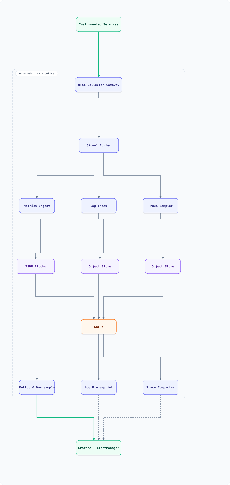

<div align="center">

# System Design: Observability Pipeline (Metrics, Logs & Traces at Scale)

</div>


## Table of Contents

<details>
<summary><b>📑 Jump to a section</b></summary>

1. [Overview](#overview)
2. [Requirements](#requirements)
3. [High-Level Architecture](#high-level-architecture)
4. [Microservices](#microservices)
5. [Database Design](#database-design)
6. [Scaling Tiers](#scaling-tiers)
7. [Key Techniques & Patterns](#key-techniques--patterns)
8. [Key Design Decisions](#key-design-decisions)
9. [Failure Modes & Recovery](#failure-modes--recovery)
10. [Cost Estimation (50 TB/day of logs)](#cost-estimation-50-tbday-of-logs)
11. [Trade-off Analysis](#trade-off-analysis)
12. [Key Metrics to Monitor](#key-metrics-to-monitor)
13. [Deep Dive Prompts](#deep-dive-prompts)
14. [Common Interview Follow-ups (with answers)](#common-interview-follow-ups-with-answers)
15. [Low-Level Design (LLD) - Algorithms & Data Structures](#low-level-design-lld---algorithms--data-structures)
16. [Micro-Details & Edge Cases](#micro-details--edge-cases)
17. [Do's & Don'ts](#dos--donts)
18. [References & Further Reading](#references--further-reading)

</details>

---

## Overview

Design the **telemetry backbone** that turns raw signals emitted by every service into three queryable products — metrics for alerting, logs for investigation, traces for causality — while keeping the bill proportional to value rather than to volume.

The three signals have genuinely different physics, and the whole design follows from that:

- **Metrics are small, structured and must never be lost.** A dropped metric is a missing alarm. Samples are high-volume but tiny and perfectly compressible (delta-of-delta timestamps, XOR-encoded float values), so they get the strongest durability path and the tightest query SLO.
- **Logs are huge, semi-structured and sampled in *investigation* value, not in volume.** 50 TB/day cannot be searched raw forever, so ingest must **fingerprint** (template-extract), **index selectively**, and **tier** storage — hot for 30 days, cold for a year, cheap for the rest.
- **Traces are the most expensive per useful byte and cannot be sampled head-first.** A head-sampled trace loses exactly the requests you care about (the 500s and the slow ones), so the pipeline buffers whole traces briefly and decides **tail-based**, keeping every error and every outlier.

The hard engineering is therefore: a **cardinality governor** (the classic way observability bills explode), **backpressure that sheds by priority** rather than randomly, and **sampling that preserves the rare event**.

### Key Numbers

| Metric | Value | Why it matters |
| :--- | :--- | :--- |
| Emitting instances | ~12K per region | Fluent Bit / OTel sidecars and SDKs |
| Metric samples | 8M/sec peak, ~25B/day | Highest durability requirement |
| Active metric series | 20M (cap 4M per metric) | Cardinality is the cost of metrics |
| Log volume | 50 TB/day raw (~6 TB compressed) | Storage and index cost dominate |
| Spans per day | 1.5B emitted, ~5% retained (all errors kept) | Tail sampling is what makes traces affordable |
| Ingest → queryable | < 5 s (metrics), < 30 s (logs/traces) | Alerting reacts to fresh data |
| Query latency | p95 < 2 s for 7d rollups, < 10 s for 30d raw | Dashboards must feel instant |
| Alert evaluation | every 15 s; SLO windows 5m/1h + 30m/6h | Fast detection without flap |
| Retention | metrics 15d raw → 90d 1m → 2y 1h; logs 30d hot + 1y cold; traces 30d | Cost curve versus debugging horizon |
| Cost target | < $0.35 per GB ingested end-to-end | The pipeline is judged as a product with a unit price |
| Shedding | by priority when queues > 80% full | Never drop alerts to save dashboards |

## Requirements

### Functional Requirements

- **Ingest** metrics, logs and traces over OTLP (push) with per-tenant authentication
- **Redact** at the edge: strip credentials, tokens and personal data before anything is persisted
- **Route** each signal to its dedicated store through a single control plane
- **Cap cardinality** per metric, per tenant, with explicit overrides and dropped-series accounting
- **Sample traces** tail-based: assemble a trace, then keep errors, slow outliers and a baseline sample
- **Fingerprint logs**: extract templates, index selectively, keep full text in object storage
- **Downsample and tier**: raw → 1m → 5m → 1h with retention per tier
- **Query** with PromQL-style metric queries, log search, and trace lookup by id or attribute
- **Alert** on rules and on SLO burn rates, routing to on-call with deduplication and silences
- **Isolate tenants**: fair query scheduling, per-tenant ingest quotas, no cross-tenant visibility

### Non-Functional Requirements

- **Durability by priority**: metrics are never dropped silently; logs and traces may be sampled and *must report* what was dropped
- **Freshness**: metrics queryable in < 5 s; logs and traces in < 30 s
- **Query performance**: p95 < 2 s over 7 days of rollups, p95 < 10 s over 30 days of raw blocks
- **Cost**: bounded per GB ingested, with per-tenant attribution and a self-observability dashboard
- **Availability**: ingestion 99.99%; query 99.9% (degraded "recent data only" > total outage)
- **Self-observation**: the pipeline monitors itself with the same stack it serves

## High-Level Architecture

### Architecture Diagram



**Interactive diagram:** [diagrams/system-design/observability-pipeline.architecture.html](diagrams/system-design/observability-pipeline.architecture.html) — pan/zoom, search, dark/light theme, PNG/SVG export.


*Solid = the ingest path from services to the query layer, dashed = rollup, compaction and alerting feedback. Services and the dashboards sit outside the boundary.*

### Data Flow

1. **Instrumented services** emit OTLP (or scrape targets are polled) and their local agents batch signals — metrics every 15 s, logs/traces as they occur
2. The **OTel Collector Gateway** authenticates the tenant, applies memory-limiters and queue backpressure, redacts secrets/PII, and enriches (Kubernetes metadata, service tier, environment)
3. The **Signal Router** fans each signal family to its own pipeline and stamps a priority class (alerts > SLO > dashboards > debug) used later for shedding
4. **Metrics Ingest** runs the **cardinality governor**, then appends samples to the TSDB WAL; blocks are cut every 2 h and compacted in the background
5. **Log Index** fingerprints each line into a template, writes an inverted index for the low-cardinality dimensions, and ships the full body to object storage (parquet, partitioned by tenant/day)
6. **Trace Sampler** buffers spans by `trace_id` until the trace is complete or its deadline expires, then applies the tail policy (errors, latency outliers, baseline ratio). Retained traces land in object storage with an attribute index
7. **Rollup & Downsample** consumes the raw streams and writes 1m/5m/1h aggregates; the **Trace Compactor** merges small trace files; the **Log Fingerprint** job maintains the template catalogue
8. **Query Frontend** serves PromQL-style queries from rollups first and raw blocks only when necessary; the **Alert Evaluator** runs rules and SLO burn-rate windows and routes to on-call (Grafana + Alertmanager)

## Microservices

| Service | Responsibility | Notes |
| :--- | :--- | :--- |
| **OTel Collector Gateway** | Auth, batching, redaction, enrichment, memory limiting | Runs as a DaemonSet plus a load-balanced gateway tier |
| **Signal Router** | Per-signal fan-out, priority classification, tenant quotas | Stateless; policy from the control plane |
| **Metrics Ingest** | Cardinality governor, WAL append, TSDB block cut/compact | The strongest durability path in the pipeline |
| **Log Index** | Template extraction, selective inverted index, object-store writer | Index only what is queried at scale |
| **Trace Sampler** | Trace assembly by `trace_id`, tail-based keep/drop policy | Bounded buffer with a deadline, never unbounded memory |
| **Rollup & Downsample** | Raw → 1m → 5m → 1h aggregates, retention enforcement | Idempotent per (series, window) |
| **Log Fingerprint** | Template catalogue, anomaly counts, dedup of repeated lines | Powers "what changed?" queries |
| **Trace Compactor** | Merge small span files, build attribute index, expire by tier | Keeps the query layer fast and cheap |
| **Query Frontend** | Query parsing, rollup selection, per-tenant fair scheduling, caching | Read path is where cost and latency are won |
| **Alert Evaluator** | Rule evaluation every 15 s, SLO burn-rate windows, dedupe, silences | Runs against the same rollups as dashboards |
| **Control Plane** | Tenants, quotas, cardinality overrides, retention policies, rule config | GitOps-backed; every change is auditable |

## Database Design

```sql
-- Series registry: one row per unique (metric, label set) — the cardinality ledger.
CREATE TABLE metric_series (
  series_id    BIGSERIAL PRIMARY KEY,
  tenant_id    BIGINT NOT NULL,
  metric       TEXT   NOT NULL,                  -- http_request_duration_seconds
  labels       JSONB  NOT NULL,                  -- {service, route, status, region}
  fingerprint  BIGINT NOT NULL,                  -- hash(labels) for fast lookup
  first_seen   TIMESTAMPTZ NOT NULL DEFAULT now(),
  last_seen    TIMESTAMPTZ NOT NULL,
  UNIQUE (tenant_id, fingerprint)
);
CREATE INDEX metric_series_metric_idx ON metric_series (tenant_id, metric, last_seen DESC);

-- Cardinality governance: hard caps and the audit of what was coalesced or dropped.
CREATE TABLE cardinality_limits (
  tenant_id      BIGINT NOT NULL,
  metric_pattern TEXT   NOT NULL,                 -- 'http_*' or '*'
  max_series     INT    NOT NULL,
  label_drop_list TEXT[] NOT NULL DEFAULT '{}',   -- high-cardinality labels to coalesce
  action         TEXT   NOT NULL DEFAULT 'coalesce', -- coalesce | drop | allow
  PRIMARY KEY (tenant_id, metric_pattern)
);

-- Retention is data: tier, age window, and what happens at expiry.
CREATE TABLE retention_policies (
  signal      TEXT NOT NULL,                      -- metrics | logs | traces
  tier        TEXT NOT NULL,                      -- raw | 1m | 5m | 1h | warm | cold
  resolution  TEXT NOT NULL,                      -- 15s | 1m | 1h | n/a
  retain_days INT  NOT NULL,
  storage     TEXT NOT NULL,                      -- tsdb | object | cold-archive
  PRIMARY KEY (signal, tier)
);

-- Rules and SLOs are versioned config; evaluation reads the compiled form.
CREATE TABLE alert_rules (
  id           BIGSERIAL PRIMARY KEY,
  tenant_id    BIGINT NOT NULL,
  name         TEXT   NOT NULL,
  expr         TEXT   NOT NULL,                   -- PromQL-style expression
  for_seconds  INT    NOT NULL DEFAULT 0,
  severity     TEXT   NOT NULL,                   -- critical | warning | info
  priority     INT    NOT NULL DEFAULT 5,         -- shedding and paging order
  route        TEXT   NOT NULL,                   -- on-call rotation / channel
  enabled      BOOLEAN NOT NULL DEFAULT true
);

CREATE TABLE slo_definitions (
  id             BIGSERIAL PRIMARY KEY,
  tenant_id      BIGINT NOT NULL,
  service        TEXT   NOT NULL,
  sli            TEXT   NOT NULL,                 -- availability | latency_p99
  objective_pct  NUMERIC(5,3) NOT NULL,           -- 99.9
  window_days    INT    NOT NULL DEFAULT 30,
  burn_windows   JSONB  NOT NULL                  -- [[300,3600,14.4],[1800,21600,6]]
);

-- Log stream index (low-cardinality dimensions only); bodies live in object storage.
CREATE TABLE log_stream_index (
  id           BIGSERIAL PRIMARY KEY,
  tenant_id    BIGINT NOT NULL,
  service      TEXT   NOT NULL,
  level        TEXT   NOT NULL,
  fingerprint  TEXT   NOT NULL,                   -- template hash from the fingerprinter
  template     TEXT   NOT NULL,                   -- 'user <*> logged in from <ip>'
  day          DATE   NOT NULL,
  count        BIGINT NOT NULL DEFAULT 0,
  sample_msg   TEXT,
  UNIQUE (tenant_id, day, fingerprint, service)
);

-- Trace retention decisions, so sampling can always answer "why is this missing?".
CREATE TABLE trace_decisions (
  trace_id       TEXT PRIMARY KEY,
  tenant_id      BIGINT NOT NULL,
  root_service   TEXT NOT NULL,
  duration_ms    INT  NOT NULL,
  has_error      BOOLEAN NOT NULL,
  decision       TEXT NOT NULL,                   -- kept_error | kept_slow | kept_sample | dropped_ratio | dropped_overflow
  decided_at     TIMESTAMPTZ NOT NULL DEFAULT now()
);
```

**TSDB block layout** — each 2-hour block holds a series index (fingerprint → label set), a postings list per label pair, chunk files with delta-of-delta timestamps and XOR-compressed values, and a `tombstones` file. Compaction merges adjacent blocks and materialises downsampled 1m/1h chunks.

**Object store** — logs as parquet partitioned by `tenant/day/service/hour`; traces as one file per trace (compacted into per-hour bundles); both with lifecycle rules matching `retention_policies`.

**Kafka topics** — `signals.metrics`, `signals.logs`, `signals.traces` (raw ingest, tiered storage for replay), `rollups` (downsampled output), `alerts` (fired notifications), `config.events` (policy and rule changes).

## Scaling Tiers

### Tier 1: 1K - 10K Users

| Component | Choice |
| :--- | :--- |
| **Collection** | One OTel collector per service or a single shared collector |
| **Metrics** | Prometheus server per cluster, 15d local retention |
| **Logs** | Loki/Elasticsearch single node, or logs to object storage with a simple search |
| **Traces** | Head sampling at 1–5%, Jaeger/Tempo single instance |
| **Alerting** | Alertmanager with static rules; no SLO automation |
| **Cost** | Managed stack in the low thousands per month; sampling is the main lever |

### Tier 2: 10K - 1M Users

| Component | Choice |
| :--- | :--- |
| **Collection** | DaemonSet collectors plus a gateway tier with redaction and enrichment |
| **Metrics** | Sharded TSDB (tenant hash), cardinality governor, 1m/1h rollups |
| **Logs** | Selective index, parquet in object storage, 30d hot + 1y cold |
| **Traces** | Tail-based sampling with a trace assembly buffer and per-tenant budgets |
| **Alerting** | SLO burn-rate multi-window alerts, deduplication, on-call routing |
| **Query** | Per-tenant fair scheduling and result caching in the query frontend |

### Tier 3: 1M - 10M+ Users

| Component | Choice |
| :--- | :--- |
| **Collection** | Regional collector fleets with cross-region failover and edge aggregation |
| **Metrics** | Multi-region TSDB with global query federation; per-region cardinality caps |
| **Logs** | Tiered storage with hot/warm/cold classes and per-tenant retention policies |
| **Traces** | Adaptive sampling by SLO error budget, plus always-keep for the critical services |
| **Alerting** | Global rule evaluation with per-region burn windows and blast-radius limits |
| **Governance** | Chargeback per team, anomaly detection on ingest, automatic cardinality quarantine |

## Key Techniques & Patterns

| Technique | Description | Used In |
| :--- | :--- | :--- |
| **Cardinality governor** | Enforces series caps and coalesces high-cardinality labels to `__other__` instead of letting a metric explode | Metrics Ingest + LLD §2 |
| **Tail-based trace sampling** | Assemble the trace, then keep errors and latency outliers plus a baseline — decisions recorded, never silent | Trace Sampler + LLD §3 |
| **Head sampling as a shock absorber** | A cheap first cut on the most expensive signals keeps the tail buffer bounded | Collector Gateway |
| **Log fingerprinting / templating** | Normalize variable tokens into templates so 50 TB/day becomes a countable catalogue | Log Fingerprint + LLD §4 |
| **Tiered downsampling** | Raw → 1m → 5m → 1h with per-tier retention; queries auto-select the cheapest tier | Rollup & Downsample + LLD §5 |
| **Multi-window SLO burn rates** | Fast and slow windows together: page on the fast burn, ticket on the slow one | Alert Evaluator + LLD §6 |
| **Backpressure and priority shedding** | Queues signal saturation; drop debug telemetry before SLO telemetry, never metrics for alerts | Collector Gateway, Signal Router |
| **PromQL-style inverted index** | Label postings lists make selective queries cheap without scanning blocks | TSDB |
| **Exemplars** | Metrics carry trace ids so a spike links straight to the slow request | Metrics Ingest → Trace Sampler |
| **Selective log indexing** | Index low-cardinality dimensions only; search full bodies in object storage | Log Index |
| **Deduplication by fingerprint** | Repeated identical lines collapse into one entry with a count | Log Fingerprint |
| **Self-observability** | The pipeline is instrumented with its own stack, including ingest lag and drop counters | All services |

## Key Design Decisions

| Decision | Choice | Why |
| :--- | :--- | :--- |
| Sampling point for traces | **Tail-based, after assembly** | Head sampling discards the exact errors and outliers you need |
| Trace buffer bounds | **Per-tenant byte budget + deadline** | An unbounded assembly buffer is an outage with extra steps |
| Metric durability | **WAL first, then blocks; never sample metrics** | A missing sample is a missing page |
| Log body storage | **Object storage, index only the useful dimensions** | Full-text indexing of everything is the single biggest cost line |
| Cardinality policy | **Cap and coalesce, with an explicit override path** | Silent explosion vs silent data loss — choose auditable coalescing |
| Downsampling | **Automatic by age, query picks the tier** | Nobody pages on 1-second resolution data from last month |
| Alerting semantics | **SLO burn rate plus explicit rules, both versioned** | Air-gapped rules rot; SLOs tie paging to user-visible harm |
| Shedding order | **Debug logs → sampled traces → dashboard queries → SLO metrics → alerts** | The pipeline must degrade the cheapest to protect the most valuable |
| Query isolation | **Per-tenant concurrency and cost budgets** | One analyst running a 30-day regex must not slow the on-call dashboard |
| Retention | **Data-driven policies, not code** | Retention is a business decision that changes quarterly |
| Timestamp handling | **Store raw timestamps, always UTC, reject skew beyond 1h** | Bad clocks create silently unqueryable data |

## Failure Modes & Recovery

| Failure | Impact | Recovery |
| :--- | :--- | :--- |
| Ingest spike (deploy, incident storm) | Collector queues fill | Backpressure with priority shedding; alerts and SLO metrics keep flowing, debug logs are dropped with a counted reason |
| Single collector OOM | Local signal loss | Memory limiter per collector, DaemonSet restarts, gateway tier buffer, and a drop counter surfaced on a dashboard |
| Cardinality explosion (new label value) | TSDB writes slow, memory climbs | Governor caps series per metric, coalesces the offending label, quarantines the metric, and notifies the owner |
| TSDB disk full | Metrics stop persisting | Head block size limits, oldest-block eviction with an alert, retention shrunk automatically before writes fail |
| Kafka lag on the raw path | Data is late but not lost | Consumers autoscale on lag; freshness SLO alerts; tiered storage keeps the raw stream replayable |
| Trace buffer overflow | Some traces are dropped | Keep-errors beats keep-ratio under pressure; dropped traces are counted by reason and the budget is visible to tenants |
| Tail sampler skew (one hotspot service) | Buffer thrash | Per-service sampling budgets plus a slow-trace threshold that scales with the service's own p99 |
| Log pipeline poisoning (one service logs debug at 10× volume) | Cost spike | Per-tenant and per-stream ingest quotas, fingerprint-based dedup, and an automatic throttle with a notification |
| Alert storm after an outage | Pager fatigue, missed real alerts | Alertmanager grouping, inhibition rules, dedupe by fingerprint, and SLO-based silencing instead of manual mutes |
| Clock skew from a bad deployment | Unqueryable samples, wrong ordering | Reject timestamps more than 1h off ingest time; emit a clock-skew metric per producer |
| Query stampede after an incident | Dashboards time out | Query frontend caching, per-tenant concurrency caps, and automatic downgrade to coarser rollups under load |
| Redaction gap leaks a secret into a log | Credential exposure | Redaction at the collector (closest to the producer), plus a continuous scanner that samples stored logs for secret patterns |

## Cost Estimation (50 TB/day of logs)

| Component | Monthly Cost |
| :--- | :--- |
| Collector fleet (DaemonSets + gateway, ~150 pods) | $7,400 |
| Kafka (ingest buffers, tiered storage) | $5,200 |
| TSDB compute + SSD (25B samples/day, 20M series) | $12,600 |
| Log object storage (1.5 PB raw, ~180 TB compressed + index) | $4,900 |
| Trace storage (1.5B spans → ~5% retained) | $3,100 |
| Query compute (dashboard + ad-hoc, autoscaled) | $6,800 |
| Alert evaluation, control plane, meta stores | $1,600 |
| **Total** | **~$41,600/mo** |

Two numbers explain nearly the whole bill: **retained log bytes** and **active series × resolution**. That is why cardinality control, selective indexing and tiered downsampling are not optimizations bolted on later — they are the architecture. A useful sanity check: at $41.6K/month for ~1.5 PB/month ingested, the pipeline runs at roughly **$0.03/GB**, comfortably inside the $0.35/GB budget that includes query and retention.

## Trade-off Analysis

| Trade-off | Option A | Option B | Winner | Why |
| :--- | :--- | :--- | :--- | :--- |
| Trace sampling | Head-based (cheap, blind) | Tail-based (buffered, smart) | **Tail-based** | Errors and outliers are the only traces anyone opens |
| Log indexing | Index everything (fast, expensive) | Index dimensions, store bodies | **Selective** | Full-text indexing is the dominant cost; bodies are searched rarely and cheaply archived |
| Cardinality | Allow all labels (rich, unbounded) | Cap and coalesce (bounded, lossy) | **Cap and coalesce, audibly** | An unbounded label set takes down the TSDB; coalescing is reversible and logged |
| Metric fidelity | Always raw 1s resolution | Downsample by age | **Downsample** | Nobody alerts on last month at 1-second resolution |
| Failure posture | Lose nothing, cost anything | Shed by priority, count drops | **Shed by priority** | Debug telemetry is worth less than an SLO alert; drops must be visible |
| Storage engine | One store for all three signals | Purpose-built per signal | **Per signal** | Traces and metrics have incompatible access patterns; a shared store is slow at both |
| Query path | Query raw blocks always | Rollups first, raw on demand | **Rollups first** | 10–100× less data scanned for the same answer |
| Alert source of truth | Bespoke alert rules only | SLO burn rate + rules | **Both** | SLOs tie paging to user harm; rules catch the operational specifics |
| Tenancy model | Shared index, tenant label | Hard isolation per tenant | **Shared with quotas** | Isolation is enforced by budgets and labels; separate stacks multiply cost |
| Data retention default | Keep everything | Expire by policy | **Expire by policy** | Retention is a business decision; unbounded retention is a budget bug |

## Key Metrics to Monitor

| Metric | Target | Alert Threshold |
| :--- | :--- | :--- |
| Ingest → queryable lag (metrics) | < 5 s | > 30 s |
| Ingest → queryable lag (logs/traces) | < 30 s | > 5 min |
| Collector queue saturation | < 60% | > 80% (shedding active) |
| Dropped telemetry by reason | 0 for alerts/SLO | any drop of alert-class data |
| Active series per metric | within the cap | > 90% of cap for 15 min |
| Cardinality coalesced series | < 1% of total | > 5% |
| Trace sampling buffer overflow | < 0.1% of traces | > 1% |
| Query p95 latency | < 2 s (7d rollups) | > 5 s |
| Query error rate | < 0.1% | > 1% |
| Cost per GB ingested | < $0.35 | > $0.50 for two days |
| Alert evaluation lag | < 20 s | > 60 s (paging is late) |
| Alert fatigue ratio | < 20% of pages acted on | rising week over week |

**The pipeline must watch itself**: if the collector drop counter, ingest lag or the alert evaluation clock is unhealthy, every other SLO in the company is being measured with a broken ruler. Self-observability alerts outrank product alerts.

## Deep Dive Prompts

1. **Why is tail-based sampling strictly better** than head sampling, and what makes it expensive?
2. **Design the trace assembly buffer:** keys, deadlines, memory accounting, and what you drop first.
3. **Cardinality explosion:** a new label doubles your series count overnight — walk the detection, mitigation and permanent fix.
4. **How do you make 50 TB/day of logs searchable for a year** without indexing all of it?
5. **Explain TSDB compression** (delta-of-delta timestamps, XOR floats) and why it matters at 25B samples/day.
6. **Design the shedding order** under ingest saturation and justify each step in terms of user harm.
7. **How do multi-window burn-rate alerts work**, and why do single-window thresholds either flap or miss?
8. **How do you attribute observability cost per team**, and what do you do with a team whose logs dominate the bill?
9. **What breaks when you go multi-region** — clocks, federation, retention, and per-region cardinality?
10. **Design the query frontend** so a 30-day regex over a trillion log lines cannot affect the on-call dashboard.

## Common Interview Follow-ups (with answers)

**Q: Why not just use managed Prometheus, Loki and Tempo and call it done?**
A: Managed services are the right Tier 1 and often Tier 2 answer. What they do not solve is the *policy* layer: which signals deserve durability, what your cardinality budget is per team, how traces are sampled, what gets shed under pressure, and who pays. Those decisions live in the control plane either way — the question is whether you own it. The pipeline design above is what you build when the managed bill, or the sampling behaviour, becomes the constraint.

**Q: How do you avoid losing the one trace that matters?**
A: Never decide at the head. Spans are buffered by `trace_id`, and the policy keeps *every* trace that contains an error, every trace above the service's adaptive latency threshold, plus a low baseline ratio for statistical work. Decisions are recorded in `trace_decisions`, so a missing trace can always be explained — that audit trail is what makes sampling trustworthy rather than mysterious.

**Q: A new team adds a `user_id` label to a metric and series count triples in an hour. What happens?**
A: The cardinality governor caps the metric, coalesces the offending label to `__other__`, quarantines new series for that metric, and notifies the owner with the exact label pair that blew the budget. The TSDB stays up, dashboards degrade into an aggregated view for that metric only, and the fix is a label removal or an explicit override sized against the tenant's budget.

**Q: How do you search a year of logs without a full-text index?**
A: Three layers: the inverted index covers low-cardinality dimensions (service, level, template hash, day); the fingerprinter collapses repeated lines into counted templates so "what changed" is answered without scanning; and full bodies live in parquet on object storage, scanned only for narrow time ranges that a template or dimension filter has already narrowed. Ad-hoc regex across a year is deliberately expensive and rate-limited.

**Q: What happens to ingestion during a large incident, when telemetry volume multiplies?**
A: Backpressure with priority shedding. Queues report saturation, and the router drops in a fixed order — debug logs, then sampled traces, then dashboard queries — while keeping SLO metrics, alert evaluation and error traces. Every drop is counted and attributed, so the incident review can say precisely which telemetry was lost and why.

**Q: How do you keep alert noise under control?**
A: Paging is tied to SLO burn rates (fast window for page, slow window for ticket), not to every threshold breach. Alertmanager groups by service and fingerprint, inhibition rules suppress downstream symptoms when a root-cause alert is firing, and silencing is time-boxed and logged. Alert fatigue is itself a monitored metric — if the acted-on ratio drops, the rules are the problem.

**Q: What is the single biggest cost lever?**
A: Retained log bytes. Compress harder, index less, expire sooner, and deduplicate by template. The second lever is active series × resolution, which the cardinality governor and tiered downsampling address. Compute is elastic and follows; storage and cardinality are structural, which is why they are decided at design time.

## Low-Level Design (LLD) - Algorithms & Data Structures

### 1. Histogram Quantiles (p95 without storing every sample)

```js
/**
 * Prometheus-style histogram: cumulative buckets are cheap to store and aggregate,
 * and quantiles are interpolated inside the bucket that contains the rank.
 */
const DEFAULT_BUCKETS = [0.005, 0.01, 0.025, 0.05, 0.1, 0.25, 0.5, 1, 2.5, 5, 10];

class Histogram {
  constructor(buckets = DEFAULT_BUCKETS) {
    this.buckets = [...buckets].sort((a, b) => a - b);
    this.counts = new Array(this.buckets.length + 1).fill(0); // last slot = +Inf
    this.count = 0;
    this.sum = 0;
  }

  observe(seconds) {
    this.count += 1;
    this.sum += seconds;
    const idx = this.buckets.findIndex(b => seconds <= b);
    this.counts[idx === -1 ? this.buckets.length : idx] += 1;
  }

  /** Linear interpolation inside the containing bucket — the standard estimate. */
  quantile(q) {
    if (this.count === 0) return NaN;
    const rank = q * this.count;
    let cumulative = 0;
    for (let i = 0; i < this.counts.length; i++) {
      const next = cumulative + this.counts[i];
      if (rank <= next) {
        const upper = this.buckets[i] ?? Infinity;
        const lower = i === 0 ? 0 : this.buckets[i - 1];
        if (!Number.isFinite(upper)) return lower; // falls in +Inf: report the last finite bound
        const inBucket = rank - cumulative;
        return lower + ((upper - lower) * inBucket) / (this.counts[i] || 1);
      }
      cumulative = next;
    }
    return this.buckets[this.buckets.length - 1];
  }

  merge(other) { // parallel aggregation: buckets are additive
    other.counts.forEach((c, i) => { this.counts[i] += c; });
    this.count += other.count;
    this.sum += other.sum;
    return this;
  }
}

// Two latency distributions aggregated across shards.
let seed = 7;
const rand = () => ((seed = (seed * 1103515245 + 12345) & 0x7fffffff) / 0x7fffffff);
const shardA = new Histogram();
const shardB = new Histogram();

for (let i = 0; i < 20000; i++) shardA.observe(Math.round(rand() * 400) / 1000 + 0.004);
for (let i = 0; i < 5000; i++) shardB.observe(Math.round(rand() * 3000) / 1000 + 0.01);

for (const q of [0.5, 0.9, 0.95, 0.99]) {
  console.log(`shard A p${q * 100}:`, shardA.quantile(q).toFixed(4), 's');
}
console.log('aggregated p95:', shardA.merge(shardB).quantile(0.95).toFixed(4), 's', '| samples:', shardA.count);
```

### 2. Cardinality Governor (cap and coalesce, audibly)

```js
/**
 * The governor is the difference between a healthy TSDB and an outage caused by one
 * engineer adding `user_id` to a label set. Over budget, high-cardinality labels are
 * coalesced (not silently dropped) and every decision is counted for audit.
 */
class CardinalityGovernor {
  constructor({ maxSeriesPerMetric, labelDropList = [], action = 'coalesce' }) {
    this.maxSeriesPerMetric = maxSeriesPerMetric;
    this.labelDropList = labelDropList;
    this.action = action;
    this.seriesByMetric = new Map();
    this.stats = { accepted: 0, coalesced: 0, dropped: 0, quarantined: new Set() };
  }

  #fingerprint(metric, labels) {
    const canonical = Object.keys(labels).sort().map(k => `${k}=${labels[k]}`).join(',');
    return `${metric}{${canonical}}`;
  }

  ingest({ metric, labels, value }) {
    const fp = this.#fingerprint(metric, labels);
    if (!this.seriesByMetric.has(metric)) this.seriesByMetric.set(metric, new Set());
    const series = this.seriesByMetric.get(metric);

    if (series.has(fp)) { this.stats.accepted++; return { accepted: true, fingerprint: fp, labels, value }; }
    if (series.size < this.maxSeriesPerMetric) { series.add(fp); this.stats.accepted++; return { accepted: true, fingerprint: fp, labels, value }; }

    // Over budget: coalesce the configured high-cardinality labels to a single bucket.
    if (this.action === 'coalesce') {
      const coalesced = { ...labels };
      let changed = false;
      for (const l of this.labelDropList) {
        if (coalesced[l] !== undefined && coalesced[l] !== '__other__') { coalesced[l] = '__other__'; changed = true; }
      }
      if (changed) {
        const cfp = this.#fingerprint(metric, coalesced);
        if (!series.has(cfp) && series.size < this.maxSeriesPerMetric + 100) series.add(cfp);
        this.stats.coalesced++;
        return { accepted: true, coalesced: true, fingerprint: cfp, labels: coalesced, value };
      }
    }
    this.stats.quarantined.add(metric);
    this.stats.dropped++;
    return { accepted: false, reason: 'cardinality_cap', metric, droppedLabels: this.labelDropList };
  }
}

const governor = new CardinalityGovernor({ maxSeriesPerMetric: 500, labelDropList: ['user_id', 'session_id'] });
const outcomes = { accepted: 0, coalesced: 0, dropped: 0 };

// 5,000 requests: bounded by (route, status) but unbounded if user_id is a label.
for (let i = 0; i < 5000; i++) {
  const r = governor.ingest({
    metric: 'http_requests_total',
    labels: { service: 'checkout', route: '/pay', status: i % 7 === 0 ? '500' : '200', user_id: `u_${i}` },
    value: 1,
  });
  if (!r.accepted) outcomes.dropped++;
  else if (r.coalesced) outcomes.coalesced++;
  else outcomes.accepted++;
}

console.log('outcomes:', outcomes);
console.log('series retained:', governor.seriesByMetric.get('http_requests_total').size,
            'of cap', governor.maxSeriesPerMetric);
console.log('quarantined metrics:', [...governor.stats.quarantined]);

// A metric that respects its label budget is never touched.
const safe = new CardinalityGovernor({ maxSeriesPerMetric: 10, labelDropList: ['user_id'] });
for (let i = 0; i < 6; i++) safe.ingest({ metric: 'cpu_seconds', labels: { pod: `p${i}` }, value: 1 });
console.log('well-behaved metric accepted:', safe.stats.accepted, '| coalesced:', safe.stats.coalesced);
```

### 3. Tail-Based Trace Sampling (keep errors, keep outliers, sample the rest)

```js
/**
 * Spans arrive out of order and from many services. The sampler buffers them by
 * trace_id until the root span closes or the deadline expires, then decides.
 * Decisions are recorded so "why is this trace missing?" is always answerable.
 */
class TailSampler {
  constructor({ bufferBudgetSpans, deadlineMs, slowThresholdMs, baselineRatio, reservoirSize }) {
    this.bufferBudgetSpans = bufferBudgetSpans;
    this.deadlineMs = deadlineMs;
    this.slowThresholdMs = slowThresholdMs;
    this.baselineRatio = baselineRatio;
    this.reservoirSize = reservoirSize;
    this.buffers = new Map();
    this.reservoir = [];
    this.stats = { keptError: 0, keptSlow: 0, keptSample: 0, droppedRatio: 0, droppedOverflow: 0, droppedDeadline: 0 };
  }

  ingest(span, nowMs) {
    if (!this.buffers.has(span.traceId)) {
      this.buffers.set(span.traceId, { spans: [], firstSeen: nowMs, hasError: false, durationMs: 0, rootClosed: false });
    }
    const buf = this.buffers.get(span.traceId);
    buf.spans.push(span);
    if (span.status === 'error' || span.statusCode >= 500) buf.hasError = true;
    if (span.parentId === null) { buf.rootClosed = true; buf.durationMs = span.durationMs; }

    // Hard memory bound: overflow is decided immediately and accounted for.
    if (buf.spans.length + this.totalBuffered() > this.bufferBudgetSpans) {
      this.buffers.delete(span.traceId);
      this.stats.droppedOverflow++;
      return { traceId: span.traceId, decision: 'dropped_overflow' };
    }
    if (buf.rootClosed) return this.#decide(span.traceId);
    return { traceId: span.traceId, decision: 'buffering' };
  }

  totalBuffered() { return [...this.buffers.values()].reduce((s, b) => s + b.spans.length, 0); }

  sweep(nowMs) {
    const expired = [];
    for (const [traceId, buf] of this.buffers) {
      if (nowMs - buf.firstSeen >= this.deadlineMs) expired.push(traceId);
    }
    return expired.map(traceId => {
      const buf = this.buffers.get(traceId);
      if (buf.hasError) return this.#decide(traceId);
      this.buffers.delete(traceId);
      this.stats.droppedDeadline++;
      return { traceId, decision: 'dropped_deadline' };
    });
  }

  #decide(traceId) {
    const buf = this.buffers.get(traceId);
    this.buffers.delete(traceId);
    if (buf.hasError) { this.stats.keptError++; return { traceId, decision: 'kept_error', spans: buf.spans.length }; }
    if (buf.durationMs >= this.slowThresholdMs) { this.stats.keptSlow++; return { traceId, decision: 'kept_slow', durationMs: buf.durationMs }; }

    // Reservoir sampling keeps an unbiased baseline sample for statistics.
    if (this.reservoir.length < this.reservoirSize) { this.reservoir.push(traceId); this.stats.keptSample++; return { traceId, decision: 'kept_sample' }; }
    const j = Math.floor(Math.random() * (this.stats.keptSample + this.stats.droppedRatio + 1));
    if (j < this.reservoirSize) {
      this.reservoir[j] = traceId;
      this.stats.keptSample++;
      return { traceId, decision: 'kept_sample' };
    }
    this.stats.droppedRatio++;
    return { traceId, decision: 'dropped_ratio' };
  }
}

const sampler = new TailSampler({ bufferBudgetSpans: 10000, deadlineMs: 5000, slowThresholdMs: 800, baselineRatio: 0.02, reservoirSize: 5 });

const decisions = [];
for (let i = 0; i < 200; i++) {
  const traceId = `trace_${i}`;
  const slow = i % 25 === 0;
  const failing = i % 40 === 0;
  sampler.ingest({ traceId, parentId: 'root', status: 'ok', statusCode: 200, durationMs: 20 }, 0);
  // The decision is made when the root span closes the trace.
  decisions.push(sampler.ingest({ traceId, parentId: null, status: failing ? 'error' : 'ok', statusCode: failing ? 500 : 200, durationMs: slow ? 2400 : 90 }, 10).decision);
}

console.log('decisions seen:', [...new Set(decisions)]);
console.log('sampler stats:', sampler.stats);
console.log('retained:', sampler.stats.keptError + sampler.stats.keptSlow + sampler.stats.keptSample, 'of 200 traces');
console.log('every error kept:', sampler.stats.keptError >= 5 && decisions.filter(d => d === 'dropped_ratio').length > 0);

// A trace whose root never arrives hits the deadline and is accounted for separately.
sampler.ingest({ traceId: 'orphan', parentId: 'root', status: 'ok', statusCode: 200, durationMs: 30 }, 0);
console.log('deadline sweep:', sampler.sweep(6000));
```

### 4. Log Fingerprinting (turn 50 TB/day into a template catalogue)

```js
/** Normalize variable tokens so identical *shapes* collapse into one template. */
const NORMALIZERS = [
  [/\b[0-9a-f]{8}-[0-9a-f]{4}-[0-9a-f]{4}-[0-9a-f]{4}-[0-9a-f]{12}\b/gi, '<uuid>'],
  [/\b(?:\d{1,3}\.){3}\d{1,3}\b/g, '<ip>'],
  [/\b[0-9a-f]{16,}\b/gi, '<hex>'],
  [/\b\d{4}-\d{2}-\d{2}T\d{2}:\d{2}:\d{2}(?:\.\d+)?Z?\b/g, '<ts>'],
  [/\b\d+(?:\.\d+)?(?:ms|s|MB|GB|KB)\b/g, '<dur>'],
  [/\b\d+\b/g, '<n>'],
];

const templateOf = (line) => {
  let out = line;
  for (const [re, token] of NORMALIZERS) out = out.replace(re, token);
  return out;
};

/** FNV-1a: a stable template hash without pulling in crypto. */
function hash(str) {
  let h = 2166136261;
  for (let i = 0; i < str.length; i++) h = ((h ^ str.charCodeAt(i)) * 16777619) >>> 0;
  return h.toString(16).padStart(8, '0');
}

class LogFingerprints {
  constructor() { this.byFingerprint = new Map(); }
  ingest(line, service, level) {
    const template = templateOf(line);
    const fp = hash(`${service}|${template}`);
    const entry = this.byFingerprint.get(fp) ?? { fp, service, level, template, count: 0, sample: line };
    entry.count += 1;
    this.byFingerprint.set(fp, entry);
    return entry;
  }
  top(n = 5) { return [...this.byFingerprint.values()].sort((a, b) => b.count - a.count).slice(0, n); }
  /** New templates in this window are what "what changed?" actually means. */
  novelTemplates(seenBefore, windowLines) {
    const novel = new Set();
    for (const line of windowLines) {
      const template = templateOf(line);
      if (!seenBefore.has(template)) novel.add(template);
    }
    return [...novel];
  }
}

const catalogue = new LogFingerprints();
const raw = [
  'user 8821 logged in from 10.4.19.22',
  'user 5523 logged in from 10.4.19.87',
  'user 1290 logged in from 172.16.4.9',
  'payment 8f14e45fceea167a processed in 240ms',
  'payment 9c1185a5c5e9fc54 processed in 1180ms',
  'db connection pool exhausted for orders-db after 30s',
  'db connection pool exhausted for billing-db after 12s',
  'GET /api/orders 200 in 45ms',
  'GET /api/orders 500 in 3200ms',
];
for (const line of raw) catalogue.ingest(line, 'checkout', line.includes('500') ? 'error' : 'info');

console.log('distinct templates:', catalogue.byFingerprint.size, 'from', raw.length, 'lines');
for (const t of catalogue.top(4)) console.log(`  x${t.count}  ${t.template}`);
console.log('stats by level:', [...catalogue.byFingerprint.values()].reduce((acc, e) => ({ ...acc, [e.level]: (acc[e.level] ?? 0) + e.count }), {}));
console.log('novel templates this window:', catalogue.novelTemplates(new Set(['user <n> logged in from <ip>']), ['cache miss for key k1', 'cache miss for key k2']));
```

### 5. Retention and Downsampling Planner (the cost model)

```js
const TIERS = [
  { name: 'raw', resolutionSec: 15, retainDays: 15, storage: 'tsdb', usdPerGbMonth: 0.24 },
  { name: '1m', resolutionSec: 60, retainDays: 90, storage: 'tsdb', usdPerGbMonth: 0.24 },
  { name: '5m', resolutionSec: 300, retainDays: 396, storage: 'object', usdPerGbMonth: 0.023 },
  { name: '1h', resolutionSec: 3600, retainDays: 730, storage: 'object', usdPerGbMonth: 0.023 },
];

/** Bytes per sample for a XOR/delta-of-delta encoded series (measured average). */
const BYTES_PER_SAMPLE = 1.7;

function plan({ series, tiers = TIERS }) {
  return tiers.map((tier, i) => {
    // Each tier stores one point per `resolutionSec`; the raw tier stores every scrape.
    const downsampleFactor = tier.resolutionSec / (tiers[0]?.resolutionSec ?? 15);
    const pointsPerSeries = (86400 / tier.resolutionSec) * tier.retainDays;
    const gb = (series * pointsPerSeries * BYTES_PER_SAMPLE) / 1e9;
    const monthly = gb * tier.usdPerGbMonth;
    return {
      tier: tier.name,
      resolutionSec: tier.resolutionSec,
      retainDays: tier.retainDays,
      pointsPerSeries: Math.round(pointsPerSeries),
      downsampleFactor,
      storedGb: +gb.toFixed(1),
      usdPerMonth: +monthly.toFixed(0),
    };
  });
}

const rows = plan({ series: 20_000_000 });
console.table(rows);
const total = rows.reduce((s, r) => s + r.usdPerMonth, 0);
console.log('storage/month across tiers: $' + total);

// Keeping 20M series at 1-second resolution for two years would be absurd by comparison.
const naive = (20_000_000 * (86400 / 15) * 730 * BYTES_PER_SAMPLE) / 1e9 * 0.24;
console.log('naive "keep everything raw for 2y" would cost: $' + Math.round(naive) + '/month');
console.log('downsampling saves:', (naive / total).toFixed(1) + 'x');
```

### 6. Multi-Window SLO Burn-Rate Alerting

```js
/**
 * Burn rate = how fast the error budget is being consumed relative to the objective.
 * A single window either flaps (short) or pages late (long); a fast + slow pair gives
 * both fast detection and confidence before waking someone up.
 */
class SloBurnRate {
  constructor({ objectivePct, windowDays = 30, fastSlope = 14.4, slowSlope = 6 }) {
    this.objective = objectivePct / 100;
    this.windowDays = windowDays;
    this.fastSlope = fastSlope;
    this.slowSlope = slowSlope;
    this.budgetRatio = 1 - this.objective;                 // allowed bad-event ratio
    this.samples = [];                                     // { tsMs, total, bad }
  }

  record({ tsMs, total, bad }) {
    this.samples.push({ tsMs, total, bad });
    return this.evaluate(tsMs);
  }

  #ratioOver(windowMs, nowMs) {
    const from = nowMs - windowMs;
    const rows = this.samples.filter(s => s.tsMs >= from);
    const total = rows.reduce((s, r) => s + r.total, 0);
    const bad = rows.reduce((s, r) => s + r.bad, 0);
    if (total === 0) return { ratio: 0, total, bad, burn: 0 };
    const ratio = bad / total;
    return { ratio, total, bad, burn: ratio / this.budgetRatio };
  }

  /**
   * pages: fast window alone, subject to the long window confirming the burn is real.
   * tickets: slow window only — the "profitability" alert nobody gets paged for.
   */
  evaluate(nowMs) {
    const fast = this.#ratioOver(3600_000, nowMs);          // 1h
    const slow = this.#ratioOver(6 * 3600_000, nowMs);      // 6h
    const budgetRemainingPct = Math.max(0, 100 * (1 - (slow.ratio / this.budgetRatio) * (1 / (this.windowDays / (6 / 24)))));
    let action = 'none';
    if (fast.burn >= this.fastSlope && slow.burn >= this.slowSlope) action = 'page';
    else if (fast.burn >= this.fastSlope) action = 'pending_confirmation';
    else if (slow.burn >= this.slowSlope) action = 'ticket';
    return {
      action,
      fast: { burn: +fast.burn.toFixed(2), errorRatio: +fast.ratio.toFixed(5), events: fast.total },
      slow: { burn: +slow.burn.toFixed(2), errorRatio: +slow.ratio.toFixed(5), events: slow.total },
      budgetRemainingPct: +budgetRemainingPct.toFixed(1),
    };
  }
}

const slo = new SloBurnRate({ objectivePct: 99.9 });

// A healthy hour: 0.02% errors against a 0.1% budget -> burn 0.2.
for (let i = 0; i < 60; i++) slo.record({ tsMs: 1_000_000 + i * 120_000, total: 100000, bad: 20 });
console.log('healthy hour:', slo.evaluate(1_000_000 + 59 * 120_000));

// Immediate incident: 2% errors for 20 minutes. The fast window screams first.
for (let i = 0; i < 20; i++) slo.record({ tsMs: 8_200_000 + i * 120_000, total: 50000, bad: 1000 });
console.log('20 min into an incident:', slo.evaluate(8_200_000 + 19 * 120_000));

// Six hours later the slow window agrees, and the page fires with confirmation.
for (let i = 0; i < 100; i++) slo.record({ tsMs: 10_000_000 + i * 120_000, total: 50000, bad: 1000 });
console.log('six hours later:', slo.evaluate(10_000_000 + 99 * 120_000));
```

## Micro-Details & Edge Cases

Telemetry pipelines fail in the details. Every row below is a real reason a chart went blank, an alert never fired, or a bill doubled:

| Micro-detail | Why it bites |
| :--- | :--- |
| **Timestamps in UTC, milliseconds (nanoseconds for spans); durations from a monotonic clock** | Wall-clock deltas go backwards on NTP steps and corrupt every latency histogram |
| **Normalize temporality: SDKs push delta, scrapers push cumulative** | Feeding both into one TSDB makes `rate()` return nonsense for half the series |
| **Detect counter resets instead of treating them as negative deltas** | A restarted pod otherwise produces a negative rate spike that pages someone |
| **Mark series stale after 2 scrape intervals** | Without staleness, a dead service keeps reporting its last value forever |
| **Cumulative `_bucket` series must include `+Inf`** | Quantile interpolation without the `+Inf` bucket underestimates every tail |
| **Histogram bucket boundaries are forever** — changing them creates new series | A "small" bucket change silently doubles cardinality and breaks historical comparisons |
| **Canonicalize label sets: sorted keys, lowercase metric names, dots → underscores** | Two spellings of the same label are two series, doubling cost with zero new information |
| **Verify a 64-bit fingerprint match with a full label comparison** | Hash collisions merge unrelated series and produce impossible-looking aggregates |
| **Cap log lines at ~64 KB with an explicit truncation marker** | One unbounded stack trace can be megabytes and is usually dropped without a trace |
| **Multiline logs need join rules (first-line regex), or each frame becomes its own entry** | Stack traces shatter into thousands of one-line logs and become unsearchable |
| **Agree the `traceparent` sampling bit with the tail sampler** | If head and tail disagree, spans of one trace arrive with different randomness and are dropped inconsistently |
| **Tail sampling requires all spans of a trace at the same collector** | Route by `trace_id` (load-balancing exporter) or accept broken traces |
| **Reject timestamps ±1h from ingest, and emit a producer clock-skew metric** | Skew breaks joins between metrics, logs and traces — the correlation you actually need |
| **Keep ~10% disk headroom before cutting a new TSDB block** | Filling the disk mid-compaction loses the whole head block, not one sample |
| **A failed block upload must not orphan the manifest** | Unreferenced blocks are invisible cost; missing entries are invisible data loss |
| **Late-arriving historical blocks should be rejected, not merged** | Backfilled old data silently rewrites charts people already acted on |
| **Every alert needs `for:` and an `absent()` companion** | "No data" is not "no problem"; a dead pipeline must page, not go quiet |
| **Align query steps to the rollup resolution; cap samples per query and regex cost** | A 1-second step over 30 days scans 30× more data than the answer needs |
| **Put the memory limiter *before* the batch processor** | Batching first turns one overloaded collector into an OOM loop |
| **Persistent queues only on the gateway tier** | Disk queues on every node turn a telemetry spike into a fleet-wide disk event |
| **Tenant as a label with per-tenant budgets; separate indexes only for regulated tenants** | Isolation by budget is cheap; isolation by stack multiplies cost by the tenant count |
| **Record what was dropped, by reason, on a dashboard users can see** | Silent sampling is indistinguishable from a broken service |

## Do's & Don'ts

| ✅ Do | ❌ Don't |
| :--- | :--- |
| Decide trace sampling at the tail, and keep every error | Don't head-sample and then wonder why the incident traces are missing |
| Record every sampling and cardinality decision with a reason | Don't drop telemetry silently — unexplained gaps destroy trust in the data |
| Cap cardinality per metric and coalesce high-cardinality labels audibly | Don't let one label value take the TSDB down |
| Downsample by age and let the query pick the cheapest tier | Don't pretend 15-second resolution from last quarter is free |
| Index log dimensions and store bodies in object storage | Don't full-text index 50 TB/day you almost never search |
| Shed by priority under saturation (debug first, alerts last) | Don't drop random data — drop the cheapest data on purpose |
| Watch the pipeline with the pipeline | Don't measure everything else with a ruler you never calibrate |
| Version rules and retention as data, under review | Don't hand-edit alert rules on a box during an incident |
| Reject timestamps that are more than an hour off ingest time | Don't let a bad clock silently create unqueryable rows |
| Budget per tenant and per team, with chargeback visible | Don't centralize the bill and decentralize the waste |

## References & Further Reading

**Collectors, storage and query engines**

- [OpenTelemetry Collector — tail sampling processor](https://github.com/open-telemetry/opentelemetry-collector-contrib/blob/main/processor/tailsamplingprocessor/README.md) — the production implementation of the trace assembly and policy logic in LLD §3
- [OpenTelemetry — sampling concepts](https://opentelemetry.io/docs/concepts/sampling/) and [Tail sampling with OpenTelemetry](https://opentelemetry.io/blog/2022/tail-sampling/) — where head, tail and consistent sampling sit relative to each other
- [Prometheus](https://github.com/prometheus/prometheus) — TSDB blocks, compaction, staleness and `rate()` semantics referenced throughout the storage design
- [Grafana Tempo](https://github.com/grafana/tempo) — trace storage and attribute indexing; [Grafana Loki](https://github.com/grafana/loki) — the index-dimensions-store-bodies model for logs
- [ClickHouse](https://github.com/ClickHouse/ClickHouse) — columnar log search at petabyte scale when object-storage scans are too slow

**Compression and alerting**

- [Gorilla: A Fast, Scalable, In-Memory Time Series Database](https://www.vldb.org/pvldb/vol8/p1816-teller.pdf) — delta-of-delta timestamps and XOR float encoding, the source of the bytes-per-sample figure in LLD §5
- [Google SRE Workbook — Alerting on SLOs](https://sre.google/workbook/alerting-on-slos/) — the multi-window, multi-burn-rate model implemented in LLD §6

*More cross-topic rules: [Interview Q&A §84](interview-qa.md#84-universal-dos--donts) · Related: [Alerting & Monitoring](system-design-alerting.md) · [DevOps Guide](devops-features.md) · [Cloud Guide](cloud.md)*

---

<nav>← [notification system](system-design-notification-system.md) · [📖 All guides](README.md) · [online judge](system-design-online-judge.md) →</nav>
