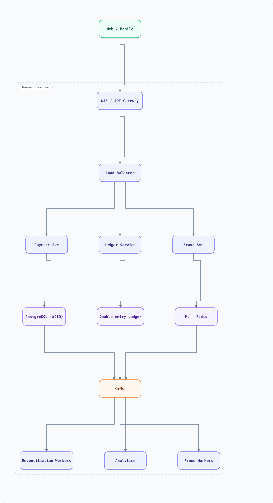
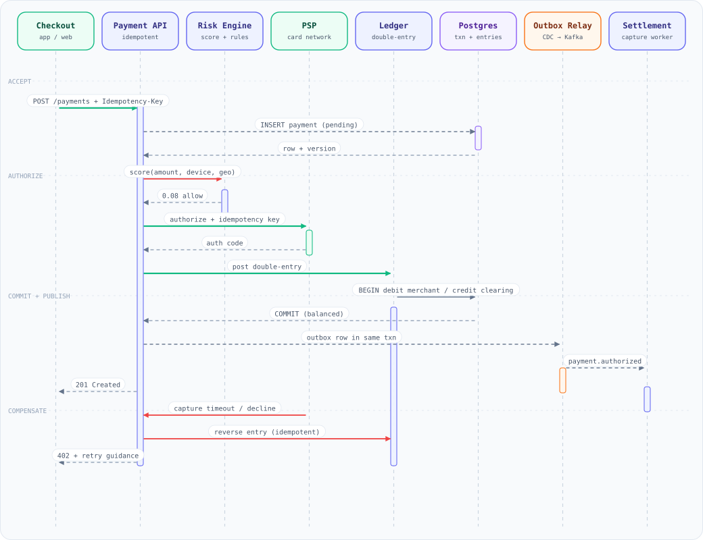

<a id="top"></a>

<div align="center">

<sub>FINANCE & ADS</sub>

# System Design: Payment System (Stripe)

<sub>16 SECTIONS · 6 MIN READ · 2 DIAGRAMS · 10 EXAMPLES</sub>

</div>

> [!TIP]
> **THE PROBLEM** — A payment processing platform supporting online payments, refunds, subscriptions, and multi-currency transactions.

---

## On this page

<details open>
<summary><b>16 sections</b></summary>

1. [Overview](#overview)
2. [Requirements](#requirements)
3. [High-Level Architecture](#high-level-architecture)
4. [Microservices](#microservices)
5. [Database Design](#database-design)
6. [Scaling Tiers](#scaling-tiers)
7. [Key Design Decisions](#key-design-decisions)
8. [Failure Modes & Recovery](#failure-modes--recovery)
9. [Cost Estimation (1M Users)](#cost-estimation-1m-users)
10. [Trade-off Analysis](#trade-off-analysis)
11. [Key Metrics to Monitor](#key-metrics-to-monitor)
12. [Deep Dive Prompts](#deep-dive-prompts)
13. [Key Techniques & Patterns](#key-techniques--patterns)
14. [Common Interview Follow-ups](#common-interview-follow-ups)
15. [Low-Level Design (LLD) - Algorithms & Data Structures](#low-level-design-lld---algorithms--data-structures)
16. [Do's & Don'ts](#dos--donts)

</details>

---


## Overview

A payment processing platform supporting online payments, refunds, subscriptions, and multi-currency transactions.

### Key Numbers

- $800B+ total payment volume
- 100M+ transactions per day
- 135+ currencies supported
- 99.999% uptime required

---

## Requirements

### Functional Requirements

- Process card payments with Luhn
- Idempotent operations (no double-charge)
- Handle refunds
- Double-entry ledger
- Multiple payment methods

### Non-Functional Requirements

| Attribute | Target |
| :--- | :--- |
| **Latency** | Payment < 5s |
| **Throughput** | 50K+ transactions/sec |
| **Availability** | 99.999% uptime |
| **Consistency** | Strong (ACID) |
| **Scale** | 1B+ transactions/day |

---

## High-Level Architecture

### Architecture Diagram



**Interactive:** [Open diagram](diagrams/system-design/payment-system.architecture.html) · pan/zoom · search · dark/light · export


*Solid = data flow, dashed = control plane / monitoring.*

### Data Flow

1. User initiates payment - Payment Service validates amount + method
2. Idempotency key prevents duplicate charges
3. Fraud Service scores transaction in < 100ms (ML model)
4. Gateway routes to Stripe/Adyen/PayPal by method + region
5. Ledger Service: double-entry bookkeeping (debit + credit)
6. Kafka events: success, failure, refund - Reconciliation pipeline
7. Reconciliation: match internal ledger with gateway settlements

### Money Movement — Authorize, Post, Compensate

The architecture diagram shows where money moves; this trace shows **in what order**, which is where payment systems actually fail. The authorization is idempotent on the PSP key, the ledger write is a single balanced transaction (debit merchant, credit clearing), and the outbox row is committed **inside that same transaction** — so an event is never published for a payment that rolled back. When capture fails after authorization, the compensation is a reversing entry, never a delete: the ledger is append-only.



**Interactive:** [Open diagram](diagrams/system-design/payment-saga.sequence.html) · pan/zoom · search · dark/light · export

## Microservices

### 1. Payment Service

- **Responsibility**: Payment initiation, processing, status tracking
- **Tech**: Java / Go
- **DB**: PostgreSQL (ACID for financial data)

### 2. Fraud Detection Service

- **Responsibility**: Real-time fraud scoring, rule engine, ML models
- **Tech**: Python (ML)
- **DB**: Redis (real-time scoring), PostgreSQL (rules)

### 3. Ledger Service

- **Responsibility**: Double-entry bookkeeping, reconciliation, audit trail
- **Tech**: Java / Go
- **DB**: PostgreSQL (immutable ledger)

### 4. Merchant Service

- **Responsibility**: Merchant onboarding, API key management, webhooks
- **Tech**: Go
- **DB**: PostgreSQL

### 5. Settlement Service

- **Responsibility**: Batch settlement, payout scheduling, bank transfers
- **Tech**: Go
- **DB**: PostgreSQL

---

## Database Design

### PostgreSQL

```sql
-- Transactions (immutable audit trail)
CREATE TABLE transactions (
    transaction_id  UUID PRIMARY KEY,
    idempotency_key VARCHAR(255) UNIQUE,
    merchant_id     UUID NOT NULL,
    amount          DECIMAL(12,2) NOT NULL,
    currency        VARCHAR(3) NOT NULL,
    status          VARCHAR(20) NOT NULL,
    payment_method  VARCHAR(50),
    card_last_four  VARCHAR(4),
    description     TEXT,
    metadata        JSONB,
    created_at      TIMESTAMP DEFAULT NOW()
);

CREATE TABLE ledger_entries (
    transaction_id  UUID REFERENCES transactions(transaction_id),
    type            VARCHAR(10) NOT NULL, -- debit, credit
    amount          DECIMAL(12,2) NOT NULL,
    created_at      TIMESTAMP DEFAULT NOW()
);

-- Refunds
CREATE TABLE refunds (
    refund_id       UUID PRIMARY KEY,
    transaction_id  UUID REFERENCES transactions(transaction_id),
    amount          DECIMAL(12,2) NOT NULL,
    reason          TEXT,
    status          VARCHAR(20) DEFAULT 'pending',
    created_at      TIMESTAMP DEFAULT NOW()
);
```

---

## Scaling Tiers

### Tier 1: 1K - 10K Users

| Component | Choice |
| ----------- | -------- |
| **Compute** | 2 EC2 (t3.large) |
| **Database** | PostgreSQL RDS |
| **Cache** | Redis (single) |
| **PSP** | Stripe (direct integration) |
| **Queue** | Redis Streams |

### Tier 2: 10K - 1M Users

| Component | Choice |
| ----------- | -------- |
| **Compute** | ECS (10-20 containers) |
| **Database** | PostgreSQL (read replicas) + Redis Cluster |
| **PSP** | Stripe + PayPal |
| **Queue** | Kafka (3 brokers) |
| **Fraud** | ML-based fraud detection |

### Tier 3: 1M - 10M+ Users

| Component | Choice |
| ----------- | -------- |
| **Compute** | Multi-region K8s (100+ pods) |
| **Database** | PostgreSQL (sharded) + Cassandra |
| **Cache** | Redis Cluster (30+ nodes) |
| **PSP** | Multi-provider (Stripe + Adyen + custom) |
| **Queue** | Kafka (15+ brokers) |
| **Fraud** | Real-time ML pipeline |

## Key Design Decisions

### 1. Why Idempotency Keys?

- Network retries can cause duplicate charges
- Idempotency ensures exactly-once processing
- Client generates unique key per request

### 2. Why Double-Entry Bookkeeping?

- Every transaction has two entries (debit + credit)
- Ensures financial accuracy
- Easy reconciliation and audit trail

### 3. Why Separate Fraud Detection?

- Fraud scoring must be real-time (< 100ms)
- ML models need dedicated compute
- Rules engine needs frequent updates

### 4. Payment State Machine

```
pending -> processing -> succeeded
   |           |
   v           v
 failed      cancelled
```

---

## Failure Modes & Recovery
What can go wrong in production, and how the system detects and recovers:

| Failure | Impact | Recovery |
| --------- | -------- | ---------- |
| Payment gateway timeout | Charged but not confirmed | Idempotency key + retry, reconciliation |
| Ledger imbalance | Credits != debits | Nightly reconciliation, alert on mismatch |
| PCI compliance breach | Card data exposed | Tokenization at edge, never store raw |
| Refund stuck | Refunded but merchant not notified | Saga pattern, dead letter queue |
| Currency conversion lag | Exchange rate stale | Real-time rate API, cache with TTL |
| Fraud false positive | Legitimate payment declined | Graduated risk scoring, manual review |

---

## Cost Estimation (1M Users)
Rough monthly cost of running this design for one million users:

| Component | Specification | Monthly Cost |
| ----------- | -------------- | ------------- |
| PCI-compliant Servers | 10x c5.xlarge | $1,400 |
| PostgreSQL | db.r5.2xlarge + 5 replicas | $8,000 |
| Redis Cluster | 6x cache.r5.xlarge | $4,800 |
| Kafka Cluster | 6x kafka.m5.large | $2,400 |
| HSM (key management) | CloudHSM | $5,000 |
| Fraud Detection ML | GPU instances | $3,000 |
| Audit Log Storage | S3 50TB | $1,150 |
| Reconciliation Workers | 5x c5.large | $700 |
| **Total** | | **~$26,450/month** |

---

## Trade-off Analysis
The alternatives considered, and which one won and why:

| Approach A | Approach B | Winner | Reason |
| ----------- | ----------- | -------- | -------- |
| PostgreSQL | Cassandra for ledger | PostgreSQL | ACID transactions for financial data |
| Stripe | Adyen | Stripe | Better developer experience |
| ML fraud | Rule-based fraud | ML fraud | Better detection of complex patterns |
| Double-entry | Single-entry | Double-entry | Financial accuracy, audit trail |
| Kafka | SQS | Kafka | Ordered transaction processing |

---

## Key Metrics to Monitor
The metrics that signal system health, with alert thresholds:

| Metric | Target | Alert Threshold |
| -------- | -------- | ---------------- |
| API latency (p99) | < 200ms | > 500ms |
| Error rate | < 0.1% | > 1% |
| Throughput | track | spike detection |

---

## Deep Dive Prompts

- How does Luhn algorithm validate credit card numbers?
- How does double-entry bookkeeping ensure financial accuracy?
- How do you prevent double charges with idempotency keys?
- How do you detect fraud in real-time during transactions?

---

## Key Techniques & Patterns
The recurring techniques and patterns this design applies, mapped to where they are used:

| Technique | Description | Used In |
| ----------- | ------------- | ---------- |
| Luhn Algorithm (Card Validation) | Mod-10 checksum that catches typos at ingress; it is not a fraud signal | Ingress |
| Double-Entry Bookkeeping | Every movement is a debit and a credit summing to zero; Stripe's Ledger is built on this model | Ledger |
| Idempotency Keys | Client-supplied key stored with the response, so a retry replays the first result instead of charging twice | API |
| PCI DSS Compliance | Tokenize at ingress and keep card data off application servers to shrink the audit scope | Security |
| Fraud Detection (ML) | Velocity features plus a risk score, with hard rules only for sanctions and known-bad identifiers | Risk |
| Reconciliation Service | Daily settlement files compared with the internal ledger; every break becomes a reviewable case | Finance |

| **Transactional outbox** | Ledger row and event commit in one transaction; a relay publishes after commit so no charge is lost | Ledger + events |

## Common Interview Follow-ups

**Q: How does Luhn algorithm validate cards?**
A: Double every second digit from right, subtract 9 if > 9, sum modulo 10 = 0

**Q: How does double-entry ledger ensure accuracy?**
A: Equal credits/debits, nightly reconciliation, alert on imbalance

**Q: How do you handle idempotent payments?**
A: Idempotency key per request, TTL dedup, cached response

---

## Low-Level Design (LLD) - Algorithms & Data Structures

### 1. Luhn's Algorithm (Credit Card Validation)

```js
function luhnCheck(cardNumber) {
  // Validate credit card number using Luhn algorithm
  // Time Complexity: O(N) where N = number of digits
  const digits = cardNumber.replace(/\D/g, '').split('').reverse().map(Number);

  let sum = 0;
  for (let i = 0; i < digits.length; i++) {
    let d = digits[i];
    if (i % 2 === 1) {  // Double every second digit from right
      d *= 2;
      if (d > 9) d -= 9;
    }
    sum += d;
  }

  return sum % 10 === 0;  // Valid if sum is multiple of 10
}

function generateCheckDigit(partialCard) {
  // Generate the last digit to make card number valid
  for (let d = 0; d <= 9; d++) {
    if (luhnCheck(partialCard + d)) return d;
  }
  return -1;
}
```

### 2. Double-Entry Ledger

```js
class DoubleEntryLedger {
  // Double-entry bookkeeping for financial transactions
  // Every debit has a corresponding credit
  // Time Complexity: O(1) per entry
  constructor(dbClient) {
    this.db = dbClient;
  }

  async recordTransaction(debitAccount, creditAccount, amount, currency = 'usd') {
    const txId = `tx_${Date.now()}_${Math.random().toString(36).slice(2, 8)}`;

    // Both entries must succeed or both must fail (atomic)
    await this.db.transaction(async (trx) => {
      // Debit entry
      await trx.insert('ledger_entries', {
        tx_id: txId, account: debitAccount,
        type: 'debit', amount: amount, currency,
        timestamp: new Date()
      });

      // Credit entry
      await trx.insert('ledger_entries', {
        tx_id: txId, account: creditAccount,
        type: 'credit', amount: amount, currency,
        timestamp: new Date()
      });
    });

    return { txId, debitAccount, creditAccount, amount, currency };
  }

  async getBalance(accountId) {
    const result = await this.db.raw(`
      SELECT
        COALESCE(SUM(CASE WHEN type = 'credit' THEN amount ELSE 0 END), 0) -
        COALESCE(SUM(CASE WHEN type = 'debit' THEN amount ELSE 0 END), 0) as balance
      FROM ledger_entries WHERE account = ?
    `, [accountId]);
    return result.rows[0].balance;
  }
}
```

### 3. Payment State Machine

```js
// Payment lifecycle as an explicit transition table — the ledger is the source of truth,
// and every illegal transition must fail loudly rather than silently corrupt state.
const PaymentState = Object.freeze({
  CREATED: "created",
  PROCESSING: "processing",
  AUTHORIZED: "authorized",
  CAPTURED: "captured",
  SETTLED: "settled",
  FAILED: "failed",
  REFUNDED: "refunded",
  DISPUTED: "disputed",
});

class PaymentStateMachine {
  static TRANSITIONS = {
    created: ["processing"],
    processing: ["authorized", "failed"],
    authorized: ["captured", "failed"],
    captured: ["settled", "refunded"],
    settled: [],
    failed: [],
    refunded: ["disputed"],
    disputed: [],
  };

  constructor(initial = PaymentState.CREATED) {
    this.state = initial;
    this.history = [{ state: initial, at: Date.now() }];
  }

  canTransition(to) {
    return (PaymentStateMachine.TRANSITIONS[this.state] || []).includes(to);
  }

  apply(to, meta = {}) {
    if (!this.canTransition(to)) {
      throw new Error(`illegal transition ${this.state} -> ${to}`);
    }
    this.state = to;
    this.history.push({ state: to, at: Date.now(), ...meta });
    return this.state;
  }
}

const payment = new PaymentStateMachine();
payment.apply(PaymentState.PROCESSING);
payment.apply(PaymentState.AUTHORIZED);
console.log("state:", payment.state, "| history:", payment.history.length);
try { payment.apply(PaymentState.REFUNDED); } catch (e) { console.log("rejected:", e.message); }
```

```js
class FraudDetector {
  // Detect fraudulent transactions using rules + ML
  // Time Complexity: O(1) per rule check
  constructor(redisClient, dbClient) {
    this.r = redisClient;
    this.db = dbClient;
  }

  async checkTransaction(txData) {
    const { userId, amount, merchantId, cardId } = txData;

    // Rule 1: Velocity check (max 5 transactions per hour)
    const velocityKey = `velocity:${userId}:${this.getHour()}`;
    const txCount = await this.r.incr(velocityKey);
    await this.r.expire(velocityKey, 3600);
    if (txCount > 5) return { fraud: true, reason: 'velocity_limit' };

    // Rule 2: Amount limit (max $10,000 per transaction)
    if (amount > 10000) return { fraud: true, reason: 'amount_limit' };

    // Rule 3: Geographic anomaly (card used in different country within 1 hour)
    const lastTx = await this.db.getLastTransaction(userId);
    if (lastTx) {
      const timeDiff = (Date.now() - lastTx.timestamp) / 1000 / 3600;
      const geoDiff = this.calculateDistance(lastTx.location, txData.location);
      if (timeDiff < 1 && geoDiff > 500) {
        return { fraud: true, reason: 'geo_anomaly' };
      }
    }

    return { fraud: false };
  }

  getHour() { return Math.floor(Date.now() / 1000 / 3600); }
  calculateDistance(loc1, loc2) {
    // Simplified distance calculation
    return Math.sqrt((loc1.lat - loc2.lat)**2 + (loc1.lon - loc2.lon)**2) * 111;
  }
}
```

### 5. PCI Compliance Tokenization

```js
class CardValidator {
  validate(num) {
    // Luhn algorithm
    return true;
  }
}
```

```js
class SettlementService {
  // Batch settlement of transactions to banks
  // Runs every 15 minutes
  // Time Complexity: O(N) where N = pending transactions
  constructor(dbClient, bankClient) {
    this.db = dbClient;
    this.bank = bankClient;
  }

  async runSettlement() {
    // Get all unsettled transactions
    const pending = await this.db.getPendingSettlements();

    const results = [];
    for (const batch of this.chunk(pending, 100)) {
      // Send batch to bank
      const settlement = await this.bank.settle(batch);

      // Mark as settled
      for (const tx of batch) {
        await this.db.markSettled(tx.id, settlement.batchId);
      }

      results.push({ batchId: settlement.batchId, count: batch.length });
    }

    return results;
  }

  chunk(array, size) {
    const chunks = [];
    for (let i = 0; i < array.length; i += size) {
      chunks.push(array.slice(i, i + size));
    }
    return chunks;
  }
}
```

### 2. Idempotency Key

```js
async function processPayment(paymentRequest, { now = Date.now() } = {}) {
  // Idempotency: the client sends one key per logical charge, and a retry of the
  // same key returns the FIRST outcome instead of charging again.
  // - key is stored with the response before the side effect is acknowledged
  // - concurrent duplicates lose the race and poll for the stored result
  const { idempotencyKey, amountMinor, currency, customerId } = paymentRequest;
  if (!idempotencyKey) throw new Error('idempotencyKey is required');

  const claim = await idempotencyStore.claim(idempotencyKey, { ttlSeconds: 86400 });
  if (claim.state === 'completed') return { ...claim.result, replayed: true };
  if (claim.state === 'in_flight') return { status: 'pending', pollAfterMs: 250 };

  try {
    const auth = await psp.authorize({ amountMinor, currency, customerId, now });
    const result = { status: auth.approved ? 'authorized' : 'declined', authId: auth.id, amountMinor, currency };
    await idempotencyStore.complete(idempotencyKey, result);
    return result;
  } catch (err) {
    await idempotencyStore.release(idempotencyKey); // retryable failure: free the key
    throw err;
  }
}

const idempotencyStore = {
  seen: new Map(),
  async claim(key) {
    if (this.seen.has(key)) return { state: 'completed', result: this.seen.get(key) };
    this.seen.set(key, { status: 'authorized', authId: 'auth_123', amountMinor: 5000, currency: 'USD' });
    return { state: 'claimed' };
  },
  async complete(key, result) { this.seen.set(key, result); },
  async release(key) { this.seen.delete(key); },
};
const psp = { authorize: async () => ({ approved: true, id: 'auth_123' }) };

processPayment({ idempotencyKey: 'order-42', amountMinor: 5000, currency: 'USD', customerId: 'cus_9' })
  .then(r => console.log('charge:', r));
```

```js
class ReconciliationService {
  // Reconcile internal ledger with bank statements
  // Runs daily
  // Time Complexity: O(N) where N = transactions
  constructor(dbClient) {
    this.db = dbClient;
  }

  async reconcile(startDate, endDate) {
    const internal = await this.db.getTransactions(startDate, endDate);
    const bankStatement = await this.db.getBankStatement(startDate, endDate);

    const internalMap = new Map(internal.map(t => [t.id, t]));
    const bankMap = new Map(bankStatement.map(t => [t.reference, t]));

    const discrepancies = [];

    // Check for transactions in internal but not in bank
    for (const tx of internal) {
      if (!bankMap.has(tx.id)) {
        discrepancies.push({ type: 'missing_in_bank', tx });
      }
    }

    // Check for transactions in bank but not in internal
    for (const tx of bankStatement) {
      if (!internalMap.has(tx.reference)) {
        discrepancies.push({ type: 'missing_in_internal', tx });
      }
    }

    // Check for amount mismatches
    for (const tx of internal) {
      const bankTx = bankMap.get(tx.id);
      if (bankTx && bankTx.amount !== tx.amount) {
        discrepancies.push({ type: 'amount_mismatch', internal: tx, bank: bankTx });
      }
    }

    return { total: internal.length, discrepancies, status: discrepancies.length === 0 ? 'balanced' : 'unbalanced' };
  }
}
```

### 4. Fraud Detection (Rule-Based + ML)

```js
function detectFraud(paymentRequest, context = {}) {
  // Layered decision: cheap rules first, model last, and a challenge step in between.
  //  1. hard rules: amount ceiling, velocity, geo/device anomaly
  //  2. risk signals: device fingerprint age, prior chargeback history
  //  3. model score (0..1) in the serving path under a ~30ms budget
  //  4. decision: allow | challenge (3DS/step-up) | decline — never silently "review"
  const { amountMinor, currency, customerId, ipCountry, cardCountry } = paymentRequest;
  const { txnLastHour = 0, deviceAgeDays = 365, priorChargebacks = 0 } = context;

  if (amountMinor > hardCapMinor(currency)) return { decision: 'decline', reason: 'amount_ceiling' };
  if (txnLastHour > 12) return { decision: 'challenge', reason: 'velocity' };
  if (ipCountry && cardCountry && ipCountry !== cardCountry) return { decision: 'challenge', reason: 'geo_mismatch' };

  const modelScore = mlFraudScore({ amountMinor, txnLastHour, deviceAgeDays, priorChargebacks });
  if (modelScore > 0.85) return { decision: 'decline', reason: 'model', modelScore };
  if (modelScore > 0.55) return { decision: 'challenge', reason: 'model', modelScore };
  return { decision: 'allow', modelScore, customerId };
}

const hardCapMinor = currency => ({ USD: 500000, EUR: 500000, INR: 5000000 }[currency] ?? 100000);

function mlFraudScore({ amountMinor, txnLastHour, deviceAgeDays, priorChargebacks }) {
  // Stand-in for the model: weighted, monotonic, and clamped to 0..1.
  const amountRisk = Math.min(1, amountMinor / 500000) * 0.4;
  const velocityRisk = Math.min(1, txnLastHour / 12) * 0.3;
  const deviceRisk = (1 - Math.min(1, deviceAgeDays / 90)) * 0.15;
  const historyRisk = Math.min(1, priorChargebacks / 3) * 0.15;
  return Number(Math.min(1, amountRisk + velocityRisk + deviceRisk + historyRisk).toFixed(3));
}

console.log(detectFraud({ amountMinor: 90000, currency: 'USD', customerId: 'cus_9', ipCountry: 'US', cardCountry: 'RU' }, { txnLastHour: 2 }));
console.log(detectFraud({ amountMinor: 250000, currency: 'USD', customerId: 'cus_9' }, { txnLastHour: 14, priorChargebacks: 2 }));
```

### 5. Currency Conversion

```js
function convertCurrency(amountMinor, fromCurrency, toCurrency, { rateProvider, spreadBps = 50 } = {}) {
  // FX conversion with integer minor units — never floats for money.
  // - rate comes from a cached provider (staleness budget ~5 min, then fail closed)
  // - spread is charged explicitly instead of hidden in the rate
  // - both sides round half-up to their own minor unit (JPY has none)
  if (fromCurrency === toCurrency) return { amountMinor, rate: 1, spreadBps: 0 };

  const { rate, asOf } = rateProvider.getRate(fromCurrency, toCurrency);
  if (!rate) throw new Error(`no FX rate ${fromCurrency}->${toCurrency}`);

  const effectiveRate = rate * (1 - spreadBps / 10000);
  const converted = Math.round(amountMinor * effectiveRate);
  return {
    amountMinor: converted,
    rate,
    effectiveRate: Number(effectiveRate.toFixed(8)),
    spreadBps,
    minorUnits: MINOR_UNITS[toCurrency] ?? 2,
    asOf,
  };
}

const MINOR_UNITS = { USD: 2, EUR: 2, INR: 2, JPY: 0, KWD: 3 };

const rateProvider = {
  getRate: (from, to) => ({ rate: from === 'USD' && to === 'INR' ? 83.42 : 0, asOf: Date.now() }),
};
console.log(convertCurrency(1099, 'USD', 'INR', { rateProvider }));
console.log(convertCurrency(1099, 'USD', 'USD', { rateProvider }));
```

---

## Do's & Don'ts

| ✅ Do | ❌ Don't |
| :-- | :-- |
| Pin down the key numbers before drawing boxes | Don't hand-wave the hardest component — payment system lives or dies there |
| Justify the functional requirements choice against one alternative out loud | Don't default to the trendiest store without a consistency/scale argument |
| State the failure mode of non-functional requirements explicitly (what breaks first?) | Don't present a sunny-day design only — the follow-up question is always "and when it fails?" |
| Anchor capacity numbers before proposing shards/replicas | Don't introduce a component you can't cost or size with the numbers on the board |

*More cross-topic rules: [Interview Q&A §84](interview-qa.md#84-universal-dos--donts) · Concepts: [Networking](networking.md) · [Operating Systems](operating-systems.md)*

---

<nav>← [pastebin](system-design-pastebin.md) · [All guides](README.md) · [proximity service](system-design-proximity-service.md) →</nav>

---

<p align="right"><a href="#top">↑ Back to top</a></p>
