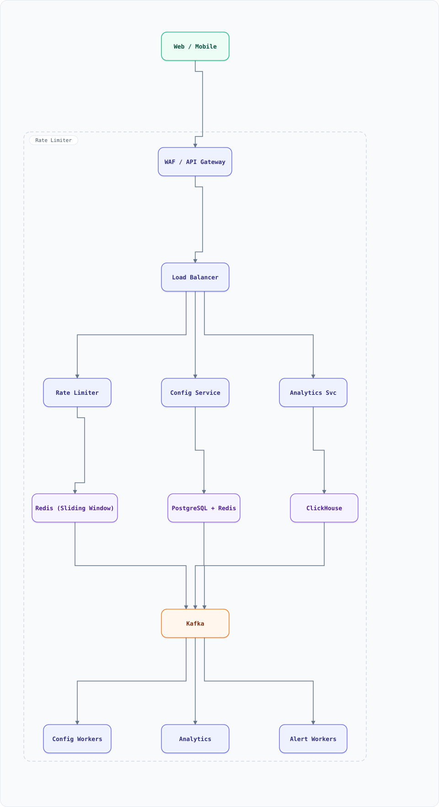
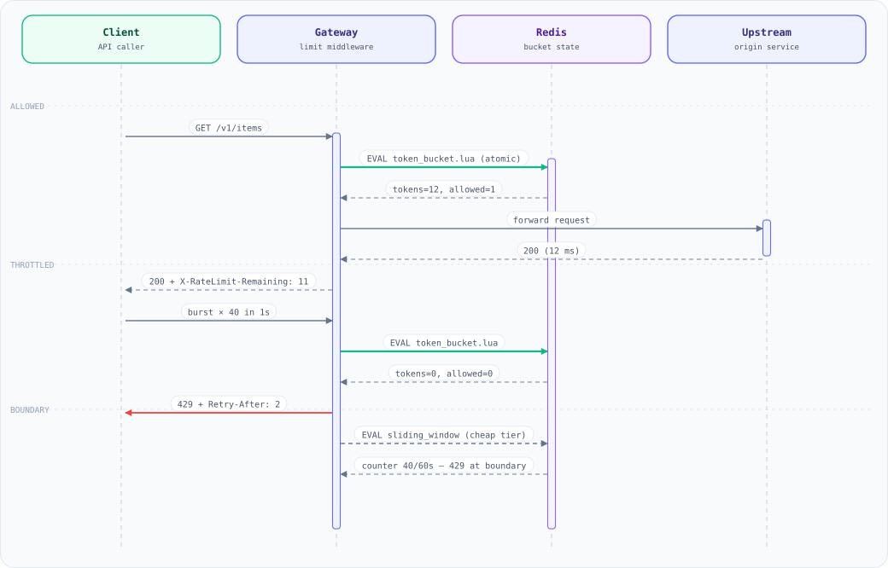

<div align="center">

<sub>INFRASTRUCTURE</sub>

# System Design: Rate Limiter

</div>

> [!TIP]
> **THE PROBLEM** — A distributed rate limiting system that controls API request rates per user/IP/API key to prevent abuse and ensure fair usage.

## Table of Contents

<details open>
<summary><b>📑 Jump to a section</b></summary>

1. [Overview](#overview)
2. [Requirements](#requirements)
3. [High-Level Architecture](#high-level-architecture)
4. [Microservices](#microservices)
5. [Database Design](#database-design)
6. [Scaling Tiers](#scaling-tiers)
7. [Key Design Decisions](#key-design-decisions)
8. [Failure Modes & Recovery](#failure-modes--recovery)
9. [Cost Estimation (1M Users)](#cost-estimation-1m-users)
10. [Trade-off Analysis](#trade-off-analysis)
11. [Key Metrics to Monitor](#key-metrics-to-monitor)
12. [Deep Dive Prompts](#deep-dive-prompts)
13. [Key Techniques & Patterns](#key-techniques--patterns)
14. [Common Interview Follow-ups](#common-interview-follow-ups)
15. [Low-Level Design (LLD) - Algorithms & Data Structures](#low-level-design-lld---algorithms--data-structures)
16. [Do's & Don'ts](#dos--donts)

</details>

---


## Overview

A distributed rate limiting system that controls API request rates per user/IP/API key to prevent abuse and ensure fair usage.

### Key Numbers

- 10M+ API requests per second
- 100K+ rate limit rules
- Sub-millisecond decision time

---

## Requirements

### Functional Requirements

- Limit API requests per user/IP/key
- Support token bucket and sliding window
- Return HTTP 429 with Retry-After
- Real-time usage statistics
- Distributed rate limiting

### Non-Functional Requirements

| Attribute | Target |
| :--- | :--- |
| **Latency** | Rate check < 1ms |
| **Throughput** | 10M+ requests/sec |
| **Availability** | 99.99% uptime |
| **Consistency** | Soft consistency |
| **Scale** | 100K+ rate limit keys |

---

## High-Level Architecture

### Architecture Diagram



**Interactive diagram:** [diagrams/system-design/rate-limiter.architecture.html](diagrams/system-design/rate-limiter.architecture.html) — pan/zoom, search, dark/light theme, PNG/SVG export.


*Solid = data flow, dashed = control plane / monitoring.*

### Data Flow

1. API request hits Rate Limiter before reaching backend
2. Redis sliding window counter checks request count
3. Under limit: increment counter, forward request
4. Over limit: return 429 Too Many Requests + Retry-After
5. Config Service: dynamic limit changes per API key / tier
6. Analytics: rate limit hits, false positives, capacity planning
7. Alerts when approaching limits (80% threshold)

### One Request, One Atomic Decision

The decision has to be atomic: read-modify-write across two round trips lets a burst slip through between the read and the write, so the bucket lives in a single Lua script. Allowed requests carry `X-RateLimit-Remaining` so well-behaved clients can self-throttle, and denials carry `Retry-After` instead of an opaque 429. The last exchange is the known weakness of fixed windows — a burst that straddles the boundary passes twice at up to double the limit, which is why the cheaper tier uses a sliding-window counter.



**Interactive diagram:** [diagrams/system-design/ratelimit-decision.sequence.html](diagrams/system-design/ratelimit-decision.sequence.html) — pan/zoom, search, dark/light theme, PNG/SVG export.

## Microservices
How the system is decomposed into independently deployed services:

| Service | Responsibility | Tech | DB |
| --------- | --------------- | ------ | ----- |
| **API Gateway** | Rate limit check at edge | NGINX/Kong/Envoy | Redis |
| **Rule Engine** | Manage rate limit rules | Go/Node.js | PostgreSQL |
| **Counter Service** | Increment/reset counters | Go | Redis |
| **Analytics Service** | Track rate limit metrics | Python | ClickHouse |
| **Config Service** | Dynamic rule updates | Go | etcd/Consul |

---

## Database Design

### PostgreSQL: Rate Limit Rules

```sql
CREATE TABLE rate_limit_rules (
    id              SERIAL PRIMARY KEY,
    rule_name       VARCHAR(100) NOT NULL,
    resource        VARCHAR(100) NOT NULL,  -- API endpoint or resource
    limit_type      VARCHAR(20) NOT NULL,   -- 'per_user', 'per_ip', 'global'
    max_requests    INT NOT NULL,
    window_seconds  INT NOT NULL,
    algorithm       VARCHAR(20) DEFAULT 'sliding_window_counter',
    is_active       BOOLEAN DEFAULT true,
    created_at      TIMESTAMP DEFAULT NOW(),
    updated_at      TIMESTAMP DEFAULT NOW()
);

CREATE INDEX idx_rules_resource ON rate_limit_rules(resource);
CREATE INDEX idx_rules_active ON rate_limit_rules(is_active);
```

### Redis: Rate Limit Counters

```redis
-- Sliding Window Counter (per user per resource)
SET rate:user:123:api:/v1/posts:window:1725148800 42
EXPIRE rate:user:123:api:/v1/posts:window:1725148800 120

-- Token Bucket (per user)
HSET rate:token:user:123 tokens 85 last_refill 1725148800 capacity 100 refill_rate 10

-- Fixed Window (per IP)
INCR rate:ip:192.168.1.1:window:1725148800
EXPIRE rate:ip:192.168.1.1:window:1725148800 60
```

## Scaling Tiers

### Tier 1: 1K - 10K Users

| Component | Choice |
| ----------- | -------- |
| **Redis** | Single Redis instance |
| **Algorithm** | Fixed Window or Token Bucket |
| **Placement** | Application layer |

### Tier 2: 10K - 1M Users

| Component | Choice |
| ----------- | -------- |
| **Redis** | Redis Cluster (6 nodes) |
| **Algorithm** | Sliding Window Counter |
| **Placement** | API Gateway + Application |

### Tier 3: 1M - 10M+ Users

| Component | Choice |
| ----------- | -------- |
| **Redis** | Redis Cluster (30+ nodes, multi-region) |
| **Algorithm** | Token Bucket + Sliding Window |
| **Placement** | Multi-layer (Gateway + App + DB) |
| **Sync** | Redis Pub/Sub for cross-region sync |

---

## Key Design Decisions

### 1. Where to Place Rate Limiter?

- **API Gateway**: Centralized, easy to manage
- **Application Layer**: More granular control
- **Both**: Defense in depth

### 2. Rate Limit Keys

- Per user: `rate:{user_id}`
- Per IP: `rate:{ip_address}`
- Per API key: `rate:{api_key}`
- Per endpoint: `rate:{endpoint}:{user_id}`

### 3. Rate Limit Response

```text
// HTTP 429 Too Many Requests
{
    "error": "rate_limit_exceeded",
    "message": "Too many requests",
    "retry_after": Math.floor(30 / seconds)
}

```

### 4. Redis Lua Script (Atomic)

```lua
-- Atomic rate limiting in Redis
local key = KEYS[1]
local limit = tonumber(ARGV[1])
local window = tonumber(ARGV[2])

local current = tonumber(redis.call('GET', key) or '0')
if current + 1 > limit then
    return 0  -- Reject
else
    redis.call('INCR', key)
    redis.call('EXPIRE', key, window)
    return 1  -- Allow
end
```

### 5. Rate Limit Headers

```
X-RateLimit-Limit: 100
X-RateLimit-Remaining: 95
X-RateLimit-Reset: 1625206400
Retry-After: 30
```

---

## Failure Modes & Recovery
What can go wrong in production, and how the system detects and recovers:

| Failure | Impact | Recovery |
| --------- | -------- | ---------- |
| Redis cluster down | Limiter fails open | Fail-open design, local memory fallback |
| Clock skew across nodes | Sliding window inaccurate | NTP sync, logical timestamps |
| Hot key popular API | Single Redis shard overloaded | Local caching, sharded keys |
| Config change propagation | Nodes enforce old limits | Kafka broadcast, version stamps |
| Race condition on counter | Over/under count requests | Redis INCR atomic, Lua script |
| Client bypasses limit | Multiple IPs | Session-based limiting, API key + IP + user |

---

## Cost Estimation (1M Users)
Rough monthly cost of running this design for one million users:

| Component | Specification | Monthly Cost |
| ----------- | -------------- | ------------- |
| Redis Cluster | 6x cache.r5.xlarge | $4,800 |
| Rate Limiter Nodes | 10x c5.xlarge | $1,400 |
| Config Service | 3x c5.large | $420 |
| Kafka (config broadcast) | 3x kafka.m5.large | $1,200 |
| Monitoring | Prometheus + Grafana | $500 |
| **Total** | | **~$8,320/month** |

---

## Trade-off Analysis
The alternatives considered, and which one won and why:

| Approach A | Approach B | Winner | Reason |
| ----------- | ----------- | -------- | -------- |
| Token bucket | Fixed window | Token bucket | Allows bursts, smoother rate limiting |
| Sliding window | Fixed window | Sliding window | More accurate request counting |
| Redis | Database | Redis | Sub-ms operations for rate limiting |
| Lua script | Application logic | Lua script | Atomic operations, no race conditions |
| Local + distributed | Distributed only | Local + distributed | Faster local checks, global coordination |

---

## Key Metrics to Monitor
The metrics that signal system health, with alert thresholds:

| Metric | Target | Alert Threshold |
| -------- | -------- | ---------------- |
| API latency (p99) | < 200ms | > 500ms |
| Error rate | < 0.1% | > 1% |
| Throughput | track | spike detection |

---

## Deep Dive Prompts

- How does token bucket algorithm handle traffic bursts?
- How do you implement distributed rate limiting across multiple servers?
- How do you prevent race conditions in rate limiting?
- How do you handle rate limit violations gracefully?

---

## Key Techniques & Patterns
The recurring techniques and patterns this design applies, mapped to where they are used:

| Technique | Description | Used In |
| ----------- | ------------- | ---------- |
| Token Bucket Algorithm | Capacity plus refill rate; permits bursts up to the bucket, the model Stripe documents for its API | Core |
| Sliding Window Counter | Two adjacent fixed windows weighted by overlap, the approximation Cloudflare describes | Core |
| Fixed Window Counter | Cheapest option, but allows a double burst across the window boundary | Core |
| Distributed Rate Limiting (Redis) | Lua for atomic check-and-decrement; local buckets with periodic sync cut the per-request round trip | Cluster |
| Rate Limit Headers | RateLimit-Limit/Remaining/Reset plus Retry-After on 429, so clients can back off correctly | API |
| Graceful Degradation | Fail open for reads, fail closed for auth and payments; a local fallback when Redis is unreachable | Resilience |
| Composite Policy Chain | One request checked against several limits (global, tenant, route, user); any deny rejects, with the strictest Retry-After | All tiers |

## Common Interview Follow-ups

**Q: What happens when Redis goes down?**
A: Fail-open design, local memory fallback, alert ops

**Q: How do you handle distributed rate limiting?**
A: Redis atomic INCR, Lua script, consistent hashing

**Q: Which algorithm is best?**
A: Token bucket for bursts, sliding window for accuracy, leaky bucket for smooth output

**Q: How do you enforce several limits on one request?**
A: Model each as a strategy with its own key, state and failure mode; evaluate the cheapest local check first, then shared state, and reject if any required policy denies. Return the strictest Retry-After and say which policy fired.

---

## Low-Level Design (LLD) - Algorithms & Data Structures

### 1. Token Bucket Algorithm

```js
class TokenBucket {
  // Token bucket rate limiter
  // Time Complexity: O(1) per request
  constructor(capacity, refillRate) {
    this.capacity = capacity;      // Max burst size
    this.tokens = capacity;        // Current available tokens
    this.refillRate = refillRate;  // Tokens added per second
    this.lastRefill = Date.now();
  }

  consume(tokens = 1) {
    this.refill();
    if (this.tokens >= tokens) {
      this.tokens -= tokens;
      return { allowed: true, remaining: Math.floor(this.tokens) };
    }
    return { allowed: false, remaining: 0, retryAfter: this.retryTime(tokens) };
  }

  refill() {
    const now = Date.now();
    const elapsed = (now - this.lastRefill) / 1000;
    this.tokens = Math.min(this.capacity, this.tokens + elapsed * this.refillRate);
    this.lastRefill = now;
  }

  retryTime(tokens) {
    const deficit = tokens - this.tokens;
    return Math.ceil((deficit / this.refillRate) * 1000);  // ms until tokens available
  }
}

class SlidingWindowCounter {
  // Sliding window rate limiter using two fixed windows
  // Time Complexity: O(1) per request
  constructor(windowSizeSec, maxRequests) {
    this.windowSize = windowSizeSec;
    this.maxRequests = maxRequests;
    this.prevCount = 0;
    this.currCount = 0;
    this.windowStart = Math.floor(Date.now() / 1000 / windowSizeSec) * windowSizeSec;
  }

  allow() {
    this.rollWindow();
    if (this.currCount < this.maxRequests) {
      this.currCount++;
      return true;
    }
    return false;
  }

  rollWindow() {
    const now = Math.floor(Date.now() / 1000);
    const currentWindow = Math.floor(now / this.windowSize) * this.windowSize;

    if (currentWindow > this.windowStart) {
      // Shift windows
      const elapsed = (currentWindow - this.windowStart) / this.windowSize;
      this.prevCount = elapsed >= 2 ? 0 : this.currCount;
      this.currCount = 0;
      this.windowStart = currentWindow;
    }
  }
}
```

### 2. Sliding Window Log Algorithm

```js
class SlidingWindowLog {
  // Sliding Window Log: keep one timestamp per request, drop the expired ones.
  // Most accurate, highest memory usage.
  // Redis form is atomic in one Lua script:
  //   ZREMRANGEBYSCORE key 0 (now - window) ; ZCARD key ; ZADD key now now ; PEXPIRE key window
  constructor(windowSeconds, maxRequests) {
    this.windowMs = windowSeconds * 1000;
    this.maxRequests = maxRequests;
    this.log = []; // timestamps, oldest first
  }

  allow(now = Date.now()) {
    const cutoff = now - this.windowMs;
    while (this.log.length && this.log[0] <= cutoff) this.log.shift();
    if (this.log.length >= this.maxRequests) {
      return { allowed: false, remaining: 0, retryAfterMs: this.log[0] + this.windowMs - now };
    }
    this.log.push(now);
    return { allowed: true, remaining: this.maxRequests - this.log.length };
  }
}

const log = new SlidingWindowLog(60, 3);
console.log(log.allow(1000), log.allow(1001), log.allow(1002), log.allow(1003));
```

### 3. Sliding Window Counter Algorithm

```js
class SlidingWindowCounter {
  // Weighted count of the previous + current fixed window.
  // Two counters of memory; error is bounded by how skewed the previous window was.
  constructor(windowSeconds, maxRequests) {
    this.windowMs = windowSeconds * 1000;
    this.maxRequests = maxRequests;
    this.currCount = 0;
    this.prevCount = 0;
    this.currStart = Math.floor(Date.now() / this.windowMs) * this.windowMs;
  }

  allow(now = Date.now()) {
    const windowStart = Math.floor(now / this.windowMs) * this.windowMs;
    const elapsedWindows = (windowStart - this.currStart) / this.windowMs;
    if (elapsedWindows >= 1) {
      this.prevCount = elapsedWindows === 1 ? this.currCount : 0; // 2+ windows skipped → all stale
      this.currCount = 0;
      this.currStart = windowStart;
    }
    const fraction = (now - windowStart) / this.windowMs;
    const estimate = this.prevCount * (1 - fraction) + this.currCount;
    if (estimate >= this.maxRequests) return { allowed: false, remaining: 0, estimate };
    this.currCount++;
    return { allowed: true, remaining: Math.floor(this.maxRequests - estimate - 1) };
  }
}

const swc = new SlidingWindowCounter(60, 100);
console.log(swc.allow(Date.now()));
```

### 4. Leaky Bucket Algorithm

```js
class LeakyBucket {
  // FIFO queue drained at a fixed rate; overflow is dropped.
  // Smooths bursts into a steady output stream (a burst is queued, never forwarded at once).
  constructor(capacity, leakPerSecond) {
    this.capacity = capacity;
    this.leakPerSecond = leakPerSecond;
    this.queue = [];
    this.lastLeak = Date.now();
  }

  #drain(now) {
    const leaked = Math.floor(((now - this.lastLeak) / 1000) * this.leakPerSecond);
    if (leaked > 0) {
      this.queue.splice(0, leaked); // drop the oldest — they are already "processed"
      this.lastLeak = now;
    }
  }

  allow(now = Date.now()) {
    this.#drain(now);
    if (this.queue.length >= this.capacity) {
      return { allowed: false, queueDepth: this.queue.length, retryAfterMs: 1000 / this.leakPerSecond };
    }
    this.queue.push(now);
    return { allowed: true, queueDepth: this.queue.length };
  }
}

const bucket = new LeakyBucket(5, 1);
for (let i = 0; i < 7; i++) console.log(i, bucket.allow(Date.now()));
```

### 5. Fixed Window Counter Algorithm

```js
class FixedWindowCounter {
  // Simplest algorithm: one counter per fixed time bucket.
  // Redis form is INCR + EXPIRE — cheap, but a burst across a boundary can double the rate.
  constructor(windowSeconds, maxRequests) {
    this.windowMs = windowSeconds * 1000;
    this.maxRequests = maxRequests;
    this.buckets = new Map();
  }

  allow(key, now = Date.now()) {
    const bucket = Math.floor(now / this.windowMs);
    const id = `${key}:${bucket}`;
    const count = (this.buckets.get(id) || 0) + 1;
    this.buckets.set(id, count);
    if (count > this.maxRequests) {
      return { allowed: false, remaining: 0, retryAfterMs: (bucket + 1) * this.windowMs - now };
    }
    return { allowed: true, remaining: this.maxRequests - count };
  }
}

const fixed = new FixedWindowCounter(60, 2);
console.log(fixed.allow('user-7', 1000), fixed.allow('user-7', 1200), fixed.allow('user-7', 1300));
```

### 6. Distributed Rate Limiter with Consistent Hashing

```js
const crypto = require('crypto');

class DistributedRateLimiter {
  /**
   * Routes rate limit checks to specific Redis shards using consistent hashing.
   * Ensures all requests for the same user hit the same Redis node.
   */
  constructor(redisNodes, windowSeconds, maxRequests) {
    this.nodes = redisNodes.sort();
    this.window = windowSeconds;
    this.maxRequests = maxRequests;
  }

  getShard(userId) {
    const hash = parseInt(crypto.createHash('md5').update(userId).digest('hex').slice(0, 8), 16);
    return this.nodes[hash % this.nodes.length];
  }

  async allow(userId, ruleId) {
    const shard = this.getShard(userId);
    const key = `ratelimit:${ruleId}:${userId}`;
    const now = Math.floor(Date.now() / 1000);
    const windowStart = now - this.window;

    // Lua script for atomic check-and-increment
    const luaScript = `
      redis.call('ZREMRANGEBYSCORE', KEYS[1], 0, ARGV[1])
      local count = redis.call('ZCARD', KEYS[1])
      if count < tonumber(ARGV[2]) then
        redis.call('ZADD', KEYS[1], ARGV[3], ARGV[3])
        redis.call('EXPIRE', KEYS[1], ARGV[4])
        return 1
      end
      return 0
    `;

    const result = await shard.eval(luaScript, 1, key, windowStart, this.maxRequests, now, this.window * 2);
    return result === 1;
  }
}

const limiter = new RateLimiter(); console.log("Rate limiter ready");
```

---

### Rate Limiting Strategies

| Strategy | Use Case | Accuracy | Memory |
| ---------- | ---------- | ---------- | -------- |
| Token Bucket | API rate limiting | High | Low |
| Sliding Window Log | Strict rate limiting | Highest | High |
| Sliding Window Counter | General purpose | High | Low |
| Fixed Window Counter | Simple limits | Medium | Lowest |
| Leaky Bucket | Traffic shaping | High | Low |

### Composing Policies: One Request, Several Limits

A real gateway rarely enforces one limit. A request may need to satisfy a global fleet cap, a tenant quota, a per-route limit and a per-user burst allowance. Model each as a small strategy and compose them:

- **Rule** = `(key extractor, algorithm, limit, window, cost, failure mode)`. Keep policy config versioned and hot-reloadable.
- Run the cheapest check first (in-process token bucket) and only then the shared Redis check; reject if **any** required policy denies.
- Return the strictest `Retry-After` plus a `Which-Policy` header, so a client can back off intelligently instead of guessing.
- Keep state per `(policy, key)` with a TTL, and cap key cardinality with an LRU; otherwise Redis becomes the unbounded thing you were protecting.
- Choose fail-open or fail-closed **per policy**: availability limits can fail open, fraud and payment limits must fail closed.

```js
class CompositeLimiter {
  constructor() { this.policies = []; }
  add(name, limit, windowMs) {
    this.policies.push({ name, limit, windowMs, hits: new Map() });
    return this;                         // fluent: .add(...).add(...)
  }
  allow(key, now = 0) {
    const decisions = this.policies.map(p => {
      const hits = (p.hits.get(key) ?? []).filter(t => now - t < p.windowMs);
      const ok = hits.length < p.limit;
      const retryAfterMs = ok ? 0 : p.windowMs - (now - hits[0]);
      if (ok) hits.push(now);
      p.hits.set(key, hits);             // per (policy, key) state
      return { policy: p.name, ok, retryAfterMs };
    });
    const denied = decisions.filter(d => !d.ok);
    return {
      allowed: denied.length === 0,
      retryAfterMs: Math.max(0, ...denied.map(d => d.retryAfterMs)),
      decisions,
    };
  }
}

const limiter = new CompositeLimiter().add('tenant', 5, 1000).add('route', 2, 1000);
console.log('r1:', limiter.allow('u1', 1000).allowed);
console.log('r2:', limiter.allow('u1', 1100).allowed);
console.log('r3:', JSON.stringify(limiter.allow('u1', 1200)));
console.log('u2 unaffected:', limiter.allow('u2', 1250).allowed);
```

The demo's third request passes the tenant limit (3 of 5) but fails the route limit (2 per second), showing why a single global counter cannot express a per-route policy.

---

## Do's & Don'ts

| ✅ Do | ❌ Don't |
| :-- | :-- |
| Pin down the key numbers before drawing boxes | Don't hand-wave the hardest component — rate limiter lives or dies there |
| Justify the functional requirements choice against one alternative out loud | Don't default to the trendiest store without a consistency/scale argument |
| State the failure mode of non-functional requirements explicitly (what breaks first?) | Don't present a sunny-day design only — the follow-up question is always "and when it fails?" |
| Anchor capacity numbers before proposing shards/replicas | Don't introduce a component you can't cost or size with the numbers on the board |

*More cross-topic rules: [Interview Q&A §84](interview-qa.md#84-universal-dos--donts) · Concepts: [Networking](networking.md) · [Operating Systems](operating-systems.md)*

---

<nav>← [proximity service](system-design-proximity-service.md) · [📖 All guides](README.md) · [recommendation system](system-design-recommendation-system.md) →</nav>
