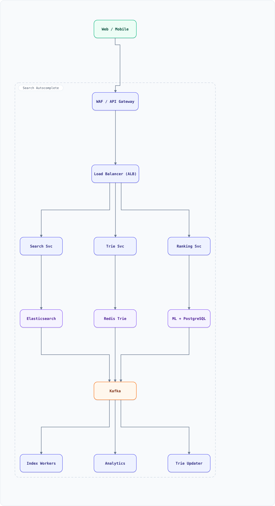

<div align="center">

# System Design: Search Autocomplete (Typeahead)

</div>

> [!TIP]
> **TL;DR** — A real-time search autocomplete system providing instant suggestions as users type, with < 100ms response time.

## Table of Contents

<details>
<summary><b>📑 Jump to a section</b></summary>

1. [Overview](#overview)
2. [Requirements](#requirements)
3. [High-Level Architecture](#high-level-architecture)
4. [Microservices](#microservices)
5. [Database Design](#database-design)
6. [Scaling Tiers](#scaling-tiers)
7. [Key Design Decisions](#key-design-decisions)
8. [Failure Modes & Recovery](#failure-modes--recovery)
9. [Cost Estimation (1M Users)](#cost-estimation-1m-users)
10. [Trade-off Analysis](#trade-off-analysis)
11. [Key Metrics to Monitor](#key-metrics-to-monitor)
12. [Deep Dive Prompts](#deep-dive-prompts)
13. [Key Techniques & Patterns](#key-techniques--patterns)
14. [Common Interview Follow-ups](#common-interview-follow-ups)
15. [Low-Level Design (LLD) - Algorithms & Data Structures](#low-level-design-lld---algorithms--data-structures)
16. [Do's & Don'ts](#dos--donts)

</details>

---


## Overview

A real-time search autocomplete system providing instant suggestions as users type, with < 100ms response time.

### Key Numbers

| Metric | Value |
| :--- | :--- |
| **queries per day** | 100M+ |
| **<** | 100ms response time |
| **unique search terms** | 10M+ |
| **QPS at peak** | 100K+ |

---

## Requirements

### Functional Requirements

- Show suggestions after 2 chars
- Rank by popularity and recency
- Typo tolerance and fuzzy matching
- Cache popular prefixes
- Track analytics for ranking

### Non-Functional Requirements

| Attribute | Target |
| :--- | :--- |
| **Latency** | Suggestion < 100ms |
| **Throughput** | 100K+ queries/sec |
| **Availability** | 99.99% uptime |
| **Consistency** | Eventually consistent |
| **Scale** | 10B+ queries, 1M+ prefixes |

---

## High-Level Architecture

### Architecture Diagram



**Interactive diagram:** [diagrams/system-design/search-autocomplete.architecture.html](diagrams/system-design/search-autocomplete.architecture.html) — pan/zoom, search, dark/light theme, PNG/SVG export.


*Solid = data flow, dashed = control plane / monitoring.*

### Data Flow

1. User types query - Trie Service returns top-5 suggestions (< 50ms)
2. Trie stored in Redis (in-memory, sub-ms lookups)
3. Ranking Service applies ML model: popularity + personalization
4. Full search - Search Service queries Elasticsearch cluster
5. Kafka events: click, impression - update trie popularity scores
6. Background: Trie Updater rebuilds trie hourly from click data
7. Analytics: query volume, CTR, zero-result rate

## Microservices

### 1. Autocomplete Service

- **Responsibility**: Suggest completions as user types
- **Tech**: Go (high performance)
- **DB**: Redis (Trie cache), PostgreSQL (query history)

### 2. Analytics Service

- **Responsibility**: Track search queries, compute popularity
- **Tech**: Python / Flink
- **DB**: ClickHouse (OLAP), Kafka (event stream)

### 3. Trending Service

- **Responsibility**: Real-time trending searches, boost recent popular queries
- **Tech**: Go
- **DB**: Redis (sorted sets)

---

## Database Design

### PostgreSQL

```sql
-- Search Queries (for analytics)
CREATE TABLE search_queries (
    query_id        BIGSERIAL PRIMARY KEY,
    query_text      TEXT NOT NULL,
    user_id         UUID,
    result_count    INT,
    clicked_result  VARCHAR(255),
    searched_at     TIMESTAMP DEFAULT NOW()
);

-- Popular Terms (pre-computed)
CREATE TABLE popular_terms (
    term_id         SERIAL PRIMARY KEY,
    term            VARCHAR(255) UNIQUE NOT NULL,
    frequency       INT DEFAULT 0,
    last_updated    TIMESTAMP DEFAULT NOW()
);
```

### Redis (Trie Cache)

```
# Trie structure in Redis
# Key: trie:{prefix}
# Value: sorted set of completions (score = popularity)

# Example: typing "net"
ZADD trie:net 1000000 "netflix"
ZADD trie:net 500000 "netscape"
ZADD trie:net 200000 "netflix login"

# Get completions for prefix "net"
ZREVRANGE trie:net 0 9 WITHSCORES

# Trending searches
ZADD trending:1min {score} {query}
ZADD trending:5min {score} {query}
```

---

## Scaling Tiers

### Tier 1: 1K - 10K Users

| Component | Choice |
| ----------- | -------- |
| **Compute** | 2 EC2 (t3.large) |
| **Trie** | In-memory (single server) |
| **Cache** | Local cache |
| **Analytics** | PostgreSQL |

### Tier 2: 10K - 1M Users

| Component | Choice |
| ----------- | -------- |
| **Compute** | ECS (10-20 containers) |
| **Trie** | Sharded by prefix |
| **Cache** | Redis Cluster (6 nodes) |
| **Analytics** | ClickHouse |

### Tier 3: 1M - 10M+ Users

| Component | Choice |
| ----------- | -------- |
| **Compute** | Multi-region K8s (100+ pods) |
| **Trie** | Distributed trie (custom) |
| **Cache** | Redis Cluster (30+ nodes) |
| **Analytics** | ClickHouse + Kafka |
| **ML** | Personalized suggestions |

---

## Key Design Decisions

### 1. Why Trie over Elasticsearch?

- Trie: O(L) lookup, in-memory, sub-millisecond
- Elasticsearch: Full-text search, but higher latency
- Use Trie for autocomplete, ES for full search

### 2. Why Cache Popular Prefixes?

- 90% of queries are for top 10% prefixes
- Cache hit ratio > 90%
- Reduces trie lookup load

### 3. Why Analytics Pipeline?

- Popular queries change over time
- Need to update trie frequencies
- Trending topics need real-time tracking

### 4. Why Personalization?

- Same prefix, different suggestions per user
- User history influences suggestions
- A/B test personalization algorithms

---

## Failure Modes & Recovery
What can go wrong in production, and how the system detects and recovers:

| Failure | Impact | Recovery |
| --------- | -------- | ---------- |
| Trie node corruption | Returns garbage | Rebuild from analytics, popularity fallback |
| Cache stampede popular prefix | All requests hit trie | Request coalescing, stale-while-revalidate |
| Personalization stale | Suggestions not adapting | Online learning pipeline, periodic refresh |
| Analytics lag | Trending queries not appearing | Near-real-time aggregation, manual boost |
| Typo tolerance aggressive | Irrelevant suggestions | Edit distance tuning, click feedback |
| Multi-language broken | Non-English returns English | Language detection, per-language trie |

---

## Cost Estimation (1M Users)
Rough monthly cost of running this design for one million users:

| Component | Specification | Monthly Cost |
| ----------- | -------------- | ------------- |
| API Servers | 10x c5.xlarge | $1,400 |
| Redis Cluster | 12x cache.r5.xlarge | $9,600 |
| Elasticsearch | 15x m5.xlarge | $6,300 |
| PostgreSQL | db.r5.xlarge + 2 replicas | $3,600 |
| Kafka (analytics) | 3x kafka.m5.large | $1,200 |
| Trie Service | 10x c5.xlarge | $1,400 |
| Analytics Workers | 5x c5.large | $700 |
| **Total** | | **~$24,200/month** |

---

## Trade-off Analysis
The alternatives considered, and which one won and why:

| Approach A | Approach B | Winner | Reason |
| ----------- | ----------- | -------- | -------- |
| Redis Trie | Elasticsearch prefix | Redis Trie | O(K) lookup, in-memory speed |
| TF-IDF | BM25 | TF-IDF | Better for short queries |
| Redis cache | Database cache | Redis | Sub-ms response for hot queries |
| Min-Heap | Sort | Min-Heap | O(N log K) for top-K suggestions |
| Kafka | SQS | Kafka | Higher throughput for query logging |

---

## Key Metrics to Monitor
The metrics that signal system health, with alert thresholds:

| Metric | Description | Target |
| -------- | ------------- | -------- |
| **Autocomplete Latency** | Time to return suggestions | < 50ms (p99) |
| **Cache Hit Rate** | % of prefix lookups from cache | > 90% |
| **Trie Lookup Time** | Time for prefix search | < 10ms |
| **Suggestion Relevance** | % of clicks on top-3 suggestions | > 70% |
| **Trie Update Latency** | Time to update trie with new queries | < 1 minute |
| **Personalization Lift** | CTR improvement from personalization | > 15% |
| **Memory Usage** | Trie memory footprint | < 10GB |
| **Query Coverage** | % of queries with suggestions | > 85% |
| **Trending Detection Speed** | Time to detect trending query | < 5 minutes |
| **Suggestion Freshness** | Average age of suggestions | < 24 hours |

## Deep Dive Prompts

- How does Trie data structure achieve O(K) prefix lookup?
- How do you handle fuzzy matching for typos?
- How do you rank suggestions by time-decay and popularity?
- How do you cache hot queries for sub-50ms responses?

---

## Key Techniques & Patterns
The recurring techniques and patterns this design applies, mapped to where they are used:

| Technique | Description | Used In |
| ----------- | ------------- | ---------- |
| Trie Data Structure | Applied in this system | Architecture + LLD |
| Frequency-Based Ranking | Applied in this system | Architecture + LLD |
| Distributed Caching | Applied in this system | Architecture + LLD |
| Real-time Updates | Applied in this system | Architecture + LLD |
| Personalization | Applied in this system | Architecture + LLD |
| Multi-language Support | Applied in this system | Architecture + LLD |

## Common Interview Follow-ups

**Q: How does Trie work for autocomplete?**
A: Prefix tree, traverse to node, collect children, rank by popularity

**Q: How do you handle typo tolerance?**
A: Levenshtein edit distance, fuzzy matching threshold, phonetic matching

**Q: How do you rank suggestions in real-time?**
A: Popularity with time decay, user history personalization, CTR feedback

---

## Low-Level Design (LLD) - Algorithms & Data Structures

### 1. Trie Data Structure

```js
class TrieNode {
  constructor() { this.children = {}; this.isEnd = false; this.frequency = 0; }
}
class Trie {
  constructor() { this.root = new TrieNode(); }
  insert(word) {
    let node = this.root;
    for (const ch of word.toLowerCase()) {
      if (!node.children[ch]) node.children[ch] = new TrieNode();
      node = node.children[ch];
    }
    node.isEnd = true;
    node.frequency++;
  }
  search(prefix) {
    let node = this.root;
    for (const ch of prefix.toLowerCase()) {
      if (!node.children[ch]) return [];
      node = node.children[ch];
    }
    return this._collect(node, prefix, []).sort((a, b) => b.freq - a.freq).slice(0, 10);
  }
  _collect(node, prefix, results) {
    if (node.isEnd) results.push({ word: prefix, freq: node.frequency });
    for (const [ch, child] of Object.entries(node.children)) {
      this._collect(child, prefix + ch, results);
    }
    return results;
  }
}
```

### 2. Top-K with Min-Heap

```js
class SearchRanker {
  constructor(redisClient) { this.r = redisClient; }
  async rank(query, results) {
    const scores = [];
    for (const r of results) {
      const clicks = parseInt(await this.r.get('clicks:' + r.id) || '0');
      const freshness = (Date.now() - r.createdAt) / (1000 * 3600 * 24);
      const score = clicks * 0.7 + (1 / (freshness + 1)) * 0.3;
      scores.push({ ...r, score });
    }
    return scores.sort((a, b) => b.score - a.score);
  }
}

const trie = new TrieService(); console.log("Trie service ready");
```

### 3. Prefix Ranking with Time Decay

```js
class DecayRanker {
  // Recent queries outrank historically popular ones even with lower frequency.
  // score = count * 2^(-age / halfLife)  — an exponential time decay.
  constructor(halfLifeHours = 6) {
    this.halfLifeMs = halfLifeHours * 3600 * 1000;
  }

  score(count, lastSeenMs, now = Date.now()) {
    const age = Math.max(0, now - lastSeenMs);
    return count * Math.pow(2, -age / this.halfLifeMs);
  }

  rank(entries, now = Date.now()) {
    return entries
      .map(e => ({ ...e, score: this.score(e.count, e.lastSeenMs, now) }))
      .sort((a, b) => b.score - a.score);
  }
}

const ranker = new DecayRanker(6);
console.log(ranker.rank([
  { query: 'kafka', count: 1000, lastSeenMs: Date.now() - 7 * 86400000 },
  { query: 'kafka streams', count: 40, lastSeenMs: Date.now() - 60000 },
]).map(r => `${r.query}: ${r.score.toFixed(2)}`));
```

### 4. Personalized Suggestions

```js
class PersonalizedRanker {
  // Blend the user's own history into the generic ranking.
  // final = (1 - w) * genericScore + w * userAffinity, so history breaks near-ties.
  constructor(userHistory = [], weight = 0.3) {
    this.history = new Map(userHistory.map(([q, hits]) => [q, hits]));
    this.weight = weight;
    this.maxHits = Math.max(1, ...this.history.values());
  }

  affinity(query) {
    return (this.history.get(query) || 0) / this.maxHits; // 0..1
  }

  rank(prefix, suggestions) {
    return suggestions
      .filter(s => s.query.startsWith(prefix))
      .map(s => ({
        ...s,
        finalScore: (1 - this.weight) * s.score + this.weight * this.affinity(s.query),
      }))
      .sort((a, b) => b.finalScore - a.finalScore);
  }
}

const personal = new PersonalizedRanker([['kafka streams', 9], ['kotlin', 2]]);
console.log(personal.rank('k', [
  { query: 'kafka', score: 0.9 },
  { query: 'kafka streams', score: 0.6 },
]).map(s => `${s.query}: ${s.finalScore.toFixed(2)}`));
```

### Data Structures Summary

| Component | Data Structure | Time | Space |
| ----------- | --------------- | ------ | ------- |
| **Prefix Lookup** | Trie | O(L) | O(ALPHABET *L* N) |
| **Top-K Selection** | Min-Heap | O(N log K) | O(K) |
| **Trending Score** | Time Decay Formula | O(1) | O(1) |
| **Personalization** | User History (Sorted Set) | O(K) | O(U * H) |
| **Analytics** | ClickHouse (Columnar) | O(1) aggregate | O(N) |

---

### Key Algorithms

### 1. Trie Data Structure (Implementation)

```js
class TrieNode {
  constructor() {
    this.children = new Map(); // char -> TrieNode
    this.isEnd = false;
    this.frequency = 0;        // times this exact query was searched
  }
}

const root = new TrieNode();
root.children.set('k', new TrieNode());
root.children.get('k').isEnd = true;
root.children.get('k').frequency = 42;
console.log('trie root children:', [...root.children.keys()], 'kfreq:', root.children.get('k').frequency);
```

### 2. Trie Caching (Redis)

```js
class CachedAutocomplete {
  // Trie lookup in-process, hot prefixes cached in Redis.
  // - TTL with jitter so popular prefixes don't all expire together
  // - a versioned key namespace invalidates every prefix when the trie is rebuilt
  constructor(trie, cache, { ttlSeconds = 60, jitterSeconds = 10, version = 1 } = {}) {
    this.trie = trie;
    this.cache = cache; // { get(key), set(key, value, ttlSeconds) }
    this.ttl = ttlSeconds;
    this.jitter = jitterSeconds;
    this.version = version;
  }

  keyFor(prefix) { return `ac:v${this.version}:${prefix}`; }

  async suggest(prefix, limit = 10) {
    const key = this.keyFor(prefix);
    const cached = await this.cache.get(key);
    if (cached) return JSON.parse(cached);

    const results = this.trie.search(prefix).slice(0, limit);
    const ttl = this.ttl + Math.floor(Math.random() * this.jitter);
    await this.cache.set(key, JSON.stringify(results), ttl);
    return results;
  }

  invalidate() { this.version++; } // old keys age out; no scan/delete needed
}

const memory = new Map();
const fakeCache = {
  async get(k) { return memory.get(k) ?? null; },
  async set(k, v) { memory.set(k, v); },
};
const trie = { search: p => [{ query: `${p}afka`, freq: 10 }] };
const cached = new CachedAutocomplete(trie, fakeCache);
cached.suggest('k').then(r => console.log('cached suggestions:', r));
```

### 3. Popularity Scoring

```js
function calculate_popularity_score(query, windowHours = 24) {
  // Popularity = frequency * recency boost, over a sliding window.
  // Recency boost keeps today's breakout query ahead of last month's champion.
  const now = Date.now();
  const windowMs = windowHours * 3600 * 1000;
  const events = searchAnalytics.events(query).filter(e => now - e.at <= windowMs);
  if (events.length === 0) return 0;

  const frequency = events.length;
  const meanAge = events.reduce((sum, e) => sum + (now - e.at), 0) / frequency;
  const recencyBoost = 1 + (1 - meanAge / windowMs); // 1..2
  return frequency * recencyBoost;
}

searchAnalytics.record('vector db', 'u1', 3);
console.log('popularity:', calculate_popularity_score('vector db').toFixed(2));
```

### 4. Trending Boost

```js
function get_trending_boost(query) {
  // Boost queries that are accelerating, not just frequent.
  // Compare three windows with decreasing weight so a spike in the last minute dominates.
  const now = Date.now();
  const windows = [[60e3, 1.0], [5 * 60e3, 0.6], [15 * 60e3, 0.3]];
  let boost = 0;
  for (const [spanMs, weight] of windows) {
    const recent = searchAnalytics.events(query).filter(e => now - e.at <= spanMs).length;
    const baseline = Math.max(1, searchAnalytics.events(query).length / 15); // per-minute baseline
    boost += weight * (recent / (spanMs / 60e3) / baseline);
  }
  return Number(Math.min(boost, 3).toFixed(2)); // capped so trending can't drown relevance
}

searchAnalytics.record('kafka vs rabbitmq', 'u2', 1);
console.log('trending boost:', get_trending_boost('kafka vs rabbitmq'));
```

### 5. Analytics Pipeline

```js
function record_search(query, userId, resultCount) {
  // One write path feeding three consumers: popularity, trie frequencies, trending.
  // resultCount lets you detect "zero-result" queries — the best content signal there is.
  searchAnalytics.record(query, userId, resultCount);
  trie.increment(query);                 // prefix frequencies for autocomplete
  trending.observe(query, Date.now());   // 1/5/15-minute trend windows
  if (resultCount === 0) zeroResultQueue.push({ query, userId, at: Date.now() });
}

record_search('kafka exactly once', 'u3', 4);
console.log('recorded:', searchAnalytics.events('kafka exactly once').length, 'event(s)');
```

---

## Do's & Don'ts

| ✅ Do | ❌ Don't |
| :-- | :-- |
| Pin down the key numbers before drawing boxes | Don't hand-wave the hardest component — search autocomplete lives or dies there |
| Justify the functional requirements choice against one alternative out loud | Don't default to the trendiest store without a consistency/scale argument |
| State the failure mode of non-functional requirements explicitly (what breaks first?) | Don't present a sunny-day design only — the follow-up question is always "and when it fails?" |
| Anchor capacity numbers before proposing shards/replicas | Don't introduce a component you can't cost or size with the numbers on the board |

*More cross-topic rules: [Interview Q&A §84](interview-qa.md#84-universal-dos--donts) · Concepts: [Networking](networking.md) · [Operating Systems](operating-systems.md)*

---

<nav>← [route reconstruction](system-design-route-reconstruction.md) · [📖 All guides](README.md) · [search engine](system-design-search-engine.md) →</nav>
