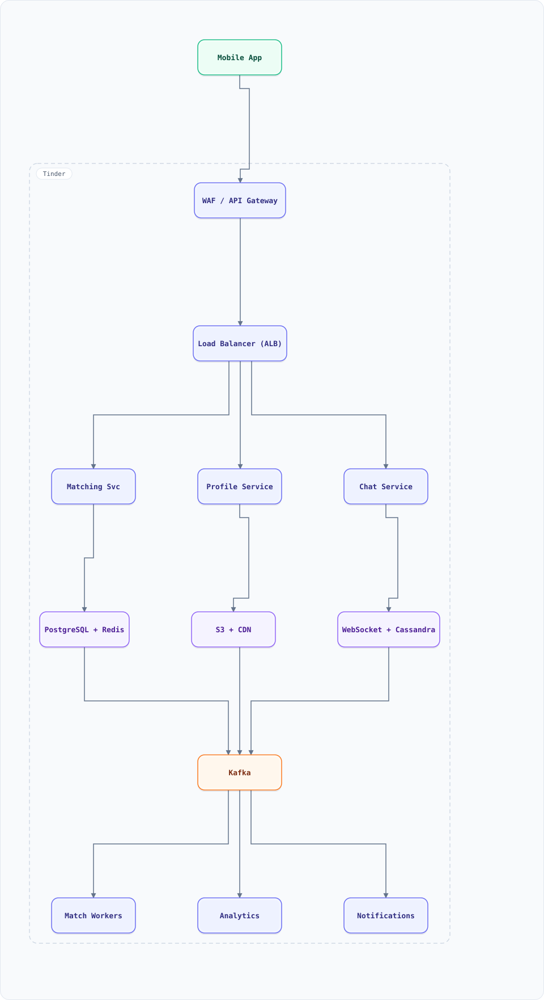

<a id="top"></a>

<div align="center">

<sub>DATING</sub>

# System Design: Tinder (Dating App)

<sub>16 SECTIONS · 6 MIN READ · 1 DIAGRAM · 4 EXAMPLES</sub>

</div>

> [!TIP]
> **THE PROBLEM** — A location-based dating platform supporting profile discovery, swiping, matching, messaging, and preferences for 50M+ daily active users.

---

## On this page

<details open>
<summary><b>16 sections</b></summary>

1. [Overview](#overview)
2. [Requirements](#requirements)
3. [High-Level Architecture](#high-level-architecture)
4. [Microservices](#microservices)
5. [Database Design](#database-design)
6. [Scaling Tiers](#scaling-tiers)
7. [Key Design Decisions](#key-design-decisions)
8. [Failure Modes & Recovery](#failure-modes--recovery)
9. [Cost Estimation (1M Users)](#cost-estimation-1m-users)
10. [Trade-off Analysis](#trade-off-analysis)
11. [Key Metrics to Monitor](#key-metrics-to-monitor)
12. [Deep Dive Prompts](#deep-dive-prompts)
13. [Key Techniques & Patterns](#key-techniques--patterns)
14. [Common Interview Follow-ups](#common-interview-follow-ups)
15. [Low-Level Design (LLD) - Algorithms & Data Structures](#low-level-design-lld---algorithms--data-structures)
16. [Do's & Don'ts](#dos--donts)

</details>

---


## Overview

A location-based dating platform supporting profile discovery, swiping, matching, messaging, and preferences for 50M+ daily active users.

### Key Numbers

| Metric | Value |
| :--- | :--- |
| **daily active users** | 50M+ |
| **swipes per day** | 1.8B+ |
| **matches per day** | 26M+ |
| **messages per day** | 1.5B+ |

---

## Requirements

### Functional Requirements

- Swipe right to like, left to pass
- View profiles with photos and bio
- Match with mutual swipes
- Send messages to matches
- Set preferences (distance, age)

### Non-Functional Requirements

| Attribute | Target |
| :--- | :--- |
| **Latency** | Profile < 200ms, swipe < 100ms |
| **Throughput** | 100M+ swipes/day |
| **Availability** | 99.99% uptime |
| **Consistency** | Strong for matches |
| **Scale** | 75M+ monthly users, 190+ countries |

---

## High-Level Architecture

### Architecture Diagram



**Interactive:** [Open diagram](diagrams/system-design/tinder.architecture.html) · pan/zoom · search · dark/light · export


*Solid = data flow, dashed = control plane / monitoring.*

### Data Flow

1. User creates profile - Profile Service stores in PostgreSQL
2. Discovery: Matching Service loads profiles from nearby users
3. User swipes - Like/Pass stored in PostgreSQL (bilateral check)
4. If both liked - Match created - push notification to both
5. Matched users - Chat Service opens WebSocket conversation
6. Kafka events: swipe patterns - ML model improves recommendations
7. Analytics: match rate, conversation rate, retention metrics

## Microservices

### 1. Profile Service

- **Responsibility**: Profile creation, photo upload, bio, preferences, verification
- **Tech**: Go
- **DB**: PostgreSQL (profiles), S3 (photos)

### 2. Discovery Service (Critical)

- **Responsibility**: Generate swipe deck, location-based filtering, preference matching, avoid showing same profile
- **Tech**: Go / Python
- **DB**: Redis (swipe deck, seen profiles), PostgreSQL (location index)

### 3. Matching Service (Critical)

- **Responsibility**: Determine matches (both swiped right), prevent duplicate matches, match notifications
- **Tech**: Go
- **DB**: Cassandra (matches, write-heavy), Redis (match cache)
- **Queue**: Kafka (match events)

### 4. Chat Service

- **Responsibility**: One-to-one messaging between matched users, message history
- **Tech**: Go
- **DB**: Cassandra (messages), Redis (recent messages)

### 5. Notification Service

- **Responsibility**: Match notifications, new message alerts, daily recommendations
- **Tech**: Node.js
- **Channels**: FCM, APNs

### 6. ML Ranking Service

- **Responsibility**: Profile ranking (Elo score), recommendation optimization, behavioral analysis
- **Tech**: Python (ML), TensorFlow
- **DB**: Redis (scores), PostgreSQL (features)

---

## Database Design

### PostgreSQL (Profiles & Location)

```sql
CREATE TABLE profiles (
    profile_id      UUID PRIMARY KEY DEFAULT gen_random_uuid(),
    user_id         UUID UNIQUE NOT NULL,
    name            VARCHAR(255) NOT NULL,
    age             INT,
    gender          VARCHAR(20),
    bio             TEXT,
    photos          TEXT[],
    interests       TEXT[],
    latitude        DECIMAL(10,8),
    longitude       DECIMAL(11,8),
    location        GEOMETRY(POINT, 4326),
    elo_score       DECIMAL(5,2) DEFAULT 1000,
    is_active       BOOLEAN DEFAULT TRUE,
    created_at      TIMESTAMP DEFAULT NOW()
);

CREATE INDEX idx_profiles_location ON profiles USING GIST (location);

-- Swipe tracking
CREATE TABLE swipes (
    swiper_id       UUID NOT NULL,
    swiped_id       UUID NOT NULL,
    direction       VARCHAR(10), -- left, right, super
    created_at      TIMESTAMP DEFAULT NOW(),
    PRIMARY KEY (swiper_id, swiped_id)
);
```

### Cassandra (Matches & Messages)

```cql
CREATE TABLE matches (
    user_a_id       UUID,
    user_b_id       UUID,
    matched_at      TIMESTAMP,
    source          TEXT, -- swipe, super_like
    PRIMARY KEY ((user_a_id), matched_at, user_b_id)
) WITH CLUSTERING ORDER BY (matched_at DESC);

CREATE TABLE messages (
    match_id        UUID,
    message_id      TIMEUUID,
    sender_id       UUID,
    content         TEXT,
    created_at      TIMESTAMP,
    PRIMARY KEY ((match_id), message_id)
) WITH CLUSTERING ORDER BY (message_id DESC);
```

### Redis

```
# Discovery deck (pre-computed swipe deck per user)
LPUSH deck:{user_id} {profile_id_1} {profile_id_2} ...

# Seen profiles (prevent showing same profile)
SADD seen:{user_id} {profile_id}

# Swipe record (for match detection)
HSET swipes:{user_id} {target_id} "right" | "left"

# Location index
GEOADD profiles:locations {lon} {lat} {profile_id}

# Elo score cache
SETEX elo:{profile_id} 3600 {score}
```

---

## Scaling Tiers

### Tier 1: 1K - 10K Users

| Component | Choice |
| ----------- | -------- |
| **Compute** | 2-4 EC2 (t3.large) |
| **Database** | PostgreSQL RDS |
| **Cache** | Redis (single) |
| **Media** | S3 + CloudFront |
| **Queue** | Redis Streams |
| **ML** | Simple Elo scoring |

### Tier 2: 10K - 1M Users

| Component | Choice |
| ----------- | -------- |
| **Compute** | ECS (20-50 containers) |
| **Database** | PostgreSQL + Cassandra (3 nodes) |
| **Cache** | Redis Cluster (12 nodes) |
| **Media** | S3 + multi-CDN |
| **Queue** | Kafka (3 brokers) |
| **ML** | SageMaker (ranking) |

### Tier 3: 1M - 10M+ Users

| Component | Choice |
| ----------- | -------- |
| **Compute** | Multi-region K8s (500+ pods) |
| **Database** | Cassandra (50+ nodes) + PostgreSQL (sharded) |
| **Cache** | Redis Cluster (30+ nodes) |
| **Queue** | Kafka (15+ brokers) |
| **ML** | Real-time recommendation engine |
| **Geo** | S2 Cells + custom spatial index |

---

## Key Design Decisions

### 1. Pre-Computed Discovery Deck

- Generate 100+ profiles per user in advance
- Store in Redis list (LPUSH)
- User swipes from deck, refill when low
- Avoids real-time query on every swipe

### 2. Swipe-to-Match Detection

- When user A swipes right on user B
- Check if user B already swiped right on user A (HGET swipes:{B} {A})
- If yes: MATCH! Notify both users
- If no: Store A's swipe, continue

### 3. Elo Score for Profile Ranking

- Higher Elo = shown more frequently
- Elo increases when right-swiped
- Elo decreases when left-swiped
- Creates natural quality ranking

### 4. Why Cassandra for Matches?

- Write-heavy (26M matches/day)
- Time-series access (recent matches first)
- Partition by user_id for even distribution

### 5. Anti-Abuse

- Rate limit swipes (100/day for free users)
- Shadow ban for spam/abuse
- Photo verification (face match)

---

## Failure Modes & Recovery
What can go wrong in production, and how the system detects and recovers:

| Failure | Impact | Recovery |
| --------- | -------- | ---------- |
| Elo score drift | Matches become irrelevant | Weekly recalibration, A/B test weights |
| Deck generation slow | Spinning wheel | Pre-computed decks, background refresh |
| Match notification delayed | Miss time-sensitive match | Priority push, SMS fallback |
| Location inaccurate | Matched 100km away | GPS + WiFi triangulation, distance threshold |
| Super like abuse | Spam super likes | Daily limit, cooldown, behavioral analysis |
| Payment failure | Premium not unlocked | Grace period, retry, manual activation |

---

## Cost Estimation (1M Users)
Rough monthly cost of running this design for one million users:

| Component | Specification | Monthly Cost |
| ----------- | -------------- | ------------- |
| API Servers | 20x c5.xlarge | $2,800 |
| PostgreSQL | db.r5.xlarge + 3 replicas | $4,800 |
| Redis Cluster | 6x cache.r5.xlarge | $4,800 |
| Elasticsearch | 10x m5.xlarge | $4,200 |
| S3 Photo Storage | 50TB | $1,150 |
| CDN | 20TB/month transfer | $1,600 |
| ML Matching | GPU instances | $3,000 |
| Kafka Cluster | 6x kafka.m5.large | $2,400 |
| Geo Service | 5x c5.xlarge | $700 |
| **Total** | | **~$25,450/month** |

---

## Trade-off Analysis
The alternatives considered, and which one won and why:

| Approach A | Approach B | Winner | Reason |
| ----------- | ----------- | -------- | -------- |
| Redis GEO | PostGIS | Redis GEO | Sub-ms proximity queries |
| Cassandra | PostgreSQL | Cassandra | Write-heavy swipe workload |
| Redis set intersection | Database join | Redis set | O(min(N,M)) mutual like detection |
| WebSocket | Long polling | WebSocket | True real-time chat |
| Custom Elo | ML ranking | Custom Elo | Simpler, more interpretable |

---

## Key Metrics to Monitor
The metrics that signal system health, with alert thresholds:

| Metric | Target |
| -------- | -------- |
| Discovery deck load time | < 200ms |
| Swipe processing latency | < 100ms |
| Match detection latency | < 500ms |
| Profile load time (p99) | < 300ms |
| Chat message delivery | < 200ms |
| API response time (p99) | < 200ms |
| Match success rate | > 30% |
| Deck refill latency | < 1s |
| System availability | 99.95% |
| Location query accuracy | < 100m |

---

## Deep Dive Prompts

- How does Elo scoring work for profile ranking?
- How do you detect mutual likes in real-time?
- How do you handle 1.8B+ swipes per day?
- How does discovery deck avoid showing the same profile twice?

---

## Key Techniques & Patterns
The recurring techniques and patterns this design applies, mapped to where they are used:

| Technique | Description | Used In |
| ----------- | ------------- | ---------- |
| Elo Rating System | Pairwise preference score updated per swipe; Tinder has since described moving to ML ranking | Ranking |
| Swipe Recommendation Algorithm | Candidate generation by distance and preferences, then ranking with an explicit exploration budget | Matching |
| Geospatial Matching | Cell-based candidate lookup with a distance filter, the same family as geohash and H3 | Discovery |
| Redis for Swipe Queue | Precomputed candidate decks per active user, rebuilt on activity or expiry | Serving |
| Like/Pass State Machine | Swipe is idempotent per (user, target); a match is a derived event, never a stored flag | Core |
| Photo Verification | Liveness and face-match checks before a photo becomes eligible for ranking | Trust |

## Common Interview Follow-ups

**Q: How does Elo scoring work for matchmaking?**
A: Rating from swipe outcomes, adjusted by opponent rating, personalized discovery deck

**Q: How do you handle cold start?**
A: Popular profiles in area, bio/interest matching, accelerate from early swipes

**Q: How does super like prevent abuse?**
A: Daily limit, cooldown period, behavioral analysis, premium gets more

---

## Low-Level Design (LLD) - Algorithms & Data Structures

### 1. Elo Score Algorithm (Matchmaking)

```js
class MatchingEngine {
  constructor(redisClient, dbClient) { this.r = redisClient; this.db = dbClient; }
  async getDiscoveryDeck(userId, count = 20) {
    const user = await this.db.getUser(userId);
    const prefs = user.preferences || {};
    const candidates = await this.db.findCandidates({
      ageMin: prefs.ageMin || 18, ageMax: prefs.ageMax || 50,
      distanceKm: prefs.distance || 50, excludeIds: user.swipedIds || []
    });
    return candidates.map(c => ({
      ...c, score: this.calcElo(user.eloScore, c.eloScore) * this.calcCompat(user, c)
    })).sort((a, b) => b.score - a.score).slice(0, count);
  }
  calcElo(my, their) { return 1 / (1 + Math.pow(10, (their - my) / 400)); }
  calcCompat(u1, u2) {
    let s = 1.0;
    if (u1.interests && u2.interests) s += u1.interests.filter(i => u2.interests.includes(i)).length * 0.1;
    return s;
  }
}
```

### 2. Discovery Deck Generation

```js
async function generateDiscoveryDeck(userId, deckSize = 100) {
  //  1. candidate generation: geohash + age/gender/preference buckets (Redis sets)
  //  2. hard filters: already seen, already matched, blocked, inactive > 30d
  //  3. rank by Elo proximity + activity + distance decay
  //  4. take the top N candidates, never the whole set (deck is pre-warmed)
  //  5. store in Redis with a TTL so a stale deck expires instead of pinning memory
  const me = await profileStore.get(userId);
  const candidateIds = await candidateSource.nearby({
    geohash: me.geohash,
    radiusKm: me.preferences.radiusKm ?? 50,
    limit: deckSize * 8, // over-fetch: filters below remove a lot
  });

  const seen = await interactionStore.seenSet(userId);
  const filtered = [];
  for (const id of candidateIds) {
    if (seen.has(id)) continue;                       // already swiped
    const candidate = await profileStore.get(id);
    if (!candidate || !candidate.active) continue;     // deleted or dormant
    if (!withinPreferences(me.preferences, candidate)) continue;
    if (await blockStore.isBlocked(userId, id)) continue;
    filtered.push(candidate);
  }

  const ranked = filtered
    .map(candidate => ({
      ...candidate,
      score: eloProximity(me.elo, candidate.elo) * activityBoost(candidate.lastActiveAt),
    }))
    .sort((a, b) => b.score - a.score)
    .slice(0, deckSize);

  await deckStore.set(userId, ranked.map(c => c.id), { ttlSeconds: 3600 });
  return ranked;
}

const eloProximity = (mine, theirs) => 1 / (1 + Math.abs(mine - theirs) / 400);
const activityBoost = lastActiveAt => Math.pow(2, -((Date.now() - lastActiveAt) / 86400000) / 7);
const withinPreferences = (prefs, candidate) =>
  (!prefs.minAge || candidate.age >= prefs.minAge) &&
  (!prefs.maxAge || candidate.age <= prefs.maxAge);

const profileStore = { get: async id => ({ id, elo: 1400, active: true, age: 28, geohash: 'tdr1y', lastActiveAt: Date.now() - 3600000, preferences: { radiusKm: 50 } }) };
const candidateSource = { nearby: async () => ['p1', 'p2', 'p3'] };
const interactionStore = { seenSet: async () => new Set() };
const blockStore = { isBlocked: async () => false };
const deckStore = { set: async () => true };

generateDiscoveryDeck('u1', 3).then(deck => console.log('deck:', deck.map(p => p.id)));
```

### 3. Match Detection Algorithm

```js
class SwipeService {
  constructor(redisClient, dbClient) { this.r = redisClient; this.db = dbClient; }
  async swipe(swiperId, swipedId, direction) {
    await this.db.recordSwipe(swiperId, swipedId, direction);
    if (direction === 'right') {
      const reverse = await this.db.getSwipe(swipedId, swiperId);
      if (reverse && reverse.direction === 'right') {
        const matchId = 'match_' + Date.now() + '_' + Math.random().toString(36).substr(2, 9);
        await this.db.createMatch({ matchId, users: [swiperId, swipedId], createdAt: new Date() });
        await this.r.publish('notifications', JSON.stringify({ type: 'match', users: [swiperId, swipedId] }));
        return { matched: true, matchId };
      }
    }
    return { matched: false };
  }
}

const match = new MatchService(); console.log("Match service ready");
```

### 4. Super Like Priority Algorithm

```js
async function handleSuperLike(superLikerId, targetId, now = Date.now()) {
  // A Super Like is a scarce signal: 5/day, and it must be worth spending.
  //  1. store it (idempotent per pair, TTL 24h)
  //  2. pin the liker to the top of the target's next deck (a reserved slot)
  //  3. notify the target once — never twice for the same like
  //  4. nudge the liker's Elo only after the interaction resolves (no self-inflation)
  const claim = await superLikeStore.claim(superLikerId, targetId, { ttlSeconds: 86400 });
  if (!claim.ok) return { ok: false, reason: claim.reason }; // daily cap or duplicate

  await deckStore.pinToTop(targetId, superLikerId, { slot: 'super-like' });
  await notificationQueue.publish({
    userId: targetId,
    type: 'super_like',
    idempotencyKey: `super:${superLikerId}:${targetId}`,
    payload: { from: superLikerId, animated: true },
  });

  // Elo moves on the outcome of the interaction, not on the act of liking.
  if (claim.reciprocated) await eloService.adjust(superLikerId, +8, { reason: 'super_like_match' });
  return { ok: true, pinned: true, notifiedAt: now };
}

const superLikeStore = {
  claim: async (from, to) => ({ ok: true, reason: null, reciprocated: false }),
};
const deckStore = { pinToTop: async () => true };
const notificationQueue = { publish: async msg => console.log('notify', msg.type, msg.idempotencyKey) };
const eloService = { adjust: async () => true };

handleSuperLike('u1', 'u2').then(r => console.log('super like:', r));
```

## Do's & Don'ts

| ✅ Do | ❌ Don't |
| :-- | :-- |
| Pin down the key numbers before drawing boxes | Don't hand-wave the hardest component — tinder lives or dies there |
| Justify the functional requirements choice against one alternative out loud | Don't default to the trendiest store without a consistency/scale argument |
| State the failure mode of non-functional requirements explicitly (what breaks first?) | Don't present a sunny-day design only — the follow-up question is always "and when it fails?" |
| Anchor capacity numbers before proposing shards/replicas | Don't introduce a component you can't cost or size with the numbers on the board |

*More cross-topic rules: [Interview Q&A §84](interview-qa.md#84-universal-dos--donts) · Concepts: [Networking](networking.md) · [Operating Systems](operating-systems.md)*

---

<nav>← [ticketing system](system-design-ticketing-system.md) · [All guides](README.md) · [twitter](system-design-twitter.md) →</nav>

---

<p align="right"><a href="#top">↑ Back to top</a></p>
