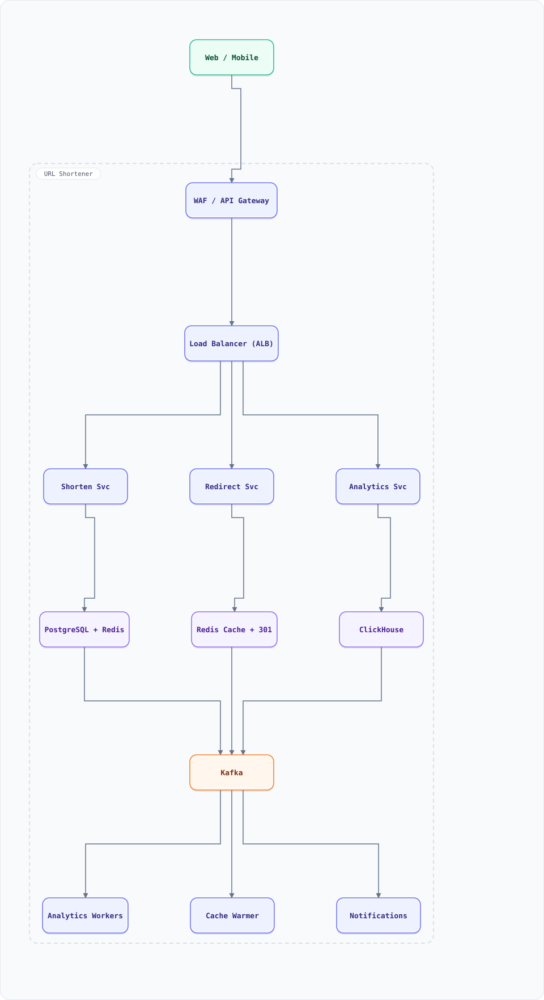

<a id="top"></a>

<div align="center">

<sub>INFRASTRUCTURE</sub>

# System Design: URL Shortener (bit.ly)

<sub>16 SECTIONS · 5 MIN READ · 1 DIAGRAM · 8 EXAMPLES</sub>

</div>

> [!TIP]
> **THE PROBLEM** — A URL shortening service that converts long URLs to short, shareable links with analytics tracking.

## Start here (plain English)

**What it does.** Turns a long URL into a short code and redirects every visit to the original, counting clicks.

**Think of it like.** A coat-check ticket: a small numbered tag that the desk can exchange for your coat.

**Why it's hard.** Reads outnumber writes 100:1, so redirects must never wait on the database, and codes must be unique across regions.

**The core idea.** Mint IDs in bulk (counter ranges or Snowflake), encode them in Base62, and serve the mapping from cache with the database as fallback.

**Watch out for.** Hashing the URL and taking the first seven characters collides. A counter or a checked-unique hash is safer.

**Before this doc.** [Caching strategies](system-design-concepts.md#16-caching-strategies) · [Base62 & Snowflake IDs](system-design-concepts.md#73-base62-encoding--snowflake-ids)

**Read it in.** 5 min: [Overview](#overview) + [Architecture](#high-level-architecture) · 20 min: add [Design decisions](#key-design-decisions) + [Failure modes](#failure-modes--recovery) · full: all 16 sections.

**Read next.** [Pastebin](system-design-pastebin.md) · [Unique ID generator](system-design-unique-id-generator.md)

**Terms.** [cache-aside](GLOSSARY.md#cache-aside) · [TTL](GLOSSARY.md#ttl) · [idempotency](GLOSSARY.md#idempotency) · [shard](GLOSSARY.md#shard)


---

## On this page

<details open>
<summary><b>16 sections</b></summary>

1. [Overview](#overview)
2. [Requirements](#requirements)
3. [High-Level Architecture](#high-level-architecture)
4. [Microservices](#microservices)
5. [Database Design](#database-design)
6. [Scaling Tiers](#scaling-tiers)
7. [Key Design Decisions](#key-design-decisions)
8. [Failure Modes & Recovery](#failure-modes--recovery)
9. [Cost Estimation (1M Users)](#cost-estimation-1m-users)
10. [Trade-off Analysis](#trade-off-analysis)
11. [Key Metrics to Monitor](#key-metrics-to-monitor)
12. [Deep Dive Prompts](#deep-dive-prompts)
13. [Key Techniques & Patterns](#key-techniques--patterns)
14. [Common Interview Follow-ups](#common-interview-follow-ups)
15. [Low-Level Design (LLD) - Algorithms & Data Structures](#low-level-design-lld---algorithms--data-structures)
16. [Do's & Don'ts](#dos--donts)

</details>

---


## Overview

A URL shortening service that converts long URLs to short, shareable links with analytics tracking.

### Key Numbers

| Metric | Value |
| :--- | :--- |
| **URLs shortened per day** | 100M+ |
| **redirects per day** | 10B+ |
| **Read/write ratio** | 100:1 |

---

## Requirements

### Functional Requirements

- Shorten long URL to short URL
- Redirect short URL to original
- Support custom aliases
- Track click analytics
- Set expiration time

### Non-Functional Requirements

| Attribute | Target |
| :--- | :--- |
| **Latency** | Redirect < 50ms |
| **Throughput** | 100M+ URLs/day |
| **Availability** | 99.99% uptime |
| **Consistency** | Strong for URL mapping |
| **Scale** | 500M+ unique URLs |

---

## High-Level Architecture

### Architecture Diagram



**Interactive:** [Open diagram](diagrams/system-design/url-shortener.architecture.html) · pan/zoom · search · dark/light · export


*Solid = data flow, dashed = control plane / monitoring.*

### Data Flow

1. User submits long URL - Shorten Service generates Base62 ID
2. ID from pre-generated counter (Distributed ID Generator)
3. Long URL + metadata stored in PostgreSQL + Redis cache
4. Short URL redirect - Redirect Service looks up Redis (sub-ms)
5. Cache miss - PostgreSQL fallback + cache for next time
6. Redirect status is a product decision: 301/308 are permanent and cacheable (308 also preserves the method), 302/307 are temporary; with 301/302 a client may switch a POST to GET, so use 307/308 when the method must survive
7. Kafka events: click, referrer, geo - Analytics

## Microservices

### 1. URL Service

- **Responsibility**: URL creation, validation, custom aliases, expiry
- **Tech**: Go / Node.js
- **DB**: PostgreSQL (URL mappings)
- **Cache**: Redis (hot URLs)

### 2. Redirect Service

- **Responsibility**: URL redirection, analytics tracking, bot detection
- **Tech**: Go (high performance)
- **Cache**: Redis (redirect cache)

### 3. Analytics Service

- **Responsibility**: Click tracking, geographic data, device info, referral tracking
- **Tech**: Python / Flink
- **DB**: ClickHouse (OLAP), Kafka (event stream)

---

## Database Design

### PostgreSQL

```sql
CREATE TABLE urls (
    id              BIGSERIAL PRIMARY KEY,
    short_code      VARCHAR(10) UNIQUE NOT NULL,
    original_url    TEXT NOT NULL,
    user_id         UUID,
    created_at      TIMESTAMP DEFAULT NOW(),
    expires_at      TIMESTAMP,
    click_count     BIGINT DEFAULT 0
);

CREATE INDEX idx_short_code ON urls(short_code);
```

### Redis

```redis
# URL cache (hot URLs)
SETEX url:{short_code} 86400 {original_url}

# Click counter
INCR url:{short_code}:clicks
```

---

## Scaling Tiers

### Tier 1: 1K - 10K Users

| Component | Choice |
| ----------- | -------- |
| **Compute** | 2 EC2 (t3.large) |
| **Database** | PostgreSQL RDS |
| **Cache** | Redis (single) |
| **Queue** | Redis Streams |

### Tier 2: 10K - 1M Users

| Component | Choice |
| ----------- | -------- |
| **Compute** | ECS (10-20 containers) |
| **Database** | PostgreSQL (sharded by short_code) |
| **Cache** | Redis Cluster (6 nodes) |
| **Queue** | Kafka (3 brokers) |

### Tier 3: 1M - 10M+ Users

| Component | Choice |
| ----------- | -------- |
| **Compute** | Multi-region K8s (100+ pods) |
| **Database** | PostgreSQL (Citus sharding) + Cassandra |
| **Cache** | Redis Cluster (30+ nodes) |
| **CDN** | Multi-CDN (redirect at edge) |

---

## Key Design Decisions

### 1. Base62 Encoding (Short Code Generation)

```js
function generate_short_code(url) {
  // Hash the canonical URL, then encode the first 7 Base62 characters.
  hash = sha256(url)
  return base62_encode(hash).slice(0, 7)
}
```

### 2. Counter-Based Generation (Distributed)

```js
class CounterBasedGenerator {
    // Distributed counter for unique short codes
    // - Each server gets a unique ID range
    // - No collisions between servers
  next_code() {
    id = counter_store.increment_and_get()
    return base62_encode(id)
  }
}
```

### 3. Read-Through Cache

```js
function redirect(short_code) {
    // - Cache miss: query DB, populate cache
  url = cache.get(short_code)
  if (url == null) {
    url = database.get(short_code)
    if (url == null) return http_response(404)
    cache.set(short_code, url, ttl=3600)
  }
  queue.publish("url.click", { "short_code": short_code })
  return http_redirect(url)
}
```

### 4. Analytics Pipeline

```js
function track_click(short_code, request) {
    // Async click tracking pipeline
    // - Don't block redirect response
  event = {
    "short_code": short_code,
    "timestamp": current_unix_timestamp(),
    "ip": request.remote_addr,
    "user_agent": request.headers.get("user-agent")
  }
  analytics_queue.publish("url.clicks", event)
}
```

### 5. URL Expiry (TTL)

```js
function check_url_expiry(short_code) {
    // URLs can have optional expiry
    // - Check on redirect
    // - Background job cleans expired URLs
  record = database.get(short_code)
  if (record == null) return false
  if (record.expires_at != null && record.expires_at <= now()) {
    cache.delete(short_code)
    database.delete(short_code)
    return false
  }
  return true
}
```

---

## Failure Modes & Recovery
What can go wrong in production, and how the system detects and recovers:

| Failure | Impact | Recovery |
| --------- | -------- | ---------- |
| ID generator exhaustion | No more short URLs | Multi-shard counter, auto-scale ranges |
| Redis cache miss storm | All redirects hit DB | CDN for popular URLs, local cache |
| DNS propagation delay | New URL not resolving | Edge caching, DNS pre-warming |
| Analytics lag | Click counts not updating | Async via Kafka, batch aggregation |
| Duplicate URL creation | Same URL gets multiple shorts | Hash-based dedup, custom aliases override |
| Spam URL abuse | Platform used for phishing | URL scanning, user reporting, blocklist |

---

## Cost Estimation (1M Users)
Rough monthly cost of running this design for one million users:

| Component | Specification | Monthly Cost |
| ----------- | -------------- | ------------- |
| API Servers | 10x c5.xlarge | $1,400 |
| PostgreSQL | db.r5.xlarge + 3 replicas | $4,800 |
| Redis Cluster | 6x cache.r5.xlarge | $4,800 |
| Kafka (analytics) | 3x kafka.m5.large | $1,200 |
| CDN | 50TB/month (redirects) | $4,000 |
| Analytics Workers | 5x c5.large | $700 |
| **Total** | | **~$16,900/month** |

---

## Trade-off Analysis
The alternatives considered, and which one won and why:

| Approach A | Approach B | Winner | Reason |
| ----------- | ----------- | -------- | -------- |
| Base62 | MD5 hash | Base62 | Shorter, URL-safe, no special characters |
| Snowflake ID | UUID | Snowflake | Monotonically increasing, better for B-tree |
| Redis cache | Database only | Redis | Sub-ms redirect lookups |
| PostgreSQL | MySQL | PostgreSQL | Better JSON support for analytics |
| Bloom filter | HashSet for dedup | Bloom filter | Memory-efficient, 1% false positive rate |

---

## Key Metrics to Monitor
The metrics that signal system health, with alert thresholds:

| Metric | Description | Target |
| -------- | ------------- | -------- |
| **Redirect Latency** | Time to resolve short URL to original | < 5ms (p99) |
| **Cache Hit Rate** | % of redirects served from Redis | > 99% |
| **Short Code Collision Rate** | Duplicate codes generated | 0% |
| **URLs Created/sec** | Write throughput | Monitored |
| **Click-through Rate** | Analytics tracking accuracy | 100% |
| **URL Expiry Accuracy** | Expired URLs correctly blocked | 100% |
| **Base62 Decode Errors** | Invalid short codes received | < 0.01% |
| **Database Lag** | Replication delay for new URLs | < 100ms |
| **CDN Cache Hit** | % of redirects from CDN edge | > 80% |
| **Bloom Filter FP Rate** | False positive rate for duplicates | < 1% |

## Deep Dive Prompts

- How does Base62 encoding generate short URLs?
- How do you ensure unique ID generation across distributed systems?
- How do you handle 100M+ URL shortening requests per day?
- How do you detect and block malicious URLs?

---

## Key Techniques & Patterns
The recurring techniques and patterns this design applies, mapped to where they are used:

| Technique | Description | Used In |
| ----------- | ------------- | ---------- |
| Base62 Encoding | 62^7 is about 3.5 trillion keys, and base62 avoids the plus and slash characters that break URLs | Encoding |
| Unique ID Generation | Snowflake or a key-generation service handing out ranges, so creation needs no per-URL database round trip | ID service |
| Cache-Aside Pattern | Redis lookup, database on miss, then fill; reads dominate by orders of magnitude | Read path |
| Redirect Status Codes | 301/308 cache aggressively (losing per-click analytics); 302/307 keep clicks measurable at the cost of a request; 307/308 preserve the request method where 301/302 may not | API |
| Analytics Tracking | Click events go to Kafka asynchronously; the redirect never waits on analytics | Analytics |
| Spam Detection | Denylist, domain reputation and creation rate limits before a link is issued | Safety |

## Common Interview Follow-ups

**Q: How do you generate unique short URLs?**
A: Base62 encoding, multi-shard counter, collision detection

**Q: How do you handle 10B+ redirects/day?**
A: CDN popular URLs, Redis cache TTL, DB fallback

**Q: How do you track click analytics?**
A: Async Kafka counting, batch Cassandra aggregation

---

## Low-Level Design (LLD) - Algorithms & Data Structures

### 1. Base62 encoding

```js
const BASE62 = '0123456789abcdefghijklmnopqrstuvwxyzABCDEFGHIJKLMNOPQRSTUVWXYZ';

function encodeBase62(num) {
  // Convert a non-negative integer to a Base62 string. O(log62 n) time.
  if (!Number.isInteger(num) || num < 0) throw new Error('non-negative integer required');
  if (num === 0) return BASE62[0];
  let out = '';
  while (num > 0) {
    out = BASE62[num % 62] + out;
    num = Math.floor(num / 62);
  }
  return out;
}

function decodeBase62(str) {
  // Convert a Base62 string back to an integer. O(n) time.
  let n = 0;
  for (const ch of str) {
    const digit = BASE62.indexOf(ch);
    if (digit < 0) throw new Error(`invalid base62 character: ${ch}`);
    n = n * 62 + digit;
  }
  return n;
}

console.log(encodeBase62(125));  // "21"
console.log(decodeBase62('21')); // 125
console.log(62 ** 7);            // 3521614606208 — the 7-character keyspace
```

Seven characters give `62^7 ≈ 3.5 trillion` codes. Base62 is used instead of Base64 because `+` and `/` are unsafe in a URL path, and instead of hex because hex needs 13 characters for the same space.

### 2. Range-based distributed ID generation

```js
class CounterStore {
  constructor() { this.value = 0; }
  incrementAndGet() { return ++this.value; } // Redis INCR is atomic
}

class RangeAllocator {
  // Each server reserves a block of IDs, then hands them out locally.
  // No coordination per URL: one round trip per block.
  constructor(store, rangeSize = 1000) {
    this.store = store;
    this.rangeSize = rangeSize;
    this.next = 0;
    this.end = 0;
  }

  reserve() {
    const block = this.store.incrementAndGet();
    this.next = block * this.rangeSize;
    this.end = this.next + this.rangeSize;
  }

  nextId() {
    if (this.next >= this.end) this.reserve();
    return this.next++;
  }
}

const store = new CounterStore();
const serverA = new RangeAllocator(store);
const serverB = new RangeAllocator(store);
const ids = new Set();
for (let i = 0; i < 2500; i++) ids.add(serverA.nextId());
for (let i = 0; i < 2500; i++) ids.add(serverB.nextId());
console.log(ids.size); // 5000: two servers, no collisions
```

The failure mode is a lost block after a crash: the IDs in an unissued block are simply never used. That is a gap in the keyspace, not a duplicate, which is the safe direction to fail.

### 3. Bloom filter for duplicate-URL detection

Use the canonical [Bloom filter in Concepts §17](system-design-concepts.md#17-bloom-filter). Keep the bit array in Redis or a per-node cache, rotate it on a schedule, and treat a positive as "look up the database" — never as proof of duplication.

### 4. Cache-aside redirect with single-flight

```js
class SingleFlightCache {
  // Reads cache -> database, but collapses concurrent misses for one key
  // into a single database read. The "thundering herd" fix.
  constructor(cache, db) {
    this.cache = cache;
    this.db = db;
    this.inflight = new Map();
  }

  async get(key) {
    const hit = this.cache.get(key);
    if (hit !== undefined) return { value: hit, source: 'cache' };

    if (this.inflight.has(key)) {
      return { value: await this.inflight.get(key), source: 'single-flight' };
    }

    const pending = (async () => {
      const value = await this.db.get(key);
      if (value !== undefined) this.cache.set(key, value);
      return value;
    })();

    this.inflight.set(key, pending);
    try {
      return { value: await pending, source: 'database' };
    } finally {
      this.inflight.delete(key);
    }
  }
}

(async () => {
  const cache = new Map();
  const db = new Map([['abc', 'https://example.com']]);
  const svc = new SingleFlightCache(cache, { get: async k => db.get(k) });
  const [a, b] = await Promise.all([svc.get('abc'), svc.get('abc')]);
  console.log(a, b); // one database read, one request joins the in-flight promise
})();
```

The redirect path should also set a short TTL and a cache-control header at the edge. The database remains the source of truth; the cache is allowed to be stale for the TTL window.

### 5. Click deduplication

```js
class ClickDeduper {
  // Count at most one click per (short code, user) per window.
  // In production this is Redis SET NX EX 300, not an in-process map.
  constructor(windowMs = 300_000) {
    this.windowMs = windowMs;
    this.seen = new Map();
  }

  first(shortCode, userId, now = Date.now()) {
    const window = Math.floor(now / this.windowMs);
    const key = `${shortCode}:${userId}:${window}`;
    const expiry = (window + 1) * this.windowMs;

    for (const [k, exp] of this.seen) if (exp <= now) this.seen.delete(k);
    if (this.seen.has(key)) return false;

    this.seen.set(key, expiry);
    return true;
  }
}

const deduper = new ClickDeduper(300_000);
console.log(deduper.first('abc', 'u1', 1_000));   // true
console.log(deduper.first('abc', 'u1', 2_000));   // false, same 5-minute window
console.log(deduper.first('abc', 'u1', 400_000)); // true, new window
```

Deduplicating clicks keeps analytics honest without blocking the redirect: the counter is incremented asynchronously, and the redirect never waits for Kafka.

## Do's & Don'ts

| ✅ Do | ❌ Don't |
| :-- | :-- |
| Pin down the key numbers before drawing boxes | Don't hand-wave the hardest component — url shortener lives or dies there |

*More cross-topic rules: [Interview Q&A §84](interview-qa.md#84-universal-dos--donts) · Concepts: [Networking](networking.md) · [Operating Systems](operating-systems.md)*

---

<nav>← [unique id generator](system-design-unique-id-generator.md) · [All guides](README.md) · [video conferencing](system-design-video-conferencing.md) →</nav>

---

<p align="right"><a href="#top">↑ Back to top</a></p>
