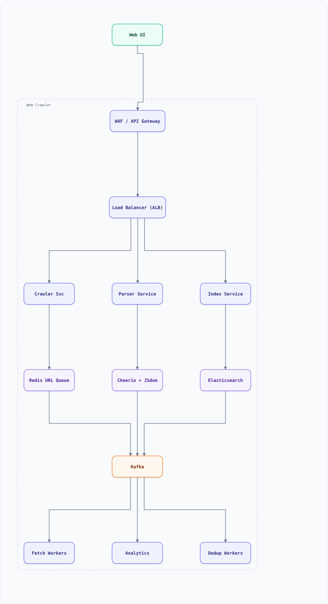

<a id="top"></a>

<div align="center">

<sub>INFRASTRUCTURE</sub>

# System Design: Web Crawler

<sub>16 SECTIONS · 6 MIN READ · 1 DIAGRAM · 6 EXAMPLES</sub>

</div>

> [!TIP]
> **THE PROBLEM** — A distributed web crawler that systematically browses and downloads web pages for indexing, archiving, or data analysis.

---

## On this page

<details open>
<summary><b>16 sections</b></summary>

1. [Overview](#overview)
2. [Requirements](#requirements)
3. [High-Level Architecture](#high-level-architecture)
4. [Microservices](#microservices)
5. [Database Design](#database-design)
6. [Scaling Tiers](#scaling-tiers)
7. [Key Design Decisions](#key-design-decisions)
8. [Failure Modes & Recovery](#failure-modes--recovery)
9. [Cost Estimation (1M Users)](#cost-estimation-1m-users)
10. [Trade-off Analysis](#trade-off-analysis)
11. [Key Metrics to Monitor](#key-metrics-to-monitor)
12. [Deep Dive Prompts](#deep-dive-prompts)
13. [Key Techniques & Patterns](#key-techniques--patterns)
14. [Common Interview Follow-ups](#common-interview-follow-ups)
15. [Low-Level Design (LLD) - Algorithms & Data Structures](#low-level-design-lld---algorithms--data-structures)
16. [Do's & Don'ts](#dos--donts)

</details>

---


## Overview

A distributed web crawler that systematically browses and downloads web pages for indexing, archiving, or data analysis.

### Key Numbers

- 1B+ pages crawled per day
- 1000+ concurrent connections
- Petabytes of crawled data

---

## Requirements

### Functional Requirements

- Crawl pages from seed URLs
- Extract links and content
- Respect robots.txt
- Detect duplicate content
- Store content for indexing

### Non-Functional Requirements

| Attribute | Target |
| :--- | :--- |
| **Latency** | Crawl scheduling < 1s |
| **Throughput** | 1B+ pages/day |
| **Availability** | 99.9% uptime |
| **Consistency** | Eventually consistent |
| **Scale** | 10B+ URLs, 500TB+ storage |

---

## High-Level Architecture

### Architecture Diagram



**Interactive:** [Open diagram](diagrams/system-design/web-crawler.architecture.html) · pan/zoom · search · dark/light · export


*Solid = data flow, dashed = control plane / monitoring.*

### Data Flow

1. Seed URLs added to Redis queue (sorted by priority)
2. Fetch Workers pull URLs, respect robots.txt + rate limits
3. Parser extracts links, metadata, content from HTML
4. Dedup via URL normalization + content hash (Bloom filter)
5. New URLs added back to queue (BFS traversal)
6. Parsed content indexed in Elasticsearch for search
7. Kafka events: crawl_stats - Analytics dashboard

## Microservices

### 1. URL Frontier Service

- **Responsibility**: URL prioritization, politeness (robots.txt), deduplication
- **Tech**: Go
- **DB**: Redis (priority queue), PostgreSQL (URL metadata)

### 2. Downloader Service

- **Responsibility**: Fetch web pages, handle robots.txt, rate limiting
- **Tech**: Go / Python
- **DB**: Redis (download queue)

### 3. Content Parser Service

- **Responsibility**: HTML parsing, content extraction, link extraction
- **Tech**: Python (BeautifulSoup/Scrapy)
- **DB**: S3 (raw content)

### 4. URL Dedup Service

- **Responsibility**: Detect duplicate URLs, content fingerprinting
- **Tech**: Go
- **DB**: Redis (Bloom filter), PostgreSQL (URL hash)

---

## Database Design

### PostgreSQL

```sql
CREATE TABLE urls (
    url_id          BIGSERIAL PRIMARY KEY,
    url             TEXT UNIQUE NOT NULL,
    domain          VARCHAR(255),
    status          VARCHAR(20) DEFAULT 'pending',
    priority        INT DEFAULT 5,
    last_crawled    TIMESTAMP,
    crawl_frequency INT DEFAULT 86400,
    created_at      TIMESTAMP DEFAULT NOW()
);

CREATE TABLE crawl_results (
    result_id       BIGSERIAL PRIMARY KEY,
    url_id          BIGINT REFERENCES urls(url_id),
    http_status     INT,
    content_hash    VARCHAR(64),
    content_size    BIGINT,
    crawled_at      TIMESTAMP DEFAULT NOW()
);
```

### Redis

```
# URL frontier (priority queue)
ZADD frontier:high {priority} {url}
ZADD frontier:medium {priority} {url}
ZADD frontier:low {priority} {url}

# URL dedup (Bloom filter simulation)
SET url:seen:{hash} "1" EX 604800

# Domain rate limiting
SET domain:{domain}:last_fetch {timestamp}
```

---

## Scaling Tiers

### Tier 1: 1K - 10K Pages/Day

| Component | Choice |
| ----------- | -------- |
| **Compute** | Single EC2 (t3.medium) |
| **Database** | PostgreSQL |
| **Queue** | In-memory queue |
| **Storage** | Local filesystem |
| **Crawl Rate** | 1 page/second |

### Tier 2: 10K - 1M Pages/Day

| Component | Choice |
| ----------- | -------- |
| **Compute** | ECS (5-10 containers) |
| **Database** | PostgreSQL + Redis |
| **Queue** | Redis Streams |
| **Storage** | S3 |
| **Crawl Rate** | 100 pages/second |

### Tier 3: 1M - 10M+ Pages/Day

| Component | Choice |
| ----------- | -------- |
| **Compute** | Multi-region K8s (50+ pods) |
| **Database** | PostgreSQL (sharded) + Cassandra |
| **Queue** | Kafka (10+ brokers) |
| **Storage** | S3 + custom blob store |
| **Crawl Rate** | 1000+ pages/second |

---

## Key Design Decisions

### 1. Why BFS over DFS for Crawling?

- BFS naturally respects depth limits
- Better parallelization across domains
- More predictable memory usage

### 2. Why SimHash for Dedup?

- Near-duplicate detection (not just exact matches)
- O(N) computation vs O(N^2) for pairwise comparison
- Hamming distance threshold tunable for precision

### 3. Why Priority Queue for URL Frontier?

- Important pages crawled first (higher authority = higher priority)
- Prevents low-quality pages from blocking important ones
- Domain-aware scheduling respects robots.txt

### 4. Why Content-Addressable Hashing?

- Same content = same hash = skip download
- Saves bandwidth (80%+ for duplicate content)
- Enables distributed dedup across crawler nodes

## Failure Modes & Recovery
What can go wrong in production, and how the system detects and recovers:

| Failure | Impact | Recovery |
| --------- | -------- | ---------- |
| Politeness violation | Overwhelms small website | Respect robots.txt, adaptive rate limiting |
| Infinite crawl loop | Spider traps consume resources | URL depth limit, content similarity detection |
| Duplicate content waste | Same page crawled 100 times | SimHash fingerprinting, bloom filter dedup |
| Storage overflow | Content exceeds capacity | Tiered storage, automatic archival |
| Robots.txt parsing error | Blocked from valid pages | Conservative fallback, manual override |
| DNS resolution failure | Cannot reach target sites | DNS cache, fallback to public DNS |

---

## Cost Estimation (1M Users)
Rough monthly cost of running this design for one million users:

| Component | Specification | Monthly Cost |
| ----------- | -------------- | ------------- |
| Crawler Nodes | 50x c5.xlarge | $7,000 |
| PostgreSQL | db.r5.xlarge + 3 replicas | $4,800 |
| Redis (URL frontier) | 6x cache.r5.xlarge | $4,800 |
| S3 (crawled content) | 500TB | $11,500 |
| Kafka (URL queue) | 6x kafka.m5.large | $2,400 |
| DNS Cache | 3x c5.large | $420 |
| **Total** | | **~$30,920/month** |

---

## Trade-off Analysis
The alternatives considered, and which one won and why:

| Approach A | Approach B | Winner | Reason |
| ----------- | ----------- | -------- | -------- |
| BFS | DFS | BFS | More controlled depth, better politeness |
| SimHash | MinHash | SimHash | Faster for near-duplicate detection |
| Redis frontier | Database queue | Redis | O(log N) priority operations |
| Go | Python | Go | Higher concurrency, lower latency |
| S3 | Local storage | S3 | Unlimited scalability |

---

## Key Metrics to Monitor
The metrics that signal system health, with alert thresholds:

| Metric | Description | Target |
| -------- | ------------- | -------- |
| **Pages Crawled/sec** | Crawl throughput | > 1000 pages/sec |
| **Avg Response Time** | Time to fetch and parse a page | < 2 seconds |
| **Duplicate Detection Rate** | % of duplicate content caught | > 95% |
| **robots.txt Compliance** | Respected by all crawlers | 100% |
| **URL Frontier Depth** | Queue depth across all domains | < 1M |
| **Domain Politeness** | Respects crawl-delay | 100% |
| **Error Rate** | Failed page fetches | < 5% |
| **Freshness** | Pages re-crawled within TTL | > 90% |
| **Memory Usage** | Bloom filter + SimHash memory | < 4GB |
| **DNS Cache Hit** | DNS lookups served from cache | > 95% |

---

## Deep Dive Prompts

- How do you respect robots.txt and crawl-delay directives?
- How does SimHash detect near-duplicate content?
- How do you handle 1B+ pages to crawl efficiently?
- How do you prevent crawler traps and infinite loops?

---

## Key Techniques & Patterns
The recurring techniques and patterns this design applies, mapped to where they are used:

| Technique | Description | Used In |
| ----------- | ------------- | ---------- |
| BFS/DFS Traversal | A priority frontier ordered by importance and change rate beats plain BFS for freshness | Frontier |
| URL Frontier with Priority | Per-host queues with politeness delay; the global frontier selects which host to serve next | Frontier |
| Politeness (robots.txt) | Fetch and cache robots per host and honour crawl-delay; getting this wrong gets the crawler blocked | Etiquette |
| Bloom Filter for Dedup | O(1) membership with false positives only, which is the right error direction: never re-crawl a seen URL | Dedup |
| Distributed Crawling | Partition by host so two workers never hit one server at once | Scale |
| DNS Resolution Cache | Cache DNS with its TTL; resolution is a real bottleneck at crawl scale | Network |

## Common Interview Follow-ups

**Q: How do you avoid crawling same page twice?**
A: URL normalization, bloom filter dedup, SimHash near-duplicate

**Q: How do you handle politeness?**
A: Respect robots.txt, per-domain rate limiting, adaptive backoff

**Q: How do you handle spider traps?**
A: URL depth limit, content similarity detection, manual blacklist

---

## Low-Level Design (LLD) - Algorithms & Data Structures

### 1. BFS URL Frontier with Priority Queue

```js
class WebFetcher {
  constructor(rateLimiter, dbClient) { this.limiter = rateLimiter; this.db = dbClient; }
  async fetch(url) {
    if (!await this.limiter.allow(new URL(url).hostname)) return null;
    try {
      const resp = await fetch(url, { headers: { 'User-Agent': 'CrawlerBot/1.0' } });
      const html = await resp.text();
      await this.db.savePage({ url, html, fetchedAt: Date.now() });
      return html;
    } catch (e) { return null; }
  }
}
```

### 2. SimHash for Near-Duplicate Detection

```js
class LinkParser {
  parse(html, baseUrl) {
    const links = [];
    const regex = /href=["']([^"']+)["']/g;
    let match;
    while ((match = regex.exec(html)) !== null) {
      try {
        const url = new URL(match[1], baseUrl).href;
        if (url.startsWith('http')) links.push(url);
      } catch (e) {}
    }
    return [...new Set(links)];
  }
}
```

### 3. Robots.txt Parser

```js
class ContentDedup {
  constructor(redisClient) { this.r = redisClient; }
  async isDuplicate(content) {
    const hash = this.simHash(content);
    const existing = await this.r.get('content:' + hash);
    if (existing) return true;
    await this.r.setex('content:' + hash, 86400 * 30, '1');
    return false;
  }
  simHash(content) {
    let hash = 0;
    for (let i = 0; i < content.length; i++) {
      hash = ((hash << 5) - hash + content.charCodeAt(i)) | 0;
    }
    return hash.toString(16);
  }
}

const fetcher = new FetcherService(); console.log("Fetcher service ready");
```

### 4. Content Fingerprinting for Dedup

```js
class ContentDedup {
  // Three layers, cheapest first — the URL filter kills most duplicates before any hashing.
  //  1. URL normalisation + exact-URL set (Bloom filter in front of it)
  //  2. content fingerprint (SimHash) to catch mirrors and paginated reprints
  //  3. canonical/rel-tag respect: honour the page's own <link rel=canonical>
  constructor({ fingerprintThresholdBits = 3, bloomBits = 1 << 20 } = {}) {
    this.seenUrls = new Set();
    this.bloom = new Uint8Array(bloomBits / 8);
    this.fingerprints = []; // recent SimHashes for near-duplicate comparison
    this.threshold = fingerprintThresholdBits;
  }

  normalise(url) {
    const u = new URL(url);
    u.hash = '';
    u.host = u.host.replace(/^www\./, '');
    [...u.searchParams.keys()]
      .filter(k => /^(utm_|fbclid|gclid|ref)/i.test(k))
      .forEach(k => u.searchParams.delete(k));
    return u.toString();
  }

  seenRecently(url) {
    const h = this.hash32(this.normalise(url));
    const byte = (h >>> 3) % this.bloom.length;
    const bit = 1 << (h & 7);
    const present = (this.bloom[byte] & bit) !== 0;
    this.bloom[byte] |= bit;
    if (present && this.seenUrls.has(this.normalise(url))) return true; // bloom hit + set = exact
    this.seenUrls.add(this.normalise(url));
    return false;
  }

  isNearDuplicate(text) {
    const fp = this.simhash(text);
    const dup = this.fingerprints.some(other => this.hamming(fp, other) <= this.threshold);
    if (!dup) {
      this.fingerprints.push(fp);
      if (this.fingerprints.length > 10000) this.fingerprints.shift(); // bounded window
    }
    return dup;
  }

  simhash(text) {
    const vectors = new Array(32).fill(0);
    for (const token of text.toLowerCase().split(/\W+/).filter(Boolean)) {
      const h = this.hash32(token);
      for (let i = 0; i < 32; i++) vectors[i] += (h >>> i) & 1 ? 1 : -1;
    }
    let out = 0;
    for (let i = 0; i < 32; i++) if (vectors[i] > 0) out |= 1 << i;
    return out >>> 0;
  }

  hamming(a, b) {
    let x = (a ^ b) >>> 0, count = 0;
    while (x) { x &= x - 1; count++; }
    return count;
  }

  hash32(str) {
    let h = 2166136261;
    for (let i = 0; i < str.length; i++) h = Math.imul(h ^ str.charCodeAt(i), 16777619) >>> 0;
    return h;
  }
}

const dedup = new ContentDedup();
console.log('first  :', dedup.seenRecently('https://Example.com/a?utm_source=x'));
console.log('again  :', dedup.seenRecently('https://example.com/a/'));
console.log('near-dup article:', dedup.isNearDuplicate('kafka exactly once semantics explained in depth'));
```

### Data Structures Summary

| Component | Data Structure | Purpose |
| ----------- | --------------- | --------- |
| **URL Frontier** | Priority queue (min-heap) | Crawl order by importance |
| **URL Dedup** | Hash set (Redis) | Exact URL deduplication |
| **Content Dedup** | SimHash | Near-duplicate detection |
| **Domain Rules** | Robots.txt parser + cache | Polite crawling |
| **URL Normalization** | URL canonicalization | Prevent param-based duplicates |

---

### Key Algorithms

### 1. BFS Crawl with Priority Queue

```text
class WebCrawler {
  constructor() {
        this.frontier = PriorityQueue()
        this.visited = BloomFilter(capacity=1000000000)

function crawl(seed_urls) {
        // Add seed URLs
        for (const url of seed_urls)
            this.frontier.push(url, priority=10)

        while (! this.frontier.empty()) {
            url = this.frontier.pop()

            if (this.visited.contains(url)) {
                continue

            this.visited.add(url)

            // Download page
            content = download(url)

            // Extract links
            links = extract_links(content)

            // Add new URLs to frontier
            for (const link of links)
                if (! this.visited.contains(link)) {
                    priority = this.calculate_priority(link)
                    this.frontier.push(link, priority)

```

### 2. URL Priority Scoring

```js
function calculatePriority(url, meta = {}) {
  // Crawl order = authority × link value × freshness ÷ cost-to-render.
  // The scheduler pulls the highest score first; low-score URLs may never be crawled.
  const domainAuthority = meta.domainAuthority ?? 0.5;      // 0..1, from the ranking service
  const inboundLinks = meta.inboundLinks ?? 1;               // PageRank-like signal
  const ageHours = meta.lastModifiedHoursAgo ?? 168;
  const depth = meta.depth ?? 0;
  const renderCost = meta.requiresJs ? 3 : 1;                // headless render is ~3x

  const authorityScore = domainAuthority * Math.log10(1 + inboundLinks);
  const freshness = Math.pow(2, -ageHours / 168);            // half-life of one week
  const depthPenalty = 1 / (1 + depth * 0.1);                // deep pages matter less

  return Number(((authorityScore * freshness * depthPenalty) / renderCost).toFixed(4));
}

const queue = [
  ['https://news.example.com/lead', { domainAuthority: 0.9, inboundLinks: 50000, lastModifiedHoursAgo: 1, depth: 1 }],
  ['https://blog.example.com/2019/post', { domainAuthority: 0.4, inboundLinks: 20, lastModifiedHoursAgo: 20000, depth: 6, requiresJs: true }],
].map(([url, meta]) => ({ url, priority: calculatePriority(url, meta) }))
 .sort((a, b) => b.priority - a.priority);

console.log('crawl order:', queue.map(q => `${q.url} (${q.priority})`));
```

### 3. Content Deduplication (SimHash)

```text
function content_fingerprint(content) {
    // SimHash for near-duplicate detection
    // - Generates a 64-bit fingerprint
    // - Similar content produces nearby fingerprints
    // - Used to avoid crawling equivalent pages repeatedly

    tokens = tokenize(content);
    hashed_tokens = [hash(token) for token in tokens];
    weighted_vector = sum_weights(hashed_tokens);
    fingerprint = simhash(weighted_vector);
    return fingerprint;
}
```

### 4. Robots.txt Parser

```js
function check_robots_txt(url, user_agent) {
    // Check whether a URL is allowed by robots.txt
    // - Cache robots.txt per domain
    // - Respect crawl-delay and user-agent rules

    robots = fetch_cached_robots(url.domain);
    return robots.allows(url.path, user_agent);
}

```

---

## Do's & Don'ts

| ✅ Do | ❌ Don't |
| :-- | :-- |
| Pin down the key numbers before drawing boxes | Don't hand-wave the hardest component — web crawler lives or dies there |
| Justify the functional requirements choice against one alternative out loud | Don't default to the trendiest store without a consistency/scale argument |
| State the failure mode of non-functional requirements explicitly (what breaks first?) | Don't present a sunny-day design only — the follow-up question is always "and when it fails?" |
| Anchor capacity numbers before proposing shards/replicas | Don't introduce a component you can't cost or size with the numbers on the board |

*More cross-topic rules: [Interview Q&A §84](interview-qa.md#84-universal-dos--donts) · Concepts: [Networking](networking.md) · [Operating Systems](operating-systems.md)*

---

<nav>← [video conferencing](system-design-video-conferencing.md) · [All guides](README.md) · [youtube](system-design-webhook-delivery.md) →</nav>

---

<p align="right"><a href="#top">↑ Back to top</a></p>
