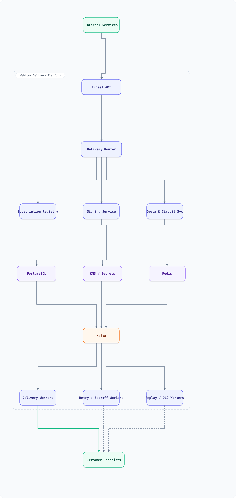
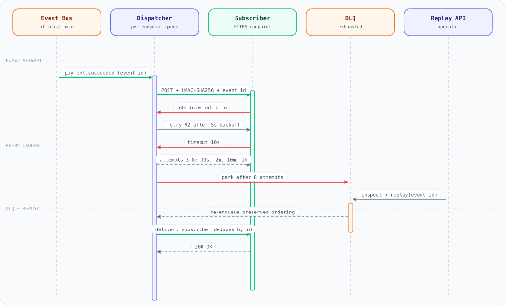

<a id="top"></a>

<div align="center">

<sub>INFRASTRUCTURE</sub>

# System Design: Webhook Delivery (Outbound Event Fan-Out)

<sub>16 SECTIONS · 12 MIN READ · 2 DIAGRAMS · 6 EXAMPLES</sub>

</div>

> [!TIP]
> **THE PROBLEM** — At-least-once outbound fan-out with signed payloads, retries that cannot stampede a recovering endpoint, and a replayable dead-letter queue.

---

## On this page

<details open>
<summary><b>16 sections</b></summary>

1. [Overview](#overview)
2. [Requirements](#requirements)
3. [High-Level Architecture](#high-level-architecture)
4. [Microservices](#microservices)
5. [Database Design](#database-design)
6. [Scaling Tiers](#scaling-tiers)
7. [Key Techniques & Patterns](#key-techniques--patterns)
8. [Key Design Decisions](#key-design-decisions)
9. [Failure Modes & Recovery](#failure-modes--recovery)
10. [Cost Estimation (1M deliveries/day)](#cost-estimation-1m-deliveriesday)
11. [Trade-off Analysis](#trade-off-analysis)
12. [Key Metrics to Monitor](#key-metrics-to-monitor)
13. [Deep Dive Prompts](#deep-dive-prompts)
14. [Common Interview Follow-ups (with answers)](#common-interview-follow-ups-with-answers)
15. [Low-Level Design (LLD) - Algorithms & Data Structures](#low-level-design-lld---algorithms--data-structures)
16. [Do's & Don'ts](#dos--donts)

</details>

---

## Overview

Design the system that delivers **webhooks** (Stripe / GitHub / Shopify class): internal services publish domain events, tenants register HTTPS endpoints, and the platform POSTs a signed payload to each subscriber — retrying for hours when the customer is down, never losing an event, and never letting one bad endpoint slow down everyone else. The hard part is not sending an HTTP request; it is being a *good citizen to a hostile, flaky internet*: at-least-once delivery with duplicates, per-endpoint isolation, replayable history, and a signature the customer can verify.

### Key Numbers

| Metric | Value | Why it matters |
| :--- | :--- | :--- |
| Ingested events | 20K/sec peak, 200M/day | Fan-out source rate |
| Endpoints per tenant | 1–20 (avg 3) | Multiplies delivery volume |
| Deliveries/day | 1M–50M | ~600/sec avg, 5K/sec peak |
| First-attempt latency (p99) | < 5s from event to POST | Customers expect "live" data |
| Delivery timeout | 10s connect+read | Slow endpoints can't pin workers |
| Retry schedule | 8 attempts over 24h | `1m 5m 15m 1h 6h 12h 24h 24h` + jitter |
| At-least-once window | 24h, then DLQ + 30d replay | Time to fix an outage |
| Signature window | 5 min tolerance | Blocks replay attacks |
| Tenant quota | 1K deliveries/sec burst | Protects the shared fleet |
| Availability | 99.95% of events delivered in 24h | Business promise |

## Requirements

### Functional Requirements

- **Subscribe** — tenants register HTTPS endpoints with event-type filters, and can pause/enable them
- **Deliver** — each matching event produces one signed POST per endpoint, with attempt history
- **Retry** — failures retry on a fixed ladder with exponential backoff + jitter; respect `Retry-After`
- **Idempotency** — every delivery carries a stable id so the customer can dedupe
- **Isolate** — one failing endpoint (or tenant) must not degrade others; breakers + per-tenant quotas
- **Replay** — a tenant can re-deliver the last 30 days for a date range or event type
- **Inspect** — delivery log with request/response snippets and attempt timeline
- **Rotate secrets** — rotate HMAC keys with a dual-signature window so verification never breaks

### Non-Functional Requirements

- **At-least-once, never silently drop** — duplicates are allowed and documented; loss is not
- **Ordering is per-resource best-effort** — events for one object can be serialized; global order is not promised
- **Bounded work** — no unbounded queue: retries have a max depth and a max age
- **SSRF-safe** — never POST to private ranges, link-local, or a DNS rebinding trick
- **Multi-tenant fairness** — one tenant's burst cannot consume the fleet's capacity
- **Auditable** — every attempt and signature is recorded for 30 days

## High-Level Architecture

### Architecture Diagram



**Interactive:** [Open diagram](diagrams/system-design/webhook-delivery.architecture.html) · pan/zoom · search · dark/light · export


*Solid = delivery path, dashed = retry and replay path. Everything inside the boundary is the platform; producers and customer endpoints are outside it.*

### Data Flow

1. **Internal services** publish a domain event to the **Ingest API** (or directly to the event topic); the API authenticates the producer, validates the schema, and computes an `event_id`
2. Ingest writes the event once, then resolves matching subscriptions from the **Subscription Registry** and writes one *delivery intent* per endpoint into Kafka (`webhook.attempt`, partitioned by `endpoint_id`)
3. **Delivery Workers** consume attempts, fetch the tenant's signing key (**Signing Service** → KMS), POST the payload with `X-Webhook-Id`, `X-Webhook-Timestamp`, `X-Webhook-Signature`, and append the result to the **delivery log**
4. On failure the worker classifies the response (retryable vs permanent) and hands the attempt to the **Retry Scheduler**, which re-enqueues it on the ladder topic with a delay
5. **Quota & Circuit** tracks per-endpoint health and tenant rate: an endpoint that keeps failing opens its breaker and its attempts are parked, not hammered
6. After the ladder is exhausted an attempt lands in the **DLQ**; the **Replay service** re-enqueues it on demand after the customer fixes their side

### Delivery, Backoff, and Replay

Delivery is at-least-once, so the receiver — not the sender — owns deduplication, keyed on the event id that travels with every attempt. Retries use the same signed payload and the same id, with exponential backoff and jitter so a subscriber outage does not turn into a synchronized retry storm. Exhausting the ladder parks the event in the DLQ rather than dropping it, and replay re-enqueues it with its original id so consumers can still discard duplicates.



**Interactive:** [Open diagram](diagrams/system-design/webhook-retry.sequence.html) · pan/zoom · search · dark/light · export

## Microservices

| Service | Responsibility | Notes |
| :--- | :--- | :--- |
| **Ingest API** | Authenticate producers, validate schema, assign `event_id`, fan out intents | Stateless; idempotent per producer-supplied key |
| **Subscription Registry** | CRUD for endpoints, filters, secrets metadata, pause/resume | Reads are cached (60s TTL) and versioned |
| **Delivery Router** | Match events to subscriptions, apply filters, batch intents | Pure function: event + registry → intents |
| **Delivery Workers** | HTTP POST, signing, classify result, write attempt log | Concurrency-bounded per endpoint |
| **Retry Scheduler** | Delay ladder, jitter, `Retry-After` handling, ordering holds | Publishes to retry topics; never sleeps in-process |
| **Replay / DLQ Service** | Re-enqueue DLQ or date-range replays, dedupe by attempt id | Operator-triggered and self-service |
| **Quota & Circuit** | Tenant token buckets, per-endpoint breakers, auto-disable | Redis counters + sliding windows |
| **Signing Service** | Per-tenant HMAC keys, rotation, dual-key window | Keys in KMS; workers get short-lived material |
| **Console / Admin** | Delivery log UI, manual replay, breaker reset, secret rotation | Read-only views over the same tables |

## Database Design

```sql
-- One row per tenant endpoint. Secrets are references, never values.
CREATE TABLE endpoints (
  id             BIGSERIAL PRIMARY KEY,
  tenant_id      BIGINT NOT NULL,
  url            TEXT   NOT NULL,
  event_types    TEXT[] NOT NULL,          -- {} = all events
  status         TEXT NOT NULL DEFAULT 'enabled',  -- enabled | paused | disabled_auto
  secret_ref     TEXT NOT NULL,            -- KMS key id, not the secret
  max_attempts   INT  NOT NULL DEFAULT 8,
  created_at     TIMESTAMPTZ NOT NULL DEFAULT now()
);
CREATE INDEX endpoints_tenant_idx ON endpoints (tenant_id, status);

-- Delivery attempts: append-only, partitioned monthly, 30-day retention.
CREATE TABLE delivery_attempts (
  id            BIGSERIAL PRIMARY KEY,
  endpoint_id   BIGINT NOT NULL,
  event_id      UUID   NOT NULL,
  attempt       INT    NOT NULL,
  status        TEXT   NOT NULL,           -- delivered | failed | parked | dlq
  http_status   INT,
  error_code    TEXT,                      -- timeout | connect | dns | tls | ssrf_blocked
  duration_ms   INT,
  request_id    TEXT NOT NULL,             -- what the customer sees
  created_at    TIMESTAMPTZ NOT NULL DEFAULT now(),
  UNIQUE (endpoint_id, event_id, attempt)  -- retries are idempotent at the DB level
);
CREATE INDEX delivery_attempts_event_idx ON delivery_attempts (event_id, created_at DESC);

-- Event payloads live once, off the hot path.
CREATE TABLE events (
  event_id     UUID PRIMARY KEY,
  type         TEXT NOT NULL,
  payload_ref  TEXT NOT NULL,              -- s3://webhook-payloads/<tenant>/<day>/<id>.json.zst
  size_bytes   INT  NOT NULL,
  created_at   TIMESTAMPTZ NOT NULL
);
```

**Kafka topics** — `webhook.attempt` (work), `webhook.retry.1m|5m|15m|1h|6h|12h|24h` (delayed re-enqueue), `webhook.dlq` (exhausted), `webhook.events` (audit/analytics). Partitions keyed by `endpoint_id` so per-endpoint ordering is preserved and retry depth stays local.

**Redis** — tenant token buckets (Lua, sliding window), per-endpoint breaker counters, and a dedupe set for replay requests (`replay:{tenant}:{hash}` with TTL).

**Object storage** — payload bodies (zstd-compressed, 30-day lifecycle). Attempts carry a reference, so a 1MB payload is never copied into PostgreSQL or Kafka.

## Scaling Tiers

### Tier 1: 1K - 10K Users

| Component | Choice |
| :--- | :--- |
| **Ingest** | 2 app instances behind an ALB |
| **Queue** | Kafka (3 brokers) or SQS + a Redis-backed delay wheel |
| **Workers** | 4–8 stateless workers |
| **Database** | PostgreSQL (single primary) + Redis (single) |
| **Payloads** | S3 with a 30-day lifecycle rule |
| **Retries** | In-worker timer wheel (no separate scheduler service yet) |

### Tier 2: 10K - 1M Users

| Component | Choice |
| :--- | :--- |
| **Ingest** | 10–20 instances, autoscaled on request rate |
| **Queue** | Kafka (6 brokers, RF=3) with per-delay retry topics |
| **Workers** | 40–80 workers, per-endpoint concurrency limits |
| **Database** | PostgreSQL with read replicas; attempts partitioned monthly |
| **Isolation** | Per-endpoint circuit breakers, per-tenant quotas in Redis Cluster |
| **Observability** | Delivery dashboards per tenant, DLQ alarms at depth thresholds |

### Tier 3: 1M - 10M+ Users

| Component | Choice |
| :--- | :--- |
| **Ingest** | Multi-region ingest, regional Kafka, global event id |
| **Queue** | 12+ brokers per region, tiered storage for replay windows |
| **Workers** | 1K+ workers, egress-proxied pools with per-destination limits |
| **Database** | Sharded PostgreSQL by tenant, or CockroachDB/Spanner for the registry |
| **Isolation** | Dedicated worker pools for the largest tenants + strict priority lanes |
| **Retention** | 90-day payload archive in cold storage, self-service replay UI |

## Key Techniques & Patterns

| Technique | Description | Used In |
| :--- | :--- | :--- |
| **HMAC payload signing** | Signature over `timestamp.body` with a per-tenant key; tolerance window blocks replays | Signing Service + LLD §1 |
| **At-least-once + idempotency id** | Every delivery carries a stable `webhook_id`; the customer dedupes | Delivery Workers, DB unique key |
| **Exponential backoff with full jitter** | Retry ladder with randomized delay so a recovered endpoint isn't stampeded | Retry Scheduler + LLD §2 |
| **Per-endpoint circuit breaker** | Track consecutive failures; open, then half-open probe after cooldown | Quota & Circuit + LLD §3 |
| **Token-bucket isolation** | Per-tenant quota so one burst cannot consume the fleet | Redis Lua counters |
| **SSRF egress guard** | Resolve, validate against private ranges, pin the IP for the request | Delivery Workers + LLD §4 |
| **Payload offloading** | Body in object storage, reference in the message | ingest → S3 → attempts |
| **Priority lanes** | Payment/security events get a separate topic + worker pool | Kafka topic design |
| **Stripe-style HMAC signing** | Timestamp + raw body signed with the tenant secret; the receiver rejects stale timestamps, which is what makes replay attacks fail | Delivery Workers + LLD §1 |

## Key Design Decisions

| Decision | Choice | Why |
| :--- | :--- | :--- |
| Push or pull for tenants | **Push (POST) with signatures** | Customers behind NAT cannot be polled; signing gives authenticity |
| Delivery guarantee | **At-least-once, documented duplicates** | Exactly-once across the public internet is impossible; make duplicates cheap |
| Retry timing | **Delay topics, not in-worker sleep** | Workers stay stateless; a restart cannot lose a pending retry |
| Ordering | **Per-endpoint partition key, best-effort** | Global ordering would serialize the fleet; per-object ordering is what customers need |
| Bad endpoint handling | **Breaker + auto-disable after 24h** | Protects the fleet and gives the customer a clear signal |
| Secret rotation | **Dual-key window (old + new signature)** | Rotation without dropping deliveries |
| Payload location | **Object storage with reference** | Keeps Kafka and PostgreSQL small; replay reads cold data |
| Replay | **Re-enqueue from the log, new request ids** | Same code path as normal delivery, with dedupe |

## Failure Modes & Recovery

| Failure | Impact | Recovery |
| :--- | :--- | :--- |
| Endpoint slow (no response) | Worker pinned for 10s | Hard connect/read timeouts, per-endpoint concurrency cap, breaker on repeated timeouts |
| Endpoint returns 5xx | Attempt fails | Retry ladder; 5xx is retryable, 4xx (except 429) is permanent → DLQ |
| Endpoint returns 429 + `Retry-After` | Rate-limit collision | Honour `Retry-After`, then resume the ladder; never retry faster than told |
| Endpoint deleted / DNS gone | Delivery fails fast | Classify as permanent after N DNS failures, notify tenant, auto-disable |
| SSRF attempt (internal URL) | Security breach | Egress guard blocks private ranges + redirects to them; alert the tenant |
| Kafka lag | Deliveries delayed | Autoscale workers on lag; priority lanes keep payment events moving |
| Poison payload (never succeeds) | Retries burn capacity | Schema validation at ingest, bounded retries, DLQ with the raw body |
| Worker crash mid-POST | Customer may see a duplicate | Same `webhook_id` on retry; the unique key in `delivery_attempts` records one logical attempt |
| Retry storm after outage | Customer overloaded | Full jitter spreads the ladder; breaker holds traffic until a probe passes |
| Signing key rotated mid-flight | Signature verification fails | Dual-key window: old and new signatures accepted for 24h |
| One tenant floods | Fleet saturation | Tenant token bucket sheds to the DLQ, not to other tenants |

## Cost Estimation (1M deliveries/day)

| Component | Monthly Cost |
| :--- | :--- |
| Compute (ingest + workers, ~30 instances avg) | $4,200 |
| Kafka (6 brokers, 3 AZ) | $3,100 |
| PostgreSQL (multi-AZ primary + replica) | $1,800 |
| Redis Cluster (quotas + breakers) | $900 |
| Object storage (payloads, 30d lifecycle) | $400 |
| Egress (HTTP POST, ~40 GB/day) | $3,600 |
| Observability + log retention | $700 |
| **Total** | **~$14,700/mo** |

Egress dominates — which is why payload offloading plus customer-side dedupe (not re-sending bodies) matters more than compute tuning.

## Trade-off Analysis

| Trade-off | Option A | Option B | Winner | Why |
| :--- | :--- | :--- | :--- | :--- |
| Delivery guarantee | Exactly-once (2PC-style ack) | At-least-once + idempotency id | **At-least-once** | The customer's endpoint is a black box; duplicates are cheaper than loss |
| Retry pacing | Aggressive (retry every 30s) | Ladder with jitter (1m → 24h) | **Ladder** | Aggressive retries turn a blip into a sustained outage |
| Ordering | Global per tenant | Per endpoint/resource key | **Per key** | Global order destroys parallelism and is rarely needed |
| Queueing | One shared topic | Priority lanes + per-tenant quotas | **Lanes + quotas** | Fairness is a requirement, not a nicety |
| Payload transport | Inline (payload in Kafka) | Reference to object storage | **Reference** | Keeps brokers small; replay reads cold data |
| Failure handling | Infinite retries | Bounded ladder → DLQ → replay | **Bounded** | Unbounded queues are an outage waiting to happen |

## Key Metrics to Monitor

| Metric | Target | Alert Threshold |
| :--- | :--- | :--- |
| First-attempt latency p99 | < 5s | > 30s |
| Delivery success rate (24h window) | > 99.9% | < 99% |
| Retry depth histogram p95 | ≤ 3 attempts | ≥ 6 attempts |
| DLQ depth | < 0.1% of attempts | > 1% or growing for 15 min |
| Breaker-open endpoints | < 0.5% of endpoints | > 2% |
| Kafka consumer lag (attempt topics) | < 10s | > 2 min |
| SSRF-blocked requests | 0 for healthy tenants | any spike |
| Scheduler re-enqueue delay error | < 1s vs plan | > 15s |

## Deep Dive Prompts

1. **How do you guarantee at-least-once delivery without a duplicate-sensitivity disaster at the customer?**
2. **Design the retry ladder:** how many attempts, what delays, and where does jitter come from?
3. **How does the circuit breaker decide to open, and how does it recover without a thundering herd?**
4. **Walk the SSRF threat model** — DNS rebinding, redirects, and why an IP allowlist alone fails.
5. **How would you deliver per-object ordered events without serializing the entire tenant?**
6. **Design replay:** a tenant processed a bad batch 6 days ago; make it right without double-charging anyone.
7. **What changes when the fleet goes multi-region?** Clocks, ids, egress, and data residency.
8. **How do you onboard a tenant whose endpoint can only handle 10 req/sec while their events burst to 5K?**
9. **Where do you store payloads, and how do you keep 30 days of replay cheap?**
10. **How would you support a customer who wants signed webhooks over mutual TLS instead of HMAC?**

## Common Interview Follow-ups (with answers)

**Q: At-least-once means duplicates. How do you stop double-processing at the customer?**
A: Every delivery carries `webhook_id` (stable per endpoint+event) and the payload's `event_id`. Document both: retries reuse `webhook_id`, replays mint new ones but keep `event_id`. Customers dedupe on `event_id`. We also send `X-Webhook-Attempt` so a retry is obvious.

**Q: Why not just retry with exponential backoff inside the worker and skip the scheduler service?**
A: Because a worker that sleeps holds memory and loses its retry on restart. Delay topics (or SQS delay queues) make retries durable state: the worker is stateless, deploys are safe, and the ladder can be inspected and re-planned.

**Q: How is `Retry-After` handled when it is 6 hours?**
A: It becomes the next delay verbatim (capped at the max age). The ladder resumes afterwards, but we never retry earlier than the customer asked — that's the difference between a well-behaved webhook platform and a DDoS with a signature.

**Q: What stops one big tenant from starving everyone else?**
A: Tenant token buckets at the ingest boundary plus per-endpoint concurrency limits in the worker pool. Exhausted quota goes to the delay topics (not dropped), and the largest tenants can be pinned to a dedicated worker pool.

**Q: How does the breaker avoid flapping?**
A: Three states with hysteresis: open after N consecutive failures, half-open sends a single probe, and it only closes after M successes in a row. Cooldown doubles on repeated opens, and a `Retry-After`-driven reopen is scheduled, not immediate.

**Q: How do you keep secrets safe?**
A: The signing key lives in KMS; the Signing Service issues short-lived material to workers, and the plaintext key never appears in the database or logs. Rotation publishes both signatures for 24h so customers verify at their own pace.

**Q: What does the customer see when we auto-disable their endpoint?**
A: An alert plus a delivery-log view showing the failure pattern, the exact reason (DNS, timeout, TLS, 4xx), and a one-click "re-enable and replay" — auto-disable is a signal, never a silent drop.

## Low-Level Design (LLD) - Algorithms & Data Structures

### 1. HMAC Payload Signing (with replay window)

```js
// Signed payloads: signature covers "{timestamp}.{body}" so a captured request
// cannot be replayed later. Node builtin crypto; no dependency required.
const { createHmac, timingSafeEqual } = require('crypto');

class WebhookSigner {
  constructor(secretProvider, { toleranceSeconds = 300 } = {}) {
    this.secretProvider = secretProvider; // { get(tenantId): { current, previous? } }
    this.tolerance = toleranceSeconds;
  }

  // Two headers go out during a rotation: v1 (current) and v1b (previous key).
  sign(tenantId, body, timestamp = Math.floor(Date.now() / 1000)) {
    const { current, previous } = this.secretProvider.get(tenantId);
    const payload = `${timestamp}.${body}`;
    const signature = (secret, tag) => `${tag}=${createHmac('sha256', secret).update(payload).digest('hex')}`;
    return {
      timestamp,
      signature: signature(current, 'v1'),
      ...(previous ? { previousSignature: signature(previous, 'v1b') } : {}),
    };
  }

  verify(tenantId, body, { timestamp, signature, previousSignature }, now = Math.floor(Date.now() / 1000)) {
    if (Math.abs(now - timestamp) > this.tolerance) return { ok: false, reason: 'timestamp_out_of_window' };
    const { current, previous } = this.secretProvider.get(tenantId);
    const payload = `${timestamp}.${body}`;
    const matches = (secret, header) => {
      if (!secret || !header) return false;
      const expected = createHmac('sha256', secret).update(payload).digest('hex');
      const [tag, value] = header.split('=');
      return tag === 'v1' && value.length === expected.length &&
        timingSafeEqual(Buffer.from(value, 'hex'), Buffer.from(expected, 'hex'));
    };
    // During rotation either key is acceptable — nothing is dropped mid-rollover.
    const ok = matches(current, signature) || matches(previous, previousSignature);
    return ok ? { ok: true } : { ok: false, reason: 'signature_mismatch' };
  }
}

const signer = new WebhookSigner({
  get: () => ({ current: 'whsec_new', previous: 'whsec_old' }),
});
const signed = signer.sign('tenant-7', '{"type":"payment.succeeded"}');
console.log('signed headers:', signed.signature.slice(0, 20) + '...');
console.log('verify:', signer.verify('tenant-7', '{"type":"payment.succeeded"}', signed));
console.log('tampered body:', signer.verify('tenant-7', '{"type":"payment.failed"}', signed));
```

### 2. Retry Ladder with Full Jitter

```js
class RetryLadder {
  // Delays make the shape explicit: fast early retries, patient later ones.
  // Full jitter (random between 0 and the planned delay) is what stops a fleet-wide
  // retry storm when a shared dependency recovers.
  static SCHEDULE_SECONDS = [60, 300, 900, 3600, 21600, 43200, 86400, 86400];

  constructor({ maxAgeSeconds = 86400 * 2, jitter = 'full' } = {}) {
    this.maxAge = maxAgeSeconds;
    this.jitter = jitter;
  }

  nextAttempt(attempt, { now = Date.now(), retryAfterSeconds, firstSeenAt = now } = {}) {
    if (attempt >= RetryLadder.SCHEDULE_SECONDS.length) {
      return { action: 'dlq', reason: 'attempts_exhausted', attempt };
    }
    if (now - firstSeenAt > this.maxAge * 1000) {
      return { action: 'dlq', reason: 'max_age_exceeded', attempt };
    }
    if (retryAfterSeconds && retryAfterSeconds > 0) {
      // The customer explicitly asked us to wait — never retry sooner.
      return { action: 'retry', attempt: attempt + 1, delaySeconds: Math.min(retryAfterSeconds, this.maxAge) };
    }
    const planned = RetryLadder.SCHEDULE_SECONDS[attempt];
    const delaySeconds = this.jitter === 'full' ? Math.random() * planned : planned;
    return { action: 'retry', attempt: attempt + 1, delaySeconds: Math.round(delaySeconds), planned };
  }

  classify(result) {
    // Permanent failures must never spend the ladder: 4xx (except 429/408) is terminal.
    if (result.error === 'timeout' || result.error === 'connect' || result.error === 'dns') return 'retry';
    if (!result.httpStatus) return 'retry';
    if (result.httpStatus === 408 || result.httpStatus === 429) return 'retry';
    if (result.httpStatus >= 500) return 'retry';
    if (result.httpStatus >= 400) return 'permanent';
    return 'delivered';
  }
}

const ladder = new RetryLadder();
console.log('attempt 0 ->', ladder.nextAttempt(0));
console.log('attempt 3 ->', ladder.nextAttempt(3, { retryAfterSeconds: 7200 }));
console.log('attempt 8 ->', ladder.nextAttempt(8));
console.log('classify 404:', ladder.classify({ httpStatus: 404 }));
console.log('classify 503:', ladder.classify({ httpStatus: 503 }));
```

### 3. Per-Endpoint Circuit Breaker

```js
class EndpointBreaker {
  // Three states with hysteresis, plus an exponential cooldown so a dead endpoint
  // cannot be probed to death: closed -> open -> half-open -> closed.
  constructor({ failureThreshold = 5, successThreshold = 2, baseCooldownMs = 30000, maxCooldownMs = 1800000 } = {}) {
    this.failureThreshold = failureThreshold;
    this.successThreshold = successThreshold;
    this.baseCooldown = baseCooldownMs;
    this.maxCooldown = maxCooldownMs;
    this.state = 'closed';
    this.consecutiveFailures = 0;
    this.halfOpenSuccesses = 0;
    this.cooldownMs = baseCooldownMs;
    this.openedAt = null;
  }

  allow(now = Date.now()) {
    if (this.state === 'closed') return { allow: true };
    if (this.state === 'open') {
      if (now - this.openedAt >= this.cooldownMs) {
        this.state = 'half-open';
        this.halfOpenSuccesses = 0;
        return { allow: true, probe: true };
      }
      return { allow: false, retryAt: this.openedAt + this.cooldownMs };
    }
    return { allow: true, probe: true }; // half-open: one probe at a time
  }

  recordSuccess(now = Date.now()) {
    if (this.state === 'half-open') {
      if (++this.halfOpenSuccesses >= this.successThreshold) this.#close();
      return this.state;
    }
    this.consecutiveFailures = 0;
    return this.state;
  }

  recordFailure(now = Date.now()) {
    if (this.state === 'half-open') {
      this.#open(now, true);
      return this.state;
    }
    if (++this.consecutiveFailures >= this.failureThreshold) this.#open(now, false);
    return this.state;
  }

  #open(now, fromProbe) {
    this.state = 'open';
    this.openedAt = now;
    // Repeated failures back off further, so recovery is slow and boring.
    this.cooldownMs = fromProbe
      ? Math.min(this.maxCooldown, this.cooldownMs * 2)
      : this.baseCooldown;
    this.consecutiveFailures = 0;
  }

  #close() {
    this.state = 'closed';
    this.cooldownMs = this.baseCooldown;
    this.consecutiveFailures = 0;
    this.halfOpenSuccesses = 0;
  }
}

const breaker = new EndpointBreaker({ failureThreshold: 3, baseCooldownMs: 1000 });
for (let i = 0; i < 3; i++) { breaker.recordFailure(0); }
console.log('after 3 failures:', breaker.allow(500), '| state:', breaker.state);
console.log('after cooldown  :', breaker.allow(1500));
breaker.recordSuccess(1600); breaker.recordSuccess(1700);
console.log('after 2 probes  : state =', breaker.state);
```

### 4. SSRF Egress Guard

```js
const PRIVATE_V4 = [
  [/^10\./, 'rfc1918-10'],
  [/^127\./, 'loopback'],
  [/^169\.254\./, 'link-local'],
  [/^192\.168\./, 'rfc1918-192'],
  [/^172\.(1[6-9]|2\d|3[01])\./, 'rfc1918-172'],
  [/^0\./, 'this-network'],
  [/^100\.(6[4-9]|[7-9]\d|1[0-2]\d)\./, 'cgnat'],
];

function assertEgressAllowed(url, { resolvedIps = [], allowPrivate = false } = {}) {
  // Defence in depth: check the literal host, then every resolved address, and pin
  // the chosen IP for the request. Redirects are re-validated, never followed blindly.
  const parsed = new URL(url);
  if (parsed.protocol !== 'https:') throw new Error(`blocked scheme: ${parsed.protocol}`);

  // DNS names are checked through their resolved addresses; IP literals are checked
  // directly. A name with no resolution is a caller bug, not something to guess about.
  const isV4 = host => /^\d{1,3}(\.\d{1,3}){3}$/.test(host);
  const candidates = [parsed.hostname, ...resolvedIps].filter(Boolean);

  if (!allowPrivate && /^https:/.test(parsed.protocol) && isV4(parsed.hostname) === false && resolvedIps.length === 0) {
    throw new Error(`unresolved host: ${parsed.hostname}`); // resolve before validating
  }

  for (const host of candidates) {
    if (allowPrivate) break;
    if (host.includes(':')) {
      if (/^(::1|fc|fd|fe80)/i.test(host) || host === '::') throw new Error(`blocked IPv6 host: ${host}`);
      continue;
    }
    if (!isV4(host)) continue; // DNS name — validated through its resolved addresses
    for (const [re, reason] of PRIVATE_V4) {
      if (re.test(host)) throw new Error(`blocked destination (${reason}): ${host}`);
    }
  }
  return { ok: true, pinnedIp: resolvedIps[0] ?? parsed.hostname };
}

console.log('public :', assertEgressAllowed('https://hooks.customer.com/x', { resolvedIps: ['203.0.113.7'] }));
try { assertEgressAllowed('https://hooks.customer.com/x', { resolvedIps: ['169.254.169.254'] }); }
catch (e) { console.log('blocked:', e.message); }
try { assertEgressAllowed('http://internal.svc/x'); }
catch (e) { console.log('blocked:', e.message); }
```

### 5. Per-Tenant Token Bucket (fairness under burst)

```js
class TenantTokenBucket {
  // One bucket per tenant, refilled at tier rate. Exceeding the bucket does not drop
  // the event: it moves to the delay topic, so fairness never costs correctness.
  constructor({ tiers = { free: 20, pro: 200, enterprise: 1000 } } = {}) {
    this.tiers = tiers;
    this.buckets = new Map(); // tenantId -> { tokens, capacity, lastRefill }
  }

  #bucket(tenantId, tier, now) {
    let bucket = this.buckets.get(tenantId);
    if (!bucket) {
      const capacity = this.tiers[tier] ?? this.tiers.free;
      bucket = { tokens: capacity, capacity, refillPerSecond: capacity / 10, lastRefill: now };
      this.buckets.set(tenantId, bucket);
    }
    const elapsed = (now - bucket.lastRefill) / 1000;
    bucket.tokens = Math.min(bucket.capacity, bucket.tokens + elapsed * bucket.refillPerSecond);
    bucket.lastRefill = now;
    return bucket;
  }

  take(tenantId, tier = 'pro', now = Date.now()) {
    const bucket = this.#bucket(tenantId, tier, now);
    if (bucket.tokens < 1) {
      const deficit = 1 - bucket.tokens;
      return { allowed: false, retryAfterMs: Math.ceil((deficit / bucket.refillPerSecond) * 1000) };
    }
    bucket.tokens -= 1;
    return { allowed: true, remaining: Math.floor(bucket.tokens) };
  }
}

const quotas = new TenantTokenBucket();
console.log('burst of 3 for a free tenant:',
  quotas.take('t1', 'free', 0), quotas.take('t1', 'free', 0), quotas.take('t1', 'free', 0));
```

### 6. Delivery Worker (at-least-once, idempotent attempt log)

```js
class DeliveryWorker {
  // The loop that must be boring: take an attempt, respect the breaker and quota,
  // POST once, classify the result, log exactly one row, then re-enqueue or DLQ.
  constructor({ http, signer, breakers, quotas, log, attempts }) {
    this.http = http;
    this.signer = signer;
    this.breakers = breakers;
    this.quotas = quotas;
    this.log = log;
    this.attempts = attempts;
  }

  async handle({ tenantId, endpoint, event, attempt = 0 }) {
    const breaker = this.breakers.get(endpoint.id);
    const verdict = breaker.allow();
    if (!verdict.allow) {
      return { action: 'parked', reason: 'circuit_open', retryAt: verdict.retryAt };
    }

    const quota = this.quotas.take(tenantId, endpoint.tier ?? 'pro');
    if (!quota.allowed) {
      // Over quota -> delay, never drop.
      return { action: 'delayed', reason: 'tenant_quota', retryAfterMs: quota.retryAfterMs };
    }

    const body = JSON.stringify(event.payload);
    const signature = this.signer.sign(tenantId, body);
    const startedAt = Date.now();

    let result;
    try {
      const response = await this.http.post(endpoint.url, body, {
        headers: {
          'content-type': 'application/json',
          'x-webhook-id': `${endpoint.id}:${event.id}`,   // stable across retries
          'x-webhook-event-id': event.id,                   // stable across replays
          'x-webhook-attempt': String(attempt + 1),
          'x-webhook-timestamp': String(signature.timestamp),
          'x-webhook-signature': signature.signature,
        },
        timeoutMs: 10000,
      });
      result = { httpStatus: response.status, retryAfterSeconds: response.retryAfterSeconds };
    } catch (err) {
      result = { error: err.code ?? 'connect' };
    }
    const durationMs = Date.now() - startedAt;

    // Exactly one durable row per (endpoint, event, attempt) — the unique key makes
    // a crashed-and-replayed attempt idempotent in the log.
    await this.log.append({
      endpointId: endpoint.id,
      eventId: event.id,
      attempt: attempt + 1,
      status: this.#classify(result),
      httpStatus: result.httpStatus ?? null,
      durationMs,
    });

    if (result.httpStatus && result.httpStatus < 400) breaker.recordSuccess();
    else if (result.error || result.httpStatus >= 500) breaker.recordFailure();

    return { action: this.#classify(result) === 'delivered' ? 'done' : 'retry', result };
  }

  #classify(result) {
    if (result.httpStatus && result.httpStatus < 400) return 'delivered';
    if (!result.httpStatus) return 'failed';
    if (result.httpStatus === 408 || result.httpStatus === 429) return 'failed';
    if (result.httpStatus >= 500) return 'failed';
    return 'permanent';
  }
}

const breakerStore = new Map();
const workers = new DeliveryWorker({
  http: { post: async () => ({ status: 200 }) },
  signer: { sign: () => ({ timestamp: 1735689600, signature: 'v1=deadbeef' }) },
  breakers: { get: id => breakerStore.get(id) ?? breakerStore.set(id, new EndpointBreaker()).get(id) },
  quotas: new TenantTokenBucket(),
  log: { append: async row => console.log('attempt logged:', row.status, row.attempt) },
});
workers.handle({
  tenantId: 'tenant-7',
  endpoint: { id: 'ep-1', url: 'https://hooks.customer.com/x' },
  event: { id: 'evt_9f2', payload: { type: 'payment.succeeded', amount: 4200 } },
}).then(outcome => console.log('outcome:', outcome.action));
```

## Do's & Don'ts

| ✅ Do | ❌ Don't |
| :--- | :--- |
| Sign `timestamp + body` and document the tolerance window | Don't sign only the body — that is a replayable request |
| Send a stable `webhook_id` per endpoint+event and a stable `event_id` | Don't mint a new id on retry; the customer cannot dedupe what changes |
| Use delay topics for retries so a restart can't lose them | Don't sleep inside a worker and call it durability |
| Honour `Retry-After` verbatim (capped by max age) | Don't retry faster than the customer asked — that's a self-inflicted outage |
| Isolate per endpoint with breakers and per tenant with quotas | Don't share one queue and hope fair scheduling emerges |
| Bound the ladder, then DLQ with a replay path | Don't keep retrying forever; unbounded queues eventually take everything down |
| Validate egress against private ranges, redirects included | Don't trust a hostname or a single DNS lookup — rebinding is real |
| Keep payloads in object storage and put references in messages | Don't copy megabytes through Kafka and PostgreSQL |
| Publish both signatures during key rotation | Don't rotate in one step; you'll drop deliveries for hours |

*More cross-topic rules: [Interview Q&A §84](interview-qa.md#84-universal-dos--donts) · Related: [Notification System](system-design-notification-system.md) · [RabbitMQ Guide](rabbitmq-features.md) · [Networking Guide](networking.md)*

---

<nav>← [web crawler](system-design-web-crawler.md) · [All guides](README.md) · [youtube](system-design-youtube.md) →</nav>

---

<p align="right"><a href="#top">↑ Back to top</a></p>
